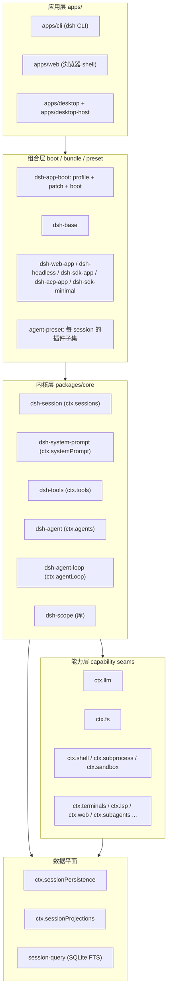
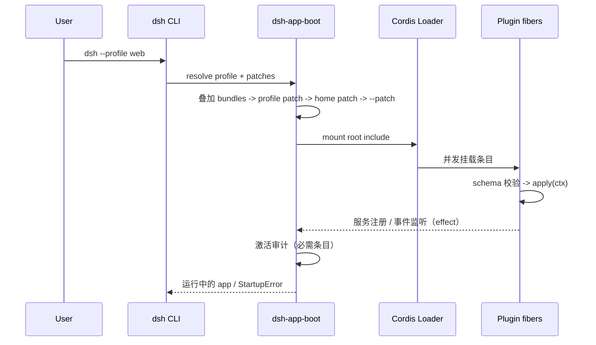
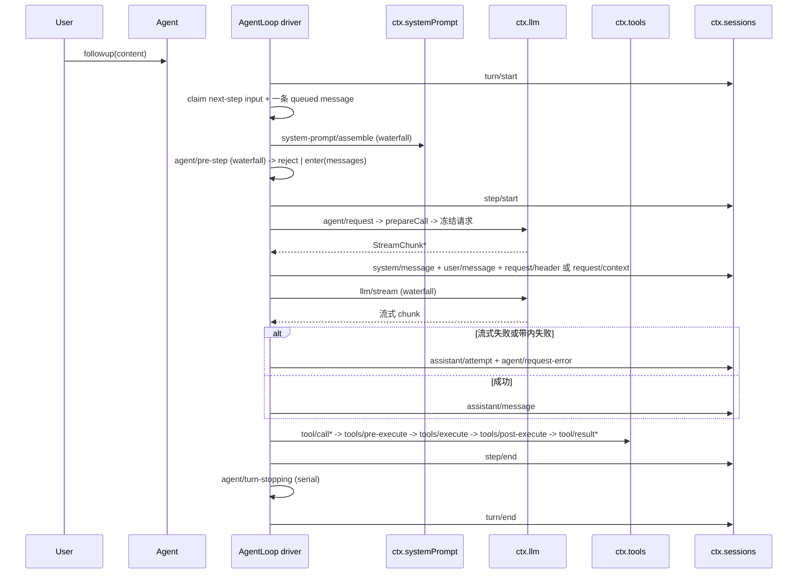
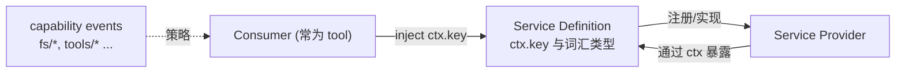
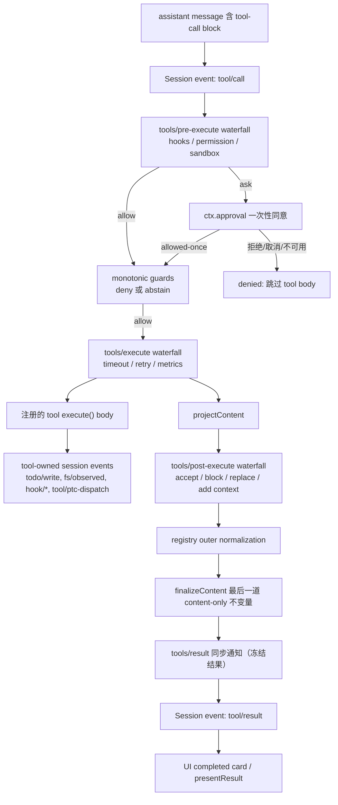
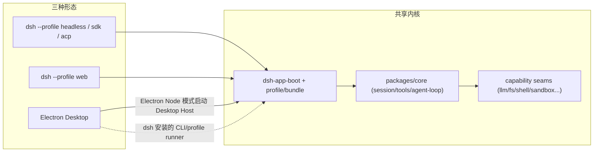
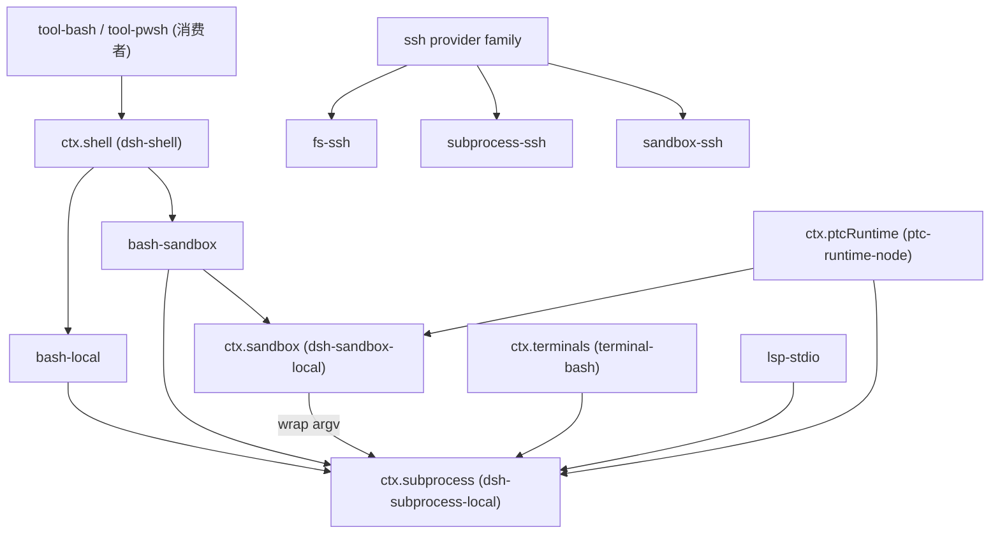

# DSH 系统架构

> **一句话总结**：一切皆插件、会话日志即唯一事实源的 Cordis agent harness。

| 项目 | 内容 |
|---|---|
| 回答的问题 | DSH 由哪些层组成、如何启动与组装、agent 一轮怎样运行、会话如何持久化、能力如何替换、扩展点挂在哪里 |
| 适合读者 | 有经验的工程师/架构师；已能运行 `dsh`，想从整体到内核理解系统 |
| 前置阅读 | [00-项目全景](00-项目全景.md) |
| 主要来源 | `docs/architecture.md`、`docs/cordis-primer.md`、`docs/cordis-tutorial/`、`docs/agent-lifecycle.md`、`docs/glossary.md`、`docs/capability-seams.md`、`docs/subsystems/core.md`、`docs/subsystems/session.md`、`docs/subsystems/persistence.md`、`docs/subsystems/session-projection.md`、`docs/subsystems/tools.md`、`docs/tool-execution-pipeline.md`、`docs/event-producer-consumer.md`、`docs/module-graph.md`、`packages/README.md`、`apps/cli/README.md`、`apps/cli/composition.md` |

## 一、通俗理解（先读这一节）

### 1.1 这是什么

DSH 是一个 **all-plugin（全插件）** 的 agent harness：模型适配器、工具注册表、会话日志、agent loop 本身都是插件，因此每一个都可以从配置层替换。仓库里没有“需要打补丁的特权内核”，扩展方式是“在其它插件旁边挂载一个插件”，而注册（registration）是 effect，插件卸载时会自动回滚。（来源：`docs/architecture.md`）

产品形态上，DSH 提供三种运行外表，共享同一内核：

| 形态 | 入口 | 进程外形 |
|---|---|---|
| CLI / headless | `dsh --profile headless "task"` | 一次性任务，打印最终答案后退出 |
| Web | `dsh --profile web` | 本机 HTTP(S) 服务器 + 浏览器 GUI |
| Desktop | Electron 应用 | 打包的完整 dsh 运行时 + Web 应用 |

（来源：`apps/cli/README.md`、`packages/bundle/headless/README.md`、`packages/bundle/web-app/README.md`、`apps/desktop/README.md`）

### 1.2 为什么是 everything-is-a-plugin

agent 产品的能力边界会持续变化：模型供应商会换、工具体系会加、安全策略会收紧。如果把这些写死在一个中央 loop 里，每次变更都要改核心代码。DSH 的选择是：

1. **能力挂在服务（Service）上**，而不是硬编码在主流程里。`ctx.llm`、`ctx.tools`、`ctx.sessions`、`ctx.shell` 等都是服务键；消费者按名字找服务，而不是 import 具体实现。（来源：`docs/cordis-primer.md`）
2. **注册是 effect**。提示词段落、工具 schema、适配器、监听器都通过 `ctx.effect()` / `ctx.on()` 安装，卸载时按 disposer 回退。（来源：`docs/cordis-primer.md`、`docs/cordis-tutorial/02-lifecycle-and-effects.md`）
3. **行为扩展走已文档化的扩展点**。新增行为应挂在扩展点上；改动 `agent-loop` 本身需要同步更新 `docs/architecture.md`。（来源：`AGENTS.md`、`docs/architecture.md`）

### 1.3 为什么选 Cordis

Cordis 是 DSH 底下 vendored 的插件框架（源码与同步流程见 `vendor/README.md`）。（来源：`docs/cordis-primer.md`、`vendor/README.md`）

选择它带来四个直接收益：

- **依赖即顺序**：插件用 `inject` 声明所需服务，Cordis 把插件保持在 PENDING 直到服务出现；`cordis.yml` 中的条目并发启动，位置不决定加载顺序。（来源：`docs/cordis-tutorial/03-services.md`、`docs/cordis-tutorial/01-first-plugin.md`）
- **可替换性由配置承担**：卸载 `dsh-bash-local`、挂载另一个 `shell` provider，所有 `inject: ['shell']` 的插件会干净地重启到新实现上。（来源：`docs/cordis-tutorial/03-services.md`）
- **事件是扩展点**：服务支撑直接调用，事件支撑“广播而不知道谁在监听”；事件有明确的派发模式契约。（来源：`docs/cordis-tutorial/04-events.md`）
- **可逆生命周期**：配置编辑、热重载、显式 dispose、依赖服务消失都会触发卸载，effect 保证清理。（来源：`docs/cordis-tutorial/02-lifecycle-and-effects.md`）

**与常见 agent 框架的区别（以 DSH 文档能支撑的表述为准）**：DSH 不把行为集中在一个可被 hook 的固定 loop 类里，而是把能力拆成服务 + 事件 + capability seam（能力缝）；扩展方式不是“给中央控制器加回调”，而是“在扩展点注册并随插件卸载回滚”。仓库文档没有把 DSH 与具体第三方框架做逐项对比，因此这里只陈述 DSH 自己的设计取向。（来源：`docs/architecture.md`、`docs/glossary.md`、`AGENTS.md`）

### 1.4 直觉图：一台“可插拔的组装机”

下面这张 ASCII 图给出一条从“入口”到“事实源”的主干，细节在后续章节展开。

```text
                        入口层（apps/）
   dsh CLI (apps/cli)         Web 应用 (apps/web)       Desktop (apps/desktop + desktop-host)
        |                          |                          |
        +-----------+--------------+--------------------------+
                    v
              组合层（packages/boot + packages/bundle + preset）
   profile($DSH_HOME/profiles/<name>) -> bundles 的 cordis.patch.yml
        -> profile 的 cordis.patch.yml -> home patch -> --patch overlay
                    |
                    v
              Cordis Loader（vendor/）+ 插件树
                    |
        +-----------+----------------------------+
        v                                        v
   内核层（packages/core）                  能力层（capability seams）
   session / system-prompt / tools          llm / fs / shell / subprocess
   agent / agent-loop / scope               sandbox / terminal / ssh / ptc-runtime
        |                                        |
        +----------------+-----------------------+
                         v
             持久化 / 投影（packages/session, session-query）
             会话日志 SessionEvent（唯一事实源）
```

图注：上层只组合与呈现，下层提供可替换能力，最底层是 append-only 会话日志；模型看到的上下文由日志投影得到。（来源：`docs/architecture.md`、`docs/subsystems/session.md`、`packages/README.md`）

### 1.5 一次对话在最直觉层面发生了什么

用户发一句话 → 它变成一条待处理消息进入 agent 的 inbox → 一个 turn 打开 → 组装 system prompt 与工具 schema → 发模型请求 → 流式接收 → 若模型要求调用工具则执行工具并把结果写回日志 → 决定是否再来一轮 step → 关闭 turn。期间所有“模型可见”的事实都先落到会话日志，下一轮从日志重新推导历史。（来源：`docs/architecture.md#turn-flow`、`docs/subsystems/core.md`）

## 二、全局分层图

DSH 的层次可以按“责任”切成四层。需要强调的是：这不是进程边界，而是依赖与替换边界；同一进程里四层都通过 Cordis 服务与事件连接。（来源：`docs/architecture.md`、`packages/README.md`）

### 2.1 分层一览（表）

| 层 | 位置 | 责任 | 代表包 |
|---|---|---|---|
| 应用层 | `apps/` | 启动入口、Web shell、Electron 外壳 | `apps/cli`、`apps/web`、`apps/desktop`、`apps/desktop-host` |
| 组合层 | `packages/boot`、`packages/bundle`、`packages/preset` | profile/bundle/patch、启动与重载、按 session 组装 | `dsh-app-boot`、`dsh-base`、`dsh-web-app`、`dsh-sdk-minimal` |
| 内核层 | `packages/core` | 会话、提示词、工具、agent 契约与默认循环 | `dsh-session`、`dsh-system-prompt`、`dsh-tools`、`dsh-agent`、`dsh-agent-loop` |
| 能力层 | `packages/` 其它组 | 可替换能力（capability seam 的 Definition/Provider/Consumer） | `dsh-llm`、`dsh-fs`、`dsh-shell`、`dsh-sandbox`、`dsh-subagent` 等 |

（来源：`packages/README.md`、`packages/core/README.md`、`docs/architecture.md#core-packages`）

### 2.2 分层图（Mermaid）



图注：应用层不直接实现 agent 语义；组合层把插件行装配成树；内核层定义 agent 契约与默认循环；能力层通过 seam 提供可替换实现；数据平面把日志落盘并投影出读模型。（来源：`docs/architecture.md`、`docs/capability-seams.md`、`docs/subsystems/session-projection.md`）

## 三、启动与组合链路

### 3.1 从 `dsh` 到“服务就绪”的全链路

1. `dsh` 命令解析自身参数，把其余参数交给被启动的 profile（`dsh --profile <name>` 或 `dsh <name>`）。（来源：`apps/cli/README.md`）
2. profile 目录位于 `$DSH_HOME/profiles/<name>`，包含 `package.json`（`dsh.profile.bundles` 有序列表 + 树外插件依赖）与 `cordis.patch.yml`（用户自己的补丁层）。（来源：`apps/cli/README.md`、`docs/architecture.md#profiles-and-bundles`）
3. bundle 是“Cordis 配置行 + 其挂载代码”的分发格式；bundle 在自身 `package.json` 的 `dsh` 字段中声明 `dsh.bundle.patch`，指向补丁文件。（来源：`docs/architecture.md#profiles-and-bundles`、`packages/bundle/README.md`）
4. `dsh-app-boot` 把各层 patch 依次叠加到一个空条目列表上：profile 的有序 bundle → profile 的 `cordis.patch.yml` → home 级 patch → `--patch` overlay。（来源：`docs/architecture.md#profiles-and-bundles`、`apps/cli/README.md`）
5. Loader 解析并挂载条目；`!!js` 表达式在 `config` 与 `disabled` 中按声明注入对插件上下文求值，其它元数据保持字面量。（来源：`docs/cordis-primer.md#loader-configuration`、`docs/cordis-tutorial/05-config.md`）
6. 每个插件先做 Config schema 校验（校验失败 fiber 进入 FAILED），再由 Cordis 调用 `apply(ctx)`；条目并发启动，顺序由 `inject` 依赖决定。（来源：`docs/cordis-tutorial/05-config.md`、`docs/cordis-tutorial/03-services.md`）
7. `boot()` 在 Loader 稳定后做激活审计：必需的 enabled 条目无法激活时，回滚整个 app 并以 `StartupError` 失败退出。（来源：`packages/boot/app-boot/README.md`）



图注：patch 只做两件事——按 `id` 替换某行的整个 `config`，或插入新行；profile 的某个 bundled patch 永远可以被更上层覆盖。（来源：`docs/architecture.md#profiles-and-bundles`）

### 3.2 配置如何变成运行对象

| 配置概念 | 运行时落点 | 来源 |
|---|---|---|
| `cordis.yml` 条目 `name` | 模块说明符，Loader 解析后挂载为 plugin fiber | `docs/cordis-tutorial/01-first-plugin.md` |
| 条目 `id` | 稳定身份，Loader 借此区分“改动”与“删+加”，HMR 才能精准重载 | `docs/cordis-tutorial/06-composition-and-hmr.md` |
| 条目 `config` | 经插件导出的 `Config` schema 校验后作为 `apply(ctx, config)` 的第二参数 | `docs/cordis-tutorial/05-config.md` |
| `!!js` 表达式 | 在 `config` / `disabled` 求值；环境相关选择推荐用 overlay | `docs/cordis-primer.md#loader-configuration` |
| `.volatile()` 字段 | 普通字段变化会重挂插件；volatile-only 变化只更新稳定引用并发 `loader/volatile-update` | `docs/cordis-tutorial/05-config.md#volatile-fields` |
| `disabled: true` | 保留条目、跳过挂载；恢复后连同依赖它的 PENDING 插件一起加载 | `docs/cordis-tutorial/06-composition-and-hmr.md` |
| `group` / `isolate` | 一组条目作为一个单元加载/卸载；`isolate` 让一组拥有某个服务名的独立实例 | `docs/cordis-tutorial/06-composition-and-hmr.md` |
| agent `preset` | 每 session 的插件行子集；一份 preset 用同一套补丁语义作用在其 `config.plugins` 内 | `docs/architecture.md#profiles-and-bundles`、`packages/preset/README.md` |

### 3.3 出厂 profile 与 bundle

| profile | bundle 组成 | 特征 |
|---|---|---|
| `web` | `dsh-base` + `dsh-web-app` | 浏览器 GUI |
| `headless` | `dsh-base` + `dsh-headless` | 一次性任务，无服务器 |
| `sdk` | `dsh-base` + `dsh-sdk-app` | JSON-RPC stdio 服务 |
| `acp` | `dsh-base` + `dsh-acp-app` | automation-only ACP 服务 |
| `sdk-minimal` | 仅 `dsh-sdk-minimal` | 有意例外：一个 bundle 拥有完整显式树，不套用 `dsh-base` |

（来源：`docs/architecture.md#profiles-and-bundles`、`packages/bundle/README.md`、`packages/bundle/sdk-minimal/README.md`）

`dsh-base` 是 web/headless/sdk/acp 共享的第一层：模型适配器、工具、持久化、sandbox 与 approval 策略、settings、credentials、telemetry。（来源：`docs/architecture.md#profiles-and-bundles`、`packages/bundle/base/README.md`）

HMR 由 YAML 控制：base 开启 config-only 的 `dsh-hmr`；headless、SDK、ACP 关闭；`sdk-minimal` 不包含。profile patch 可以覆盖这些默认。（来源：`docs/architecture.md#profiles-and-bundles`）

### 3.4 启动期的失败语义

| 失败模式 | 可选条目（启动） | 必需条目（启动） | 之后的配置 HMR |
|---|---|---|---|
| 根配置/必需 overlay 缺失、不可读、格式错误 | 停止启动 | 停止启动 | 非法补丁被拒且不改变运行配置 |
| 模块 import / 求值抛错 | 警告后继续 | 停止启动 | 报告错误，保留成功的兄弟条目 |
| Config schema 校验失败 | 警告后继续 | 停止启动 | 新条目保持 inactive，旧条目保留 |
| 同步/异步 `apply()` 抛错 | 警告后继续 | 稳定后停止启动 | 保留成功兄弟，修正后可激活 |
| 注入的服务不可用 | 保持等待 | 停止启动 | 保持等待，补上 provider 后可激活 |
| `apply()` 返回 Promise 之外的后台未处理拒绝 | 致命 | 致命 | 致命 |

（来源：`packages/boot/app-boot/README.md#startup-and-reload-failures`）

全局必需列表覆盖共享 Agent 执行、应用端点与 Web 引导/传输：`agent-loop`、`webserver`、`web-runtime`、`modules`、`connection`、`headless-runner`、`acp`、`sdk-jsonrpc-server`。（来源：`packages/boot/app-boot/README.md`）

## 四、Cordis 插件内核

### 4.1 五个核心概念

| 概念 | 含义 | 来源 |
|---|---|---|
| Context | 服务的容器；服务占据稳定的 `ctx.<key>`，其它插件按键查找而不是 import 实现 | `docs/cordis-primer.md` |
| Service | 一个插件提供的命名能力；`Service` 子类在构造时用 `super(ctx, 'name')` 注册 | `docs/cordis-tutorial/03-services.md` |
| inject | 声明的服务依赖；Cordis 把插件保持在 PENDING 直到依赖存在；依赖消失时会卸载依赖它的插件 | `docs/cordis-tutorial/03-services.md` |
| Fiber | 一个已加载插件实例的运行时句柄；`ctx.plugin(child)` 返回 fiber，`fiber.dispose()` 递归卸载子插件 | `docs/cordis-tutorial/02-lifecycle-and-effects.md` |
| effect | 可逆注册；`ctx.effect()` 返回 disposer，注册类 API（`ctx.on`、`tools.register`）经 effect 管理，`ctx.plugin()` 返回可 `dispose()` 的 fiber | `docs/cordis-tutorial/02-lifecycle-and-effects.md`、`docs/cordis-tutorial/03-services.md` |

插件有三种形态：函数插件（named-export `name` / `inject` / `Config` / `apply`）、对象插件（带 `apply` 方法）、类插件（`Service` 子类）。（来源：`docs/cordis-tutorial/01-first-plugin.md`、`packages/AGENTS.md`）

### 4.2 Fiber 状态机

```text
PENDING -> LOADING -> ACTIVE -> UNLOADING -> DISPOSED
                 \-> FAILED
```

- PENDING：已声明，但某个必需服务还不可用。
- LOADING / ACTIVE：`apply` 正在运行 / 已完成。
- FAILED：`apply` 或 Config 校验抛出。
- UNLOADING / DISPOSED：disposer 正在运行 / 已完全拆除。

（来源：`docs/cordis-tutorial/02-lifecycle-and-effects.md`）

诊断“插件什么都不做”的方法是遍历 `ctx.registry.values()` 与每个 `runtime.fibers`，找 `FiberState.PENDING`。（来源：`docs/cordis-tutorial/06-composition-and-hmr.md`）

### 4.3 五种事件派发模式

| 模式 | 调用 | 是否 await | 顺序 | 有返回值 | 语义 |
|---|---|---|---|---|---|
| emit | `ctx.emit(name, ...args)` | 否 | 注册顺序 | 否 | 同步广播；Promise/返回值不被等待或收集 |
| waterfall | `ctx.waterfall(name, ...args, next)` | 否 | 注册顺序 | 是 | around-middleware；调 `next()` 委托，不调即短路 |
| parallel | `ctx.parallel(name, ...args)` | 是 | 并行 | 否 | 所有监听器并发执行并一起等待 |
| serial | `ctx.serial(name, ...args)` | 是 | 注册顺序 | 是 | 顺序 await；第一个非 null/false/undefined 返回值胜出并停止后续 |
| bail | `ctx.bail(name, ...args)` | 否 | 注册顺序 | 是 | serial 的同步版，遇到第一个 bail 值停止 |

（来源：`docs/cordis-primer.md#dispatch-modes`、`docs/cordis-tutorial/04-events.md`）

派发模式是事件的公共契约；harness 事件用 `@mode` JSDoc 标注，生成目录会核对声明与派发点。（来源：`docs/cordis-primer.md#dispatch-modes`）

**waterfall 纪律**：只观察或补充的监听器必须调用 `next()`；不调用即“拥有该决定并短路”。这正是 `agent/pre-step`、`agent/request`、`tools/*` 等拦截点的实现基础。（来源：`docs/cordis-primer.md#cordis-waterfall-semantics`、`docs/cordis-tutorial/04-events.md`）

### 4.4 生命周期与卸载顺序

- effect body 在加载时运行，返回的 disposer 在卸载时运行；插件生命周期的资源不需要手动释放。
- disposer 按注册的逆序开始，但多个**异步** disposer 并发执行；需要严格顺序的清理要写在同一个 disposer 里并内部 await。
- `fiber.dispose()` 在所有清理（含异步）完成后 resolve，并递归卸载它挂载的子插件。

（来源：`docs/cordis-tutorial/02-lifecycle-and-effects.md`）

### 4.5 HMR

`@deepseek-ai/dsh-hmr` 监听文件并在保存时“卸载旧实例 → 加载新代码”。它依赖 Loader 的 native helper 读取 Node loader 内部；它 `inject` `timer` 做 debounce（缺失时会一直 PENDING，静默不工作）。编辑 `cordis.yml` 本身也会被 diff：Loader 按 `id` 只挂载/卸载/重配变化的条目。（来源：`docs/cordis-tutorial/06-composition-and-hmr.md`、`packages/boot/README.md`）

在 dsh 中，`dsh-hmr` 与 Plugin Manager 的配置写入共享一个串行队列；包操作在该队列之外运行。（来源：`packages/boot/app-boot/README.md`、`apps/cli/README.md#profiles`）

### 4.6 依赖求解与作用域

- 依赖由 `inject` 表达，不靠文件顺序；可选依赖用 `ctx.get(name)` 在使用点探测，不用 `ctx.<name>` 属性代理。（来源：`docs/cordis-tutorial/03-services.md`、`packages/AGENTS.md`）
- **agent scope（作用域）**：一个贡献要么是全局的，要么属于且只属于一个 scope key。本项目约定：一个 live agent 就是它自己 scope 的 key；`agent.ctx` 上的注册既 scope 可见又 scope 生命周期。scoped 注册**不**向下继承到子 agent，子树行为用 lineage 数据表达。（来源：`docs/glossary.md#agent-scope`、`docs/subsystems/scope.md`）
- **shadowing**：最具体者胜——同名 scoped 工具/段落/变量只在该 scope 内替换全局版本。`tools.restrict` 对某 scope 过滤全局工具集，被过滤的工具既不出现在 prompt 中也拒绝执行，与不存在的工具无法区分。（来源：`docs/glossary.md#agent-scope`）
- **isolate 组**：`group` 可给一组条目独立的服务实例；agent preset 中需要不同能力集的 session 通过 `isolate` realm 实现。（来源：`docs/architecture.md#where-new-behavior-goes`、`docs/cordis-tutorial/06-composition-and-hmr.md`）

## 五、agent-loop：一轮完整时序

### 5.1 turn 与 step 的区分

- **step**：一次模型请求 + 它触发的工具执行。
- **turn**：零或多个 step；在第一条输入被 claim 之前打开，在“没有欠账”之后关闭。

（来源：`docs/architecture.md#turn-flow`、`docs/glossary.md#loop-hierarchy`）

“round（轮次）”是更外层的策略迭代（如 goal round、Ralph round），round 计数属于该策略，不统计 session 中每一次 turn。（来源：`docs/glossary.md#loop-hierarchy`）

### 5.2 一轮时序



图注：完整版本见 `docs/agent-lifecycle.md`；该文件由 `scripts/gen-doc-graphs.ts` 生成，事件签名以生成目录为准。（来源：`docs/agent-lifecycle.md`）

### 5.3 关键阶段

1. **开 turn**：`turn/start` 在 claim 排队输入或跑 pre-step 之前打开；reject、空输入、取消或失败都可能让它没有 step 就关闭。（来源：`docs/subsystems/session.md`）
2. **claim**：`agent/pre-step` 接收被 exclusive claim 的批（`messages`）、拟定的 `turn/step` 坐标与当前 turn 的取消 `signal`；返回 `PreStepDecision`（`reject` 或 `enter`）。被 reject 或在首个 batch 为空时，turn 不消耗 step 就关闭。`enter` 可设置 `startsRequestSeries` 开启新的 request series。（来源：`docs/subsystems/core.md`、`docs/architecture.md#turn-flow`）
3. **组装与冻结**：`system-prompt/assemble` 是 waterfall；随后 `agent/request` 与 `prepareCall()` 解析真实 route。取消发生在任一异步阶段时，system 与 user 都不会提交。冻结后的请求使用不可变模型输入 + 实时取消。（来源：`docs/architecture.md#turn-flow`、`docs/subsystems/core.md`）
4. **流式**：provider 的流经 `llm/stream` waterfall；`agent/assistant-stream` 发布 process-local 的 start/chunk/end 帧。`chunk` 是瞬态；loop 在 committed end 帧之前追加一条内嵌完整 compact timed stream 的 `assistant/message` 或 `assistant/attempt`。（来源：`docs/architecture.md#turn-flow`、`docs/agent-lifecycle.md`）
5. **工具**：`tool/call*` → `tools/pre-execute` →（guards）→ `tools/execute` → `toolBody` → `tools/post-execute` → `tools/result` → 写回 `tool/result`。失败 step 会补齐缺失的工具结果。（来源：`docs/tool-execution-pipeline.md`、`docs/architecture.md#turn-flow`）
6. **收尾**：`step/end`；若工具还欠一次请求或又到了 next-step 输入就继续下一个 step；`agent/turn-stopping` 是串行的终止检查点，没有 `next()`。（来源：`docs/architecture.md#turn-flow`）

### 5.4 三类事件域

| 事件域 | 性质 | 用途 |
|---|---|---|
| Session events | 追加到日志的持久事实，经 `session/event` 广播 | 事实必须跨 reload 存活时使用 |
| Agent events（`agent/*`） | 携带 live `Agent` 的运行时协调 | 观察/拦截在途工作：inbox、step、status、request、validation、continuation |
| Capability events（`fs/*`、`tools/*`、`telemetry/*` 等） | 把策略与适配器挂到 seam，而不 import loop | 给能力加策略 |

（来源：`docs/architecture.md#events`、`docs/event-producer-consumer.md`）

事件是 many-to-many 关系；`docs/event-producer-consumer.md` 由仓库 TypeScript Program 解析生成，列出每个事件的 Declaration 位置、派发者与监听者。（来源：`docs/event-producer-consumer.md`）

### 5.5 Agent 句柄的投递与取消

`Agent` 是插件（UI、hooks、编排器）面向的公开面；`ctx.agents.get(id)` 返回它。`send` 暴露 target 与 wakeup 路由；`followup` / `steer` / `inject` 是固定预设别名。（来源：`docs/subsystems/core.md#the-agent-handle`）

取消 cause 是 TypeScript 强制的同进程输入：`user` / `parent` / `hook` / `disposed`；`turn/end` 把结果记为 `{ kind: 'aborted', reason }`。（来源：`docs/subsystems/core.md`）

inbox 是 agent 拥有的持久投影，分 `next-turn` 与 `next-step` 两个有序列表；`agent/inbox/inserted|claimed|discarded` 是消费单个消息时的精确通知。（来源：`docs/subsystems/core.md`）

## 六、Session 数据平面

### 6.1 事件日志是唯一事实源

`Session` 是 `SessionEvent` 的 append-only 日志；LLM 消息历史由 `deriveMessages()` 从日志推导，不单独存储，replay 就是对同一批事件重新推导。每条事件带单调 `seq`、`time` 与按 `type` 区分的 `data`；surface 变体还可携带 `sourceEventSeqs` 与 `surfaceOp`。（来源：`docs/subsystems/session.md`、`docs/subsystems/core.md#sessions`）

`SessionEventMap` 合并可扩展：插件通过 declaration merging 增加事件类型（例如 compaction seam 与 hook protocol 的事件）。（来源：`docs/subsystems/session.md#sessioneventmap--the-event-vocabulary`）

核心 14 个事件变体：`turn/start`、`turn/end`、`step/start`、`step/end`、`user/message`、`developer/message`、`system/message`、`assistant/message`、`assistant/attempt`、`tool/call`、`tool/result`、`request/header`、`request/context`、`session/end-seed`。（来源：`docs/subsystems/core.md`）

两条与重放有关的约定：

- 每个成功的 provider 调用记录一条 `assistant/message`（包括无内容与 `max-tokens` 结束），其中内嵌精确的 compact timed stream；空内容不进入推导历史。
- 失败/重试/取消/流错误的 attempt 若到达 settlement 但没有 surface message，就把流记为 `assistant/attempt`。settlement 前的硬进程丢失不会留下 durable attempt stream。

（来源：`docs/agent-lifecycle.md`、`docs/subsystems/session.md`）

### 6.2 持久化 seam 与后端

`ctx.sessionPersistence` 是事件日志的 durability seam：Service Definition 暴露 `create`/`open`/`stat`/`list`/`flush`，`create`/`open` 返回 per-session `SessionHandle`（`read`/`append`/`flush`/`close`），handle 是所有日志访问与单写者所有权的唯一入口。**没有并行的持久事件类型**。（来源：`docs/subsystems/persistence.md`）

| 语义 | 内容 |
|---|---|
| append vs flush | append 是 best-effort：resolve 表示已接受、有序、本 backend 可见；只有 flush resolve 才承诺崩溃后仍存在 |
| 单写者 | 活跃 owner 存在时第二次 `open(id, 'write')` 抛 `SessionAlreadyOwnedError` |
| 可见性 | `create` resolve 起本进程可见；backend 可延迟物理物化，其它进程只看到已物化 session |
| 崩溃恢复 | 仓库不截断/修复 open turn；reader（agent-loop resume）计算 `interruptedTurnClosers`（缺失工具错误、open `step/end`、合成 `turn/end`，其 payload 为 `{ turn, reason: { kind: 'interrupted' } }`）并以普通 batch 写回 |

（来源：`docs/subsystems/persistence.md`）

出厂后端是 `dsh-session-persistence-jsonl`：每 session 一个 append-only 逻辑 JSONL，默认由带校验的 Zstandard 帧拼接（或按配置原始行）、原子物化、逐 batch `fsync`、首次新 append 前截断 torn tail。（来源：`docs/subsystems/persistence.md#the-backend`）

`session/event` 是同步通知，backend 按 session id 路由进活跃 write handle 的有界 write-behind 窗口；`session/flush` 取消等待并排空。`session/disposed` 做同样的最终排空并关闭 handle。（来源：`docs/subsystems/persistence.md#the-flush-checkpoint`）

### 6.3 投影（projection）seam

`ctx.sessionProjections` 让 domain host 插件向 client carrier 提供“日志派生的整值状态”。注册单元是纯同步 fold：`init(header, inheritedEventCount)` 与 `apply(state, event)`；框架只订阅一次 `session/event` 并把每个已提交事件 fold 过每个已注册单元，domain 不持有订阅，client 不做 fold。（来源：`docs/subsystems/session-projection.md`）

- `stateOf(session, key)`：读一个 live host state，不算无关 view。
- `snapshot(session)`：完全同步，返回一个一致读切面（`asOfSeq` 为所有值反映的最后事件 seq，空日志为 -1）。
- change feed：只有当单元的 raw `view` 结果以 `Object.is` 变化时才通知。
- `stateVersion` 用于持久化缓存的失效：序列化字段或 fold 语义变化时递增，否则旧的 `(sessionId, key, ver, seq, val)` 行会被丢弃。
- `ctx.sessionProjectionCache` 打开 `session_projcache` domain，在节流 write-behind 加三个强制点（session 创建、`turn/end`、session disposal）写检查点。

（来源：`docs/subsystems/session-projection.md`、`docs/architecture.md#session-log`）

### 6.4 恢复、版本与代际

- 格式版本权威是 `packages/core/session/src/types.ts` 中的 `SESSION_FORMAT_VERSION`；catalog generator 推导 codec 顺序并检查相邻迁移能到达它。
- 当前 checkout 的 finalized 版本为 4，最新已发布版本也是 4，证据 tag 为 `dsh-v0.2.0-rc.2`。
- 每个版本号从 0 到 checkout writer 都有格式参考；已提交的代际路径**永不** rename、replace 或 delete。
- `stat`/`list` 只按最高 canonical 代际分类；`open` 要么选同一代际、要么拒绝未来版本、要么一次性解码并组合相邻迁移链。
- JSONL v0 用 `session.jsonl[.zstd]`，v1 及以后用 `session.vN.jsonl[.zstd]`。

（来源：`docs/session-format-status.md`、`docs/architecture.md#session-log`）

## 七、capability seam 三段式模型

### 7.1 定义

一个 **capability seam（能力缝）** 是一个可替换能力，包含三个角色：

1. **Service Definition（服务定义）**：Cordis `Service`，拥有自己的 `ctx.<key>` 与词汇类型——可以是抽象类（如 `ShellExecutor`）或具体 registry（如 `WebRuntime`），但**绝不是 TypeScript `interface`**。
2. **Service Provider（服务提供者）**：实现该能力的一个或多个插件。
3. **Consumer（消费者）**：注入该服务并使用的插件，通常是 model-facing tool。

一个包可以同时承担多个角色（如 `dsh-user-approval` 在同一包里拥有 approval seam 的定义与实现），但单个角色不构成 seam；新增一种能力意味着设计全部三个角色。（来源：`docs/glossary.md#capability-seam`、`docs/architecture.md#capability-seams`）

`packages/README.md` 把这条写成依赖规则：扩展插件依赖 Service Definition，绝不依赖具体 provider；`dsh-agent-loop` 可替换，UI/hook/tool 插件依赖 `dsh-agent`。（来源：`packages/README.md#dependencies`）



图注：seam 是“可替换能力”的完整三段；事件可以把策略挂到 seam 上而不 import loop。（来源：`docs/glossary.md#capability-seam`、`docs/architecture.md#events`）

### 7.2 三个真实实例

| seam | Service Definition | Provider | Consumer |
|---|---|---|---|
| shell 执行 | `dsh-shell`（`ctx.shell`） | `dsh-bash-local`、`dsh-bash-sandbox`、`dsh-pwsh-local` | `dsh-tool-bash`、`dsh-tool-pwsh`、hooks 桥 |
| filesystem | `dsh-fs`（`ctx.fs`） | `dsh-fs-local`、`dsh-fs-sandbox`、`dsh-fs-ssh` | `dsh-tool-fs` |
| 会话持久化 | `dsh-session-persistence`（`ctx.sessionPersistence`） | `dsh-session-persistence-jsonl` | `dsh-agent-loop`、`session-query` 等 |

（来源：`docs/capability-seams.md` 表格、`docs/glossary.md#capability-seam`、`docs/subsystems/persistence.md`）

**为什么这很重要**：filesystem 与 subprocess provider 共享同一个 execution world，所以把它们指向远程 sandbox，会连同 Bash、PTY、LSP 一起移动，而不需要 fork provider。（来源：`docs/architecture.md#capability-seams`）

## 八、工具运行时

### 8.1 注册与 schema

工具注册在 `ctx.tools` 上。`defineTool` 把 `parameters` 规格转成给模型看的 JSON Schema、推导 `args` 类型并在 `execute` 之前校验模型给出的参数。（来源：`docs/cordis-tutorial/07-into-the-harness.md`）

`ToolDefinition` = 模型可见 `ToolSchema` + 强制的 canonical `output` 声明 + `execute` + host-only 调度元数据 + 可选 final-content 回调 + 可选 UI presenter。registry 的 `schemas()` 用显式 allowlist 构造模型可见的 `ToolSchema[]`：`output`/`execute`/`projectContent`/`finalizeContent`/`timeoutMs`/`isConcurrencySafe`/`presentCall`/`presentResult` **绝不**进入模型请求。（来源：`docs/subsystems/tools.md`）

`output.schema` 是对每次成功 canonical 值执行的 raw JSON Schema；`output.render` 生成 Native/model 内容；`presentationMeta` 是可重放的展示投影。（来源：`docs/subsystems/tools.md`）

### 8.2 执行流水线



图注：generic pre/post waterfall 承载 hooks 与 approval 策略；`ctx.approval` 在 monotonic guards 之前解析 ask；around-dispatch 关注点（如 timeout）包在 `tools/execute` 外。（来源：`docs/tool-execution-pipeline.md`）

### 8.3 结果回写

`tool/result` 是单个 model-facing outcome，携带 `turn`/`step`/`message`；可选 `error`（仅在 `isError: true` 时允许）与可选 `meta`。`meta` 对 core 不透明、但必须 JSON-serializable（`Session.append` 用 `isJsonValue` 运行时校验），因此 durable log 能在 replay 时复现同样的卡片。（来源：`docs/subsystems/session.md`）

工具结果落日志后，active-batch 的 `additionalContexts` 以 FIFO 注入到已记录工具结果之后的 `user/message`。（来源：`docs/tool-execution-pipeline.md`）

### 8.4 UI 呈现的分工

- `presentCall(args)` 呈现 PENDING 状态，`presentResult(args, result)` 呈现 COMPLETED 状态；二者必须是纯函数、无副作用，因为它们既可能在实时流式时调用，也可能在会话日志 replay 时调用。（来源：`docs/subsystems/tools.md`）
- Host presenter 保持纯净；Web 卡片从 raw events 与持久化的 result metadata 派生。（来源：`AGENTS.md`、`docs/cookbook/adding-a-tool.md`）
- `tool/result.meta` 是工具私有的展示载荷，core 不解释它，生产工具（如 `dsh-tool-fs`）在 `presentResult` 中读回自己的 `meta`。（来源：`docs/subsystems/session.md`）

## 九、核心不变量：模型可见 ⟺ 已记录

### 9.1 定义

**Model-visible means logged。** 每一个模型请求都必须能从会话日志重建；任何新的模型可见输入都需要一个 session event。插件若要改变已有消息内容，必须注册纯 message projection（detached reader 需显式提供同样的定义）。（来源：`docs/architecture.md#session-log`、`AGENTS.md`）

### 9.2 对设计的连锁影响

| 影响面 | 结果 |
|---|---|
| 历史 | `deriveMessages()` 从日志投影消息历史，而不是另存一份 |
| 提示词 | system prompt 作为 `system/message` surface node 提交，而不是当作请求字段 |
| 工具 schema 变更 | 作为 developer message 的工具变更块进入日志；route 决定投影哪些 |
| 流式 | live 的 `agent/assistant-stream` 只服务 UI 增量；durable 事实是 `assistant/message`/`assistant/attempt` 内嵌的 stream |
| 附件/图片 | 被接受的图片在 session event 之前由 host 提交为 durable attachment reference |
| 上下文注入 | `agent.inject()` 落到下一次被接纳请求，并以 `user/message` 记录 |
| UI | Web 只负责“怎么画”；不进入 session log 的进程内控制状态使用自己的 snapshot/frame；新模型可见输入仍需 session event |

（来源：`docs/architecture.md#session-log`、`docs/subsystems/session.md`、`docs/agent-lifecycle.md`、`packages/client/AGENTS.md`）

这条不变量还解释了为什么 `tool/call` 必须在执行之前落日志、为什么每次 provider 调用都要有 durable settlement：模型下一轮看到的，必须恰好等于日志能重建的内容。

## 十、进程与边界

### 10.1 Host / Client / 远程 BFF / SDK

| 角色 | 内容 | 来源 |
|---|---|---|
| Host | 运行 Cordis 插件树、agent、持久化与业务服务；Web GUI 的 HTTP(S) 服务器位于 `packages/host` | `packages/host/README.md` |
| Client | 浏览器半边：shell 引导、与 Host 的 RPC/事件通信、共享 client 服务、UI feature 插件 | `packages/client/README.md` |
| 远程 BFF | `packages/api`：`remotes` 决定暴露哪些 Host 能力，`gateway` 承载调用与结果 | `packages/api/README.md`、`docs/api-gateway.md` |
| SDK | 进程外驱动：换行分隔 JSON-RPC，TypeScript client + server，Python SDK 讲同一协议 | `packages/sdk/README.md`、`python/README.md` |

Remote 调用的编程模型是：业务服务用 `@Remote`/`@RemoteScope` 标记暴露给 Client 的方法；未标记的方法不进入生成的 Client 类型也不能经 `ctx.remote` 调用。Client 侧是普通对象上的具体函数，不是 JS Proxy，调用挂在 `ctx.remote.<namespace>` / `agentCtx.remote.<namespace>` 下。（来源：`docs/api-gateway.md`）

调用运行时走 Connection 的 `/api` route：`connection.rpc.call('/api', '<namespace>/<method>', { args }, signal)` → `POST /api/<namespace>/<method>`。Connection 拥有传输、RPC id、响应信封与取消；Gateway 拥有 Remote 数据协议与业务派发。**Session 事件流、分页、增量投影等明确不在 Remote 方法协议内**，即便复用 Connection 也不能伪装成 Remote。（来源：`docs/api-gateway.md`）

### 10.2 Web / Desktop / CLI 如何共用内核



- **CLI/headless**：`dsh --profile headless "task"` 运行一个 fresh persisted session，打印最终答案后退出；不开端口、不留后台进程。`--json` 提供 NDJSON 事件流，`--session-id` 续接会话。（来源：`packages/bundle/headless/README.md`）
- **Web**：`dsh --profile web` 启动浏览器 GUI；启动打印带 token 的 URL，默认打开浏览器。Host 由 `dsh-base` + `dsh-web-app` 组合，浏览器半在 `packages/client` 与 `apps/web`。（来源：`packages/bundle/web-app/README.md`、`packages/client/README.md`）
- **Desktop**：Electron 外壳包着完整 dsh Web 应用；Electron `RunAsNode` 子进程启动共享 profile runner，窗口立即加载打包的 Web 入口并等待 boot injection，然后在同一 document 中激活 client 插件。Node IPC 承载 boot injection、readiness、致命错误与 shutdown。（来源：`apps/desktop/README.md`、`docs/architecture.md#desktop-application`）

三形态共享的是**同一个** Cordis 内核与持久化：Desktop 与 npm CLI 共享 product data，但包、激活、lockfile 相互独立；Desktop 拥有保留的 `$DSH_HOME/profiles/desktop`。（来源：`docs/architecture.md#desktop-application`）

**应用启动纪律**：只有具名 `dsh` profile 能启动受支持的 Node 应用；package bin、demo、公开 SDK argv 逃逸都被禁止，`verify-application-entrypoints` 维护显式分类。（来源：`AGENTS.md`、`docs/architecture.md#application-launch`）

## 十一、执行与隔离栈

### 11.1 各能力的关系



图注：箭头是“通过哪个 seam 执行”。subprocess 是最底层的进程原语；sandbox 不自己 spawn，而是包装消费者“正要 spawn 的 argv”。（来源：`docs/capability-seams.md` 表格、`docs/subsystems/subprocess.md`、`docs/subsystems/sandbox.md`）

| 能力 | Service Definition | 关键语义 | 来源 |
|---|---|---|---|
| subprocess | `dsh-subprocess`（`ctx.subprocess`） | 拥有 `DSH_*` 受管环境、凭证擦除、`CollectedOutput`、进程树/会话生命周期、stdio 处置与 kill 升级 | `docs/subsystems/subprocess.md` |
| shell | `dsh-shell`（`ctx.shell`） | request/spec 分离：`resolve(request) -> ShellExecSpec`；返回进程 handle，不注册 job | `docs/subsystems/shell.md` |
| sandbox | `dsh-sandbox`（`ctx.sandbox`） | 只描述文件影响：`read-only` / `workspace-write` / `danger-full-access`；`full` / `partial` enforcement 是上报事实 | `docs/subsystems/sandbox.md` |
| ssh | `packages/ssh` | 用一个远程 filesystem/process world 实现既有 fs/subprocess/sandbox API；不新增 SSH 专属工具 | `docs/subsystems/ssh.md` |
| terminal | `dsh-terminal`（`ctx.terminals`） | 持久 PTY；owner-scoped session 身份；send 返回 `stdin_read`/`inferred_idle`/`timeout`/`session_exit` | `docs/subsystems/terminal.md` |
| ptc-runtime | `dsh-ptc-runtime`（`ctx.ptcRuntime`） | 在 host bindings 上运行一段程序；`PtcRunRequest` → `PtcRunSpec` → 输出/失败/sandbox 事实 | `docs/subsystems/ptc-runtime.md` |

关键区分：

- **shell ≠ job**：shell seam 只返回进程 handle；后台 job 的 id、所有权与控制属于 `ctx.jobs`。（来源：`docs/subsystems/shell.md`）
- **sandbox 是包装而非 spawn**：消费者把即将 spawn 的 argv 交给 sandbox，同一 world 的 backend 在 per-call policy 下包装并上报 enforcement。（来源：`docs/capability-seams.md`）
- **SSH 是传输**：远程文件影响由所选远程 sandbox provider 执行；Harness、模型传输与会话存储仍在 host。（来源：`docs/subsystems/ssh.md`）

## 十二、扩展点总表

新增行为应挂到已文档化的扩展点上。下表是 `docs/architecture.md#where-new-behavior-goes` 的完整列表（“目标 → 机制”）。

| 目标 | 机制 | 对应包/服务 |
|---|---|---|
| 新增模型 provider | 在 `ctx.llm` 注册 adapter | `packages/llm` |
| 新增 model-facing 能力 | 在 `ctx.tools` 注册；schema 进入 prompt 组装 | `packages/core/tools` |
| 给某个 session 不同能力集 | 组合 agent preset；其中服务行需要 `isolate` realm | `packages/preset` |
| 新增 shell 执行 | 注册 `ctx.shell` backend；本地实现经 `ctx.subprocess` spawn | `packages/shell`、`packages/subprocess` |
| 新增持久终端 | 注册 `ctx.terminals` backend + `dsh-tool-terminal`（工具包位于 `packages/experimental/tool-terminal`） | `packages/terminal` |
| 新增人类命令 | 在 `ctx.commands` 注册；不产生模型 turn | `packages/interaction/commands` |
| 管理后台 job | 在 `ctx.jobs` 注册；`job_*` 工具读取/停止 | `packages/jobs` |
| 外部 webhook 启动 session | 在 `ctx.webhookRuntime` 注册可信规则并挂 provider adapter | `packages/experimental/webhook` |
| 新增文件系统访问或策略 | 注册 `ctx.fs` provider 或监听 `fs/*` | `packages/fs` |
| 约束 spawn 的进程 | 使用 `ctx.sandbox` backend；消费者在 spawn 前包装 argv | `packages/sandbox` |
| 拦截 request/tool/turn | 使用对应 `agent/*` 或 `tools/*` 事件；`agent/turn-stopping` 可停止 turn | `packages/core/agent` |
| 增加 model-facing 上下文 | 调 `agent.inject()`；落到下一次被接纳请求 | `packages/core/agent` |
| 增加 UI/编辑器集成 | 驱动 `ctx.agents` 并从 `session/event` 渲染 | `packages/client`、`packages/host` |
| 新增 Web Client Chat node | 注册 `ConversationNodeDefinition` + keyed renderer | `packages/client/ui-*` |
| 增加持久 session 状态 | 扩展 `SessionEventMap`；从日志渲染与重放 | `packages/core/session` |
| 生成 session title | 注册唯一的 `ctx.sessionTitle` provider | `packages/session/session-title` |
| 管理同 session 目标 | 使用 `ctx.goals`；经 `agent/*` 续跑 | `packages/goal` |
| 在 turn 边界 fork session | `ctx.agents.create({ sessionId, seed, inheritedEventCount, meta: { parentSession, isSeeded } })` | `packages/core/agent` |
| 新后端存储 session | 实现 `SessionPersistence`（`create`/`open`/`stat`/`list`/`flush`） | `packages/session/session-persistence` |
| 把注册限制到一个 agent | 使用该 agent 的 `agent.ctx` | `packages/core/scope` |

（来源：`docs/architecture.md#where-new-behavior-goes`）

## 十三、关键不变量与约束清单

1. **模型可见 ⟺ 已记录**：任何到达模型请求的内容都必须能从会话日志重建；新的模型可见输入必须先有 session event。（来源：`AGENTS.md`、`docs/architecture.md#session-log`）
2. **注册即 effect**：每个贡献都经 `ctx.effect()` / `ctx.on()`；registry 的 `register()` 返回 disposer。（来源：`AGENTS.md`、`docs/cordis-primer.md`）
3. **waterfall 监听器必须调 `next()`**：不调用即短路；只有“拥有决定”时才允许。（来源：`AGENTS.md`、`docs/cordis-primer.md#cordis-waterfall-semantics`）
4. **capability seam 是三段式**：Service Definition / Service Provider / Consumer 齐全才算 seam；单个角色不算。（来源：`docs/glossary.md#capability-seam`）
5. **扩展插件依赖 Service Definition，不依赖具体 provider**：`dsh-agent-loop` 可替换，扩展依赖 `dsh-agent`。（来源：`packages/README.md#dependencies`）
6. **插件优先于改 loop**：新行为走扩展点；改 `agent-loop` 必须同步更新 `docs/architecture.md`。（来源：`AGENTS.md`）
7. **不在插件里硬编码 tunable**：随部署变化的选项必须是有校验的 `Config` 字段，可从 `cordis.yml` 改；协议常量、外部规格、安全不变量保持固定。（来源：`AGENTS.md`）
8. **错误配置大声失败**：自包含时在加载期失败，否则在最早可解析点失败；绝不静默跳过缺失引用。（来源：`AGENTS.md`）
9. **跨边界的不透明 id 必须 branded**（`Branded<B>`），不能是裸 `string`。（来源：`AGENTS.md`）
10. **source plane 与 artifact plane 永不混用**：静态 gate 与测试经 tsconfig `paths` 解析到 `src` 并在干净树通过；消费 `lib/` 的 gate 必须声明该依赖。（来源：`AGENTS.md`）
11. **显式优先于隐式**：默认化是拥有者实现里显式的 `resolve(request): Spec` 步骤，不是 `run()` 内隐藏的 `?? default`；`dsh-shell` 的 request/spec 拆分是模板。（来源：`AGENTS.md`、`docs/subsystems/shell.md`）
12. **只在提交点发布状态**：通知与派生状态只在操作成功后更新；缓存、prompt、UI echo、replay、query view 从同一权威源派生。（来源：`packages/AGENTS.md`）
13. **已提交的 session 代际不可移动/覆盖/删除**；版本升级只能新增 version-named successor。（来源：`AGENTS.md`、`docs/architecture.md#session-log`）
14. **应用只能经具名 `dsh` profile 启动**；package bin、demo、SDK argv 逃逸被 `verify-application-entrypoints` 拒绝。（来源：`AGENTS.md`、`docs/architecture.md#application-launch`）
15. **不要在 typed 同进程边界加纯运行时校验**；只在 parser/config、queued、model/tool JSON、durable/file、worker、process、wire 边界校验。（来源：`AGENTS.md`）

## 十四、常见误解

❌ **误解 1：DSH 有一个可以打补丁的中央内核。**
✅ 事实：没有特权内核；扩展方式是“在其它插件旁边挂载一个插件”，注册随插件卸载回滚。（来源：`docs/architecture.md`）

❌ **误解 2：`cordis.yml` 里的插件按文件顺序加载。**
✅ 事实：条目并发启动，位置不决定顺序；加载顺序由 `inject` 服务依赖决定。`cordis.yml` 中调换两行输出不变，移除 provider 则消费者一直 PENDING 且不报错。（来源：`docs/cordis-tutorial/01-first-plugin.md`、`docs/cordis-tutorial/03-services.md`）

❌ **误解 3：工具的 `timeoutMs` / `isConcurrencySafe` 会写进给模型的 schema。**
✅ 事实：`schemas()` 只 allowlist `name`/`description`/`parameters`；`timeoutMs`、`isConcurrencySafe`、`execute`、`output`、presenter 都不会进入模型请求。（来源：`docs/subsystems/tools.md`）

❌ **误解 4：assistant 的流式 chunk 会逐块落盘、可逐块 replay。**
✅ 事实：`agent/assistant-stream` 的 chunk 帧是 process-local 瞬态；durable 事实是 committed end 之前追加的一条 `assistant/message` 或 `assistant/attempt`，里面内嵌 compact timed stream。settlement 前的硬进程丢失不会留下 durable attempt stream。（来源：`docs/agent-lifecycle.md`、`docs/architecture.md#turn-flow`）

❌ **误解 5：LLM 消息历史是单独存储的。**
✅ 事实：历史由 `deriveMessages()` 从 append-only 日志投影；replay 就是对同一批事件重新推导。（来源：`docs/subsystems/session.md`、`docs/subsystems/core.md#sessions`）

❌ **误解 6：写一个 TypeScript `interface` 加一个实现就是一个 capability seam。**
✅ 事实：Service Definition 必须是 Cordis `Service`（抽象类或具体 registry），不能是 `interface`；seam 还必须有 Consumer，三个角色齐全才是 seam。（来源：`docs/glossary.md#capability-seam`）

## 十五、关键文件索引

| 路径 | 作用 |
|---|---|
| `docs/architecture.md` | 权威架构地图：Cordis、profile/bundle、core 包表、事件分类、turn flow、seam、扩展点 |
| `docs/cordis-primer.md` | Cordis 五条核心概念、五种派发模式、waterfall 语义、Loader 配置 |
| `docs/cordis-tutorial/` | Cordis 动手教程 01~07：插件、生命周期/effect、服务、事件、配置、组合/HMR、进入 harness |
| `docs/agent-lifecycle.md` | turn/step 时序图（由 `scripts/gen-doc-graphs.ts` 生成） |
| `docs/glossary.md` | 领域词汇：capability seam、agent scope、goal、loop hierarchy、Ralph |
| `docs/capability-seams.md` | 每个 `ctx.<key>` 的角色、Owner、实现、消费者（生成图 + 表） |
| `docs/event-producer-consumer.md` | 每个 harness 事件的声明位置、派发者、监听者 |
| `docs/subsystems/core.md` | core 逐包循环、AgentHandle、Agent 句柄契约、类型模式、生成 Cordis API |
| `docs/subsystems/session.md` | `SessionEventMap`、surface 类型、`deriveMessages()`、`TurnEndReason` |
| `docs/subsystems/persistence.md` | `SessionPersistence`、`SessionHandle`、JSONL provider、恢复、`SessionHeader` |
| `docs/subsystems/session-projection.md` | 投影单元、`snapshot`、change feed、`ctx.sessionProjections` / cache |
| `docs/subsystems/tools.md` | `ToolDefinition`、schema DSL、执行 waterfall、UI 类型、`ctx.tools` |
| `docs/tool-execution-pipeline.md` | 工具执行流水线图（生成） |
| `docs/api-gateway.md` | Typert Remote 编程模型、生成管线、运行时调用 |
| `docs/tool-catalog.md` / `docs/config-catalog.md` / `docs/persistence-catalog.md` | 生成目录：工具、配置字段、持久化事件（体量很大，按需检索） |
| `packages/README.md` | 包分组总表与依赖规则 |
| `packages/core/README.md` | core 包表与 ctx key |
| `apps/cli/README.md` | `dsh` 入口模式、profile 目录、层优先级、HMR |
| `apps/cli/composition.md` | `dsh-base` 的完整插件行图与表（生成） |
| `packages/boot/app-boot/README.md` | profile/bundle/patch 加载、启动与重载失败表、必需条目 |
| `packages/bundle/README.md` | 出厂 bundle 及其职责 |
| `docs/module-graph.md` | 包之间的 peer 依赖图（生成，130KB，按需检索） |
| `docs/session-format-status.md` | session 格式版本、finalization 与 release 记录 |

（来源：上列各文件本体的标题与摘要）

## 十六、延伸阅读

仓库内文档：

- `docs/architecture.md` —— 每次改动 `packages/` 前应先读。
- `docs/cordis-primer.md` 与 `docs/cordis-tutorial/index.md` —— Cordis 语义与动手路径。
- `docs/subsystems/README.md` —— 每个子系统的参考页索引。
- `docs/capability-seams.md` —— 能力缝与核心服务全表。
- `docs/event-producer-consumer.md` —— 事件生产/消费矩阵。
- `packages/README.md` 与各 group README —— 包分组地图。
- `apps/cli/README.md`、`apps/cli/composition.md`、`packages/boot/app-boot/README.md` —— 启动与组合细节。

本目录其他篇目：

- [00-项目全景](00-项目全景.md) —— 通俗总览与阅读路线。
- [02-AI开发规范](02-AI开发规范.md) —— 【S2】。
- [03-设计规范](03-设计规范.md) —— 【S3】。
- [04-模块说明/01-内核与会话运行时](04-模块说明/01-内核与会话运行时.md) —— core/session/session-query/typert。
- [04-模块说明/02-模型与上下文](04-模块说明/02-模型与上下文.md) —— llm/context/compaction/skill。
- [04-模块说明/03-工具与执行环境](04-模块说明/03-工具与执行环境.md) —— fs/shell/subprocess/ssh/sandbox/terminal/ptc-runtime 等。
- [04-模块说明/04-编排自动化与自修改](04-模块说明/04-编排自动化与自修改.md) —— subagent/jobs/workflow/goal/plan/guard/preset/bundle/extensions 等。
- [04-模块说明/05-数据身份与用户状态](04-模块说明/05-数据身份与用户状态.md) —— storage/workspace/settings/credentials/attachment/spill/identity。
- [04-模块说明/06-界面与交互层](04-模块说明/06-界面与交互层.md) —— client/host/apps。
- [04-模块说明/07-开发者接口与集成](04-模块说明/07-开发者接口与集成.md) —— api/sdk/acp/boot/webhook/mcp。
- [04-模块说明/08-工程质量与支撑设施](04-模块说明/08-工程质量与支撑设施.md) —— util/test-support/experimental/benchmarks/scripts/snapshots/vendor/native/python。
- [05-自迭代实现方案](05-自迭代实现方案.md) —— 【S8】。
- [06-附录-术语表与关键文件索引](06-附录-术语表与关键文件索引.md)。

（来源：`_内部/编写规范.md` 的交付物清单）
