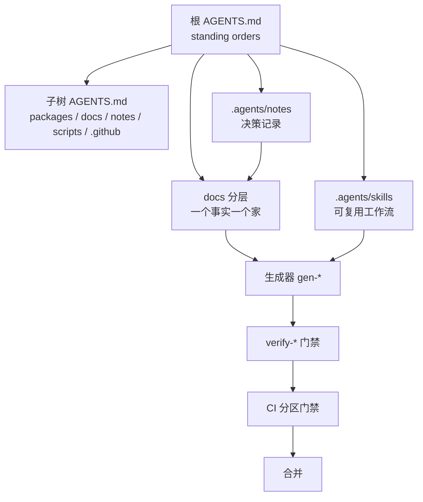
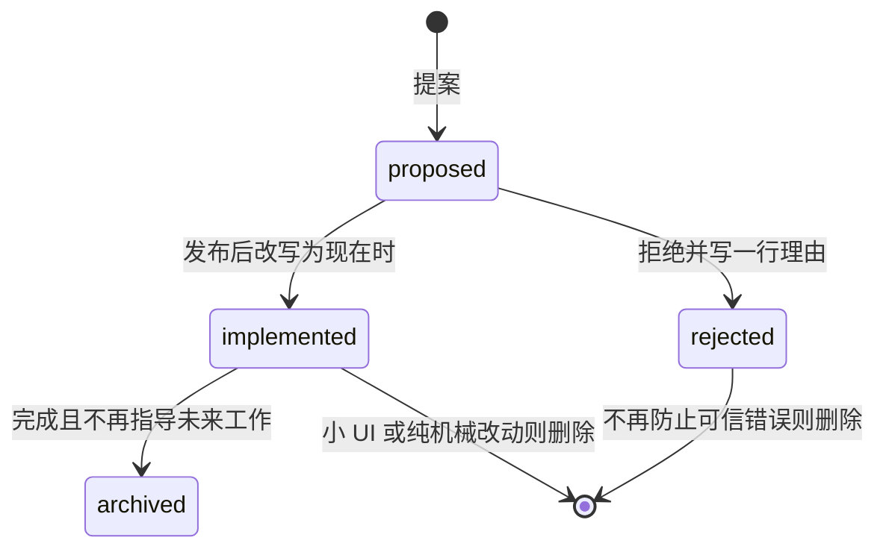

# 02-AI 开发规范

> **一句话总结**：DSH 用「一层规则 + 一套门禁」约束 agent 的每次改动。

| 项目 | 内容 |
|---|---|
| 回答的问题 | agent 进入 deepseek-harness 后按什么规范改代码、文档与 PR？规范之间谁约束谁？ |
| 适合读者 | 要在该仓库做改动的工程师、代码评审人、接入该仓库的 AI agent |
| 前置阅读 | [01-系统架构](01-系统架构.md) |
| 主要来源 | `AGENTS.md`、`docs/AGENTS.md`、`docs/development.md`、`docs/testing.md`、`.agents/notes/README.md`、`.agents/skills/*/SKILL.md`、`package.json`、`lefthook.yml`、`.github/workflows/`、`CONTRIBUTING.md`、`docs/i18n/README.md`、`docs/cookbook/`、`snapshots/AGENTS.md` |

## 一、通俗理解（先读这一节）

### 1.1 这套规范解决什么问题

DSH（DeepSeek Harness）的贡献者主要是 AI agent 和少量维护者。如果不把「事实放在哪里、改完跑什么、谁能约束谁」写死，agent 会把同一条规则抄到五处，改一处漏四处。DSH 的答案是把规范拆成几层职责，并用机器门禁把「源头」和「派生文件」钉在一起。来源：`docs/AGENTS.md`。

### 1.2 用一句话记住六个组成部分

1. **AGENTS.md 阶梯**（根 + 子树）：常驻指令（standing orders）。
2. **docs 分层**：人类可读文档的「一个事实一个家」。
3. **skills**：可复用的工作流与专项判断标准。
4. **Agent Notes**：决策的「为什么」与「放弃了什么」。
5. **生成器 + 校验门禁**：从源生成派生文件，再校验不漂移。
6. **CI**：穷尽矩阵与合并门禁。

来源：`AGENTS.md`、`docs/AGENTS.md`、`docs/testing.md`、`.agents/notes/README.md`。

### 1.3 直觉图



图 1：规范的六层协作。上层给规则，中层给事实，生成器把源变成派生文件，`verify-*` 与 CI 负责合并前的一致性。

### 1.4 三层「事实之家」的区别

- `AGENTS.md` 只放「每次会话都需要的常驻规则」，每条 1~3 行并链接它的家。
- `docs/AGENTS.md` 定义文档分层（tier），决定每个事实的归属层。
- Agent Notes 只放决策理性；不写迁移计划、验收清单。
来源：`docs/AGENTS.md`、`.agents/notes/README.md`。第 2.3、2.4 节会逐条展开。

### 1.5 一次改动如何穿过体系

改一个包的行为时，典型路径是：读 AGENTS.md 阶梯与 `docs/architecture.md` → 判断是否触发 Agent Note → 改源码与 JSDoc → 重跑生成器 → 同 PR 更新双语文档与快照 → 本地跑最小证据 → push 触发 CI。这个路径在第 2.11 节给出可执行 checklist。

## 二、技术细节

### 2.1 规范体系鸟瞰：六者如何配合

#### 2.1.1 各组成部分的职责

| 组成部分 | 职责 | 不放什么 | 来源 |
|---|---|---|---|
| 根 `AGENTS.md` | 每次会话都要在上下文里的常驻规则，每条 1~3 行，链接到事实之家 | 故事、示例、情境化流程、从链接处复述的内容 | `docs/AGENTS.md` |
| 子树 `AGENTS.md` | 该子树特有的规则（`packages/`、`docs/`、`.agents/notes/`、`scripts/`、`.github/`、`snapshots/`） | 根文件已承载的仓库级规则 | `docs/AGENTS.md` |
| `docs/` 分层 | 人类可读文档：教程与参考，按 tier 归属 | 跨层重复的事实 | `docs/AGENTS.md` |
| `.agents/skills/` | 可复用工作流与专项判断标准 | 产品与运行时契约（去 docs 或源码） | `docs/AGENTS.md` |
| `.agents/notes/` | 决策记录：为什么、放弃了什么、需要什么验证 | 迁移计划、验收清单、fixture 走查、spec-speak | `docs/AGENTS.md` |
| 生成器 + `verify-*` | 从源生成穷尽参考，并校验派生文件不漂移 | 手改生成源或生成区域 | `docs/AGENTS.md`、`package.json` |
| CI | 穷尽覆盖率与平台矩阵，合并门禁 | 本地针对性证据的替代 | `AGENTS.md` |

#### 2.1.2 谁约束谁

- 根 `AGENTS.md` 约束所有会话；`packages/AGENTS.md`、`docs/AGENTS.md`、`.agents/notes/AGENTS.md`、`.github/AGENTS.md`、`scripts/AGENTS.md`、`snapshots/AGENTS.md` 只补充子树规则，不重复仓库级规则。来源：`docs/AGENTS.md`、`packages/AGENTS.md`、`scripts/AGENTS.md`。
- `docs/AGENTS.md` 约束人类可读文档；Agent Notes 明确在其结构规则范围之外。来源：`docs/AGENTS.md`。
- skills 提供判断与流程，但自我描述为「guidance, not a complete checklist」「not a script」；真正的硬约束在执行的门禁。来源：`.agents/skills/dsh-code-review/SKILL.md`、`.agents/skills/dsh-prose-standard/SKILL.md`。
- Agent Notes 记录理性；`implemented/` note 必须随实际代码更新事实（路径、名字、机制），但不得把决策本身改写。来源：`.agents/notes/implemented/AGENTS.md`。
- 生成器拥有生成源与生成区域；`verify-*` 是 freshness 门禁；CI 把它们与平台矩阵一起跑。来源：`docs/AGENTS.md`、`package.json`。

#### 2.1.3 分层加载顺序

一个 agent 进入仓库后按此顺序读：根 `AGENTS.md` → 目标子树的 `AGENTS.md` → `docs/AGENTS.md`（改文档时）或 `docs/architecture.md`（改 `packages/` 前）→ 目标包 README / JSDoc / 既有 Agent Note → 匹配任务的 skill。来源：`AGENTS.md`、`docs/AGENTS.md`、`.agents/skills/dsh-doc/SKILL.md`。

### 2.2 根 `AGENTS.md` 规则速查表（按主题分组）

> 下表把根 `AGENTS.md` 的 `## Conventions`、`## Type safety and documentation` 等段落按主题重排。每条一句话概括，并给出它指向的事实之家。来源：`AGENTS.md`。

#### 2.2.1 架构与运行时

| 规则 | 事实之家 |
|---|---|
| 新行为挂在文档化的扩展点上；改 `agent-loop` 必须更新 `docs/architecture.md`。 | `docs/architecture.md` |
| 注册即 effect：贡献走 `ctx.effect()` / `ctx.on()`，registry 的 `register()` 返回 disposer。 | `docs/architecture.md`、`docs/cordis-primer.md` |
| capability seam（能力缝）由 Service Definition / Service Provider / Consumer 三角色组成，从不只有一个角色；只在角色独立演进时才拆分包。 | `docs/glossary.md#capability-seam` |
| 瀑布监听器必须调用 `next()` 才能委托；不调用即短路。 | `docs/cordis-primer.md#cordis-waterfall-semantics` |
| model-visible ⟺ logged：任何到达模型请求的东西都必须能从会话日志重建；新的模型可见输入需要新的 session event。 | `docs/architecture.md` |
| 只让 `dsh` profile 启动受支持的 Node 应用；包 bin、demo、SDK argv 逃逸都不允许。 | `docs/architecture.md#application-launch` |
| ESM everywhere（`"type": "module"`）；跨包用包名导入，包内相对导入带 `.ts` 后缀。 | 根 `AGENTS.md` |
| 显式优于隐式：包边界上的默认值是拥有者实现里一个显式的 `resolve(request): Spec` 步骤，不是 `run()` 里隐藏的 `?? default`（模板：`dsh-shell`）。 | 根 `AGENTS.md` |
| 保持编译面显式：同时有 Host 与 Client 程序的包暴露面专属 leaf 配置与仅作 solution 的根配置；全仓程序从 face 配置起步，绝不用根 solution。 | 根 `AGENTS.md`、`docs/development.md#typescript-project-layout` |
| 工具设计先定 UI 呈现：Host presenter 保持纯函数，Web 卡片由原始事件与持久化结果元数据派生。 | 根 `AGENTS.md`、`docs/cookbook/adding-a-tool.md` |
| 并行取值优先对称；无法解释的不对称通常意味着漏了一处抽象。 | 根 `AGENTS.md` |

#### 2.2.2 类型与 API

| 规则 | 事实之家 |
|---|---|
| 全部在 `strict: true` 且 `noImplicitAny` 下编译；残留 `any` 要解释为什么无法收窄。 | 根 `AGENTS.md` |
| 每个模块与导出都有简洁 JSDoc；函数型导出含 `@param`/`@returns`。 | `scripts/verify-export-jsdoc.ts` |
| typed event 用 declaration merging 与可合并映射；event JSDoc 需要 `@mode` 与 payload `@param`。 | `packages/core/session` |
| 只在判别标签上 switch；封闭 union 以 `assertNever` 收尾，可合并 union 走文档化 default。 | 根 `AGENTS.md` |
| 跨边界不透明 id 用 branded 类型（`Branded<B>`），不用裸 `string`。 | `dsh-brand` |
| 在 typed 同进程边界信任 TypeScript；只在 parser/config、排队、模型/工具 JSON、durable/file、worker、process、wire 边界做校验。 | 根 `AGENTS.md` |
| 不新增对 `unknown` 的断言（`as unknown` / `<unknown>`）；保留或降低既有基线。 | `.agents/notes/implemented/process/2026-09-19-no-unknown-casts.md` |
| `SessionEventMap` 成员在读取侧默认必需，除非信封带 `ignorable: true`；只在既有判别符无法防止不安全解释时升 `SESSION_FORMAT_VERSION`。 | `.agents/notes/implemented/process/2026-10-08-session-reader-compatibility-review.md` |

#### 2.2.3 错误处理

| 规则 | 事实之家 |
|---|---|
| 类型化、结构化失败 + 本地化、可操作的报告；定义处理归属、隔离与失败保证。 | `.agents/skills/dsh-error-handling/SKILL.md` |
| 空 `catch` 必须点名错误与原因，且 `try` 只包一条语句。 | 根 `AGENTS.md` |
| 不把异常吞掉当作恢复；依赖工作要么停止，要么显式升级并可见地报告未知状态。 | `.agents/skills/dsh-error-handling/SKILL.md` |

#### 2.2.4 测试

| 规则 | 事实之家 |
|---|---|
| 测试描述行为而非正确性；废弃行为要连同测试一起改，并在 PR 说明原因。 | 根 `AGENTS.md` |
| 每个非平凡 model- / product-user-visible 改动都更新 keyless recorded-session 快照。 | `docs/testing.md`、`snapshots/AGENTS.md` |
| fixture 在 macOS/Linux 回放；修 fixture，不修 normalizer。 | `snapshots/AGENTS.md` |
| 能力缝、生命周期路径与 transcript 输出要预先规划 unit / e2e / snapshot 覆盖。 | 根 `AGENTS.md` |
| 两个 SDK 都投影 loop：`agent-loop`、session-lifecycle、`SessionEventMap` 改动要在同一 PR 更新 TS 与 Python SDK 期望输出；`pnpm run test` 两者都不覆盖。 | `docs/testing.md#when-a-snapshot-test-is-required` |
| 每个 registry 贡献要有 HMR-safety 测试（dispose fiber 后断言清理）。 | `docs/testing.md` |

#### 2.2.5 文档

| 规则 | 事实之家 |
|---|---|
| 每个代码改动都带文档：同 PR 更新受影响的 README 与 JSDoc 契约。 | 根 `AGENTS.md` |
| 常规双语工作走 `docs/AGENTS.md` 的轻量路径；`dsh-translate-docs` 只在用户显式调用时运行。 | `docs/AGENTS.md`、`docs/i18n/README.md` |
| 当前态叙述、一段一物理行、一个事实一个家、字数预算。 | `docs/AGENTS.md` |
| Agent Note 只在有持久决策理性时创建；机械或本地改动豁免。 | `.agents/notes/README.md#when-to-write-one` |
| 已归档 note 冻结：不编辑、不作为当前权威。 | `.agents/notes/README.md#archiving-and-deletion` |
| 注释与文档写完整契约，不写推理记录；不用隐喻。 | `.agents/skills/dsh-prose-standard/SKILL.md`、`.agents/skills/dsh-trim-cot-leakage/SKILL.md` |
| 注释保持局部：不重述代码、不扩张无关注释、不在没有局部必要时解释远距离行为。 | 根 `AGENTS.md` |
| 禁用 `prove` 与 `nance` 这对含义不清的来源标签。 | `.agents/notes/implemented/process/2026-08-26-ban-ambiguous-origin-label.md` |

#### 2.2.6 Git / PR

| 规则 | 事实之家 |
|---|---|
| 有意识地选择 PR 历史：拆分独立改动，并在传播前修复引入问题的 PR。 | `.agents/notes/implemented/process/2026-08-02-native-github-stacks-and-optional-rebases.md` |
| standalone / stack 分支可以 merge-forward 或 rebase；重写用 `--force-with-lease`，远端移动即中止；绝不裸 `--force`。 | 同上 |
| labels：一个 PR 一个 `kind/*`、所有实质 `area/*`，加 native Issue Type。 | `.agents/notes/implemented/process/2026-08-08-unified-github-label-taxonomy.md` |
| TODO 标记按紧急度用 `FIXME` / `TODO` / `XXX`。 | `docs/development.md` |
| 文件以恰好一个结尾换行结束；`git diff --cached --check`（pre-commit）把关。 | 根 `AGENTS.md` |

#### 2.2.7 依赖与包

| 规则 | 事实之家 |
|---|---|
| 比手写更优先维护良好的依赖——前提是它真的删掉了自有代码与测试。 | `.agents/notes/implemented/process/2026-07-26-dependencies-over-hand-rolling.md` |
| 包名 `@deepseek-ai/dsh-<name>`；vendor 被 rescope 且 `private: true`。 | `docs/rescope.md` |
| Harness 包在 `peerDependencies` / `devDependencies` 声明 `@deepseek-ai/cordis`。 | 根 `AGENTS.md` |
| 工作区依赖用 DSH `workspace:*`，vendor/native 用 `workspace:~`。 | `.agents/notes/implemented/process/2026-08-10-npm-release-sequences.md` |
| 原始 / Web `cordis.yml` 的 bare plugin 必须出现在其 resolver manifest 的 `dependencies` 里；`verify-cordis-config` 强制。 | `scripts/verify-cordis-config.ts` |
| 插件里不放硬编码可调参数；部署可变的选项是经过校验、可从 `cordis.yml` 改的 `Config` 字段；协议常量、外部规范与安全不变量保持固定。 | 根 `AGENTS.md` |

#### 2.2.8 安全

| 规则 | 事实之家 |
|---|---|
| 永不提交凭据；real-API 测试与 demo 读 `DEEPSEEK_API_KEY`、可选 `DEEPSEEK_BASE_URL`、根 `.env`。 | 根 `AGENTS.md` |
| 配置错误要响亮失败（自包含时在加载期，否则在最早可解析点），绝不静默跳过缺失引用。 | 根 `AGENTS.md` |
| client UI 文案由 locale 拥有；产品文案走 typed dictionary 与 `t` 或本地化 prop，`verify-client-ui-i18n` 拒绝硬编码。 | `.agents/notes/implemented/architecture/2026-08-23-locale-owned-client-ui-copy.md` |
| 不把不受信任输出交给环境变量或可预测路径；子进程用清洗过的 env，临时 / spill 文件用私有目录与独占创建。 | `docs/defensive-patterns.md` |

### 2.3 「一个事实只有一个家」：tier 体系

#### 2.3.1 tier 表（逐行译自 `docs/AGENTS.md`）

| Tier | 职责 | 明确不放什么 |
|---|---|---|
| 根 `AGENTS.md` | 常驻指令：每次会话都需要的规则，每条 1~3 行并链接其家 | 故事、示例、情境化流程、从链接处复述的任何内容 |
| 子树 `AGENTS.md`（`packages/`、`docs/`、`.agents/notes/`） | 该子树特有的指令 | 根文件已承载的仓库级规则 |
| `architecture.md` | 有序地图：组合、核心包、loop、seam、扩展点；改 `packages/` 前必读 | 类型定义（→ subsystems）、按包细节（→ 包 README）、决策理性（→ Agent Notes）、实现状态标注 |
| `subsystems/` | 每个子系统一页参考：类型定义、语义、生成的 Cordis API | 行为叙述（→ `architecture.md`） |
| Agent Notes | 活跃决策记录：为什么、放弃了什么、需要的验证；`implemented/` 用现在时描述已发布现实 | 迁移计划、验收清单、fixture 走查、决策发布后的 spec-speak（`should…`）；归档 note 是冻结历史，绝非当前权威 |
| `postmortem/` | 事故故事——唯一允许战史叙事的 tier | — |
| Persistence history 与 format references | 类型变更确认、发布对比、完整历史格式 schema | 只改行为；当前运行时契约 |
| `cookbook/` | 带编号验证步骤的逐步 how-to | 设计理性（→ 每个指南链接的 Agent Note） |
| `user/` | 文档网站发布的面向产品指南 | 生成的参考表、贡献者流程、决策历史 |
| Package README | 按包契约：config、语义、限制、扩展点、Model Experience | JSDoc 复述、生成 catalog 复述（event / tool 表）、其他包的关注点 |
| `development.md` | 贡献者上手、日常工作流、CI 摘要；i18n 契约下的双语对 | 运行时 / 版本理性（→ Agent Notes）、会与 `package.json` 脚本漂移的逐检查清单 |
| 生成参考：subsystems 的逐页 `cordis-surface` 区域、Cordis core API + inherited tier、`tool-catalog`、`config-catalog`、`persistence-catalog`、`module-graph.md`、`cli-help` | 从源重新生成并由 freshness 把关的穷尽英文源；评审过的中文对应物遵循配对流程 | 手改生成的英文源或区域；中文对应物只能通过配对更新 |
| Skills（`.agents/skills/`） | 可复用工作流与专项决策标准 | 产品与运行时契约（→ docs 或源码） |

#### 2.3.2 placement 规则

bugs → postmortems；rationale → Agent Notes；procedures → cookbooks；type definitions → subsystems；package contracts → READMEs；standing orders → 根 `AGENTS.md` 加理性链接。来源：`docs/AGENTS.md`。

#### 2.3.3 判定顺序

先定位文档在树中的位置与自身主题；只描述自身主题到合适粒度，直接子主题只写用途、职责与高层行为，并链接到下层的家。文档类型不会扩大该范围；参考文档只对自己的主题穷尽。来源：`docs/AGENTS.md`。

### 2.4 Agent Notes 制度

#### 2.4.1 目录与状态语义

路径编码两个轴：`{lifecycle}/{class}/yyyy-mm-dd-topic-title.md`。来源：`.agents/notes/README.md`。

- **lifecycle**：`proposed/`（已评审、未建或部分建）、`implemented/`（已发布，随实际代码更新事实）、`rejected/`（考虑后拒绝，仅在其理性还能防止诱人的错误时保留）。
- **class**（封闭集合，定义在 `scripts/agent-note-tree.ts`）：`feature`、`bug-fix`、`simplification`、`architecture`、`process`、`testing`。
- `architecture` 是「我们发布的源码」的结构决策；`process` 是围绕代码的工具与流程。没有 `refactor`，它与 `simplification` 重叠。来源：`.agents/notes/README.md`。

#### 2.4.2 何时必须写

同一个 PR 里，只为代码、测试与现有文档都解释不了的持久决策理性新增或更新 Agent Note。实质未来工作从 `proposed/` 开始；已做的决策从 `implemented/` 开始。机械或本地改动（含本地 UI 呈现与交互改动）豁免。更新已拥有该决策的 note 即满足规则，不要新建重复。理由不同的决策不用编辑旧 note，而是新建并交叉链接。来源：`.agents/notes/README.md#when-to-write-one`。

#### 2.4.3 文件格式

Header 前三行固定：

```markdown
# Agent Note: <title>

Status: <status>
```

`Status:` 有三种形式且必须与所在 lifecycle 文件夹一致：`Status: proposed`、`Status: implemented`、`Status: rejected — <why, in one line>`。状态不带日期与括号；文件名带首次提出日期，git 带其余。来源：`.agents/notes/README.md`。

Body skeleton 按 lifecycle：

- `proposed/`：`## Problem`、`## Proposal`、…bespoke…、`## Alternatives considered`、`## Acceptance criteria`、`## Risks`。
- `implemented/`：`## Problem`、`## Decision`、…bespoke…、`## Alternatives considered`、`## Consequences`；`## Proposal`、`## Plan`、`## Migration plan`、`## Acceptance criteria` 会被门禁拒绝。
- `rejected/`：保留提案时的 section，verdict 在 `Status:` 行；header、`## Problem`、`## Proposal` 与 Alternatives 强制段适用。
- `## Alternatives considered` 强制：每个真实替代方案与它为什么输。
- 跨 lifecycle 移动要同步更新 `Status:` 并满足目标文件夹骨架。

来源：`.agents/notes/README.md`。

#### 2.4.4 归档与删除

- 只描述小 UI 调整或纯机械改动的 implemented note：删除完整三件套（英文、中文、sidecar）并修复或移除入站链接。
- 其他 implemented note 仅在决策完成、理性不太会指导未来工作、但记录仍有历史价值时归档；当替代方案、所有权边界、否定保证、durable / wire 语义、安全规则或重新引入条件仍有用时保持活跃。
- 绝不归档 proposed note：过时提案直接 reject。
- rejected note 只在仍能防止可信错误时保留，否则删三件套。
- 归档路径 `archived/{class}/`（没有 `implemented`）；归档操作只移动完整三件套、在两侧 `Status: implemented` 下插入相同的 `Archived: YYYY-MM-DD`、重录 sidecar、修复或删除入站链接。
- 封存后永久冻结：不编辑、不翻译、不重排、不更新、不移动、不删除，也不作为当前行为权威。文档门禁跳过归档源，包括其出站链接。
- `verify-archived-agent-notes` 强制封闭 class 树、完整三件套、归档元数据、sidecar hash 与 append-only manifest。

来源：`.agents/notes/README.md`、`.agents/notes/archived/AGENTS.md`。

#### 2.4.5 审查流程（supersession check）

每个新 Agent Note 触发一次 supersession 检查：搜索覆盖同一决策或机制的旧 note，用 `dsh-archive-agent-notes` 给每个部分或完全替代分类，并在同一 PR 归档合格的 implemented 三件套；部分替代保持活跃并交叉链接。来源：`.agents/notes/AGENTS.md`、`.agents/skills/dsh-archive-agent-notes/SKILL.md`。



图 2：Agent Note 的 lifecycle 流转。来源：`.agents/notes/README.md`。

### 2.5 Skills 体系：16 个 skill

#### 2.5.1 一览表

| Skill | 触发场景 | 核心内容 |
|---|---|---|
| `dsh-pre-push-checks` | push、force-push、mark ready、声称检查通过之前；`gh stack sync` 之后 | 先 `change-scope` 看范围，再按改动面选最小证据；不重复已通过检查 |
| `dsh-code-review` | 评审 DSH PR | 核对 live base/head 并跑 `change-scope`；6 条 blocking requirements；手工检查清单 |
| `dsh-doc` | 创建 / 重构 / 评审 / 审计 DSH Markdown 文档与网站 | kind→模板、fact-check「跑一遍再写」、voice 规则、预算、网站投影 |
| `dsh-prose-standard` | 写 / 审 / 修剪 prose | 完整命题规则、按位置的必需覆盖、边界决策 |
| `dsh-error-handling` | 设计 / 评审失败、恢复、重试、后台任务、用户可见错误 | 类型化失败、catch / recover / stop、本地化可操作报告 |
| `dsh-archive-agent-notes` | 新增 / 审计 / 修剪 / 归档 / 恢复 Agent Notes | 按未来价值分类、删除 vs 归档、三件套封存 |
| `dsh-create-upgrade-guide` | 改动破坏外部可感知面 | 范围、位置与格式、维护与验证 |
| `dsh-find-simplifications` | 找有证据的简化、评估他分支简化 | 搜索可移除义务、证明可达性与取舍、记录与合并 |
| `dsh-ci-test-reliability` | 新增 / 评审有非确定性风险的测试；诊断 flaky CI | 执行拓扑、原子分配、全局态 containment、超时预算、dispose to quiescence |
| `dsh-client-ui-ux` | 改 `packages/client` 的产品可见 GUI | token 纪律、先复用、反馈面选择、overlay 安全、平台窗口适配 |
| `dsh-merging-stacked-prs` | 落地 dependent PR 栈 | 必须用 GitHub 官方 `gh stack`；link / sync / merge / verify 流程 |
| `dsh-speed-up-perf` | 性能调查 / 优化、benchmark / CI 性能门禁 | 先建真实合成 benchmark 与 measurement card，再证明回归并删除工作 |
| `dsh-trim-cot-leakage` | 审计 / 修像泄漏推理记录的 prose | 一个测试 + 8 类 taxonomy + keep 规则 |
| `agent-experience` | 写 / 改模型可见 tool 定义、设计 skill 与多步工作流 | 最小上下文、显式发现、bounded output、locality；tool 定义规则 |
| `record-browser-gif` | 制作用于演示浏览器 / Web UI 的 GIF；每个产品可见 GUI PR 必须 | 干净 worktree、真实 server / key、一个 storyboard 一次运行、编码与验证、`gh --attach` |
| `dsh-translate-docs` | 用户显式按名调用 | 扩展双语流程（briefing、委派、整文翻译、scoped 验证）；`disable-model-invocation: true` |

来源：各 skill 的 `.agents/skills/<name>/SKILL.md` 与 `docs/AGENTS.md`。

#### 2.5.2 skill 与 docs 的分工边界

- skills 放可复用工作流与专项判断标准；产品与运行时契约去 docs 或源码。来源：`docs/AGENTS.md`。
- `dsh-translate-docs` 是唯一带 `disable-model-invocation: true` 与 `user-invocable: true` 的 skill；常规双语工作不调用它。来源：`.agents/skills/dsh-translate-docs/SKILL.md`、`docs/i18n/README.md`。
- `verify-skill-invocation-metadata` 校验 skill 调用元数据。来源：`package.json`。
- skills 常明确写「guidance, not a complete checklist / script」，不替代仓库门禁。来源：`.agents/skills/dsh-code-review/SKILL.md`、`.agents/skills/dsh-prose-standard/SKILL.md`、`.agents/skills/dsh-find-simplifications/SKILL.md`。

### 2.6 测试规范

#### 2.6.1 命令定位表

| 命令 | 定位 | 来源 |
|---|---|---|
| `pnpm run test` | 单元测试：vitest 跑 package / example 的 `tests/**` 与 `scripts/**/*.spec.ts` | `docs/testing.md` |
| `pnpm run test:coverage` | CI 覆盖率门禁：`packages/*/*/src` 每文件 100% | `docs/testing.md` |
| `pnpm run test:e2e` | real-API 测试，无 key 自跳过 | `docs/testing.md` |
| `pnpm run test:expected` | owner-local 进程期望，无 recorded-session 往返 | `docs/testing.md` |
| `pnpm run test:snapshot` | keyless recorded-session replay through shipped profiles | `docs/testing.md` |
| `pnpm run test:snapshot:record` | 模型 transcript 变化时重录 | `docs/testing.md` |
| `pnpm run test:snapshot:refresh` | replay 输入仍有效时刷新 | `docs/testing.md` |
| `pnpm run test:web` | Web 浏览器快照（先 build，Chromium；picker 也跑 WebKit） | `docs/testing.md` |
| `pnpm run test:web:ci` | CI 用只读 `DSH_SNAPSHOT=replay` 运行 web lane | `scripts/run-web-snapshots.ts` |
| `pnpm run test:bench` | 性能 benchmark（Linux PR 必需门禁 `node 24 / benchmarks`） | `docs/testing.md` |
| `pnpm run test:bench:memory` | 内存压力 benchmark | `package.json` |
| `pnpm run test:gui` | `vitest run packages/client packages/host` | `package.json` |
| `pnpm run test:docs` | 快速文档检查（无 build，doc-quick 聚合） | `package.json` |
| `pnpm run test:coverage:partitioned` | 覆盖率分区运行 | `package.json` |

#### 2.6.2 何时必须更新快照

- 每个非平凡 model-、protocol- 或 human-visible 改动，在同一个 PR 新增或更新一个 keyless recorded-session 场景；包级、e2e、mock-only 与理性证据都不能替代组装好的 transcript。来源：`docs/testing.md#when-a-snapshot-test-is-required`。
- headless、SDK、ACP、Web 的录制分别住在 `snapshots/session/`、`snapshots/sdk/`、`snapshots/acp/`、`snapshots/web/`。来源：`docs/testing.md`。
- 非 recorded-session 驱动的期望输出留在其 owning app / package / script 的 `tests/expected/`，且不用 `*.snapshot.ts` 后缀。来源：`docs/testing.md`。

#### 2.6.3 快照归属规则

- `snapshots/` 只放那些「提交的 session JSONL 既是 replay 输入又是期望持久输出」的测试。ARIA、几何、生成器、CLI、单元期望留在 owning app / script / package，用 `test:expected`、`test:web` 或 `test`。来源：`snapshots/AGENTS.md`。
- 每个场景拥有或显式引用一个 primary Session role 加连续 child roles。父文件名 `session[.vN].jsonl`，子 `session.<ordinal>[.vN].jsonl`；v0 省略 `.v0`，正版本用小写 `.vN`；文件名必须与 header 一致。replay / record / refresh 选择每个角色数值最高的 generation。来源：`snapshots/AGENTS.md`。
- 提交的 session 是归一化不动点：易变身份替换为保留关系的 typed token，request system prompt 与 tool schema 替换为 token，每个 header class 恰好一个可读 sidecar owner。来源：`snapshots/AGENTS.md`。
- 会改写 workspace 的场景设置 `workspace.final: true`，并把完整结果提交到 `workspace.expected/`；record 与 refresh 不重写这个独立 oracle。来源：`snapshots/AGENTS.md`。
- 每个测试进程都通过 `dsh` CLI 与 shipped profile 启动，可选场景 patch；不得新增另一个应用入口、隐藏 CLI 模式或可执行场景驱动。来源：`snapshots/AGENTS.md`。

#### 2.6.4 source plane vs artifact plane

- 静态门禁与测试通过 tsconfig `paths` 把 workspace import 解析到 `src`，且在干净树上通过；消费 built `lib/` 的门禁要显式声明该依赖。来源：`docs/development.md#typescript-project-layout`、根 `AGENTS.md`。
- 每个 vitest config 指向 `tsconfig.base.json`；bare workspace import 解析到 `src`，绝不通过 package `exports` 到 built `lib/`（过时产物会加载第二份模块单例）。built 产物只在显式的 `lib`-mode 子进程与 built smoke 中消费。来源：`docs/testing.md#test-resolution-source-plane-only`。
- CI 与有 build 的测试 lane 通过共享 dual-mode launcher 从 built `lib/` 启动 profile / Cordis-config 子进程；不要手写 `--import tsx`。来源：`docs/testing.md#test-subprocess-launch-modes`。
- source plane 与 artifact plane 绝不混用。来源：根 `AGENTS.md`。

#### 2.6.5 CI 分区门禁

- `ci.yml` 只跑 `pull_request`，job 包括 `node-24`、`node-24-coverage`、`node-24-bench`、`node-24-consumers`、`node-compat`、`python-sdk`、`python-runtime`、`windows-build`、`windows-coverage`、`windows-native-tests`、`all-checks-passed`。来源：`.github/workflows/ci.yml`。
- `ci-master.yml` 监听 master push 与 `workflow_dispatch`，承载 master-only 平台检查、self-hosted standby 与手动 runner benchmark，避免它们进入 PR check 面板。来源：`.github/AGENTS.md`。
- `e2e.yml` 由 `workflow_dispatch`、`push`（main / master）、`pull_request` 与 nightly cron 触发，运行 `pnpm run test:e2e`。来源：`.github/workflows/e2e.yml`。
- 本地脚本 `check:ci:*` 对应 `scripts/run-gates.ts` 的门禁 mode：`ci-primary`、`ci-linux-primary`、`ci-static`、`ci-lint-contracts-ready`、`ci-coverage`、`ci-unit`、`ci-bench`、`ci-snapshot`、`ci-artifacts`、`ci-consumers`；Windows 另有 `check:ci:windows-blocking`、`check:ci:windows-complete`、`check:ci:windows-observational-ready`，Node 兼容性是 `check:node-compat`（不属 `check:ci:*`）。来源：`package.json`、`scripts/run-gates.ts`。
- Windows 原生化：Windows job 在原生 `pwsh` 下跑，Wine 只在 `ci-master.yml` 用 Windows Node on hosted Linux，且只在诊断已知 Windows 失败时本地跑 `pnpm run check:windows-wine`。来源：`.github/AGENTS.md`、根 `AGENTS.md`。

#### 2.6.6 测试可靠性与执行拓扑

CI 里 fork 的 worker 并发跑多个 spec，覆盖率门禁在自身 job 里与其他门禁并行，self-hosted runner 共享一台主机与一个卷；被隔离的只是进程，ports、可预测路径、外部命名空间、继承的子进程都没有隔离。来源：`docs/testing.md#how-specs-execute`、`scripts/AGENTS.md`。

可靠性规则包括：用资源拥有者的分配器原子分配（`listen(0)`、`mkdtemp`、独占创建）；contain `process.env`、`cwd`、fake timer、locale / timezone、module mock 等独占可变资源并精确恢复；在状态、握手或拥有 promise 上同步而非 sleep；cleanup 注册后立即登记并 dispose 到 quiescence。来源：`.agents/skills/dsh-ci-test-reliability/SKILL.md`。一个只在单独运行时通过的 spec 是 spec 缺陷，不是 runner 不稳。来源：`scripts/AGENTS.md`。

### 2.7 生成器与校验门禁双轨机制

#### 2.7.1 双轨是什么

- `gen-*` 从源生成派生参考（catalog、graph、help、notices 等）；`verify-*` 多数是同一脚本的 `--check` 模式，比对文件是否与源一致。来源：`package.json`。
- 生成英文源与生成区域禁止手改；中文对应物只能通过配对流程更新。来源：`docs/AGENTS.md`。
- 改 documented type 时，owning subsystems page 在同一改动里更新；`verify-type-equiv` 抓的是粘贴漂移，不是从未文档化的新类型。来源：`docs/AGENTS.md`。

#### 2.7.2 gen-* / verify-* 配对表（17 组）

| 生成器 | 校验门禁（通常是 `--check`） | 防的漂移 |
|---|---|---|
| `gen-tsconfig-paths` | `verify-tsconfig-paths` | 源平面路径映射 |
| `gen-cli-help` | `verify-cli-help` | CLI help 参考 |
| `gen-cordis-catalog` | `verify-cordis-catalog` | Cordis 目录 |
| `gen-cordis-api` | `verify-cordis-api` | Cordis core API 参考 |
| `gen-cordis-inspect-catalog` | `verify-cordis-inspect-catalog` | inspect catalog |
| `gen-client-catalog` | `verify-client-catalog` | client catalog |
| `gen-tool-catalog` | `verify-tool-catalog` | tool 目录 |
| `gen-config-catalog` | `verify-config-catalog` | config 目录 |
| `gen-plugin-packages` | `verify-plugin-packages` | skill / 插件包列表 |
| `gen-dependency-catalog` | `verify-dependency-catalog` | npm 依赖目录 |
| `gen-doc-graphs` | `verify-doc-graphs` | 文档图 |
| `gen-module-graph` | `verify-module-graph` | 模块图 |
| `gen-persistence-catalog` | `verify-persistence-catalog` | 持久化目录 |
| `gen-session-format-catalog` | `verify-session-format-catalog` | Session 格式目录 |
| `gen-third-party-notices` | `verify-third-party-notices` | 第三方 notices |
| `gen-workflow-guest` | `verify-workflow-guest` | workflow guest 源 |
| `gen-official-bundle-catalog` | `verify-official-bundle-catalog` | official bundle 目录 |

来源：`package.json`。

补充三组 persistence 门禁：`persistence-changes` / `verify-persistence-changes`（同脚本 `--check`），以及独立校验脚本 `verify-persistence-releases`、`verify-persistence-formats`（没有对应的基础脚本）。`gen-translation-brief` 没有对应 verify，它服务于双语更新；`verify-v3-event-vocabulary` 是独立门禁。来源：`package.json`。

#### 2.7.3 doc-sync / test:docs / hygiene / constraints

- `pnpm run doc-sync` 跑 `scripts/run-gates.ts` 的 `doc-sync` mode，是文档门禁集合（`docSyncLeafGates` 列出约 43 个 leaf gate），包括 `doc-typecheck`、`docs:build`、`verify-doc-graphs`、`verify-md-links`、`verify-type-equiv`、`verify-translation-pairing`、`verify-md-wrap`、catalog 系列、persistence 系列、`verify-subsystem-pages`、`verify-export-jsdoc`、`verify-doc-budgets`、`verify-upgrade-guides`、Agent Note 门禁、`verify-package-readme-*` 等。来源：`scripts/run-gates.ts`。
- `pnpm run test:docs` 是 `doc-quick` 聚合：只跑 `quick: true` 的文档门禁，不含 build、生成器重生成或 VitePress build。来源：`scripts/run-gates.ts`。
- `pnpm run hygiene` 跑 `publint` + workspace / package / dependency 检查 + NodeNext consumer check（`verify-node-next-types`），并额外带 `verify-cordis-config` 与 `verify-runtime-closure`。来源：`package.json`、`scripts/run-gates.ts`。
- `pnpm run constraints` 跑 `scripts/check-workspace-constraints.ts`，走可达 Project Reference 图并检查每个引用项目自己的 compiler face。来源：`docs/development.md`。
- `verify-md-*` 系列防 Markdown 漂移：`verify-md-wrap`（一段一物理行）、`verify-md-links`（本地链接可解析）、`verify-doc-refs`、`verify-mermaid`、`verify-repository-references`、`verify-public-repository-links`。来源：`package.json`。
- 生成参考的中文对应物由生成器把区域写入两页，因此重新生成不需要手动更新中文或新记录；只有区域外的 prose 需要翻译并记录。来源：`docs/i18n/README.md`。

#### 2.7.4 门禁如何组织

`scripts/run-gates.ts` 用 `Gate` 抽象描述 id、命令、`needs` 与 `after`，并校验重复 id、未知依赖与依赖环。来源：`scripts/run-gates.ts`。门禁脚本 shell-free 调 pnpm，路径归一化为 `/`，平台适配留在需要它的门禁里。来源：`scripts/AGENTS.md`。

### 2.8 Git 与 PR 规范

#### 2.8.1 本地检查钩子（lefthook）

- `pre-commit`：staged 配对记录校验、归档 Agent Notes 校验、staged lint（`--fix` 并 bounded retry）、staged 第三方 notices 重新生成、`git diff --cached --check` 空白检查、vendor manifest guard。
- `pre-merge-commit`：Git 创建自动 merge commit 前做同样的 index-backed pairing 校验。
- `pre-push`：只跑 `pnpm run typecheck`，完成 Host lib 阶段（含生成的 Typert contracts）再做 Client TypeScript 检查。

来源：`lefthook.yml`、`docs/development.md`。钩子有意不跑 tests、snapshots、文档检查、build 或 hygiene；CI 拥有穷尽覆盖。来源：`docs/development.md`。

#### 2.8.2 stacked PR

- 同仓库依赖链必须使用 GitHub 官方 stacked-PR 特性；`gh stack --version` 不可用或跨 fork 链要 hard-stop，不得回退为逐个 `gh pr merge` + `gh pr edit`。来源：`.agents/skills/dsh-merging-stacked-prs/SKILL.md`。
- 落地用 `gh stack merge <stack-number> --yes --merge`；部分落地用边界 PR。不要 `--delete-branch`，不要手动重定向依赖者，不要逐 PR merge。来源：`.agents/skills/dsh-merging-stacked-prs/SKILL.md`。
- 分支删除要等对应 PR 报告 `MERGED` 后单独一轮做，且必须先确认没有 open PR 仍以它为 base（`gh pr list --state open --base <branch>` 返回 0）。来源：`.agents/skills/dsh-merging-stacked-prs/SKILL.md`。

#### 2.8.3 分支、历史与 force-with-lease

- standalone 与 stack 分支在 review 后都允许 rebase；重写前 fetch 远程并记录确切 OID，用 `--force-with-lease=<branch>:<observed-oid>` 发布，并发更新会中止 push；`gh stack push` / `gh stack sync` 自带 lease 保护；裸 `--force` 从不允许。来源：`.agents/skills/dsh-pre-push-checks/SKILL.md`、根 `AGENTS.md`。
- 也可以选择 incremental merge-forward：把 trunk 合进最底部受影响分支，再自底向上把更新后的父分支传播给子分支并普通 push；若 base 前进，先保存进行中的 merge-forward checkpoint 再取新 tip。来源：`.agents/skills/dsh-merging-stacked-prs/SKILL.md`、根 `AGENTS.md`。
- 任何重写都会让 commit-OID 假设失效：重写后要重新 fetch 头部，并重审未解决的 review thread、approval、mergeability 与 checks。来源：`.agents/skills/dsh-pre-push-checks/SKILL.md`。

#### 2.8.4 PR 历史选择

独立改动拆分；若某底层 PR 引入的问题影响上层，先在引入 PR 修复再传播。来源：根 `AGENTS.md`。`gh stack sync` 会 rebase 并推送，无法在重写与发布之间插入本地验证；之后必须立即重验每一受影响层，未通过前保持不合并。来源：`.agents/skills/dsh-pre-push-checks/SKILL.md`。

#### 2.8.5 labels 体系

| 维度 | 规则 |
|---|---|
| 类型 | 恰好一个规范的 `kind/*`；不支持的 kind、退休别名会失败 |
| 区域 | 至少一个 `area/*` |
| 优先级 | 至多一个 `p0`–`p3` 标签 |
| Issue Type | native Issue Type |
| 引用 | 非 draft 的人类 PR 需要至少一个同仓库 Issue 引用；`Fixes` / `Closes` / `Resolves` 是消解引用，`Refs` 是信息引用；PR Priority 必须匹配最高的消解 Issue Priority |
| 排除 | `source/*` 标签被拒绝；HTML 注释、代码围栏、行内代码里的引用不算 |

来源：`.github/issue-management/README.md`、根 `AGENTS.md`。PR 模板要求 Motivation、Changes、Testing，并以 `Fixes #NN` 或 `Related #NN` 引用同仓库 Issue。来源：`.github/pull_request_template.md`。

#### 2.8.6 pre-push 检查的取舍原则

- 没有普适的本地基线（除钩子外）；每个行为改动都需要能因该回归失败的最窄测试或专门检查，只有 diff 真正触及的面才加更宽检查。来源：`.agents/skills/dsh-pre-push-checks/SKILL.md`。
- 先用 `pnpm --silent run change-scope --base <verified-base-ref>` 看范围；合并变化后的 base 要重跑报告，并只重跑被合并作废的检查。来源：`.agents/skills/dsh-pre-push-checks/SKILL.md`。
- 命中表（精简）：包 / 脚本行为→owning vitest 文件或聚焦 test name；文档 / Agent Notes / catalog→`doc-sync`；模型 / 编辑器 / CLI / 终端可见输出→聚焦 keyless snapshot 或真实可运行示例；manifest / 公开导出 / build 配置 / worker / bin / built 路径→`build` + hygiene + owning built smoke；真实 provider→`test:e2e`。来源：`.agents/skills/dsh-pre-push-checks/SKILL.md`。
- 不因为接着要 commit / push 就手动重跑已通过的检查；尤其不要为了重复 pre-push hook 而在 push 前手跑 typecheck。来源：`.agents/skills/dsh-pre-push-checks/SKILL.md`。
- 完整本地排演只在用户明确要求、诊断 CI 失败或改动广到没有可信的更窄集合时运行。来源：`.agents/skills/dsh-pre-push-checks/SKILL.md`。

### 2.9 文档规范

#### 2.9.1 分层与预算

- 文档按 tier 归属（见 2.3 节）；每个 in-scope 文档分类为 tutorial 或 reference。tutorial 按前置依赖排序，只引入每步需要的内容；reference 定义查找范围与当前行为，不做教学排序。来源：`docs/AGENTS.md`。
- `scripts/doc-budgets.manifest.json` 设定常驻文档上限；`verify-doc-budgets` 拒绝超限或缺失文件。预算去红顺序：relocate → condense → raise（并在 PR 解释 manifest diff）。ceiling 是护栏而非压缩目标：在目标以内要保留至少 5% 余量，超目标时冻结 ceiling 直到重新回到目标以内。来源：`docs/AGENTS.md`。
- 目标值：根 `AGENTS.md` ≤ 1,960 词；`architecture.md` ≤ 2,400；子树 `AGENTS.md` ≤ 600（`packages/AGENTS.md` ≤ 750、`docs/AGENTS.md` ≤ 1,320）；`packages/README.md` ≤ 994；另有 `cordis-primer.md` 600、`defensive-patterns.md` 550、`testing.md` 1,300、`examples/AGENTS.md` 310。来源：`docs/AGENTS.md`。
- slop checklist：重复规则、史实越层、实现状态标注、手工复述 catalog / JSDoc、推理记录、段落墙、强调膨胀、implemented Agent Note 里的 spec-speak。来源：`docs/AGENTS.md`。

#### 2.9.2 双语配对流程

- 每个 in-scope 文档维护英 / 简中，三件套：`foo.md`、`foo.zh.md`、`foo.i18n.yaml`。两种语言权威相等，先写哪边都可以，另一侧从它翻译。来源：`docs/i18n/README.md`。
- 一致性记录按 heading section 记录 en / zh hash；section `i` 对应 section `i`。只有两侧在同一 section 改了 hashed 内容才冲突，此时解 Markdown 再重录。来源：`docs/i18n/README.md`。
- 轻量路径：编辑任一侧后，工作 agent 直接做最小 counterpart 更新，再 `pnpm run verify-translation-pairing --write <pair>` 重录。`--write` 必须指名确认的 pair，`--write --all` 是显式全量形式。来源：`docs/i18n/README.md`、`docs/AGENTS.md`。
- 结构签名门禁检查 heading 深度与顺序、fenced code block（info string 与内容）、表行列数、list kind、有序列表起始、item 数、链接 locale 与语义目标。来源：`docs/i18n/README.md`。
- 术语以 `docs/i18n/terminology.md` 为准；翻译规则在 `docs/i18n/translation-rules.md`，`MUST` / `MUST NOT` 是门禁或评审阻断级。来源：`docs/i18n/translation-rules.md`。
- 扩展流程 `dsh-translate-docs` 只在用户显式调用时运行；`gen-translation-brief` 生成 briefing，`--apply` 可处理纯代码围栏改动。来源：`.agents/skills/dsh-translate-docs/SKILL.md`。
- 门禁的极限：绿色只表示「在这些确切内容上确认过一致」，不表示确认可靠；质量仍由评审负责。来源：`docs/i18n/README.md`。

#### 2.9.3 一段一物理行

`verify-md-wrap` 强制「一段一个物理行」，用编辑器 soft-wrap。代码块、表格与列表结构保持格式；代码注释保持 linter 列宽以内。来源：`docs/AGENTS.md`。`.zh.md` 同样适用。来源：`docs/i18n/translation-rules.md`。

#### 2.9.4 散文标准

`dsh-prose-standard` 拥有编辑判断与必需覆盖：先标出段落里每个命题，保留 actor / action、condition / timing / ordering、modality、negative guarantee / exception、ownership / side effect / failure / consequence；只删在事实子句全部保留且结果更清晰时的形容词、重复与叙述。来源：`.agents/skills/dsh-prose-standard/SKILL.md`。按位置的必需覆盖包括 public JSDoc、internal comments、module comments、tests、cookbooks、READMEs、Agent Notes、postmortems、skills、examples / config comments、prompts / visible strings、diagnostics。来源：`.agents/skills/dsh-prose-standard/SKILL.md`。

#### 2.9.5 CoT 泄漏清理

一个测试：HEAD 上的读者，没有会话 transcript、PR thread、未提交草稿，能否解决每个引用、验证每个主张？不能就重述幸存事实并删掉其余。8 类 taxonomy：死掉的 design-session 引用、stack / PR vantage、change narration 与版本戳、review choreography、reviewer-addressed justification、restatement / derivation transcript、hedge 与 planning residue、authoring-language slip。keep 规则明确列出（issue 引用、Agent Note / postmortem 中的 merged-PR 引用、suppression justification、counterfactual-present regression pin、measured bound、runtime old/new state 等）。来源：`.agents/skills/dsh-trim-cot-leakage/SKILL.md`。

### 2.10 面向 agent 的协作契约

#### 2.10.1 新 agent 进入仓库必须知道的十件事

1. 先读根 `AGENTS.md`；改 `packages/` 前读 `docs/architecture.md`；改文档前读 `docs/AGENTS.md`。
2. 一个事实只有一个家；优先链接到 owning 文档，不复制。
3. 注册即 effect，贡献必须有 disposer 与 HMR-safety 测试。
4. model-visible ⟺ logged；新的模型可见输入需要 session event。
5. 测试面要匹配改动面；CI 拥有穷尽覆盖，本地只跑最小证据。
6. 双语对同 PR 更新并 `--write` 重录。
7. 生成文件不手改；改源再重跑生成器与 `verify-*`。
8. workspace import 走 `src`（source plane）；built `lib/` 只在显式 built 检查里消费。
9. 有持久决策理性才写 Agent Note，且新 note 触发 supersession 检查。
10. 破坏外部可感知面立刻写 upgrade guide。

来源：根 `AGENTS.md`、`docs/AGENTS.md`、`docs/development.md`、`docs/testing.md`、`.agents/notes/README.md`、`.agents/skills/dsh-create-upgrade-guide/SKILL.md`。

#### 2.10.2 常见违规（自检表）

| 违规 | 为什么错 | 纠正 |
|---|---|---|
| 从链接处复述规则 | 制造第二个 home，迟早漂移 | 保留 1~3 行 + 链接 |
| 手改生成英文源或生成区域 | 生成器会覆盖，freshness 门禁会红 | 改源或生成器模板，再 `gen-*` |
| 只改英 / 中文一侧 | 配对门禁红，语义不落地 | 同 PR 更新 counterpart 并 `--write` |
| 提交前跑全套 | 浪费时间，且 CI 才是穷尽矩阵 | 按 `dsh-pre-push-checks` 选最小证据 |
| 用 `git push --force` | 覆盖并发远端头 | `--force-with-lease=<branch>:<oid>` |
| 把行为契约写进 skill | skill 不拥有运行时契约 | 移到 docs 或源码 |
| 编辑归档 note | 封存内容冻结 | 用活跃 note 或当前文档 |
| 在 implemented note 里写计划 / 验收清单 | spec-speak 门禁拒绝 | 改现在时的 `## Decision` / `## Consequences` |

#### 2.10.3 自检命令

- 范围：`git status --short --branch`、`pnpm --silent run change-scope --base <ref>`。
- 文档改动：先 `pnpm run test:docs`，PR 级再 `pnpm run doc-sync`。
- 代码改动：聚焦 vitest；type / Remote 改动：`pnpm run typecheck`。
- 生成文件：对应 `verify-*`。
- 格式：`git diff --cached --check`。

来源：`.agents/skills/dsh-pre-push-checks/SKILL.md`、`.agents/skills/dsh-doc/SKILL.md`。

### 2.11 一次标准改动的端到端 checklist

#### 2.11.1 接单与定位

- [ ] 确认仓库根、分支、live PR base 或 stack parent：`git status --short --branch`、`change-scope --base <verified-base-ref>`。
- [ ] 读根 `AGENTS.md` 与目标子树 `AGENTS.md`。
- [ ] 改 `packages/` 前读 `docs/architecture.md`；改文档前读 `docs/AGENTS.md`。
- [ ] 读目标包 README、相关 JSDoc、既有 Agent Note 与匹配 skill。

#### 2.11.2 设计

- [ ] 判断事实之家：bug → postmortem，rationale → Agent Note，procedure → cookbook，type → subsystems，package contract → README。
- [ ] 判断是否需要新 Agent Note；需要则选 lifecycle 与 class，并做 scoped supersession 检查。
- [ ] 规划测试面：unit、e2e、snapshot / expected / web、bench，含缺失的 snapshot-harness 支持。
- [ ] 若破坏外部可感知面，规划 upgrade guide。

#### 2.11.3 实现

- [ ] 新行为挂文档化扩展点；必要时更新 `docs/architecture.md`。
- [ ] 类型安全：strict、JSDoc、无新 `unknown` 断言、branded id、判别 tag switch。
- [ ] 错误处理：类型化失败、定义处理归属与失败保证、可见报告。
- [ ] 注册贡献带 disposer 与 HMR-safety 测试。

#### 2.11.4 派生与文档

- [ ] 改源后重跑对应 `gen-*`；跑 `verify-*` 确认 freshness。
- [ ] 同 PR 更新 package README、JSDoc、subsystems page（含 `ts type-equiv` manifest）。
- [ ] 同 PR 更新双语对应文件并用 `verify-translation-pairing --write <pair>` 重录。
- [ ] 模型 / 用户可见输出更新 owning keyless snapshot。
- [ ] 产品可见 GUI 改动附 GIF（`record-browser-gif`）。

#### 2.11.5 本地证据

- [ ] 按 `dsh-pre-push-checks` 选最小证据并只运行一次。
- [ ] 文档改动：`pnpm run test:docs`，PR 级再 `pnpm run doc-sync`。
- [ ] 公开导出 / manifest / build 配置：`pnpm run build` + 相关 hygiene + owning built smoke。
- [ ] 不重跑已通过检查；不默认全套。

#### 2.11.6 提交与推送

- [ ] commit：pre-commit 会修 staged lint、校验 pairing、空白与 vendor manifest；检查被 fixer 改过的文件。
- [ ] push：pre-push 跑 `pnpm run typecheck`；普通 push 或带 lease 的重写 push。
- [ ] 校验远端 ref 与本地 `HEAD` 一致：`git rev-parse HEAD origin/$(git branch --show-current)`。

#### 2.11.7 评审与合并

- [ ] `gh pr checks` 看 CI；pending 就报告 pending，失败先定位。
- [ ] `gh stack sync` 后立即重验每个受影响层，未通过不合并。
- [ ] review 逐条验证，技术性修复或反驳，不做表演式同意。
- [ ] 栈用 `gh stack merge`；单 PR 按其规则合并。
- [ ] 合并后单独一轮删分支，且确认无 open PR 以其为 base。

来源：`.agents/skills/dsh-pre-push-checks/SKILL.md`、`.agents/skills/dsh-merging-stacked-prs/SKILL.md`、`docs/development.md`、根 `AGENTS.md`。

## 三、常见误解

❌ **误解 1：`pnpm run test` 就是 CI 的覆盖率门禁。**
✅ 事实：CI 覆盖率门禁是 `test:coverage`，对 `packages/*/*/src` 要求每文件 100%；`test` 是单元测试。来源：`docs/testing.md`、根 `AGENTS.md`。

❌ **误解 2：可以先合英文文档，之后再补中文。**
✅ 事实：每个 in-scope 文档必须成对合并，三件套缺一即红；同 PR 更新 counterpart 并 `--write <pair>` 重录。来源：`docs/i18n/README.md`。

❌ **误解 3：push 前应该把所有检查跑一遍。**
✅ 事实：没有普适本地基线；只跑能因该回归失败的最窄检查，CI 拥有穷尽覆盖与平台矩阵。完整排演只在明确要求或诊断 CI 时做。来源：根 `AGENTS.md`、`.agents/skills/dsh-pre-push-checks/SKILL.md`。

❌ **误解 4：Agent Notes 是随手记的变更日志。**
✅ 事实：只为代码、测试与文档都解释不了的持久决策理性写；机械或本地改动豁免；implemented note 随实际代码更新事实；新 note 触发 supersession 检查。来源：`.agents/notes/README.md`。

❌ **误解 5：快照回放不稳就改 normalizer。**
✅ 事实：提交的 session 是归一化不动点；fixture 在 macOS / Linux 回放，规则是修 fixture 而非 normalizer。来源：`snapshots/AGENTS.md`、根 `AGENTS.md`。

❌ **误解 6：generated catalog 可以直接手改。**
✅ 事实：生成英文源与生成区域禁止手改；中文对应物只通过配对更新；改源后跑 `gen-*` 与 `verify-*`。来源：`docs/AGENTS.md`。

## 四、关键文件索引

| 路径 | 作用 |
|---|---|
| `AGENTS.md` | 根常驻指令 |
| `docs/AGENTS.md` | 文档标准、tier 表与预算 |
| `packages/AGENTS.md` | 包作者规则 |
| `.agents/notes/README.md` | Agent Note 规矩 |
| `.agents/skills/*/SKILL.md` | 16 个 skill |
| `docs/development.md` | 贡献者上手与 CI 组织 |
| `docs/testing.md` | 测试分层与规则 |
| `snapshots/AGENTS.md` | recorded-session 快照归属 |
| `package.json` | 全部脚本清单 |
| `scripts/run-gates.ts` | 门禁聚合与 mode |
| `lefthook.yml` | Git 钩子 |
| `.github/workflows/ci.yml` | PR 门禁工作流 |
| `.github/workflows/ci-master.yml` | master-only 平台检查 |
| `docs/i18n/README.md` | 双语配对契约 |
| `docs/i18n/translation-rules.md` | 翻译规则 |
| `scripts/doc-budgets.manifest.json` | 文档字数上限 |
| `docs/cookbook/adding-a-package.md` | 新增包流程 |
| `.github/issue-management/README.md` | PR / Issue 标签与优先级政策 |

## 五、延伸阅读

- [01-系统架构](01-系统架构.md)
- `docs/architecture.md`、`docs/defensive-patterns.md`、`docs/glossary.md`
- `.agents/notes/README.md`、`docs/cookbook/adding-a-package.md`
- `docs/i18n/README.md`、`docs/i18n/translation-rules.md`
- `.agents/skills/dsh-pre-push-checks/SKILL.md`、`.agents/skills/dsh-doc/SKILL.md`、`.agents/skills/dsh-code-review/SKILL.md`
