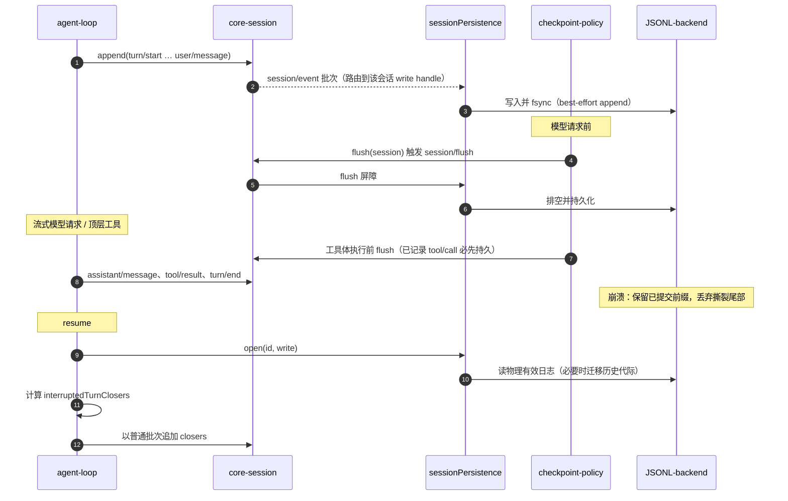
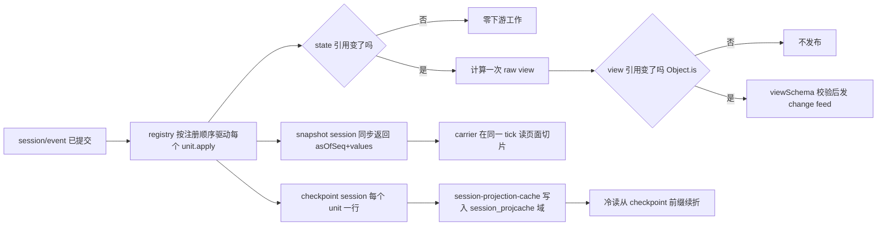
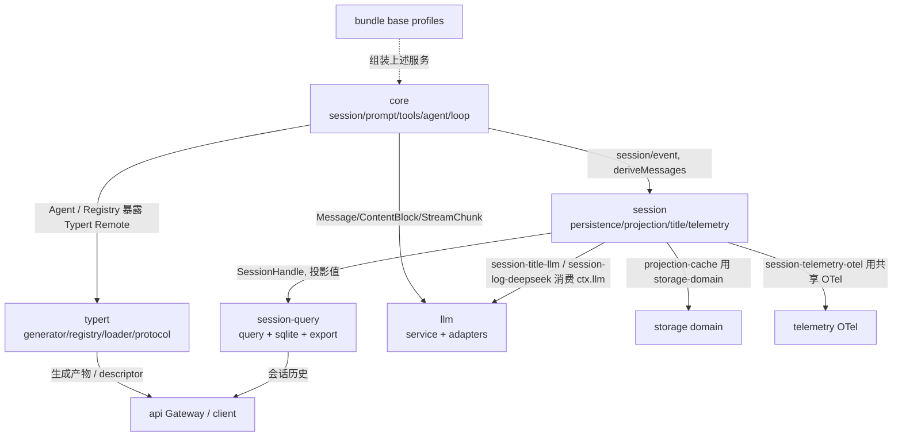

# 01 — 内核与会话运行时（core / session / session-query / typert）

> **一句话总结**：core 是 agent 内核，session 是可恢复账本，session-query 是检索台，typert 是类型化 RPC 通道。

> **适用版本**：DeepSeek Harness `0.2.1-alpha.2`（`master` @ `d743267388`）· 核对日期 2026-10-12

| 项目 | 内容 |
|---|---|
| 回答的问题 | 一次 agent 运行如何变成可恢复的事件日志？日志如何投影成客户端可读状态？历史如何被检索？Host 能力如何以类型化方法暴露给远端？ |
| 适合读者 | 需要理解或扩展 DSH 的 agent 生命周期、会话持久化、投影、检索与 Typert RPC 的工程师 |
| 前置阅读 | [00-项目全景](../00-项目全景.md)、[01-系统架构](../01-系统架构.md) |
| 本卷覆盖 | `packages/core`（8 包）、`packages/session`（21 包）、`packages/session-query`（3 包）、`packages/typert`（4 包） |
| 主要来源 | 见下方「来源表」 |

### 来源表

| 来源 | 用途 |
|---|---|
| `packages/core/README.md`、`packages/session/README.md`、`packages/session-query/README.md`、`packages/typert/README.md` | 组级职责、包清单、ctx key |
| 四组下每个子包的 `README.md` | 包级职责、配置、机制、扩展点 |
| `docs/subsystems/core.md` | core 六包的循环协作、`agent/pre-step` 与 `agent/request-error` 决策 |
| `docs/subsystems/session.md` | `SessionEventMap`、surface、事件 envelope |
| `docs/subsystems/persistence.md` | `SessionHandle`、flush checkpoint、崩溃恢复 |
| `docs/subsystems/session-projection.md` | `ProjectionDefinition`、snapshot 与 change feed |
| `docs/subsystems/session-query.md` | 逻辑记录、过滤器、搜索页、lineage |
| `docs/subsystems/session-title.md`、`docs/subsystems/session-telemetry.md` | 标题与遥测 seam |
| `docs/subsystems/typert.md` | lookup/context、invocation descriptor、registry、gateway |
| `docs/subsystems/system-prompt.md`、`docs/subsystems/tools.md`、`docs/subsystems/scope.md`、`docs/subsystems/working-directory.md` | 相邻机制 |
| `packages/core/session/src/types.ts`、`packages/core/session/src/known-event-types.ts`、`docs/session-format-status.md` | 格式版本与事件词表核验 |
| 各组包的 `package.json` | 组间/包间依赖核验 |

## 一、通俗理解（先读这一节）

### 1.1 会话不是「消息列表」，而是一本只追加的账本

DSH 把一次 agent 交互记录成一条条带类型的事件（event），按单调递增的 `seq` 追加。模型看到的消息历史不是独立存储的，而是从这本账本推导（derive）出来的。
来源：`docs/subsystems/core.md`、`packages/core/session/README.md`

### 1.2 core 是「发动机」，session 是「档案室」

`packages/core` 定义 agent 的公共接口、循环、prompt 与工具 registry；`packages/session` 把账本落盘、投影给界面、起标题、发遥测。前者决定「发生什么」，后者决定「如何保存与呈现」。
来源：`packages/core/README.md`、`packages/session/README.md`

### 1.3 session-query 是「检索台」

它不参与写入，只读：跨 live 与 persisted 会话列出、过滤、读原始日志、追踪会话/事件关系，并通过 SQLite FTS5 做带排序的全文搜索。
来源：`packages/session-query/README.md`

### 1.4 typert 是「类型通道」

构建期把 TypeScript 类型抽成编译器无关的模型并生成 schema/声明产物；运行期 registry 保存产物；业务包用 `Remote` 暴露 Host 方法给 Client 作类型化调用。
来源：`packages/typert/README.md`

### 1.5 直觉图

```text
   用户 / 界面 ──prompt──▶ ┌─────────────────────────────────────────────┐
                          │ core/agent-loop（驱动）                     │
                          │  turn → step → 模型请求 → 工具执行          │
                          └───────┬───────────────────────┬─────────────┘
                                  │ append(event)         │ deriveMessages()
                                  ▼                       │
                          ┌─────────────────────────────────────────────┐
                          │ core/session：只追加事件日志（唯一真相）    │
                          │  turn/start … user/message … tool/result …  │
                          └───┬───────────────┬───────────────┬─────────┘
                              │ session/event │ session/flush │ 读日志
                              ▼               ▼               ▼
                  ┌────────────────┐ ┌────────────────┐ ┌──────────────────┐
                  │ session 持久化 │ │ 投影 registry  │ │ session-query    │
                  │ JSONL + 格式链 │ │ stats/outline  │ │ 过滤/溯源/FTS5   │
                  └────────────────┘ └────────────────┘ └──────────────────┘
                              │
                              ▼
                  ┌────────────────┐ ┌────────────────┐ ┌────────────────┐
                  │ title 标题     │ │ telemetry 遥测 │ │ typert RPC 类型│
                  └────────────────┘ └────────────────┘ └────────────────┘
```

图：账本是中心。写入路径与读取路径都从 `core/session` 派生，typert 与它们正交。

## 二、组级说明

| 组 | 职责 | 边界（不做什么） | 包数 | ctx 服务 |
|---|---|---|---|---|
| `packages/core` | agent 公共 API 脊柱：作用域、会话、系统提示、工具 registry、agent 契约、默认模型选择、默认循环 | 不含可运行的产品组装（在 `packages/bundle`）；不实现持久化/检索 | 8 | `ctx.sessions`、`ctx.systemPrompt`、`ctx.tools`、`ctx.agents`、`ctx.agentDefaultModel`、`ctx.agentLoop` |
| `packages/session` | 持久化 seam 与 backend、格式链、checkpoint 策略、投影、标题、遥测、工作目录 | 不做检索/搜索（那是 session-query）；投影不定义领域算法 | 21 | `ctx.sessionPersistence`、`ctx.sessionProjections`、`ctx.sessionProjectionCache`、`ctx.sessionTitle`、`ctx.sessionTelemetry`、`ctx.workingDirectory` |
| `packages/session-query` | 跨 live/persisted 的统一检索：精确读、过滤、关系追踪、全文搜索、Web 导出 | 不写会话日志；不替代持久化 backend | 3 | `ctx.sessionQuery`、`ctx.sessionLogDownload` |
| `packages/typert` | 构建期类型图生成、产物加载、运行期 registry、RPC 协议声明 | 不运行业务逻辑；registry 不做 TypeScript 分析 | 4 | `ctx.typert`（registry 提供，loader 消费） |

来源：`packages/core/README.md`、`packages/session/README.md`、`packages/session-query/README.md`、`packages/typert/README.md`

关键边界：

- `packages/session` 内部按四族划分：持久化、投影、标题、遥测；每族各自拥有契约与配置。来源：`packages/session/README.md`
- `packages/core` 只拥有「可替换的脊柱零件」，`dsh-base` 才是默认产品组装。来源：`packages/core/README.md`
- `packages/typert` 的 generator 只在构建时运行，绝不在 agent 会话中运行。来源：`packages/typert/generator/README.md`

## 三、包级条目表

### 3.1 core（8 包）

| 包 | 职责 | 关键导出 / 类型 | 依赖的 seam | 来源 README |
|---|---|---|---|---|
| `packages/core/scope` | 无依赖作用域原语：子 scope 继承祖先贡献、最近定义优先；祖先可观察后代，反之不行；销毁移除全部 | `createScope`、`scopeOf`、`scopeTarget`、`ScopeKey`、`ScopedLayers` | 被 session/system-prompt/tools/agent 的 registry 复用（peer `dsh-scope`） | `packages/core/scope/README.md` |
| `packages/core/session` | 只追加 `SessionEvent` 日志与内存 store；派生模型历史、fork、flush、surface 替换 | `SessionStore`、`Session`、`SessionEventMap`、`deriveMessages`、`SessionSeq`、`SurfaceOp` | peer `dsh-scope`；依赖 `dsh-llm` 的 Message/ContentBlock | `packages/core/session/README.md` |
| `packages/core/system-prompt` | 由有序 section、动态 context、变量与工具 schema 组装一份 system prompt | `SystemPrompt`、`PromptSection`、`PromptContext`、`renderPrompt`、`toolOrder` | peer `dsh-scope`、`dsh-llm`（ToolSchema） | `packages/core/system-prompt/README.md` |
| `packages/core/tools` | 工具 registry 与受守卫的执行流水线；native Function Calling 或 PTC 模式 | `ToolRuntime`、`defineTool`、`ToolDefinition`、`ToolSchema`、`ToolGuard`、`RunCodeBridgeOptions` | peer `dsh-scope`、`dsh-session`、`dsh-system-prompt`、`dsh-ptc-runtime`、`dsh-user-approval`、`dsh-sandbox` | `packages/core/tools/README.md` |
| `packages/core/agent-tool-presentation` | 按 preset 选择模型看到 native 全量 schema 还是仅 `run_code` | 函数插件 `apply` / `Config`（`mode`） | preset 装配；选择 `ptc` 需兼容的 PTC runtime | `packages/core/agent-tool-presentation/README.md` |
| `packages/core/agent` | 公共 `Agent` 契约、live registry、initiator scope、`agent/*` 事件 | `Agent`、`AgentHandle`、`AgentRegistry`、`PreStepDecision`、`Inbox`、`AgentFactory` | peer `dsh-session`、`dsh-session-projection`、`dsh-system-prompt`、`dsh-llm`、`dsh-typert-protocol` | `packages/core/agent/README.md` |
| `packages/core/agent-default-model` | 新 agent 的部署级默认 provider / model / reasoningEffort | `AgentDefaultModelConfig`、`ctx.agentDefaultModel` | 读写 active profile patch | `packages/core/agent-default-model/README.md` |
| `packages/core/agent-loop` | `Agent` 契约的默认实现：创建/恢复 agent，驱动 turn 与 step | `AgentLoop`、`ReactLoopAgent`、`ReactLoopInbox`、`maxParallelToolCalls` | peer `dsh-agent`、`dsh-llm`、`dsh-session`、`dsh-session-persistence`、`dsh-tools` | `packages/core/agent-loop/README.md` |

### 3.2 session（21 包）

| 包 | 职责 | 关键导出 / 类型 | 依赖的 seam | 来源 README |
|---|---|---|---|---|
| `packages/session/session-format` | 纯粹的相邻格式链与产物校验库；一次消费物理行 | `createSessionFormatCatalog`、`createSessionFormatChain`、`defineSessionFormatMigration`、`SessionFormatCodec` | 无 ctx key（库） | `packages/session/session-format/README.md` |
| `packages/session/session-format-v0-to-v1` | 冻结的已发布 v0 解码与身份迁移 | `restoreV0ToV1`、`releasedV0SessionFormatCodec`、`RELEASED_V0_EVENT_TYPES` | 无 ctx key | `packages/session/session-format-v0-to-v1/README.md` |
| `packages/session/session-format-v1-to-v2` | 冻结 v1→v2：把 `assistant/chunk` 嵌回 `assistant/message`，补 `assistant/attempt` | `sessionFormatV1ToV2`、`releasedV2SessionFormatCodec` | 无 ctx key | `packages/session/session-format-v1-to-v2/README.md` |
| `packages/session/session-format-v2-to-v3` | v2→v3：system prompt 提升为 message、引用重映射、PTC/preset 名翻译 | `sessionFormatV2ToV3`、`releasedV3SessionFormatCodec` | 无 ctx key | `packages/session/session-format-v2-to-v3/README.md` |
| `packages/session/session-format-v3-to-v4` | v3→v4：提升 tool result、重命名 message source、闭合中断 turn、补 parent catalog | `sessionFormatV3ToV4`、`releasedV4SessionFormatCodec`、`validateDeliveryAccepted` | 无 ctx key | `packages/session/session-format-v3-to-v4/README.md` |
| `packages/session/session-format-catalog` | 静止的已发布相邻迁移目录；含全部历史 reader，profile 无法增删 | `sessionFormatCatalog`、`createSessionFormatCatalogWithChildren`、`historicalSessionFormatCatalog` | 依赖 `dsh-session` 当前词表；附带 `dsh-compaction-image-offload` 的 message projection | `packages/session/session-format-catalog/README.md` |
| `packages/session/session-persistence` | 定义持久化服务与共享写协调；handle 化读写 | `SessionPersistence`、`SessionHandle`、`validateStoredEvents`、`SessionAlreadyOwnedError` | peer `dsh-session`、`dsh-brand`、`dsh-timeout` | `packages/session/session-persistence/README.md` |
| `packages/session/session-persistence-jsonl` | 第一方 JSONL backend：每会话不可变代际文件，默认 zstd 帧 | `Config`（`root` / `compression`）、`JsonlSessionHandle`、`scanLog` | 注册在 `ctx.sessionPersistence`；依赖 `session-format*` | `packages/session/session-persistence-jsonl/README.md` |
| `packages/session/session-checkpoint-policy` | 三个屏障：模型请求前、顶层工具体执行前、每个 `agent/pre-step` | 函数插件 `apply`（无配置） | 包 `llm/stream`、`tools/execute`、`agent/pre-step` | `packages/session/session-checkpoint-policy/README.md` |
| `packages/session/session-log-deepseek` | 把增量 canonical 日志作为官方 DeepSeek 请求元数据上传 | `DeepSeekSessionLogExtension`、`acceptedThrough`、`dsh_session_log` | 贡献 `ctx.deepseekLlmApiExtensions` | `packages/session/session-log-deepseek/README.md` |
| `packages/session/session-projection` | 定义并驱动投影单元，把已提交事件折叠成整值 | `SessionProjectionRegistry`、`ProjectionDefinition`、`ProjectionSnapshot`、`asOfSeq` | peer `dsh-session`（`session/event`） | `packages/session/session-projection/README.md` |
| `packages/session/working-directory` | 每会话有效执行目录与 user-context 变更 | `WorkingDirectoryService`、`Config` | peer `dsh-session`、`dsh-session-projection`、`dsh-fs`、`dsh-system-prompt` | `packages/session/working-directory/README.md` |
| `packages/session/tool-working-directory` | 一个工具读/切目录，委托给 working-directory | 工具 `working_directory` | peer `dsh-tools`、`dsh-working-directory` | `packages/session/tool-working-directory/README.md` |
| `packages/session/session-projection-cache` | 持久化投影 checkpoint，冷读跳过整段日志 | `SessionProjectionCache`、`session_projcache` 域 | peer `dsh-session`、`dsh-session-projection`、`dsh-storage-domain` | `packages/session/session-projection-cache/README.md` |
| `packages/session/session-stats` | `sessionStats` 单元：整会话 turn/step 计数与各段 wall time | `sessionStatsProjectionDefinition`、`SessionStatsProjection` | 注册在 `ctx.sessionProjections` | `packages/session/session-stats/README.md` |
| `packages/session/session-turn-outline` | `turnOutline` 单元：整会话 turn 大纲（turn、`turn/start` seq、prompt 预览） | `turnOutlineProjectionDefinition`、`TurnOutlineEntry` | 注册在 `ctx.sessionProjections` | `packages/session/session-turn-outline/README.md` |
| `packages/session/session-title` | 日志派生的会话标题：确定性 fallback + 可选 provider + 显式重命名 | `SessionTitleService`、`foldSessionTitle`、`fallbackSessionTitle`、`SessionTitleProvider` | peer `dsh-session`、`dsh-session-projection`、`dsh-agent` | `packages/session/session-title/README.md` |
| `packages/session/session-title-llm` | provider 共用的有界标题执行模块 | `executeSessionTitleLlm`、`resolveSessionTitleLlmConfig` | peer `dsh-llm`、`dsh-session-title` | `packages/session/session-title-llm/README.md` |
| `packages/session/session-title-first-prompt-llm` | `first-prompt` 节奏 provider：用首条合格人类消息起标题 | 函数插件 `apply` | 注册在 `ctx.sessionTitle` | `packages/session/session-title-first-prompt-llm/README.md` |
| `packages/session/session-telemetry` | 捕获会话活动并交给唯一 reporting backend；redaction waterfall | `SessionTelemetryBackend`、`SessionTelemetryCoordinator`、`session-telemetry/record` | peer `dsh-agent`、`dsh-session` | `packages/session/session-telemetry/README.md` |
| `packages/session/session-telemetry-otel` | 通过 OpenTelemetry logs 投递；仅 `FEEDBACK_ONLY` / `DISABLED` | `OpenTelemetrySessionBackend`、`SessionTelemetryMode` | 注册在 `ctx.sessionTelemetry`；依赖共享 `dsh-otel` | `packages/session/session-telemetry-otel/README.md` |

### 3.3 session-query（3 包）

| 包 | 职责 | 关键导出 / 类型 | 依赖的 seam | 来源 README |
|---|---|---|---|---|
| `packages/session-query/session-query` | 统一检索服务：精确读、过滤、关系追踪；全文搜索为抽象面 | `SessionQueryEngine`、`SessionQueryError`、`SessionEventRecord`、`traceSession` / `traceEvent` | peer `dsh-session`、`dsh-session-persistence`、`dsh-session-title`、`dsh-session-projection`、`dsh-session-projection-cache` | `packages/session-query/session-query/README.md` |
| `packages/session-query/session-query-sqlite` | SQLite FTS5 排序全文搜索 backend；派生索引数据库 | `SqliteSessionQueryEngine`、`openSearchDatabase`、`Config`（`path` / `openAt`） | 注册在 `ctx.sessionQuery`；peer `dsh-session`、`dsh-session-persistence` | `packages/session-query/session-query-sqlite/README.md` |
| `packages/session-query/session-log-export` | Web `/export` 命令与浏览器 ZIP 下载 | `SessionLogDownloadController`、`streamSessionLogZip`、`/api/session.export` | 依赖 Connection、commands、session persistence、attachments | `packages/session-query/session-log-export/README.md` |

### 3.4 typert（4 包）

| 包 | 职责 | 关键导出 / 类型 | 依赖的 seam | 来源 README |
|---|---|---|---|---|
| `packages/typert/generator` | 构建期分析源码类型，生成 schema 工厂、声明与 Remote descriptor | `WorkspaceAnalyzer`、`FaceModelEmitter`、`WorkspaceTypertGenerator`、`typertPlugin`、`TypeGraph` | 构建管线（tsdown）与 tsconfig 面 | `packages/typert/generator/README.md` |
| `packages/typert/registry` | 运行期保存反射、lazy Zod schema 工厂与 Remote descriptor，并提供 lookup/context provider registry | `TypertRegistry`、`TypertContribution`、`ctx.typert` | 无 ctx 依赖；提供 `ctx.typert` | `packages/typert/registry/README.md` |
| `packages/typert/loader` | Loader 组合中自动注册各包生成的 Typert 产物 | 函数插件 `apply`、`validateTypertManifest` | 消费 `ctx.loader` 与 `ctx.typert` | `packages/typert/loader/README.md` |
| `packages/typert/protocol` | Remote 调用声明：`Remote` / `RemoteScope`、wire descriptor、codec、provider 契约 | `Remote`、`bindTypertRemote`、`RemoteError`、`InvocationDescriptor`、`RemoteStream` | 被业务包、生成产物、Gateway、Client 消费 | `packages/typert/protocol/README.md` |

## 四、核心机制深入讲解

### 4.1 session 事件模型与持久化 seam

**事件 envelope**：每个 `SessionEvent` 有 `type`、单调 `seq`、`time`、`data`，以及可选的 `ignorable: true`；surface 变体额外带 `surfaceOp` 与 `sourceEventSeqs`。
来源：`packages/core/session/src/types.ts`

- 不认识的 `type` 若没有 `ignorable` 标记，reader 必须拒绝重建会话，而不是静默跳过。来源：`packages/core/session/src/types.ts`
- `SessionEventMap` 通过 declaration merging 可扩展；core 声明十三个核心变体（`turn/start`、`turn/end`、`step/start`、`step/end`、`user/message`、`system/message`、`assistant/message`、`assistant/attempt`、`tool/call`、`tool/result`、`request/header`、`request/context`、`session/end-seed`），`developer/message` 也在同一声明块中。来源：`docs/subsystems/core.md`、`docs/subsystems/session.md`

**surface（模型可见面）**：`SurfaceEventType` 是闭集 `system/message`、`developer/message`、`user/message`、`assistant/message`、`tool/result`；只有这些事件可带 `surfaceOp`（`'append'` 或 `{ op: 'replace', startSeq, endSeq }`）。
来源：`packages/core/session/src/types.ts`

- 替换必须覆盖所有被遮蔽 surface node；assistant message 内嵌自己的 provider stream，禁止 `sourceEventSeqs`。来源：`packages/core/session/README.md`
- `compaction/*` 是 log-only 事件，不进入 `SurfaceEventType`，摘要本身改由一条 `user/message` 替换承载。来源：`docs/subsystems/compaction.md`

**seq 类型**：`SessionSeq`（已存在事件/闭区间水位）、`SessionLogOffset`（间隙/前缀长度，可等于事件数）、`SessionSeqCursor`（`-1` 表示空日志）、`OptionalSessionSeq`（`null` 表示缺失本身是数据）。
来源：`packages/core/session/src/types.ts`、`packages/core/session/README.md`

**当前格式版本**：`SESSION_FORMAT_VERSION = 4`。来源：`packages/core/session/src/types.ts`；`latestFinalizedVersion: 4`。来源：`docs/session-format-status.md`

**持久化 seam**：`SessionPersistence` 只导出抽象服务、`SessionHandle` 契约、稳定错误类、纯校验 helper 与 branded revision；每个 provider 自带完整存储运行时。
来源：`packages/session/session-persistence/README.md`

每个 backend 必须遵守的不变量：

1. 只追加、`seq` 连续；`append` 的首个 seq 必须等于已存 next-seq。
2. 撕裂的物理尾部绝不进入 reader。
3. 无损 JSON；`materializeAppendBatch` / `materializeCreateHeader` 单遍校验并快照。
4. `append` 是 best-effort，`flush`（单 handle 或服务级）才是持久化屏障。
5. fail-closed 读取：`validateStoredEvents` 拒绝未知词表与退役形状。
6. 每个 backend 实例每会话单写者。

来源：`packages/session/session-persistence/README.md`

**JSONL backend**：`root` 必填；`compression` 默认 `'zstd'`（校验和帧），可选 `'none'`（逐行 UTF-8）。当前 writer 每个 durable event 一行/一帧，历史代际保持不可变。
来源：`packages/session/session-persistence-jsonl/README.md`

**崩溃恢复**：resume 通过写 handle 读存储日志，计算 `interruptedTurnClosers`（合成 `tool/result` 错误、未闭合 `step/end`、`turn/end {interrupted}`），作为普通批次追加。存储只返回物理有效日志，语义修复属于 reader。
来源：`packages/session/session-persistence/README.md`、`docs/subsystems/persistence.md`

### 4.2 投影 / reference / title / telemetry

**投影单元**：一个 `ProjectionDefinition` 含 `key`、`stateSchema`、`init(header, inheritedEventCount)`、纯同步 `apply(state, event)`、可选 `wire`（`viewSchema` + `view`）与 `stateVersion`。
来源：`docs/subsystems/session-projection.md`

- 不关心的事件必须返回同一 state 引用（`Object.is` 门），否则会产生无用下游工作。
- `snapshot(session)` 同步返回 `{ asOfSeq, values }`；carrier 在同一 tick 读页面切片，`asOfSeq` 就是一致切点。
- `init` 不能从 `firstLiveSeq` 或 `session/end-seed` 推断 inherited cut。
- `checkpoint(session)` 给每个单元（含 host-only）一行；`session-projection-cache` 负责持久化。

来源：`packages/session/session-projection/README.md`、`docs/subsystems/session-projection.md`

**内建投影单元**：`sessionStats`（turns/steps/llmMs/toolMs/ttft/decode）、`turnOutline`（每个 turn 的 `turn/start` seq 与预览）、`title` 与 host-only `titleInput`、token-meter 的 `tokenUsage` / `contextPressure` / `contextBreakdown`。
来源：`packages/session/session-stats/README.md`、`packages/session/session-turn-outline/README.md`、`packages/session/session-title/README.md`、`packages/llm/token-meter/README.md`

**投影缓存**：记录写在 `session_projcache` 域，每个 session 一条 version-stamped 记录；日志领先、缓存跟随，崩溃只会让缓存落后。必写点：session 创建、`turn/end`、session disposal，其余按 `writeEveryEvents` / `writeIntervalMs` 节流。
来源：`packages/session/session-projection-cache/README.md`

**标题**：标题是 log-only 状态，每次接受的修订是一条 `session/title` 事件，`foldSessionTitle()` 取最新。三个来源：内建 fallback、注册 provider、显式 `rename()`。标题永不进入模型输入。
来源：`packages/session/session-title/README.md`

- 同时只允许一个 provider；第二个注册会抛错直到第一个开始销毁。
- `session-title-llm` 解析路由、限制输入/输出/时长、记录精确 model-visible 请求、组装流。

来源：`packages/session/session-title/README.md`、`packages/session/session-title-llm/README.md`

**遥测**：唯一 backend 实现三个成员 `emit`（非阻塞入队）、可选 `flush`、`shutdown`；`session-telemetry/record` waterfall 只改 outbound 副本，canonical 日志永不重写。`session-telemetry-otel` 只支持 `FEEDBACK_ONLY` / `DISABLED`。
来源：`packages/session/session-telemetry/README.md`、`packages/session/session-telemetry-otel/README.md`

**session-log-deepseek**：把最长的未确认连续后缀作为 `dsh_session_log` 字段上传；HTTP 2xx 后 append `delivery-accepted` 水位；崩溃后可能重发，是 at-least-once。
来源：`packages/session/session-log-deepseek/README.md`

**工作目录**：有效目录由 session projection 拥有；变更按 Session 串行、经 fs provider 校验、提交事件并排队一条 user-context 通知。
来源：`packages/session/working-directory/README.md`

### 4.3 core 的 agent 服务与 loop

**职责分离**：`Agent` 公共面与 registry 在 `dsh-agent`；构造与驱动在 `dsh-agent-loop`，通过注册的 factory 解耦。扩展插件依赖 `dsh-agent`，从不直接依赖 `dsh-agent-loop`。
来源：`packages/core/agent/README.md`、`docs/subsystems/core.md`

**agent 创建/恢复**：`ctx.agents.create()` 在单一身份下建新 agent 与 session；`resume()` 载入持久会话重建 agent；两者返回 `AgentHandle`，其 `dispose()` 拥有精确拆卸。`parentAgent` 决定 runtime child / root。
来源：`packages/core/agent/README.md`

**inbox 与驱动方法**：`followup()` 排队下一 turn、`steer()` 提交下一步输入并唤醒、`inject()` 只加模型可见上下文不唤醒、`cancel()` 中止活动。每次 inbox 变更提交一条规范化 `agent/inbox/spliced` 事件。
来源：`packages/core/agent/README.md`、`packages/core/agent-loop/README.md`

**step 准入**：`agent/pre-step` 返回 `{ kind: 'reject' }` 或 `{ kind: 'enter', messages, startsRequestSeries? }`；接受不等于提交，route 解析后才提交 system prompt 与 user 批次。
来源：`docs/subsystems/core.md`

**loop 的 turn/step 流程**：turn 边界打开 durable turn，原子认领 next-step 输入与一条 queued prompt；每个 step 组装 prompt 与工具，跑 `agent/pre-step`，然后 `step/start` → `agent/request` → `prepareCall()` → 追加 user 批次 → 记 header/context → 流式模型请求 → 工具执行 → 写回日志。
来源：`packages/core/agent-loop/README.md`

- 每次请求刷新运行时事实但不重新组装已绑定 prompt/tools；retry 复用同一渲染，不重复 `agent/pre-step` 与 user 准入。
- 取消是协作式的；已交付文本保留；取消后未派发的工具调用补合成 `tool/call` + `ABORTED_BEFORE_DISPATCH` 对。
- 失败 step 关闭前为每个未回答工具调用补错误结果（`TOOL_OUTCOME_UNKNOWN` 或 `TOOL_NOT_STARTED`）。

来源：`packages/core/agent-loop/README.md`

**持久化集成**：loop 是生产 write handle 的获取点；有 `ctx.sessionPersistence` 时 create 先 `persistence.create(header)` 拿写所有权再发布，resume 先 `open(id, 'write')`。teardown 在 driver 提完关闭事件后 close handle。
来源：`packages/core/agent-loop/README.md`

**system prompt 与工具**：`ctx.systemPrompt` 合并 global 层与 scope 层，按 order（同序按名称 code-unit）排序，跑 scope-filtered `system-prompt/assemble` waterfall，支持 `complete: true` 唯一完整 section。`ctx.tools` 保存作用域化 `ToolDefinition`，请求时投影为 `ToolSchema`；执行流水线固定为 `tools/pre-execute` → guards → `tools/execute` → `projectContent` → `tools/post-execute` → finalizeContent → `tools/result`。
来源：`packages/core/system-prompt/README.md`、`packages/core/tools/README.md`

### 4.4 typert 的类型图与 RPC 类型产物

**构建期**：`WorkspaceAnalyzer` 从 face aggregate tsconfig 建立独立 Host/Client TypeScript 程序，产出编译器无关的 `FaceModel` 与 `TypeGraph`；`FaceModelEmitter` 只消费模型，不接触 compiler node。
来源：`packages/typert/generator/README.md`

- 贡献包通过 `package.json` 声明 `./typert`（可选 `./client/typert`、`./remote`）导出；生成的声明文件把 `TYPERT` 暴露为 `unknown`，贡献包因此不依赖运行期 registry。
- 不支持的 Zod 投影以 `TypertEmitError` 失败，而不是降级源类型。
- `typertPlugin()` 在 tsdown 构建中降低装饰器并发射 face 产物。

来源：`packages/typert/generator/README.md`

**运行期 registry**：`ctx.typert` 存反射、lazy schema 工厂与 invocation descriptor；注册是原子、fiber-scoped，disposer 精确撤销。key 形如 `<package>#<face>`（反射）、`<package>#<name>`（schema）、`<namespace>/<method>`（endpoint）。
来源：`packages/typert/registry/README.md`

**protocol**：`Remote` / `RemoteScope` 在 Service prototype 上写版本化 descriptor；`bindTypertRemote()` 绑定 service 到 wire namespace；`TypertLookupMap` / `TypertContextMap` 通过 declaration merging 声明 Host 对象与 scoped Context 的 wire 身份。
来源：`packages/typert/protocol/README.md`、`docs/subsystems/typert.md`

**错误模型**：唯一 `RemoteError` 类承载 `<domain>/<reason>` code 与 code-typed details；调用方按 `code` 判别，绝不 `instanceof`；跨 realm 用结构标记 `remoteErrorOf()`。
来源：`packages/typert/protocol/README.md`

**loader**：`dsh-typert-loader` 扫描 Loader 条目，注册其生成产物，条目或插件卸载时撤销；无 `./typert` 的包静默跳过。
来源：`packages/typert/loader/README.md`

### 4.5 session-query 的检索与全文搜索

**一个分离、三个承诺**：live-preferred 逻辑语料（live `ctx.sessions` 优先，`ctx.sessionPersistence` 补足，header 冲突则失败）；返回 detached clone；精确读/过滤/追踪在本包实现一次，只有两个全文方法抽象给 backend。
来源：`packages/session-query/session-query/README.md`

**操作面**：`listSessions`、`readSession`、`filterSessions`、`filterEvents`、`readEvent`、`listEvents` / `readSurface`、`traceSession` / `traceEvent`、`searchSessions` / `searchEvents`。
来源：`packages/session-query/session-query/README.md`

**surface 一致性**：`listEvents`、`readSurface`、`traceEvent` 共用同一次 `foldSurface`，把事件分类为 `current` / `shadowed` / `log-only`，因此搜索与追踪和模型历史推导一致。
来源：`packages/session-query/session-query/README.md`、`docs/subsystems/session-query.md`

**text 过滤器不等于全文搜索**：`text` 是字面、大小写不敏感、空白灵活的子串扫描；排序全文搜索需要如 `dsh-session-query-sqlite` 的 backend。
来源：`packages/session-query/session-query/README.md`

**SQLite FTS5 backend**：派生索引数据库（application id、schema version 8），永不打开 session-persistence 库；`openAt` 可选 `startup` / `first-search` / `never`；查询文本作为一个 FTS5 phrase，语法字符当数据；游标按 generation 绑定，语料变化后报 `SESSION_QUERY_STALE_CURSOR`。
来源：`packages/session-query/session-query-sqlite/README.md`

## 五、扩展点清单

| 扩展点 | 位置 | 作用 |
|---|---|---|
| 自定义持久化 backend | 实现 `SessionPersistence` / `SessionHandle` | 替换 JSONL 存储；必须满足 6 条不变量 |
| 消息投影 | `messageProjection` + `ctx.sessions.registerMessageProjection()` | 让插件拥有改变模型可见内容的纯解释器 |
| 实验性插件记录 | `appendPluginRecord()` | 仅 `packages/experimental/` 下包可写；`ignorable: true` |
| 投影单元 | `ctx.sessionProjections.register(definition)` | 把领域日志状态折叠成客户端整值 |
| 标题 provider | `ctx.sessionTitle.register(provider)` | 同时仅一个；模型支撑的 provider 走 `session-title-llm` |
| 遥测 backend | 实现 `SessionTelemetryBackend` | 唯一；可挂 `session-telemetry/record` redaction |
| 请求字段贡献 | `ctx.deepseekLlmApiExtensions.register(field, provider)` | 给官方 DeepSeek 请求加 top-level 字段 |
| agent 生命周期事件 | `agent/pre-step`、`agent/request-error`、`agent/turn-stopping`、`agent/assistant-stream` 等 | 拦截/观察在途工作，不需改 loop |
| agent 作用域注册 | `Agent.ctx` | 工具、prompt section、变量、监听器只作用于该 agent |
| Agent driver 替换 | 注册 `AgentFactory` 到 `ctx.agents` | 替换默认循环 |
| prompt section / variable / tool provider | `ctx.systemPrompt.section()` / `variable()`、tool provider | 组装 system prompt 与工具 schema |
| 工具流水线 | `ctx.tools.register()` / `guard()` 与 `tools/*` waterfall | 注册工具、加守卫、包装 dispatcher |
| Typert Remote | `Remote`、protocol maps、`ctx.typert.register()` | 暴露 Host 能力为类型化远端调用 |
| 检索 backend | 实现抽象 `SessionQueryEngine` 的搜索方法 | 替换/新增全文搜索实现 |

来源：各包 README（见第三节）与 `docs/subsystems/core.md`、`docs/subsystems/typert.md`

## 六、关键流程时序

### 6.1 事件写入、checkpoint 与崩溃恢复



图：模型请求前、工具体执行前、每个 `agent/pre-step` 边界三个 checkpoint 让崩溃后可以从已存请求、工具调用与结果恢复。

### 6.2 投影驱动与 checkpoint



图：框架驱动、领域计算；`snapshot` 与 change feed 共用同一次 fold 结果。

## 七、依赖关系图（组与组之间）



图：实线为 `package.json` 中可核验的 `dependencies` / `peerDependencies` 方向，虚线为组装关系。来源：各包 `package.json` 与各包 README。

## 八、常见误解

1. ❌ `packages/session` 只是「写 JSONL 文件」。✅ 它是四族：持久化 seam 与 backend、投影、标题、遥测；JSONL 只是唯一的第一方 persistence provider。来源：`packages/session/README.md`
2. ❌ Session 保存模型消息历史。✅ 它只保存事件日志，模型历史由 `deriveMessages()` 从日志派生并缓存。来源：`packages/core/session/README.md`
3. ❌ 替换或 compaction 会删除被覆盖的历史。✅ 原事件留在 append-only 日志，surface 只做位置替换，replay 确定性重现。来源：`packages/compaction/compaction/README.md`、`docs/subsystems/compaction.md`
4. ❌ `append()` 返回后数据一定已持久。✅ `append` 是 best-effort；只有 resolved `flush` 才承诺崩溃后存活。来源：`packages/session/session-persistence/README.md`
5. ❌ typert 在运行期分析 TypeScript。✅ generator 只在构建时运行；registry 只保存并查找生成产物。来源：`packages/typert/generator/README.md`、`packages/typert/registry/README.md`
6. ❌ `sessionQuery.filterEvents({ text })` 就是全文搜索。✅ 它是字面子串扫描；带排序的 token/phrase 搜索需要 `session-query-sqlite`。来源：`packages/session-query/session-query/README.md`、`packages/session-query/session-query-sqlite/README.md`

## 九、关键文件索引表

| 包路径 | 代表源文件 |
|---|---|
| `packages/core/scope` | `src/index.ts`、`src/store.ts` |
| `packages/core/session` | `src/index.ts`、`src/types.ts`、`src/surface.ts`、`src/request-header.ts`、`src/repair.ts`、`src/fork.ts` |
| `packages/core/system-prompt` | `src/index.ts` |
| `packages/core/tools` | `src/index.ts`、`src/types.ts`、`src/schema.ts`、`src/json-schema.ts`、`src/ptc.ts` |
| `packages/core/agent` | `src/index.ts`、`src/runtime-types.ts`、`src/types.ts`、`src/dispatch.ts` |
| `packages/core/agent-loop` | `src/index.ts`、`src/agent.ts`、`src/inbox.ts`、`src/tool-calls.ts`、`src/runtime-context.ts` |
| `packages/session/session-persistence` | `src/index.ts`、`src/handle.ts`、`src/storage-contract.ts`、`src/errors.ts` |
| `packages/session/session-persistence-jsonl` | `src/index.ts`、`src/storage.ts`、`src/generation.ts`、`src/zstd.ts`、`src/lease.ts` |
| `packages/session/session-format` | `src/index.ts`、`src/chain.ts`、`src/catalog.ts`、`src/filename.ts` |
| `packages/session/session-format-catalog` | `src/generated.ts`、`src/current.ts`、`src/historical.ts` |
| `packages/session/session-projection` | `src/index.ts`、`src/types.ts` |
| `packages/session/session-projection-cache` | `src/index.ts`、`src/spec.ts` |
| `packages/session/session-title` | `src/index.ts`、`src/normalize.ts`、`src/types.ts` |
| `packages/session/session-telemetry` | `src/index.ts`、`src/coordinator.ts` |
| `packages/session/session-telemetry-otel` | `src/index.ts` |
| `packages/session/working-directory` | `src/index.ts` |
| `packages/session-query/session-query` | `src/index.ts`、`src/corpus.ts`、`src/observation.ts`、`src/filters.ts`、`src/tracing.ts` |
| `packages/session-query/session-query-sqlite` | `src/index.ts`、`src/query.ts`、`src/schema.ts` |
| `packages/session-query/session-log-export` | `src/index.ts`、`src/archive.ts`、`src/routes.ts` |
| `packages/typert/generator` | `src/analyzer.ts`、`src/emitter.ts`、`src/model.ts`、`src/workspace.ts`、`src/tsdown-plugin.ts` |
| `packages/typert/registry` | `src/service.ts`、`src/types.ts`、`src/client/index.ts` |
| `packages/typert/loader` | `src/index.ts` |
| `packages/typert/protocol` | `src/index.ts`、`src/types.ts`、`src/remote-error.ts` |

来源：`packages/*/*/src` 目录列举与各包 README 的 Source map。

## 十、延伸阅读

- 仓库内文档：`docs/subsystems/core.md`、`docs/subsystems/session.md`、`docs/subsystems/persistence.md`、`docs/subsystems/session-projection.md`、`docs/subsystems/session-query.md`、`docs/subsystems/session-title.md`、`docs/subsystems/session-telemetry.md`、`docs/subsystems/typert.md`、`docs/api-gateway.md`、`docs/session-format-status.md`
- 本目录：[01-系统架构](../01-系统架构.md)、[模块说明索引](README.md)、[02-模型与上下文](02-模型与上下文.md)、[03-工具与执行环境](03-工具与执行环境.md)、[04-编排自动化与自修改](04-编排自动化与自修改.md)、[05-数据身份与用户状态](05-数据身份与用户状态.md)
