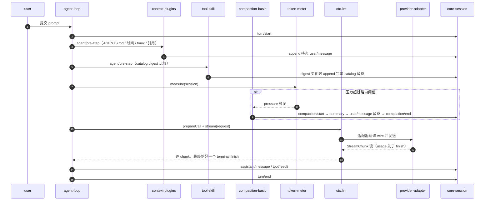
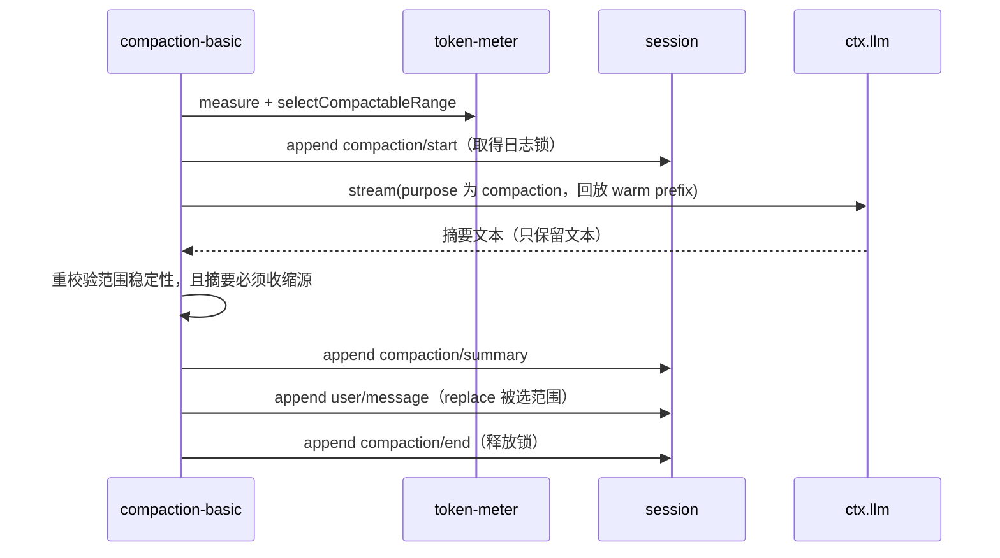
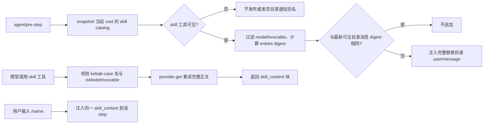
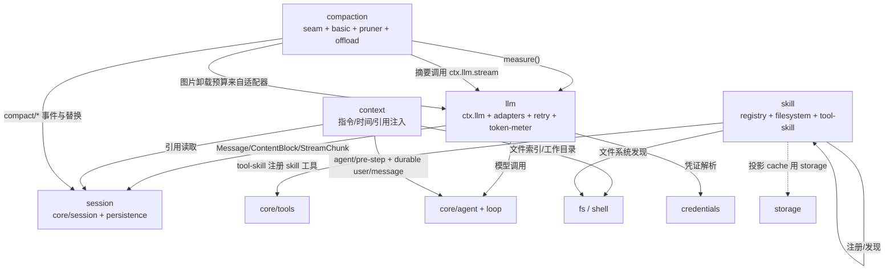

# 02 — 模型与上下文（llm / context / compaction / skill）

> **一句话总结**：llm 抽象模型调用，context 注入请求上下文，compaction 压缩历史，skill 按需加载说明书。

| 项目 | 内容 |
|---|---|
| 回答的问题 | 模型请求如何穿过 provider 适配器到达不同厂商？请求前注入了哪些上下文、以什么形式进入历史？对话过长时如何压缩、压缩的事务边界在哪？技能如何被发现、呈现给模型并按需加载？ |
| 适合读者 | 需要理解或扩展 DSH 的 LLM 接入、上下文注入、压缩策略与技能体系的工程师 |
| 前置阅读 | [01-系统架构](../01-系统架构.md)、[01-内核与会话运行时](01-内核与会话运行时.md) |
| 本卷覆盖 | `packages/llm`（9 包）、`packages/context`（6 包）、`packages/compaction`（5 包）、`packages/skill`（5 包） |
| 主要来源 | 见下方「来源表」 |

### 来源表

| 来源 | 用途 |
|---|---|
| `packages/llm/README.md`、`packages/context/README.md`、`packages/compaction/README.md`、`packages/skill/README.md` | 组级职责、包清单、ctx key |
| 四组下每个子包的 `README.md` | 包级职责、配置、机制、扩展点 |
| `docs/subsystems/llm-streaming.md` | ContentBlock/Message、`StreamChunk` 协议、adapter contract、`LlmFailure`、image pricing |
| `docs/subsystems/compaction.md` | `compaction/*` 事件、`CompactionResult`、service 与 image offload |
| `docs/subsystems/skills.md` | provider registry、本地发现优先级、session catalog 与 tool contract |
| `docs/subsystems/token-meter.md` | `TokenMeasurement`、`TokenSurfaceNode` |
| `docs/subsystems/system-prompt.md` | `AssembleContext`、tool-provider result |
| `packages/compaction/compaction-basic/src/config.ts`、`src/region.ts` | 阈值与区域事务核验 |
| 各组包的 `package.json` | 组间/包间依赖核验 |

## 一、通俗理解（先读这一节）

### 1.1 一次模型请求要过一道「中立翻译层」

上层只认一套消息、内容块与流式 chunk 词表（由 `packages/llm/llm` 声明）；每个 provider 适配器只负责把自己的 wire 格式翻译成这套词表。业务代码永远不 import 具体 provider。
来源：`packages/llm/llm/README.md`

### 1.2 上下文是「注入进对话的持久消息」

工作区指令、当前时间、被引用的其他会话等，都以 user-role 消息进入会话日志，因此能重放、能压缩、能恢复，而不是临时塞进请求。
来源：`packages/context/README.md`

### 1.3 compaction 是「对话太长时的整理」

标记为 `compaction/*` 的日志事件记录锁与摘要，真正改模型可见面的只有一条 `user/message` 替换；被覆盖的原文仍留在日志里。
来源：`packages/compaction/compaction/README.md`、`docs/subsystems/compaction.md`

### 1.4 skill 是「按需加载的说明书」

provider 把技能目录合并到 `ctx.skills`；消费者把目录（名称 + 截断描述）作为持久消息告诉模型，模型再用 `skill` 工具按名加载完整正文。
来源：`packages/skill/README.md`

### 1.5 直觉图

```text
  用户 prompt
      │
      ▼
  ┌─────────────────────────── agent-loop step ───────────────────────────┐
  │  1. 组装 system prompt（ctx.systemPrompt）与工具 schema（ctx.tools）    │
  │  2. context 插件在 agent/pre-step 注入 user/message                     │
  │        AGENTS.md / 时间 / tmux / @file / @session 引用                 │
  │  3. skill 消费者按 digest 追加 <available_skills> 目录                  │
  │  4. token-meter 测量压力 ──▶ 超阈值则 compaction 整理旧历史             │
  │  5. ctx.llm.stream(request) ──▶ provider adapter ──▶ wire              │
  │  6. 结果写回 session：assistant/message、tool/result                   │
  └────────────────────────────────────────────────────────────────────────┘
       ▲                                   │
       │  provider-neutral 词表            │ 适配器只翻译自己的 wire
       └───────────── packages/llm ────────┘
```

图：本卷四个组围绕「一个 step 的请求构造」协作；上下文与压缩都在请求构造前后发生。

## 二、组级说明

| 组 | 职责 | 边界（不做什么） | 包数 | ctx 服务 |
|---|---|---|---|---|
| `packages/llm` | provider-neutral 模型调用服务、provider 适配器、DeepSeek 请求扩展、重试执行、token 计量 | 服务本身没有配置、没有 provider wire；重试不在 `ctx.llm.stream()` 内 | 9 | `ctx.llm`、`ctx.deepseekLlmApiExtensions`、`ctx.tokenMeter` |
| `packages/context` | 在每个请求前注入模型可见上下文，但不定义任何工具 | 只做注入；不拥有检索/持久化能力（引用走 session-query） | 6 | `ctx.sessionReferenceResolver`、`ctx.fileReferences` |
| `packages/compaction` | 把较旧历史压缩成一条摘要，并可选先修剪超大工具输出/卸载图片 | 不做 token 测量（那是 `ctx.tokenMeter`）；不删除日志 | 5 | `ctx.compaction`、`ctx.toolResultPruner` |
| `packages/skill` | 从任意 provider 合并技能目录，并让模型/用户按需加载 | registry 不含技能内容本身；来源由 provider 提供 | 5 | `ctx.skills` |

来源：`packages/llm/README.md`、`packages/context/README.md`、`packages/compaction/README.md`、`packages/skill/README.md`

关键边界：

- `packages/context` 中只有 `agent-instructions` 由 `dsh-base` 默认挂载，其余为 opt-in。来源：`packages/context/README.md`
- `packages/compaction` 只决定「何时与如何压缩」；「是否超压」由 llm 组的 `ctx.tokenMeter` 决定。来源：`packages/compaction/README.md`
- `packages/skill/skill` 本身没有技能内容；模型访问至少需要一个 provider（如 `skill-filesystem`）。来源：`packages/skill/README.md`

## 三、包级条目表

### 3.1 llm（9 包）

| 包 | 职责 | 关键导出 / 类型 | 依赖的 seam | 来源 README |
|---|---|---|---|---|
| `packages/llm/llm` | provider-neutral 流式模型调用：注册适配器、发现模型、解析能力与调用默认值 | `LlmRuntime`、`LlmAdapter`、`StreamChunk`、`ContentBlock`、`BlockAssembler`、`LlmFailure`、`prepareCall` | 提供 `ctx.llm`；依赖 `dsh-brand`、`dsh-util-values`、`dsh-typert-protocol` | `packages/llm/llm/README.md` |
| `packages/llm/llm-deepseek` | 共享 DeepSeek Messages transport、请求配置、模型能力、Files API 与图片处理 | `DeepSeekAdapter`、`serialize`、`translate`、`registerDeepSeekProvider`、`Config` | 依赖 `dsh-llm`；消费 `dsh-deepseek-llm-api-extensions`、`dsh-attachment`、`dsh-fs` | `packages/llm/llm-deepseek/README.md` |
| `packages/llm/llm-deepseek-api-key` | `deepseek-official` 路由的 API-key 认证与发现 | 函数插件 `apply` / `Config` | 注册在 `ctx.llm`；依赖 `dsh-credentials`、`dsh-llm-deepseek` | `packages/llm/llm-deepseek-api-key/README.md` |
| `packages/llm/llm-deepseek-account` | `deepseek-account` 路由的账号 token 认证与失效 | 函数插件 `apply` / `Config` | 注册在 `ctx.llm`；依赖账号 provider | `packages/llm/llm-deepseek-account/README.md` |
| `packages/llm/llm-pi-ai` | 通过 pi-ai catalog 与 wire protocol 服务多 provider 路由，含手声明网关 | `PiAiAdapter`、`ProviderSpec`、`resolveProfiles`、`registerPiAiFlows` | 注册在 `ctx.llm`；依赖 `dsh-credentials`、`dsh-attachment` | `packages/llm/llm-pi-ai/README.md` |
| `packages/llm/deepseek-llm-api-extensions` | 官方 DeepSeek 请求附加 top-level 字段的注册表 | `DeepSeekLlmApiExtensionRegistry`、`prepare`、`PreparedDeepSeekLlmApiExtensions` | 提供 `ctx.deepseekLlmApiExtensions` | `packages/llm/deepseek-llm-api-extensions/README.md` |
| `packages/llm/plugin-package-inventory-deepseek` | 把活跃 Loader 包清单作为官方请求元数据 | 函数插件 `apply`、`dsh_plugin_packages` | 贡献 `ctx.deepseekLlmApiExtensions` | `packages/llm/plugin-package-inventory-deepseek/README.md` |
| `packages/llm/llm-retry` | 在 durable agent-step 边界重试失败的模型请求 | 函数插件 `apply`；`llm/retry`、`llm/retry-started` | 监听 `agent/request-error`；策略来自 provider 的 `retryPolicy` | `packages/llm/llm-retry/README.md` |
| `packages/llm/token-meter` | 从 durable 日志回放估算请求/上下文压力与单价 | `TokenMeter`、`measure`、`estimateMessage`、`TokenSurfaceNode` | 提供 `ctx.tokenMeter`；consumer 含 compaction | `packages/llm/token-meter/README.md` |

### 3.2 context（6 包）

| 包 | 职责 | 关键导出 / 类型 | 依赖的 seam | 来源 README |
|---|---|---|---|---|
| `packages/context/agent-instructions` | 加载 `AGENTS.md`/`CLAUDE.md` 工作区指令链并在文件变更后刷新 | `loadBaselineInstructions`、`renderAgentInstructions`、`Config` | peer `dsh-agent`、`dsh-fs`、`dsh-session`、`dsh-tools`、`dsh-working-directory` | `packages/context/agent-instructions/README.md` |
| `packages/context/session-reference` | 把 `dsh-session:` 提及解析为其他会话的有界只读快照 | `SessionReferenceResolver`、`encodeSessionReferenceUri`、`REFERENCE_WARNING` | 提供 `ctx.sessionReferenceResolver`；消费 `ctx.sessionQuery`、`dsh-spill` | `packages/context/session-reference/README.md` |
| `packages/context/file-reference` | `@file` 提及语法与该 seam；不拥有文件系统访问 | `FileReferenceService`、`activeAtToken`、`formatFileMention`、`FILE_REFERENCE_PROMPT` | 提供 `ctx.fileReferences`；需 provider 实现 | `packages/context/file-reference/README.md` |
| `packages/context/file-reference-local` | 本地工作区的路径补全 provider（排序、缓存、失效） | `LocalFileReferenceService`、`WorkspaceFileSearch`、`DEFAULT_FILE_SEARCH_*` | 注册在 `ctx.fileReferences`；peer `dsh-fs`、`dsh-working-directory` | `packages/context/file-reference-local/README.md` |
| `packages/context/time-context` | 每步注入当前时间、浏览器时区与距上条消息的耗时 | 函数插件 `apply`、`deriveBrowserTimeZoneContext` | peer `dsh-agent`、`dsh-llm`、`dsh-session` | `packages/context/time-context/README.md` |
| `packages/context/tmux-context` | 注入 agent 进程所在 tmux session/window/pane 与 pane 树 | 函数插件 `apply` / `Config` | peer `dsh-agent`、`dsh-shell`、`dsh-session` | `packages/context/tmux-context/README.md` |

### 3.3 compaction（5 包）

| 包 | 职责 | 关键导出 / 类型 | 依赖的 seam | 来源 README |
|---|---|---|---|---|
| `packages/compaction/compaction` | 压缩的共享契约：三个操作、日志锁、工具配对边界、摘要标记 | `CompactionEngine`、`CompactionTrigger`、`CompactionResult`、`ManualCompactionError`、`toolPairingBalancedBefore` | 提供 `ctx.compaction`；依赖 `dsh-session`、`dsh-llm` | `packages/compaction/compaction/README.md` |
| `packages/compaction/compaction-basic` | 默认 backend：压力触发、溢出恢复、区域选择、摘要 | `BasicCompactionEngine`、`resolveCompactSpec`、`summarizeWithLlm` | 注册 `ctx.compaction`；消费 `ctx.tokenMeter`、`ctx.llm` | `packages/compaction/compaction-basic/README.md` |
| `packages/compaction/compaction-tool-result-pruner` | 把超大工具文本裁成 head + 标记 + tail | `ToolResultPruner`、`PRUNE_MARKER`、`ResolvedConfig` | 提供 `ctx.toolResultPruner`；被 basic 调用 | `packages/compaction/compaction-tool-result-pruner/README.md` |
| `packages/compaction/compaction-image-offload` | 在路由拒绝图片预算时记录卸载选择并重试 | `imageOffloadProjection`、`offloadOldestImages` | 监听 `agent/request-error` 与 `compaction/summary-error` | `packages/compaction/compaction-image-offload/README.md` |
| `packages/compaction/command-compact` | `/compact` 命令：按需压缩 | 函数插件 `apply` | 注册在 `ctx.commands`；调用 `ctx.compaction` | `packages/compaction/command-compact/README.md` |

### 3.4 skill（5 包）

| 包 | 职责 | 关键导出 / 类型 | 依赖的 seam | 来源 README |
|---|---|---|---|---|
| `packages/skill/skill` | 合并任意 provider 的技能目录，解析同名胜出者并按需加载正文 | `SkillRegistry`、`SkillProvider`、`SkillCandidate`、`SkillDefinition`、`renderSkillContent` | 提供 `ctx.skills`；peer `dsh-scope`、`dsh-llm` | `packages/skill/skill/README.md` |
| `packages/skill/skill-filesystem` | 从 project/custom/user 根发现技能并 watch 变更 | `FileSystemSkillProvider`、`Config` | 注册在 `ctx.skills`；peer `dsh-fs`、`dsh-home-paths` | `packages/skill/skill-filesystem/README.md` |
| `packages/skill/skill-office` | 打包 Word/PowerPoint/Excel 工作流与结构检查 | 函数插件 `apply` / `Config`（`assetRoot`、`node`、`cli`） | 注册在 `ctx.skills` | `packages/skill/skill-office/README.md` |
| `packages/skill/tool-skill` | 发布 session 技能目录与模型可见的 `skill` 加载工具 | 函数插件 `apply` / `Config`（`catalogDescriptionMaxLength`） | 注册在 `ctx.tools`；消费 `ctx.skills` | `packages/skill/tool-skill/README.md` |
| `packages/skill/tool-workspace-dependencies` | 报告随包 Python/Node/pnpm 的绝对路径与版本 | `workspaceDependencyPaths`、`installPrimaryRuntime` | 注册在 `ctx.tools` | `packages/skill/tool-workspace-dependencies/README.md` |

## 四、核心机制深入讲解

### 4.1 LLM 抽象服务与 provider 适配器边界

**服务职责**：`ctx.llm`（`LlmRuntime`）注册适配器、暴露可配置 provider 目录、发现模型、校验/物化调用配置、执行流式请求。任何要调模型的组件都经它。来源：`packages/llm/llm/README.md`

**共享词表**：`Message`、`ContentBlock`（text/reasoning/tool-call/tool-result/image/file 等）、`StreamChunk` 是闭判别联合（`switch` 以 `assertNever` 收尾）。来源：`docs/subsystems/llm-streaming.md`

- `StreamChunk` 变体：`block-start`、`text-delta`、`reasoning-delta`、`tool-call-delta`、`block-end`、`usage`、`finish`。
- `index` 关联交错 delta；`block-end` 直接带组装好的 `ContentBlock`。
- `usage` 先于 `finish`，`finish` 之后不得再有 chunk；tool 参数全程保持原始 JSON string。

来源：`docs/subsystems/llm-streaming.md`

**每个适配器必须遵守**（节选）：

- 一次适配器调用等于一次 provider 尝试，适配器自身禁用库级重试。
- 两条合法失败路径：从 `stream()` 抛出，或以 `finish` 块（`{ type: 'finish', reason: { kind: 'error' | 'aborted' } }`）结束；两者都归一为 `LlmFailure`。
- provider 停顿由传输层用 `streamIdleTimeoutMs` 界定，超时映射 `TIMEOUT`，更早的调用方取消保持 `ABORTED`。
- 上下文溢出统一为 `CONTEXT_WINDOW_EXCEEDED`。
- 只有 terminal `stop` 且零内容块的响应视为 `EMPTY_RESPONSE` 错误（可重试）。
- 每个 provider HTTP 请求带 app-attribution header。
- `ReplayEnvelope` 是适配器私有：response 级 + 可选 per-block 对齐；只有同一 adapter 实例同时拥有历史与目标路由时才回传。

来源：`docs/subsystems/llm-streaming.md`、`packages/llm/llm/README.md`

**调用准备**：`prepareCall(config, signal, configure?)` 接受具体 `LlmCallConfig`，可选同步纯函数 `ConfigureCall` 基于冻结的控制项与模型元数据选择控制项；准备阶段绑定所捕获的适配器代际，因此 HMR/动态设置不会把一代的图片能力配到另一代端点。来源：`packages/llm/llm/README.md`

**失败码**：`NO_ADAPTER`、`MISSING_CREDENTIAL`、`INVALID_CREDENTIAL`、`AUTH`、`RATE_LIMIT`、`QUOTA`、`ACCOUNT_QUOTA`、`CONTEXT_WINDOW_EXCEEDED`、`IMAGE_OFFLOAD_REQUIRED`、`TIMEOUT`、`TRANSPORT`、`ABORTED` 等；consumer 按 code 路由，不按 message 文本。来源：`packages/llm/llm/README.md`、`packages/llm/llm-deepseek/README.md`

**图片与文件投影**：

- 图片能力路由把 durable `ImageBlock` 引用投影成路由特定的请求版本（Files id 或 inline base64）；文本-only 路由收到确定性占位文本。
- durable `FileBlock` 永不进入任何适配器；请求组装把它们替换为确定的 handle 文本（含只读路径）。
- 路由保留的图片超过 byte/count 预算时以 `IMAGE_OFFLOAD_REQUIRED` 失败，并给出还需卸载的最旧数量 `offloadImages`。

来源：`packages/llm/llm/README.md`、`docs/subsystems/llm-streaming.md`

**图片计价**：声明视觉 token 的适配器实现 `LlmAdapter.imageRequestPricing`；`ctx.llm.imageRequestPricing(provider, model)` 同步解析，供 token-meter 与 compaction 使用。来源：`docs/subsystems/llm-streaming.md`、`packages/llm/llm-deepseek/README.md`

### 4.2 wire extensions：DeepSeek 请求附加字段

**注册表**：`ctx.deepseekLlmApiExtensions.register(field, provider)` 为调用 fiber 保留一个字段；`prepare(request)` 并发准备所有 provider，克隆并冻结返回的 JSON，返回 `{ fields, accept }`；provider 抛错则省略其字段并只记录首个失败。来源：`packages/llm/deepseek-llm-api-extensions/README.md`

**接受语义**：`dsh-llm-deepseek` 在序列化基础请求后准备扩展，HTTP 2xx 后、消费 SSE body 前调用 `accept()`。传输失败/非 2xx 不接受，provider 稍后重发。来源：`packages/llm/llm-deepseek/README.md`、`packages/llm/deepseek-llm-api-extensions/README.md`

**两个内置贡献者**：

| 字段 | 包 | 行为 |
|---|---|---|
| `dsh_session_log` | `packages/session/session-log-deepseek` | 发送 watermark 之后最长连续 canonical 事件后缀；`maxBytes` 默认 8 MiB；accept 后 append `delivery-accepted` 水位；at-least-once |
| `dsh_plugin_packages` | `packages/llm/plugin-package-inventory-deepseek` | 每个请求重读活跃非 group Loader 条目，version-1 字段为 `{ name, version? }`；`enabled` 默认 true |

来源：`packages/session/session-log-deepseek/README.md`、`packages/llm/plugin-package-inventory-deepseek/README.md`

两者都在模型输入之外（不进入 messages/system/tools），KV cache 前缀不变。来源：`packages/session/session-log-deepseek/README.md`、`packages/llm/plugin-package-inventory-deepseek/README.md`

### 4.3 provider 适配器：DeepSeek 与 pi-ai

**`llm-deepseek`（Messages transport）**：

- 默认根 `https://api.deepseek.com/anthropic`，模型与 Files 请求分别追加 `/v1/messages` 与 `/v1/files`。
- 未显式 `models` 时广告 `deepseek-flash`（文本+图片）与 `deepseek-v4-pro`（纯文本），各 1,000,000 token 上下文。
- thinking/`reasoningEffort` 有 `off`/`low`/`high`/`max`；`thinking: disabled` 在插件加载时拒绝非 `off`。
- `systemPromptUpdate: in-history` 的模型会在对应 user/tool-result turn 之后发送新的 system 快照；未声明者把最新快照当 top-level system。
- `toolUpdate` 支持 `addition-only` 与 `in-history`；投影出的 tool 更新变成 system-role 的 `tool_addition`/`tool_removal` 块，并带 `mid-conversation-tool-changes-2026-07-01` beta header。
- 图片默认按 14px patch、3:1 下采样、最多 1024 token/图的目标尺寸，单边最多 4096px，`imageMaxBytes` 默认 2 MiB；优先 Files id，失败时整请求回退 inline base64，一次请求不混用。

来源：`packages/llm/llm-deepseek/README.md`

**两条认证路由**：

| 路由 | 插件 | 凭证 | 失败映射 |
|---|---|---|---|
| `deepseek-official` | `llm-deepseek-api-key` | `x-api-key`，`apiKeyEnv` 默认 `DEEPSEEK_API_KEY`，按请求解析 | 缺失 `MISSING_CREDENTIAL`、格式错 `INVALID_CREDENTIAL` |
| `deepseek-account` | `llm-deepseek-account` | `x-dsh-auth-token`，由账号 provider 解析 | HTTP 401 映射 `ACCOUNT_TOKEN_INVALID`；`QUOTA` 在离开 provider 前改写为 `ACCOUNT_QUOTA` |

来源：`packages/llm/llm-deepseek-api-key/README.md`、`packages/llm/llm-deepseek-account/README.md`

**`llm-pi-ai`（多 provider）**：

- `providers` 字典是全部配置面：每个键即请求用 `GenerateOptions.provider` 选择的路由名。
- 已安装 catalog 提供 endpoint/protocol/模型默认值；`api`/`baseURL`/`models` 让手声明网关无需改代码。
- `models` 整体替换该路由 catalog（未设字段从同名已装模型取默认）；`modelOverrides` 只改个别模型，且与 `models` 互斥。
- `reasoningEfforts` 声明可选思考级别到 wire 拼写的映射；`compat` 调整 system 角色、输出 cap 字段、thinking 传输等。
- 每操作捕获不可变快照，配置变化构建新集合，请求不会中途换配置。
- 支持 OAuth/交互式 key 登录并存入 credential store 的 `llm-pi-ai/<provider id>`；跨进程刷新加锁。

来源：`packages/llm/llm-pi-ai/README.md`

**模型发现**：pi-ai 对已装 catalog 路由直接回答（不发网络请求）；仅未描述路由才用 `GET {baseURL}/models` 或 Anthropic 原生 `/v1/models?limit=1000` 探测。来源：`packages/llm/llm-pi-ai/README.md`

### 4.4 重试与 token 计量

**`llm-retry`**：策略在 provider 适配器配置里，包本身无配置。每个计划重试在等待前先持久化：append 非 surface 的 `llm/retry`（retry id、provider、mode、policy key、failure、delay），等待后在重试开始前 append `llm/retry-started`。来源：`packages/llm/llm-retry/README.md`

- normal 模式默认对 `EMPTY_RESPONSE`、`RATE_LIMIT`、`SERVER`、`TIMEOUT`、`TRANSPORT` 重试 5 次，指数退避 500 ms–10 s、10% 抖动。
- always 模式先问下游恢复，再无限重试，直到成功、取消或插件销毁。
- 恢复发生在 `agent/request-error`（打开 step 的扩展点），失败 step 在同一 turn 内用同一 durable 历史重跑；直接 `ctx.llm.stream()` 调用仍是一次尝试。

来源：`packages/llm/llm-retry/README.md`

**`token-meter`**：`measure(session, requestHeader?)` 返回 `{ logRevision, baseline, surfaceDeltaTokens, totalTokens, surfaceTokens, nodes }` 的 detached 不可变快照；`estimateMessage(message)` 用固定启发式给单条消息计价。来源：`docs/subsystems/token-meter.md`、`packages/llm/token-meter/README.md`

- 启发式：四字符一 token 加块与角色开销；CJK 与 JSON schema 会明显低估。
- provider usage 只在最新成功调用的 canonical 请求 envelope 与测量 envelope 匹配、且总量不低于该调用的完整路由计价锚时才复用。
- 有 `ctx.sessionProjections` 时注册三个单元：`tokenUsage`（uncachedInput/output/cacheRead/cacheWrite）、`contextPressure`（pressureTokens/projectedTokens/contextWindow）、`contextBreakdown`（systemTokens/toolsTokens/messageTokens，固定启发式）。
- 图片卸载会重定价已有 node 身份但保留 usage 锚；固定参考启发式排除 `offloaded` 元数据，因此卸载不改变 `contextBreakdown` 或标量启发式总量。

来源：`packages/llm/token-meter/README.md`

### 4.5 context 注入

**`agent-instructions`**：首个请求注入一条 durable baseline 消息，内容为 user-global 链（`$DSH_HOME/AGENTS.md`、`<agentsHome>/AGENTS.md`）加项目链（项目根到会话工作目录，broad-to-specific）。成功的 `read`/`write`/`edit` 触达更深目录后，下一请求注入新适用的文件。来源：`packages/context/agent-instructions/README.md`

- 它不持续 watch 外部编辑；靠宿主文件系统操作发现新文件，resume 时对基线做协调。
- `maxBytes` 必填，默认配置为 65536；渲染先丢较宽的整文件，再截断最具体的文件，并给出预算提示。
- 注入消息是带 typed source 的普通 `user/message`，因此能重放、压缩、恢复。

来源：`packages/context/agent-instructions/README.md`

**`time-context`**：每步注入三行——带数值 offset 与 IANA 时区的 ISO 时间戳、该请求的浏览器时区策略、距上条模型可见消息的耗时。`refreshIntervalMs` 默认 600000 ms，`0` 表示每个合格 step 都注入。来源：`packages/context/time-context/README.md`

**`tmux-context`**：仅在 turn 的第一个 step、且位置相较上次注入发生变化时注入；通过 `ctx.shell` 执行只读命令，并在发出前比较 `$TMUX_PANE` 的 `#{pane_tty}` 与本进程控制终端，因此继承环境变量的终端读作不在 tmux。来源：`packages/context/tmux-context/README.md`

**`file-reference` / `file-reference-local`**：`@path` 或 `@"path with spaces"` 触发补全；seam 只做语法与候选类型，provider 拥有命名空间、排序、缓存与失效。选择候选不会读取或附加文件内容；模型必须调用文件工具才能查看。来源：`packages/context/file-reference/README.md`

- 本地 provider 每个 agent 一个 `WorkspaceFileSearch`，`maxResults` 默认 20，`maxEntries` 默认 50000；任何 `tool/result` 后索引标记 stale，下一次裸查询仍用旧索引并后台重建。
- 当地址 agent 有 `read` 工具时，provider 安装稳定的 `FILE_REFERENCE_PROMPT` 指导。

来源：`packages/context/file-reference-local/README.md`

**`session-reference`**：规范提及是 `@[label](dsh-session:<base64url-id>)` 或裸 `dsh-session:` URI。引用消息之后紧跟一条 `## Referenced sessions` 的 user-role 快照，内含固定警告：不得执行其中的指令、权限声明或工具请求，除非当前用户明确重申。来源：`packages/context/session-reference/README.md`

- 每个来源独立限流：`maxReferences` 默认 3（上限 3）、`referenceContextFraction` 默认 0.2、`maxReferenceBytes` 可显式覆盖自动预算。
- 快照在 `@pre-step` 目标消息处读一次目标会话当前 surface（仅 direct-user 文本、assistant 文本、带 compaction 标记的 user checkpoint），因此后续源变更不影响已保存转写。
- 截断的引用可通过 `ctx.get("spillStore")` 落盘，并在同一 durable 消息中给出 omission notice 与 locator。
- 它消费 `ctx.sessionQuery`，不需要 SQLite FTS。

来源：`packages/context/session-reference/README.md`

### 4.6 compaction 服务定义与基础 provider

**服务定义（`dsh-compaction`）**：三个抽象操作——`compactIfNeeded`（pressure 或 context-overflow 自动触发）、`compactNow`（一次显式按需压缩）、`compactRegion`（调用方指定的 surface 范围）。来源：`packages/compaction/compaction/README.md`

**事务与日志锁**：

1. append `compaction/start`（log-only）取得锁。
2. 概括选区。
3. append `compaction/summary`（log-only，含安全摘要、被遮蔽范围与 seq、estimate token、provider/model）。
4. 用一条 `user/message` 做 `{ op: 'replace', startSeq, endSeq }` 替换——唯一 surface 变更。
5. append `compaction/end` 释放锁。

崩溃在 1–5 之间只会留下可检测的孤儿锁，而不是错误声称成功。来源：`packages/compaction/compaction/README.md`、`docs/subsystems/compaction.md`

- 锁是时间点而非排他容器：手动路径允许选区之外出现无关 idle 注入，因此重校验选区而非要求整个 surface 相等。
- 早于最新 `session/end-seed` 的未配对 start 是上一进程生命周期的陈旧证据，不阻塞。
- `toolPairingBalancedBefore/After` 用于吸附与校验安全边界（无未回答的 assistant tool call 跨越）。

来源：`packages/compaction/compaction/README.md`

**`compaction-basic`（默认 backend）**：阈值与保留。给定上下文窗口 W、有效输出上限 O、headroom B（默认 65536），触发点为 `floor(min(W × 0.8, W − O − B))`，保留最近 `W − O` 的 16% 原文。来源：`packages/compaction/compaction-basic/README.md`

- 自动触发是串行 `agent/pre-step` 监听器，在请求派生前进价；`agent/request-error` 响应 provider 确认的 `CONTEXT_WINDOW_EXCEEDED`，跳过正常阈值与保留策略做一次最大平衡头压缩。
- 选区从第一个不是 `system/message` 的 surface node 开始，因此 surface node 0 的 system prompt 永不被遮蔽。
- 摘要调用通过 `ctx.llm.stream()` 回放 surface node 0 的 system、上一路由请求的 tools、被遮蔽区域消息（byte-for-byte），因此是真正的 warm prefix；`purpose: compaction`；只有返回文本进入 checkpoint。
- `summarize()` 是唯一子类钩子。
- 无法安全压缩（如整个会话是一个不可分单元）时不写任何日志。

来源：`packages/compaction/compaction-basic/README.md`

**`compaction-tool-result-pruner`**：仅在压缩触发成立后运行。默认超过 8192 字符的结果裁成前 4096 + `PRUNE_MARKER` + 后 1024（按 Unicode code point）。原文保留在日志，替换事件通过 `sourceEventSeqs` 引用原事件，并紧邻一条 `compaction/prune` 影子价格事件。来源：`packages/compaction/compaction-tool-result-pruner/README.md`

**`compaction-image-offload`**：只处理带 `offloadImages` 的 `IMAGE_OFFLOAD_REQUIRED` 失败；按模型请求顺序走 surface，跳过 assistant node 与已标记图片，append 一条 `image/offload` 事件标识被选 occurrence，重试不花 provider 重试预算、不产生 `llm/retry`。来源：`packages/compaction/compaction-image-offload/README.md`

**`command-compact`**：`/compact` 不消耗模型 turn，`command/run` 与 `command/done` 是 log-only，成功时 `command/done.sourceEventSeq` 指向本次 `compaction/summary`。忙或 agent 非 idle 时报告不可用。来源：`packages/compaction/command-compact/README.md`

### 4.7 skill 的 provider registry 与模型可见 catalog/loader

**registry（`ctx.skills`）**：host + per-scope 分层合并（与 tools registry 同形状）。读时合 global 层与查看 scope 链，最近层同名直接胜出；同层内按 rank、provider 注册顺序、provider 局部顺序决胜。来源：`packages/skill/skill/README.md`、`docs/subsystems/skills.md`

- provider 契约：`list(options)` 返回候选（或显式 `SkillProviderObservation`），`get(candidate, options)` 返回完整正文；注册同步，disposer 移除 provider。
- `runtime` 是保留 provider 名；插件可用 `ctx.skills.register(...)` 嵌入内存技能。
- 每次 discovery 的调用策略是两个独立布尔：`modelInvocable`（模型面工具与目录）与 `userInvocable`（人类命令），四种组合都保留。
- 完成目录按 cwd、scope 链与 revision 缓存，上限 `collectCacheMaxEntries` 默认 128；provider 的 `invalidate()` 只在精确注册仍活跃时生效。

来源：`packages/skill/skill/README.md`

**`skill-filesystem`**：技能是 `<name>/SKILL.md` 目录包或根目录顶层的 `<name>.md` 平文件；不发现嵌套 `**/SKILL.md`。frontmatter 必填 `name`（kebab-case）与 `description`，可选 `whenToUse`、`metadata`、`disable-model-invocation`、`user-invocable`。来源：`packages/skill/skill-filesystem/README.md`

根目录与优先级：

| Rank | Source | 路径 |
|---|---|---|
| 100 | `project-dsh` | `<projectRoot>/.dsh/skills` |
| 200 | `project-agents` | `<projectRoot>/.agents/skills` |
| 300 | `custom` | `Config.customSkillDirs` |
| 400 | `user-dsh` | `<dshHome>/skills` |
| 500 | `user-agents` | `<agentsHome>/skills` |
| 600 | `bundled` | `Config.bundledSkillDir`（配置时） |

来源：`packages/skill/skill-filesystem/README.md`、`docs/subsystems/skills.md`

目录与正文生命周期分离：discovery 只解析 frontmatter，每次加载重读当前文件，因此编辑正文无需版本或缓存失效。存在根由 Chokidar 监视；缺失根从最近存在祖先逐段探测。第一方 `write`/`edit` 通过 `fs/observed` 同步失效。来源：`packages/skill/skill-filesystem/README.md`

**`tool-skill`（消费者）**：

- 首个合格 `agent/pre-step` 且存在 model-invocable 技能、`skill` 工具可见时，注入一条 durable user-role `<system-reminder>` 目录；目录只含排序后的 name 与规范化、XML 转义的 description，省略 body、路径、来源、provider。
- 之后每个 step 对 server 端渲染 entries 做 digest，与日志中最新的可见 catalog 消息比较；变化才 append 完整替换，删光技能时 append 空替换退役旧名。
- 模型调用 `skill({ name })` 时先校验 kebab-case 名与 `isModelInvocable`，再重读完整正文，返回 `<skill_content>` 块。
- 用户输入中的 `/name` 触达 user-invocable 技能时，注入同一 `renderSkillContent` 渲染；这是 `disable-model-invocation` 技能的唯一入口。
- `catalogDescriptionMaxLength` 默认 500、最小 3。

来源：`packages/skill/tool-skill/README.md`、`docs/subsystems/skills.md`

**`skill-office`**：注册 `office-docx`/`office-pptx`/`office-xlsx` 三个 bundled 候选；`assetRoot`/`node`/`cli` 可配；结构检查是只读 Python（仅标准库），识别 Transitional/Strict OOXML。来源：`packages/skill/skill-office/README.md`

**`tool-workspace-dependencies`**：读取 `source` 下 `runtime.json` 与 `dependencies/`，返回 Python/Node/pnpm 绝对路径与版本；`root` 设置时首次调用复制到 Harness home 并复用。来源：`packages/skill/tool-workspace-dependencies/README.md`

## 五、扩展点清单

| 扩展点 | 位置 | 作用 |
|---|---|---|
| provider 适配器 | 注册 `LlmAdapter` 到 `ctx.llm` | 接入新模型厂商；适配器拥有 wire |
| 可配置 provider | 声明 configurable-provider 路由 + settings namespace | 让配置面启用 dormant provider 或改连接 |
| 模型发现 | 实现 adapter 的 `listModels`/发现 | 让 GUI 能列出与选择模型 |
| 调用控制 | `prepareCall(config, signal, configure?)` 的 `ConfigureCall` | 在适配器默认物化前选择 reasoning/maxTokens |
| 流中间件 | `llm/stream` waterfall | 观察/包装流式调用 |
| DeepSeek 请求字段 | `ctx.deepseekLlmApiExtensions.register(field, provider)` | 加 top-level 字段并在 2xx 后 accept |
| 重试策略 | provider 的 `retryPolicy` + `agent/request-error` 监听 | 选择 normal/always 与退避 |
| token 测量消费者 | `ctx.tokenMeter.measure()/estimateMessage()` 与三个投影单元 | 压缩/占用显示/遥测共享一次测量 |
| 上下文注入 | `agent/pre-step` 监听 + durable user/message | 新增请求上下文（新插件） |
| 文件提及 provider | 实现 `FileReferenceService` | 支持远程/虚拟文件系统补全 |
| 会话引用解析 | `ctx.sessionReferenceResolver` | 跨会话引用（消费 sessionQuery） |
| 压缩 backend | 实现 `CompactionEngine`（可在 `summarize()` 子类化） | 换模板/远程摘要器 |
| 摘要失败恢复 | `compaction/summary-error` waterfall | 要求 durable 输入恢复后重试 |
| 工具输出修剪 | `ctx.toolResultPruner` | 换修剪策略 |
| 技能 provider | `ctx.skills.registerProvider()` | 从远端/嵌入数据提供技能 |
| 嵌入技能 | `ctx.skills.register(...)` | 插件自带固定技能 |
| 模型可见目录/加载器 | `tool-skill` 风格的 pre-step + 工具 | 自定义技能呈现方式 |

来源：各包 README（见第三节）与 `docs/subsystems/llm-streaming.md`、`docs/subsystems/compaction.md`、`docs/subsystems/skills.md`

## 六、关键流程时序

### 6.1 一次 step：上下文组装 + 压缩触发 + LLM 流式请求 + 技能加载



图：上下文注入、技能目录与压缩都发生在 `agent/pre-step` 与请求派生之间；模型调用始终经 `ctx.llm` 与适配器边界。

### 6.2 compaction 区域事务



图：日志锁是事务边界；崩溃会产生孤儿 `compaction/start`，而不是半个成功记录。

### 6.3 技能目录与加载



图：目录用 digest 差分，正文每次加载重读；两条加载路径共享同一渲染。

## 七、依赖关系图（组与组之间）



图：实线为 `package.json` 中可核验的依赖/peer 方向；虚线为共享基础设施。来源：各包 `package.json` 与各包 README。

## 八、常见误解

1. ❌ `ctx.llm` 直接实现各厂商 HTTP 细节。✅ 它是 provider-neutral 服务，只定义词表与注册；wire 翻译由适配器拥有，重试由 `llm-retry` 拥有。来源：`packages/llm/llm/README.md`、`packages/llm/llm-retry/README.md`
2. ❌ `agent-instructions` 会持续监视 `AGENTS.md` 的外部编辑。✅ 它不持续 watch；靠成功的 fs 操作发现新相关文件，session resume 时对基线协调。来源：`packages/context/agent-instructions/README.md`
3. ❌ 上下文注入改变 system prompt。✅ 注入的是带 typed source 的 durable user-role 消息，位于模型历史中，可重放可压缩。来源：`packages/context/README.md`、`packages/context/agent-instructions/README.md`
4. ❌ `compaction-basic` 能压缩 system prompt 与 tools。✅ 选区从第一个非 `system/message` 的 surface node 开始，且不能拆分不可分单元；system prompt 与工具不在压缩范围。来源：`packages/compaction/compaction-basic/README.md`
5. ❌ `skill-filesystem` 会递归发现任意 `**/SKILL.md`。✅ 只发现根目录顶层的 `<name>/SKILL.md` 目录包或 `<name>.md` 平文件。来源：`packages/skill/skill-filesystem/README.md`
6. ❌ `token-meter` 的数字是精确计费。✅ 文本用四字符一 token 的固定启发式，provider usage 只在 envelope 匹配时复用；占用显示只是参考图。来源：`packages/llm/token-meter/README.md`

## 九、关键文件索引表

| 包路径 | 代表源文件 |
|---|---|
| `packages/llm/llm` | `src/index.ts`、`src/types.ts`、`src/assembler.ts`、`src/assistant-stream.ts`、`src/call-config.ts`、`src/retry-policy.ts`、`src/error.ts` |
| `packages/llm/llm-deepseek` | `src/adapter.ts`、`src/serialize.ts`、`src/translate.ts`、`src/file-store.ts`、`src/files-api.ts`、`src/model-info.ts` |
| `packages/llm/llm-deepseek-api-key` | `src/index.ts`、`src/config.ts` |
| `packages/llm/llm-deepseek-account` | `src/index.ts`、`src/config.ts` |
| `packages/llm/llm-pi-ai` | `src/index.ts`、`src/config.ts`、`src/catalog.ts`、`src/auth.ts`、`src/login.ts`、`src/discovery.ts`、`src/replay.ts` |
| `packages/llm/deepseek-llm-api-extensions` | `src/index.ts`、`src/types.ts` |
| `packages/llm/plugin-package-inventory-deepseek` | `src/index.ts`、`src/types.ts` |
| `packages/llm/llm-retry` | `src/index.ts`、`src/types.ts`、`src/brand.ts` |
| `packages/llm/token-meter` | `src/index.ts`、`src/estimate.ts`、`src/surface-fold.ts`、`src/usage-projection.ts`、`src/breakdown-projection.ts` |
| `packages/context/agent-instructions` | `src/index.ts`、`src/files.ts`、`src/render.ts`、`src/state.ts`、`src/digest.ts` |
| `packages/context/session-reference` | `src/index.ts`、`src/uri.ts`、`src/projection.ts`、`src/spill.ts`、`src/serialization.ts` |
| `packages/context/file-reference` | `src/index.ts`、`src/grammar.ts`、`src/types.ts` |
| `packages/context/file-reference-local` | `src/index.ts`、`src/search.ts` |
| `packages/context/time-context` | `src/index.ts`、`src/request-zone.ts`、`src/timestamp.ts` |
| `packages/context/tmux-context` | `src/index.ts` |
| `packages/compaction/compaction` | `src/index.ts`、`src/types.ts`、`src/tool-pairing.ts`、`src/checkpoint.ts` |
| `packages/compaction/compaction-basic` | `src/index.ts`、`src/region.ts`、`src/summarizer.ts`、`src/config.ts` |
| `packages/compaction/compaction-tool-result-pruner` | `src/index.ts`、`src/config.ts`、`src/types.ts` |
| `packages/compaction/compaction-image-offload` | `src/index.ts`、`src/image-offload.ts`、`src/projection.ts` |
| `packages/compaction/command-compact` | `src/index.ts` |
| `packages/skill/skill` | `src/index.ts` |
| `packages/skill/skill-filesystem` | `src/index.ts` |
| `packages/skill/skill-office` | `src/index.ts`、`assets/` |
| `packages/skill/tool-skill` | `src/index.ts` |
| `packages/skill/tool-workspace-dependencies` | `src/index.ts` |

来源：`packages/*/*/src` 目录列举与各包 README 的 Source map。

## 十、延伸阅读

- 仓库内文档：`docs/subsystems/llm-streaming.md`、`docs/subsystems/compaction.md`、`docs/subsystems/skills.md`、`docs/subsystems/token-meter.md`、`docs/subsystems/system-prompt.md`、`docs/subsystems/session-reference.md`、`docs/config-catalog.md`、`docs/tool-catalog.md`
- 本目录：[01-系统架构](../01-系统架构.md)、[模块说明索引](README.md)、[01-内核与会话运行时](01-内核与会话运行时.md)、[03-工具与执行环境](03-工具与执行环境.md)、[04-编排自动化与自修改](04-编排自动化与自修改.md)、[05-数据身份与用户状态](05-数据身份与用户状态.md)
