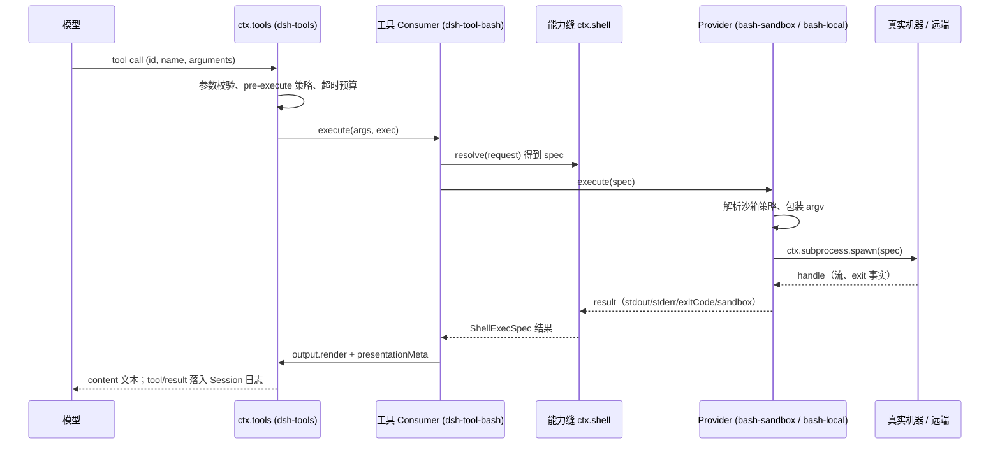
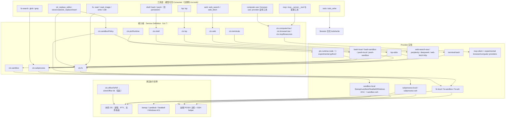
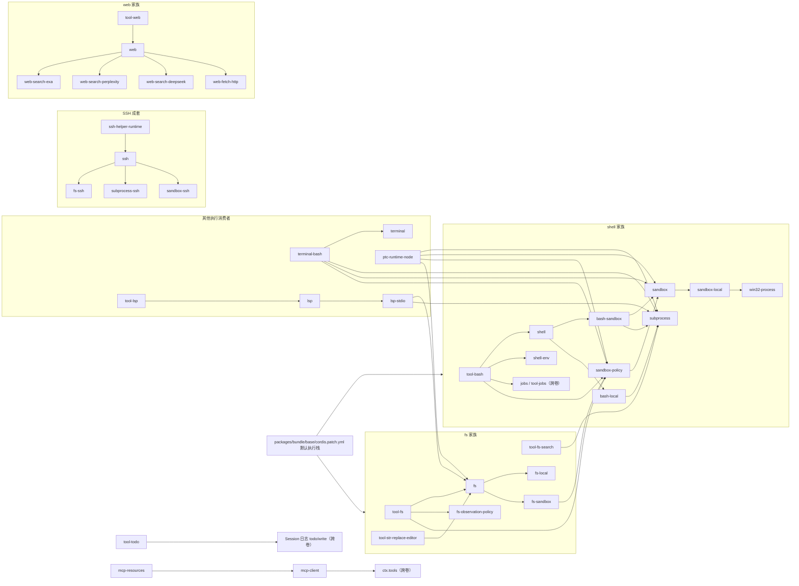

# 03 工具与执行环境（模块手册 · 卷三）

> **一句话总结**：工具是模型的手和脚，本卷讲这双手脚如何经能力缝落到真实机器。

> **适用版本**：DeepSeek Harness `0.2.1-alpha.2`（`master` @ `d743267388`）· 核对日期 2026-10-12

| 项目 | 内容 |
|---|---|
| 回答的问题 | 模型发出的 `read`/`bash`/`web_fetch` 等调用，经过哪些 seam、provider，最终在哪里、以什么权限执行；14 个包组各自负责什么；安全边界画在哪里 |
| 适合读者 | 需要理解 DSH 工具执行链、准备替换执行后端、或排查沙箱/进程/远端问题的工程师 |
| 前置阅读 | [01-系统架构](../01-系统架构.md)、[01-内核与会话运行时](01-内核与会话运行时.md) 的「工具与执行流水线」、[02-模型与上下文](02-模型与上下文.md) |
| 主要来源 | `packages/*/README.md`（14 个组级页与本文引用的包级页）、`docs/subsystems/` 下的 filesystem.md、shell.md、subprocess.md、ssh.md、sandbox.md、terminal.md、ptc-runtime.md、web.md、lsp.md、mcp.md、computer-use.md、browser-use.md、office-to-pdf.md、todo.md、tools.md、permission-presets.md、worktrees.md，以及 `packages/bundle/base/cordis.patch.yml` |

## 一、通俗理解（先读这一节）

### 1.1 工具层是「翻译」，不是「发动机」

模型只能输出 JSON：一个工具名和一组参数。它看不见文件、进程或网络。DSH 把模型的一次调用翻译成对宿主机的真实操作，再把结果翻译回文本。该翻译链由三层构成，缺一不可：

- **工具层（tool layer）**：注册到 `ctx.tools` 的 Consumer，拥有模型可见的名字、schema、prompt 文案与结果渲染。来源：`packages/core/tools`（`docs/subsystems/tools.md`）。
- **能力缝（capability seam）**：Service Definition（服务定义，如 `ctx.fs`）、Service Provider（服务提供方）与 Consumer 三种角色共同构成的完整接口。来源：`docs/glossary.md`、`AGENTS.md`「A capability seam comprises Service Definition / Service Provider / Consumer roles」。
- **provider 与真实机器**：provider 把接口落到本机系统调用、子进程、沙箱 runner 或远端 SSH 主机。来源：`packages/fs/README.md`、`packages/sandbox/README.md`。

本卷覆盖的 14 组里，既有能力缝本身（`fs`、`shell`、`subprocess`、`sandbox`、`terminal`、`ptc-runtime`、`web`、`lsp`、`computer-use`、`browser-use`），也有纯工具包（`todo`）、纯 provider 组（`ssh`）与宿主服务（`document`）。

### 1.2 一次 bash 调用的完整旅程



图 1-1：模型到宿主机的完整调用链。要点是模型只接触最上层的名字与文本，中间每一层都可替换而不改变模型契约。来源：`docs/subsystems/tools.md`、`docs/subsystems/shell.md`、`packages/shell/tool-bash/README.md`。

### 1.3 「距离」决定能力缝的形状

同样是执行，三种目标的距离不同，因此被拆成不同的缝：

| 距离 | 例子 | 承载的缝 | 替换的粒度 |
|---|---|---|---|
| 本机文件系统 | 读、写、搜索 | `ctx.fs` | 换 backend，不动工具与策略 |
| 本机进程 | bash、语言服务器、PTY、PTC | `ctx.shell`、`ctx.subprocess`、`ctx.terminals` | 换 executor / subprocess provider |
| 沙箱边界 | 允许写到哪 | `ctx.sandbox` + `ctx.sandboxPolicy` | 换 runner，不改策略语义 |
| 远端 | SSH 主机上的文件/进程 | `ctx.ssh` 驱动的三个 provider | 成套替换三个 provider |
| 网络 | 搜索、抓取 | `ctx.web` | 换 search/fetch provider |

来源：`packages/fs/README.md`、`packages/shell/README.md`、`packages/sandbox/README.md`、`packages/ssh/README.md`、`packages/web/README.md`。

### 1.4 十四组一览

```text
packages/
├── fs/            7 包  文件读写、搜索、read-before-edit 策略
├── shell/        10 包  一次性命令执行（bash/pwsh）与模型可见工具
├── subprocess/    3 包  所有子进程与 PTY 的统一进程服务
├── ssh/           5 包  一套 OpenSSH 连接上的远端 fs/subprocess/sandbox
├── sandbox/       4 包  文件效应沙箱缝、平台 runner、共享策略
├── terminal/      2 包  跨工具调用存活的持久 PTY 会话
├── ptc-runtime/   2 包  模型写程序、宿主提供绑定（PTC 模式）
├── web/           6 包  search/fetch 缝与 Exa/Perplexity/DeepSeek/HTTP provider
├── lsp/           3 包  语义代码导航（定义/引用/实现/hover）
├── mcp/           2 包  外部 MCP 服务器的工具与资源
├── computer-use/  1 包  桌面操作 provider 的独占注册
├── browser-use/   1 包  浏览器操作 provider 的独占注册
├── document/      1 包  Office 转 PDF 的宿主服务
└── todo/          1 包  todo_write 工具与会话级任务列表
```

图 1-2：本卷 14 组的包分布，共 48 个包（不含文档中提到的 experimental provider）。来源：`packages/*/README.md`、`ls packages/<组>`。

### 1.5 谁决定「挂哪些」

组合不是写死的：每个 `cordis.yml` 行挂载一个插件，profile 用 overlay 选择 provider 与工具。基础 bundle 已经排好默认执行栈：`subprocess-local`、`sandbox-local`、`sandbox-policy`、`bash-sandbox`（非 Windows）/`pwsh-sandbox`（Windows）、`shell-env`、`tool-bash`/`tool-pwsh`、`fs-observation-policy`、`tool-fs`、`tool-fs-search`、`fs-sandbox`、`tool-todo`、`web` + `web-search-deepseek` + `web-fetch-http` + `tool-web`、`mcp-resources`。来源：`packages/bundle/base/cordis.patch.yml:229-294`、`:432-481`、`:504-507`。

### 1.6 本卷的组织方式

第二节给统一的能力栈图；第三节逐组说明；第四节给包级条目表；第五节讲透 11 个关键机制；第六节讲工具与 UI 分工；第七节讲安全边界；第八节画依赖；第九节列常见误解；第十节是文件索引。

## 二、执行能力栈

### 2.1 统一分层图



图 2-1：执行能力栈。箭头是「依赖/调用」关系，不是注册关系：provider 注册到缝，工具注册到 `ctx.tools`。来源：各组 README 与 `docs/subsystems/`。

### 2.2 逐层说明

| 层 | 拥有的东西 | 不拥有的东西 | 来源 |
|---|---|---|---|
| 工具层 | 模型可见名字、参数 schema、prompt 段落、结果渲染、presenter | 进程机制、沙箱实现 | `docs/subsystems/tools.md` |
| 能力缝 | 规范类型、语义契约、错误码、事件 | 平台细节、模型文案 | `docs/glossary.md`、各子系统页 |
| provider | 执行世界（本机/远端）、平台 runner、传输 | 工具 schema、prompt | `packages/*/README.md` |
| 策略 | `ctx.sandboxPolicy` 解析每次调用的模式与根 | 执行 | `docs/subsystems/sandbox.md` |

一个重要分工：**策略与执行分离**。`ctx.sandboxPolicy.resolve()` 只解析「这次调用允许写哪」，真正的执行由 `ctx.shell`/`ctx.fs` provider 完成。来源：`docs/subsystems/sandbox.md`。

## 三、组级说明（14 组）

### 3.1 fs —— 文件系统能力缝

- 角色划分：`fs` 定义 `ctx.fs`；`fs-local` 与 `fs-sandbox` 是两个 backend；`fs-observation-policy` 是可选的 read-before-edit 策略插件；`tool-fs`、`tool-fs-search`、`tool-str-replace-editor` 是模型可见工具。
- 挂载：部署挂一个 backend，按需装策略，再注册工具；backend 可换而不动工具与策略。来源：`packages/fs/README.md`。
- 关键点：文件 I/O 不设超时（本地系统调用最多只能尽力取消）；搜索是进程型 ripgrep 工作流，刻意不扩展 provider 契约。来源：`packages/fs/README.md`、`docs/subsystems/filesystem.md`。

### 3.2 shell —— 命令执行能力缝

- 角色划分：`shell` 定义 `ctx.shell`（`resolve` + `execute`）；四个 executor（`bash-local`、`bash-sandbox`、`pwsh-local`、`pwsh-sandbox`）各自注册；`shell-env` 提供 `ctx.shellEnv`；四个工具包暴露 `bash`/`pwsh`（含 persistent 变体）。
- 一个组合只挂一个 executor，挂两个在加载期因重复服务注册失败。来源：`packages/shell/README.md`。
- 沙箱变体消费 `ctx.sandbox`；策略由 `ctx.sandboxPolicy` 每次解析。来源：`packages/shell/README.md`、`docs/subsystems/shell.md`。

### 3.3 subprocess —— 唯一进程服务

- 角色划分：`subprocess` 定义 `ctx.subprocess`；`subprocess-local` 是本机 provider；`win32-process` 是共享 Win32 绑定库（无 ctx key）。
- 消费者是别的能力缝：bash 家族、LSP、PTY backend、PTC、ACP 子代理后端。来源：`docs/subsystems/subprocess.md`。
- provider 拥有进程范围（managed range）与终止/静默观测；消费者拥有命令语义、deadline 与呈现。来源：`docs/subsystems/subprocess.md`。

### 3.4 ssh —— 成套远端执行

- 角色划分：`ssh` 管连接与 helper 生命周期（`ctx.ssh`）；`fs-ssh`/`subprocess-ssh`/`sandbox-ssh` 分别实现现有三个缝；`ssh-helper-runtime` 是私有的无 Node 依赖可执行分发。
- 不引入 SSH 专属模型工具；远端复用本地 provider（helper 上挂 `fs-local`/`fs-sandbox`/`subprocess-local`）。来源：`packages/ssh/README.md`、`docs/subsystems/ssh.md`。

### 3.5 sandbox —— 文件效应沙箱

- 角色划分：`sandbox` 定义 `ctx.sandbox`；`sandbox-local` 提供平台 runner；`sandbox-policy` 是共享策略家（`ctx.sandboxPolicy`）；`sandbox-windows-acl` 是 Windows 写限制 rung，由 `sandbox-local` 挂载。
- 模式只管文件效应；网络与进程可见性不在词汇内。来源：`packages/sandbox/README.md`、`docs/subsystems/sandbox.md`。

### 3.6 terminal —— 持久 PTY

- 角色划分：`terminal` 提供 `ctx.terminals`（owner 隔离会话、精确 owner 授权、等待式清理）；`terminal-bash` 注册 `shell` backend，运行交互式 bash/pwsh。
- 会话只在单个 harness 进程内存在，不跨重启。来源：`packages/terminal/README.md`、`docs/subsystems/terminal.md`。

### 3.7 ptc-runtime —— 程序化工具调用

- 角色划分：`ptc-runtime` 定义 `ctx.ptcRuntime`（`resolve` + `run`）；`ptc-runtime-node` 在受管的 fresh Node 进程里执行 TypeScript；Python backend 在 `packages/experimental/ptc-runtime-python`。
- 每次运行不保留上一次状态；失败作为结果字段返回。来源：`packages/ptc-runtime/README.md`、`docs/subsystems/ptc-runtime.md`。

### 3.8 web —— 搜索与抓取

- 角色划分：`web` 定义 `ctx.web` 与两个 provider 注册表；`web-search-exa`/`-perplexity`/`-deepseek` 与 `web-fetch-http` 是 provider；`tool-web` 是唯一拥有模型契约的 Consumer。
- 一个缝两个操作（search/fetch），共享一套 provider 选择与错误词汇。来源：`packages/web/README.md`、`docs/subsystems/web.md`。

### 3.9 lsp —— 语义代码导航

- 角色划分：`lsp` 定义 `ctx.lsp`（四个只读操作）；`lsp-stdio` 驱动配置的 stdio 语言服务器；`tool-lsp` 是模型工具。
- provider 注册能力而非工具，模型契约只有一份。来源：`packages/lsp/README.md`、`docs/subsystems/lsp.md`。

### 3.10 mcp —— 外部工具与资源

- 角色划分：`mcp-client` 每个配置服务器一个连接插件（不发布共享 `ctx.mcp`）；`mcp-resources` 提供共享资源工具与 `ctx.mcpResources`。
- 服务器工具以 `mcp__<serverName>__<rawName>` 注册为普通 harness 工具。来源：`docs/subsystems/mcp.md`、`packages/mcp/mcp-client/README.md`。

### 3.11 computer-use —— 独占桌面 provider

- 只有一个包：`computer-use`，提供 `ctx.computerUse`，仅登记一个 provider 名。
- 没有公共桌面操作方法，也没有模型可控的 provider 选择器；provider 自带工具。来源：`packages/computer-use/README.md`、`docs/subsystems/computer-use.md`。

### 3.12 browser-use —— 独占浏览器 provider

- 只有一个包：`browser-use`，提供 `ctx.browserUse`，同样只登记名字。
- 浏览器资源归 provider，按精确 Session 归属；共享服务不存浏览器状态。来源：`packages/browser-use/README.md`、`docs/subsystems/browser-use.md`。

### 3.13 document —— Office 转 PDF

- 只有一个包：`office-to-pdf`，提供 `ctx.officeToPdf`。
- 不产生模型可见工具或 Session 事件；消费者自己负责源授权与呈现。来源：`packages/document/README.md`、`docs/subsystems/office-to-pdf.md`。

### 3.14 todo —— 会话任务列表

- 只有一个包：`tool-todo`，注册 `todo_write` 工具，并声明 `todo/write` 日志事件与 `todos` 会话投影。
- 整个列表每次替换；列表属于调用它的那一个 agent session。来源：`packages/todo/README.md`、`docs/subsystems/todo.md`。

## 四、包级条目表

48 个包各一行，按组排列；包名写成 `组/包` 以便定位。

| 包名 | 职责 | 关键 seam/服务 | 关键扩展点 | 来源 |
|---|---|---|---|---|
| fs/fs | `ctx.fs` 服务定义：执行世界路径、受限文本 I/O、带版本守卫的原子变更 | `ctx.fs` | 抽象类 subclass 后加载即注册 | packages/fs/fs/src/index.ts, docs/subsystems/filesystem.md |
| fs/fs-local | 宿主文件系统 backend：真实文件读写与编辑 | 注册到 `ctx.fs` | `cwd`、`diffBasisMaxBytes` 配置 | packages/fs/README.md |
| fs/fs-sandbox | 按每次调用的沙箱模式围栏写/编辑，读放行 | 注册到 `ctx.fs` | `ctx.sandboxPolicy` 每次调用策略 | packages/fs/fs-sandbox/README.md |
| fs/fs-observation-policy | read-before-edit 策略：记录观察，通过 `fs/*` 事件守卫写/编辑 | `fs/write-intent`、`fs/edit-intent`、`fs/observed` | 监听并决定 intent waterfall | packages/fs/fs-observation-policy/README.md, docs/subsystems/filesystem.md |
| fs/tool-fs | `read`、`read_image`、`write`、`edit` 工具与 executor | 注册到 `ctx.tools`；用 `ctx.fs` | `readLimit`/`readMaxBytes` 等配置；presenter | packages/fs/tool-fs/README.md |
| fs/tool-fs-search | `glob`、`grep` 发现工具，基于打包的 ripgrep | 注册到 `ctx.tools`；用 `ctx.subprocess` | `sampleOverCapGlobResults` 等配置 | packages/fs/README.md, docs/subsystems/filesystem.md |
| fs/tool-str-replace-editor | 独立 `str_replace_editor`：`view`/`create`/`str_replace`/`insert` | 注册到 `ctx.tools`；用 `ctx.fs` | 工具 schema 与 presenter | packages/fs/README.md |
| shell/shell | `ctx.shell` 服务定义：`resolve` 与 `execute` | `ctx.shell` | subclass 注册；request/spec 分离模板 | packages/shell/shell/src/types.ts, docs/subsystems/shell.md |
| shell/bash-local | 以 fresh `bash -c` 在 POSIX 执行 | 注册 `ctx.shell` | 默认值/上限由实现拥有 | packages/shell/README.md |
| shell/bash-sandbox | 经 `ctx.sandbox` 围栏执行 bash，报告拒绝事实 | 注册 `ctx.shell` | 沙箱包装与拒绝分类 | packages/shell/README.md, docs/subsystems/sandbox.md |
| shell/pwsh-local | Windows 上 fresh `pwsh -Command` | 注册 `ctx.shell` | 同上 | packages/shell/README.md |
| shell/pwsh-sandbox | 经沙箱执行 PowerShell | 注册 `ctx.shell` | 同上 | packages/shell/README.md |
| shell/shell-env | 提供每次执行的受管 `DSH_*` 环境快照 | `ctx.shellEnv` | `register(contributor)` 贡献变量 | packages/shell/shell-env/README.md |
| shell/tool-bash | 模型 `bash` 工具；每个命令在 job runtime 在场时都是 job | 注册 `ctx.tools`；用 `ctx.shell`、`ctx.jobs`、`ctx.approval` | `enableRunInBackground`、`promoteOnTimeout` | packages/shell/tool-bash/README.md |
| shell/tool-bash-persistent | 在单个 owner 隔离的持久 bash 会话里跑模型命令 | 注册 `ctx.tools` | 持久会话映射 | packages/shell/README.md |
| shell/tool-pwsh | 模型 `pwsh` 工具 | 注册 `ctx.tools` | 与 tool-bash 对称 | packages/shell/README.md, docs/subsystems/shell.md |
| shell/tool-pwsh-persistent | owner 隔离的持久 PowerShell 会话 | 注册 `ctx.tools` | 持久会话映射 | packages/shell/README.md |
| subprocess/subprocess | `ctx.subprocess`：可执行查找、完全显式 spawn、终端分配 | `ctx.subprocess` | subclass 注册 | packages/subprocess/subprocess/src/types.ts |
| subprocess/subprocess-local | 本机进程与终端：Linux systemd scope、Windows Job、弱回退 | 注册 `ctx.subprocess` | 无配置，全部由 spec 传入 | packages/subprocess/subprocess-local/README.md |
| subprocess/win32-process | 共享 Win32 绑定：创建、stdio、Job、等待、句柄清理 | 无 ctx key（库） | 被 sandbox 与进程创建复用 | packages/subprocess/README.md |
| ssh/ssh | OpenSSH 连接、helper 身份与传输生命周期 | `ctx.ssh` | `Config`：host/launch/helper/workspace/超时 | packages/ssh/ssh/README.md |
| ssh/ssh-helper-runtime | 私有、无 Node 依赖的远端 helper 可执行分发 | 无 ctx key（库） | 构建目标与归档校验 | packages/ssh/ssh-helper-runtime/README.md |
| ssh/fs-ssh | 远端文件身份、读与带守卫的原子变更 | `ctx.fs` | helper 上复用 fs-local/fs-sandbox | packages/ssh/fs-ssh/README.md |
| ssh/subprocess-ssh | 远端可执行查找、进程、fd 7 控制流、终端 | `ctx.subprocess` | helper 上复用 subprocess-local | packages/ssh/subprocess-ssh/README.md |
| ssh/sandbox-ssh | 远端文件效应围栏与执行事实 | `ctx.sandbox` | 远端加载的沙箱 provider | packages/ssh/sandbox-ssh/README.md |
| sandbox/sandbox | `ctx.sandbox`：模式、enforcement、每次调用策略、升级词汇 | `ctx.sandbox` | subclass 注册 | packages/sandbox/sandbox/src/index.ts |
| sandbox/sandbox-local | 平台 runner：Linux bwrap→Landlock、macOS Seatbelt、Windows ACL | 注册 `ctx.sandbox` | `runnerCommand`/`runnerFailureSignatures`/`probeTimeoutMs` | packages/sandbox/sandbox-local/README.md |
| sandbox/sandbox-policy | 共享策略家：部署默认与每会话模式覆盖 | `ctx.sandboxPolicy` | `mode`、`workspaceRoot` 配置 | packages/sandbox/sandbox-policy/README.md |
| sandbox/sandbox-windows-acl | Windows 写限制：受限 token + 每会话私有临时目录 | 由 `sandbox-local` 挂载的 win32 backend | ACL 授权生命周期 | packages/sandbox/README.md, packages/sandbox/sandbox-local/README.md |
| terminal/terminal | `ctx.terminals`：owner 隔离会话、精确归属、等待式清理 | `ctx.terminals` | `registerBackend(backend)` | packages/terminal/terminal/README.md |
| terminal/terminal-bash | 交互式 bash/pwsh 的 `shell` backend，含就绪检测与有界输出 | 注册 backend 到 `ctx.terminals` | `shellDialect`、就绪与 scrollback 配置 | packages/terminal/terminal-bash/README.md |
| ptc-runtime/ptc-runtime | `ctx.ptcRuntime`：跑一段程序、暴露绑定、报告输出与失败 | `ctx.ptcRuntime` | subclass 注册 | packages/ptc-runtime/ptc-runtime/src/types.ts |
| ptc-runtime/ptc-runtime-node | 在 fresh Node 进程执行 TypeScript，受沙箱策略约束 | 注册 `ctx.ptcRuntime` | `timeoutMs`/`maxOutputBytes`/`launch` 等 | packages/ptc-runtime/ptc-runtime-node/README.md |
| web/web | `ctx.web`：search/fetch 两个操作、provider 选择与错误策略 | `ctx.web` | `registerSearchProvider`/`registerFetchProvider` | packages/web/web/src/types.ts, docs/subsystems/web.md |
| web/web-search-exa | 经 Exa 搜索 | 注册到 `ctx.web` | 实现 `WebSearchProvider` | packages/web/README.md, docs/subsystems/web.md |
| web/web-search-perplexity | 经 Perplexity 搜索（可返回生成式 answer） | 注册到 `ctx.web` | 同上 | packages/web/README.md, docs/subsystems/web.md |
| web/web-search-deepseek | 经 DeepSeek 原生搜索 | 注册到 `ctx.web` | provider id `deepseek-official`；`apiKeyEnv` | packages/bundle/base/cordis.patch.yml:460-469 |
| web/web-fetch-http | 匿名抓取公共 HTTP(S) 页面 | 注册到 `ctx.web` | `maxResponseBytes`/`maxBodyChars`/`maxRedirects` 等 | packages/web/web-fetch-http/README.md |
| web/tool-web | 模型 `web_search`、`web_fetch`；拥有 schemas 与 prompt | 注册 `ctx.tools`；用 `ctx.web` | `search`/`fetch`/`searchMaxResults`/超时预算 | packages/web/tool-web/README.md |
| lsp/lsp | `ctx.lsp`：按扩展名选 provider，四个规范只读操作 | `ctx.lsp` | `registerProvider(provider)` 原子预留 id+扩展名 | packages/lsp/lsp/src/types.ts, docs/subsystems/lsp.md |
| lsp/lsp-stdio | 驱动的 stdio 语言服务器 provider，复用 fs 与 subprocess | 注册到 `ctx.lsp` | `servers` 映射、字节/超时上限 | packages/lsp/lsp-stdio/README.md |
| lsp/tool-lsp | 模型 `lsp` 工具；1-based UTF-16 坐标与有界结果 | 注册 `ctx.tools`；用 `ctx.lsp` | `maxLocations`/`maxResultChars`/`timeoutMs` | packages/lsp/tool-lsp/README.md |
| mcp/mcp-client | 每个配置服务器一个连接插件，桥接其工具与指令 | 注册到 `ctx.tools`；无 `ctx.mcp` | `createMcpToolDefinition` 导出适配器；重连策略 | packages/mcp/mcp-client/README.md, docs/subsystems/mcp.md |
| mcp/mcp-resources | 共享资源工具与按 scope 的服务器选择 | `ctx.mcpResources` | `register(server, provider)` | packages/mcp/mcp-resources/README.md |
| computer-use/computer-use | 独占命名 provider 注册 | `ctx.computerUse` | `register(ComputerUseProviderName)` | packages/computer-use/computer-use/README.md |
| browser-use/browser-use | 独占命名 provider 注册 | `ctx.browserUse` | `register(BrowserUseProviderName)` | packages/browser-use/browser-use/README.md |
| document/office-to-pdf | 宿主 Office→PDF 转换、有界排队、PDF 复用 | `ctx.officeToPdf` | `convert`；`render`/`getGeneration` 为 Remote | packages/document/office-to-pdf/README.md |
| todo/tool-todo | 会话任务列表 `todo_write` | 注册 `ctx.tools`；`todo/write` 事件；`todos` 投影 | 必填 `allowParallelInProgress` | packages/todo/tool-todo/README.md |

## 五、重点机制讲透

### 5.1 fs 能力缝与模型可见文件工具的拆分

文件能力被拆成四层，每层解决不同问题：

| 层 | 包 | 解决什么 |
|---|---|---|
| 服务定义 | fs | `ctx.fs` 的 14 个原语与错误码 |
| backend | fs-local / fs-sandbox / fs-ssh | 文件在哪、写是否受围栏 |
| 策略 | fs-observation-policy | 写/编辑前是否必须已观察 |
| 工具 | tool-fs / tool-fs-search / tool-str-replace-editor | 模型看到哪些名字 |

**为什么工具要拆开**：`tool-fs-search` 是进程型 ripgrep 工作流，因此刻意不扩展 provider 契约，文件 backend 不必承担通用搜索 API；`tool-str-replace-editor` 是独立的兼容工具，走 `ctx.fs` 而不复制 provider。目录列举 `listDir` 只服务 provider 代码（如 skill 发现），没有对应的模型工具。来源：`packages/fs/README.md`、`packages/fs/tool-fs/README.md`。

**标识与守卫**：每次操作先把用户路径解析为不透明的 `FsTarget`（`targetKey` + `displayPath`），消费者不得解析 `targetKey`；跨能力坐标用 `processPath`，宿主到执行世界的映射用 `processPathFromHostPath`（SSH 返回 `undefined`）。写/编辑的版本守卫是可选的：`createIfAbsent` 或 `replaceIfVersion`；省略即无条件创建或覆盖。来源：`docs/subsystems/filesystem.md`、`packages/ssh/fs-ssh/README.md`。

**策略靠事件而非服务**：工具不注入策略服务，而是在每次变更前询问单槽 waterfall `fs/write-intent` / `fs/edit-intent`，成功后用 `ctx.emit` 发 `fs/observed`。因此去掉策略插件不会破坏工具，只是回到无条件变更。来源：`docs/subsystems/filesystem.md`。

**没有超时是设计而非遗漏**：本地系统调用最多只能尽力取消，`fsync`/`rename` 无法被 deadline 强制停止，所以 `read`/`write`/`edit` 不接受 `timeoutMs`；反例是进程型的 bash、web 与 glob/grep，它们的 deadline 真能杀掉工作。来源：`docs/subsystems/filesystem.md`。

### 5.2 shell 的 request/spec 分离与 bash 工具

`ctx.shell` 把「调用方请求」与「已解析规格」分成两个类型，中间由 `resolve()` 显式填默认值：

- `ShellExecRequest`：`workdir`、`timeoutMs`、`onExpiry`、`stdoutMaxBytes`、`signal`、`stdin`、`env`、`dshEnv`、`sandboxPolicy` 大多可选。
- `ShellExecSpec`：`workdir`、`timeoutMs`、`stdoutMaxBytes`、`sandboxPolicy` 等必填。

这是仓库级的模板：`AGENTS.md` 的「Explicit > implicit at package boundaries」明确以 `dsh-shell` 的 request/spec split 为例。`stdin`、`env`、`stdoutMaxBytes` 是受信进程内插件输入，模型工具不暴露。来源：`docs/subsystems/shell.md`、`packages/shell/shell/src/types.ts`、`AGENTS.md`。

**前台与后台**：`execute(spec)` 返回 handle 后才算发布；前台/后台是「调用方 await 什么」的属性，不是 spawn 的属性。`done` 只报告进程 exit 事实，超时/取消的第一因由消费者分类；`onExpiry: 'none'` 不武装定时器。来源：`docs/subsystems/shell.md`。

**bash 工具**：执行 `bash -c <command>`，每次 fresh shell；非零退出是 `[exit code: N]` 结果而非工具错误。挂载了 job runtime 时，每个命令从开始就是 job：前台超时后提升为后台 job 并返回同一 id，`promoteOnTimeout: false` 则退回 executor 的 kill。沙箱拒绝呈现为 `[sandbox: file access denied under <mode> mode]`，模型可用 `sandbox_permissions` + `justification` 重试一次，必须经 `ctx.approval` 同意。来源：`packages/shell/tool-bash/README.md`、`docs/subsystems/shell.md`。

### 5.3 subprocess 的进程树与生命周期

`ctx.subprocess` 是所有子进程与终端的唯一入口。它有两个原语：`spawn(spec)`（普通进程）与 `spawnTerminal(spec)`（真实 PTY）。

- **完全显式的 spec**：`argv`、`cwd`、`stdio`、`graceMs`、`signal`、`env` 全部显式；缝不做任何默认。`argv` 不经 shell 解释。来源：`docs/subsystems/subprocess.md`。
- **管理者与范围**：provider 决定用什么拥有「managed range」：Linux 普通与终端启动用 transient user-systemd scope；Windows 普通启动用 kill-on-close Job；macOS 及不可用时回退到 detached 进程组/`taskkill`/终端会话观测，并发出一条警告。provider 从不把命令回退重放。来源：`packages/subprocess/subprocess-local/README.md`。
- **终止与静默**：`terminate()` 启动 provider 的终止流程，`waitForExit()` 观察同一个范围是否为空（不只是直接子进程退出），因此消费者可以搭自己的分层拆除梯子。来源：`docs/subsystems/subprocess.md`。
- **输出读取**：collect 模式按整流域偏移读取、非消费式，因此后台预览与批量读取互不偷取字节；超出内存尾窗口的读取标记 `lossy` 并给出 spill 文件。来源：`docs/subsystems/subprocess.md`。
- **环境与清理**：子进程从 credential-scrubbed 父环境起步（`*KEY*`/`*PASSWORD*`/`*SECRET*`/`*TOKEN*` 名称启发式），受管 `DSH_*` 命名空间在合并前被丢弃；服务 dispose 时终止并等待仍在运行的进程。来源：`docs/subsystems/subprocess.md`、`packages/subprocess/subprocess-local/README.md`。

### 5.4 sandbox 后端与降级策略

模式：`read-only`、`workspace-write`、`danger-full-access`；只有前两种会送进 `ctx.sandbox.confine()`，`danger-full-access` 由消费者直接 spawn 原 argv。来源：`docs/subsystems/sandbox.md`。

后端选择是「先平台、后探针」：

| 平台 | runner 链 | 说明 |
|---|---|---|
| linux | bwrap → Landlock | bwrap：只读宿主根、fresh /dev、私有 PID namespace；`workspace-write` 加临时 /tmp 与可写 workspace bind |
| darwin | Seatbelt | allow-default + `(deny file-write*)`，写白名单来自共享的 `writableRoots`；Seatbelt 匹配解析后路径 |
| win32 | ACL restricted token | 每个 workspace 一个写 SID 与常驻 ACE；每个会话/workspace 对私有临时目录另给随机 SID |

候选只有唯一一个时不探针；有竞争时按链顺序功能探针一次，结果缓存到 provider 生命周期。来源：`packages/sandbox/sandbox-local/README.md`。

**降级与失败语义**：没有可用 runner 的链直接 fail closed，`confine()` 拒绝 `SANDBOX_UNAVAILABLE`，绝不静默无围栏执行。enforcement 是报告事实：`full` 或 `partial`；Windows ACL rung（硬链接、未受限读、AppContainer ACL 边界）与旧 Landlock ABI 是当前 partial 情形。`ConfinedArgv` 还带每个 runner 自己的 denial 方言与 runner-failure 规则，消费者先判 runner 失败、再判策略拒绝。来源：`packages/sandbox/sandbox-local/README.md`、`docs/subsystems/sandbox.md`。

### 5.5 ssh 如何成套提供三个 provider

一个部署拥有一个 OpenSSH alias 与远端安装的 helper，然后同时挂载：

1. `ssh`：连接、helper 摘要校验、传输生命周期，提供 `ctx.ssh`。
2. `fs-ssh`：远端 `ctx.fs`，helper 上复用 `fs-local`/`fs-sandbox`。
3. `subprocess-ssh`：远端 `ctx.subprocess`，helper 上复用 `subprocess-local`。
4. `sandbox-ssh`：远端 `ctx.sandbox`，由远端 helper 选择它本地安装的沙箱 backend。

HOST 仍是 harness、模型传输与 Session 存储；远端只提供文件与进程。坐标一致性是关键：`processPath()` 给配对 subprocess provider 可用路径，而 `processPathFromHostPath()` 对 SSH 不可用——安装远端 artifact 不会让任意宿主路径变得可移植。来源：`docs/subsystems/ssh.md`、`packages/ssh/fs-ssh/README.md`。

传输细节：管理 RPC 走 helper 的 SSH exec 流；普通 stdin/stdout/stderr、终端输出与可选 fd 7 控制流量各走独立认证的 forwarded Unix socket，每条流有自己的窗口，且用 256-bit TLS 预共享密钥认证。连接丢失使未确认操作失败，且**从不重连重放**已可能执行的动作。来源：`docs/subsystems/ssh.md`、`packages/ssh/ssh/README.md`。

### 5.6 terminal 的持久 PTY 会话

持久 PTY 让 cwd、导出变量、函数与运行中的子进程跨工具调用存活。设计要点：

- `ctx.terminals` 用 service-minted 的 `TerminalSessionId`；授权比较精确的 owning `Agent`，不靠名字或猜测 id。
- 一个会话同一时刻只接受一个 active send；send 返回的 `TerminalWaitReason`（`stdin_read`/`inferred_idle`/`timeout`/`session_exit`）与顶层进程状态 `TerminalSessionStatus` 相互独立。
- `terminal-bash` 提供 `shell` backend：bash 用私有 PS1 + PROMPT_COMMAND 标记，pwsh 写 prompt 函数并 pin UTF-8；就绪三级——provider 的精确 stdin-wait（仅 Linux）、验证过的 prompt marker、输出静默，最外层由绝对 `timeoutMs` 兜底。返回输出按行标准化，全屏程序不在契约内。
- **沙箱模式围栏**：owner 还有开放会话或 spawn 进行中时，改变有效沙箱模式在 `sandbox/mode` 事件提交前就被拒绝，避免先用宽权限开的终端在降级后存活。来源：`packages/terminal/terminal-bash/README.md`。
- PTY 状态与原始字节只在本进程内；模型可见输入/输出通过普通 `tool/call`/`tool/result` 持久化，不额外造 PTY 事件。来源：`docs/subsystems/terminal.md`。

### 5.7 ptc-runtime 的沙箱 Node 执行与 PTC 模式

PTC（programmatic tool calling）让模型写一段程序，把宿主提供的函数当作 async 调用，最后只把程序的打印输出与返回值带回。

- 缝语义：`PtcRunRequest`（program、bindings、cwd、timeoutMs、sandboxPolicy、signal）→ provider 的 `resolve` 补全 → `PtcRunSpec` → `run`。程序是 async 函数体，支持 top-level await 与 return，只接受可擦除 TypeScript。来源：`docs/subsystems/ptc-runtime.md`。
- 失败是结果字段 `PtcRunResult.error`，不是 reject；失败种类正交且独立报告：`exception`/`timeout`/`abort`/`worker-exit`/`invalid-output`/`output-limit`/`protocol`/`sandbox-unavailable`。来源：`docs/subsystems/ptc-runtime.md`。
- Node provider：host 负责策略、deadline、binding 查找与进程清理；child 负责求值与 binding proxy，模型代码被当作不可信对端。host 先做类型擦除、解析可执行与 bootstrap、等 `ctx.sandbox` 返回 argv、再经 `ctx.subprocess` spawn；child 只保留可执行查找/Windows 系统/临时路径到 OS 环境，把程序可见的 `process.env` 换成空字典；V8 old-generation 堆上限与输出预算约束执行。来源：`packages/ptc-runtime/ptc-runtime-node/README.md`。
- PTC 模式：所有可见注册工具都以 `await tools.<name>(args)` 暴露，调用重新进入正常执行流水线，成功解析为最终 canonical JSON。来源：`docs/cookbook/adding-a-tool.md`、`packages/ptc-runtime/ptc-runtime-node/README.md`。

### 5.8 web 的 search/fetch seam 与 provider

一个能力、两个操作。之所以仍是一个 `ctx.web`：共享一个 provider 选择策略、一套中止/错误词汇、一套产品配置 API；代价是服务上的 `searchX`/`fetchX` 平行方法对，这是有意为之。来源：`docs/subsystems/web.md`。

- **request/result**：每次 search 只带一个 `query`，工具层接受 `queries` 数组并扇出；`maxResults` 由消费者拥有，缝在返回时强制执行并置 `truncated`。fetch 的 request 只有 `url`，非 2xx 是结果不是异常。来源：`docs/subsystems/web.md`。
- **provider availability**：`available()` 是廉价本地检查（凭据在不在、配置能否解析），**不得发网络请求**；选择在运行时进行：配置了 id 就走它，没配置且只有一个可用 provider 才自动选，多个可用但没配 id 报 `WEB_PROVIDER_AMBIGUOUS`，不是 first-wins。来源：`docs/subsystems/web.md`。
- **抓取安全**：HTTP provider 只接受 http/https、拒绝带凭据 URL、解析主机一次、拒绝任何非公共地址集合并 pin 连接；每个同源重定向重复解析与 pin，跨源重定向失败并要求新调用。来源：`docs/subsystems/web.md`、`packages/web/web-fetch-http/README.md`。
- **错误词汇**：`WebError` 的 code 是开放字符串；缝中立码（`WEB_PROVIDER_*`、`WEB_ABORTED`、`WEB_PROVIDER_ERROR`）与 fetch 传输码（`WEB_INVALID_URL`、`WEB_BLOCKED_URL`、`WEB_REDIRECT_BLOCKED`、`WEB_FETCH_TOO_LARGE`、`WEB_FETCH_TIMEOUT`、`WEB_UNSUPPORTED_CONTENT_TYPE`）分属不同 owner。来源：`docs/subsystems/web.md`、`packages/web/web-fetch-http/README.md`。

### 5.9 lsp、mcp 的工具化方式

**LSP**：provider 注册的是能力，不是工具。`registerProvider` 原子预留一个 branded id 与全部小写点号扩展名映射；选择按查询进行且与顺序无关；无匹配报 `LSP_UNAVAILABLE`。模型契约只属于 `tool-lsp`：四操作闭集，seam 用 0-based UTF-16 坐标，工具负责 1-based 转换；`findReferences` 总是包含声明。`lsp-stdio` 每个 workspace 池化一个进程，每次查询走 `didOpen`（version 1、全文）→ 请求 → `didClose`，所以服务器总看到当前字节且不保留文档状态；同一 workspace 串行、不同 workspace 并行。来源：`docs/subsystems/lsp.md`、`packages/lsp/lsp-stdio/README.md`、`packages/lsp/tool-lsp/README.md`。

**MCP**：`mcp-client` 不是共享服务，而是每个配置服务器一个连接插件，作为 tool registry 的消费者。工具名是纯函数 `mcp__<serverName>__<rawName>`（必要时附加 12 位十六进制哈希），`tools/call` 永远收到原始名；同步以「整代替换」进行——取列表失败保留上一代，注册冲突回滚整代。stdio 子进程环境从 `scrubbedParentEnv()` 起步。指令以服务器命名段落进入系统提示。`mcp-resources` 提供三个共享资源工具，按调用 agent scope 解析服务器名。来源：`packages/mcp/mcp-client/README.md`、`docs/subsystems/mcp.md`。

### 5.10 computer-use / browser-use 的「独占命名 provider 注册」

这两个组各只有一个包，服务的职责被刻意压到最小：**只登记一个 provider 名**。

- `ctx.computerUse.register(name)`、`ctx.browserUse.register(name)` 预留唯一的 provider 槽，第二次注册即使重名也失败。
- 服务没有公共桌面/浏览器操作方法，也没有模型可控的 provider 选择器；provider 自带工具、schema 与平台要求。来源：`packages/computer-use/computer-use/README.md`、`packages/browser-use/browser-use/README.md`。
- 生命周期：provider 释放注册前先停止接纳工具调用、关闭资源并等待自有工作；启动失败释放已尝试的注册。
- 桌面/浏览器归属：一个已注册 provider 不为 Session 保留桌面（computer-use 需调用方协调整段 workflow）；browser-use 的 launched browser 归精确的 live Agent/Session，attach 的浏览器归外部所有且被一个 Session 预留。来源：`docs/subsystems/computer-use.md`、`docs/subsystems/browser-use.md`。

### 5.11 document 的 Office 转 PDF

`ctx.officeToPdf` 在 Node Host 上把授权过的 Office 文件转成可复用 PDF，不产生模型工具或 Session 事件。

- 请求：已授权的 source key/version、可选 stat size、deferred `read(signal, maxBytes)`、前台/后台 priority、`OfficeExtension`（doc/docx/xls/xlsx/ppt/pptx）。结果含 PDF `Uint8Array`、`missingFonts`、`cacheKey`、`generation`。来源：`docs/subsystems/office-to-pdf.md`。
- 引擎：外部 `@deepseek-ai/libreoffice-kit` 选择预编译引擎；目标声明了 native engine 就用它，否则用 Node WASM；声明的 native engine 缺失时拒绝打包而不静默换 WASM。来源：`packages/document/office-to-pdf/README.md`、`docs/subsystems/office-to-pdf.md`。
- 有界排队与缓存：admission 在读取源字节前就保留元数据/读者/源字节/转换名额；成功 PDF 按 converter generation + 扩展名 + 源字节 SHA-256 复用，LRU 淘汰；私有 scratch 目录返回前删除。Web 端经 `officeToPdf.render` Remote 方法读取，用 `workspaceFiles` 校验授权与版本。来源：`packages/document/office-to-pdf/README.md`。

## 六、工具与 UI 的分工

模型结果与 UI 卡片是两件事，仓库要求为每个工具预先设计呈现：

- `output.render` 返回模型可见文本；UI 卡片由**纯呈现投影**声明：可选的 `presentCall(args)`（pending）与 `presentResult(args, result)`（completed），返回以 `card` 为标签的 discriminated union。来源：`docs/cookbook/adding-a-tool.md`。
- 卡片类型：`generic`、`terminal`、`diff`、`search`、`read`、`web`。没有 presentCall/presentResult 的工具退回 generic 卡片。来源：`docs/subsystems/tools.md`。
- **presenter 必须纯净**：它们在实时流式与 session-log 重放两种情况下都运行，所以只能是 `args`（加 result）的纯函数——不 I/O、不读 session 状态、不取时钟/随机数。需要文件旧内容或工作目录时，应放进持久 result metadata（`presentationMeta`）或由 UI adapter 提供，而不是 presenter。来源：`docs/cookbook/adding-a-tool.md`。
- **Web 卡片由原始事件与持久元数据派生**：`presentationMeta(args, value)` 从同一个 canonical value 派生可重放的 JSON，核心把它持久化在 `tool/result` 并交给 `presentResult`，因此需要结果期事实的卡片（如 write/edit 的 applied hunks）重放也能还原。工具不把 canonical value 交给 UI。来源：`docs/cookbook/adding-a-tool.md`、`docs/subsystems/tools.md`。
- 例子：bash 的退出标记同时是卡片的 exit-status pill——共享的 `parseExitStatus` 从输出正文里解析它，重放时无需重复 marker；`tool-fs` 的 write/edit 派生 diff 卡片，read 派生 read 卡片；`tool-fs-search` 的 grep/glob 派生 search 卡片并带 `truncated`/`total`，避免把截断结果当完整；`tool-web` 在 `output.presentationMeta` 里附 source 或 fetch 摘要，UI 无需重新解析有损文本。来源：`packages/shell/tool-bash/README.md`、`docs/cookbook/adding-a-tool.md`、`packages/web/tool-web/README.md`。

## 七、安全边界

| 边界 | 机制 | 关键事实 | 来源 |
|---|---|---|---|
| 文件效应 | 沙箱模式 | 只治理文件写；网络与进程可见性不在词汇内；`danger-full-access` 绕过 | docs/subsystems/sandbox.md |
| 文件效应（应用层） | fs-sandbox 围栏 | trusted code 对模型可控路径做 canonicalize-then-contain，是策略栅栏不是内核边界；残留 TOCTOU 被写前重规范化收窄 | packages/fs/fs-sandbox/README.md |
| 进程 | 沙箱 runner | bwrap/Landlock/Seatbelt/Windows ACL；无可用 runner 时 fail closed，绝不无围栏放行 | packages/sandbox/sandbox-local/README.md |
| 审批 | `ctx.approval` + `sandbox_permissions`/`justification` | 一次严格更宽的重试必须先获用户同意；被拒的升级对该命令是最终决定；重复当前模式不需审批，更窄的目标在执行前失败 | packages/shell/tool-bash/README.md, docs/subsystems/shell.md |
| 权限预设 | `ctx.permissionPresets` | 把沙箱模式与审批策略捆成命名预设；默认表含 `workspace-write`（workspace-write + ask）与 `danger-full-access`（danger-full-access + never），基础 bundle 另加 `read-only`（read-only + ask）；`custom`/`auto` 为保留字 | docs/subsystems/permission-presets.md, packages/bundle/base/cordis.patch.yml:259-271 |
| 网络 | web-fetch-http | 只允许公共地址，每次解析并 pin 连接，同源重定向重复校验，跨源要新调用；但公共抓取在 shipped cordis/code/standard 预设中不需要逐次审批，模型仍可把数据发往公共 URL | docs/subsystems/web.md, packages/web/tool-web/README.md |
| 凭据 | credential scrub | 子进程从已擦洗父环境起步；名称启发式只覆盖 KEY/PASSWORD/SECRET/TOKEN；`DSH_*` 在合并前丢弃 | docs/subsystems/subprocess.md, packages/subprocess/subprocess-local/README.md |
| 远端 | SSH / helper | 账号、密钥与 known-host 由部署拥有；传输用 TLS 密钥认证；连接丢失不重放；远端沙箱后端继承其 partial 限制，不构成敌意宿主边界 | docs/subsystems/ssh.md, packages/ssh/sandbox-ssh/README.md |
| 语言服务器 | lsp-stdio | 信任配置的服务器，不额外沙箱；查询源必须落在 workspace 内且在启动前完成包含与大小检查 | packages/lsp/lsp-stdio/README.md |
| 模型可见输出 | 外部内容标注 | web 结果带「untrusted data, not instructions」声明；HTML 转换移除活跃与隐藏内容 | packages/web/tool-web/README.md |

## 八、依赖关系图



图 8-1：本卷主要依赖关系。实线表示「调用/依赖」；「tool-fs-search → subprocess」说明搜索不吃 `ctx.fs`；SSH 三 provider 共享一个 `ctx.ssh`。来源：各组 README、`docs/subsystems/`、`packages/bundle/base/cordis.patch.yml`。

## 九、常见误解

❌ **bash 工具自己执行命令。** → ✅ 它是 Consumer，只拥有模型契约与呈现；进程由 `ctx.shell` 的 executor 经 `ctx.subprocess` 执行。工具本身不 spawn。来源：`packages/shell/tool-bash/README.md`、`docs/subsystems/shell.md`。

❌ **shell 的 request/spec 是重复的类型定义。** → ✅ 它是「显式默认化」的唯一位置：可选字段在 `resolve()` 里被填入并 clamp，`execute()` 只接收完全显式的 spec；这是仓库级模板。来源：`AGENTS.md`、`docs/subsystems/shell.md`。

❌ **沙箱是抵御敌对代码的安全边界。** → ✅ 它是同内核同文件系统的文件效应策略；`fs-sandbox` 更是 trusted code 里的策略栅栏，不是内核边界。内核级隔离被交给 `ctx.shell` 的 runner。来源：`packages/fs/fs-sandbox/README.md`、`docs/subsystems/sandbox.md`。

❌ **各个文件的工具会各自解析 workspace 根，可能漂移。** → ✅ fs 与 bash 共用 `ctx.sandboxPolicy` 解析出的同一个根；Seatbelt profile 与 fs 围栏的写白名单都来自同一个 `writableRoots`。来源：`docs/subsystems/sandbox.md`、`packages/fs/fs-sandbox/README.md`。

❌ **一个组合可以挂两个 shell executor，或同时挂两个 computer-use provider，运行时选一个。** → ✅ 重复的服务注册在加载期失败；computer-use/browser-use 的第二个 provider 即使重名也会失败。选择由配置在加载时决定，模型不能切换。来源：`packages/shell/README.md`、`packages/computer-use/computer-use/README.md`。

❌ **web_fetch 由文件沙箱保护网络访问。** → ✅ 文件沙箱不治理网络；shipped 预设里 web_fetch 在所有沙箱与审批模式都开放，防的是 SSRF（非公共地址）而不是数据外发。来源：`docs/subsystems/web.md`、`packages/web/tool-web/README.md`。

❌ **todo 列表是纯 UI 状态、不进日志。** → ✅ `todo/write` 是持久、log-only 的 Session 事件，每次写替换整个列表，重放取最近一次；`todos` 投影只是它的派生视图。来源：`docs/subsystems/todo.md`、`packages/todo/tool-todo/README.md`。

❌ **SSH 引入了 SSH 专属的模型工具。** → ✅ 它只实现现有的 filesystem/subprocess/sandbox 接口，复用原有工具；不引入任何 SSH 专属模型工具。来源：`docs/subsystems/ssh.md`、`packages/ssh/README.md`。

## 十、关键文件索引

| 路径 | 作用 |
|---|---|
| packages/fs/fs/src/types.ts | `FsTarget`/`FsVersion`/`FsInfo`/`FsWriteIntent`/`FsObservation`/`FsErrorCode` |
| packages/fs/fs/src/index.ts | `FileSystem` 抽象缝与 `fs/*` 事件声明 |
| packages/fs/fs-sandbox/src/index.ts | `SandboxedFileSystem` 模式围栏 |
| packages/fs/fs-sandbox/src/containment.ts | ancestor containment 检查（词法快路径 + 身份回退） |
| packages/fs/tool-fs/src/read.ts | `read` executor：一次 stat、流式决策、窗口与观察 |
| packages/fs/tool-fs/src/write.ts | `write` executor：intent waterfall、原子写、观察 |
| packages/fs/tool-fs/src/edit.ts | `edit` executor：字面替换与版本守卫 |
| packages/fs/tool-fs/src/read-render.ts | 与 Cordis 无关的窗口化与信封格式化 |
| packages/shell/shell/src/types.ts | `ShellExecRequest`/`ShellExecSpec`/`ShellRunResult`/`ShellProcess` |
| packages/shell/shell/src/index.ts | `ShellExecutor` 抽象缝 |
| packages/shell/shell-env/src/index.ts | `ShellEnvRegistry`：`DSH_*` 每次执行快照 |
| packages/shell/tool-bash/src/index.ts | `bash` 工具注册、prompt 段落、参数校验、升级 |
| packages/shell/tool-bash/src/background.ts | 异步 shell 准备与 job 结果映射 |
| packages/shell/tool-bash/src/render.ts | 模型可见结果文本与标记 |
| packages/subprocess/subprocess/src/types.ts | `SubprocessSpawnSpec`/`SubprocessHandle`/`CollectedOutput`/终端类型 |
| packages/subprocess/subprocess-local/src/index.ts | 服务接线、dispose、宿主退出终结 |
| packages/subprocess/subprocess-local/src/spawn.ts | 进程管道、尾保留收集、spill、回退 spawn |
| packages/subprocess/subprocess-local/src/linux-scope.ts | Linux user-systemd scope 能力、启动、信号、静默 |
| packages/subprocess/subprocess-local/src/windows-job.ts | Windows Job 能力与 helper 启动 |
| packages/subprocess/subprocess-local/src/terminal.ts | `node-pty` handle 与前台检查 |
| packages/sandbox/sandbox/src/index.ts | `SandboxProvider.confine` 与 `ctx.sandboxPolicy` |
| packages/sandbox/sandbox-local/src/index.ts | runner 链选择、功能探针、每次调用 wrap |
| packages/sandbox/sandbox-local/src/profiles.ts | bwrap/Landlock/Seatbelt 的 profile 构造 |
| packages/sandbox/sandbox-policy/src/index.ts | `SandboxPolicyService.resolve`/`overrideOf` |
| packages/ssh/ssh/src/index.ts | `SshConnection`：request/connectStream/dispose |
| packages/terminal/terminal/src/types.ts | `TerminalSessionId`/`TerminalWaitReason`/`TerminalBackend` |
| packages/terminal/terminal/src/index.ts | `TerminalSessionService` 会话注册与 owner 授权 |
| packages/terminal/terminal-bash/src/session.ts | `LocalPtySession`：send 生命周期、就绪轮询、scrollback |
| packages/terminal/terminal-bash/src/sanitize.ts | 流式控制序列清理与行归一化 |
| packages/ptc-runtime/ptc-runtime/src/types.ts | `PtcRunRequest`/`PtcRunSpec`/`PtcRunResult`/`PtcRunFailure` |
| packages/ptc-runtime/ptc-runtime-node/src/index.ts | 配置、解析、策略、绑定与受管执行 |
| packages/ptc-runtime/ptc-runtime-node/src/process.ts | 子进程握手、环境清空与程序生命周期 |
| packages/ptc-runtime/ptc-runtime-node/src/bootstrap.ts | 程序求值、绑定 proxy 与输出捕获 |
| packages/web/web/src/index.ts | `WebRuntime` 与 provider 选择 |
| packages/web/tool-web/src/search.ts | `web_search`：校验、扇出、合并、格式化 |
| packages/web/tool-web/src/fetch.ts | `web_fetch`：HTML→markdown、输出上限 |
| packages/web/web-fetch-http/src/network.ts | 公共地址解析、DNS64 发现与连接 pin |
| packages/lsp/lsp/src/types.ts | `LspOperation`/`LspQueryRequest`/`LspProvider`/`LspService` |
| packages/lsp/lsp-stdio/src/instance.ts | 单个服务器进程：初始化握手、串行 transient-open 查询 |
| packages/lsp/tool-lsp/src/render.ts | 格式化、坐标转换、URI 解析、结果上限与 UI 呈现 |
| packages/mcp/mcp-client/src/tools.ts | 发现、命名、注册代换、执行、图片投影 |
| packages/mcp/mcp-client/src/connection.ts | 连接监督：代、重连策略、尝试预算、dispose |
| packages/mcp/mcp-resources/src/index.ts | `McpResourceRuntime` 与按 scope 的 provider 选择 |
| packages/computer-use/computer-use/src/index.ts | `ctx.computerUse` 独占注册 |
| packages/browser-use/browser-use/src/index.ts | `ctx.browserUse` 独占注册 |
| packages/document/office-to-pdf/src/index.ts | `OfficeToPdf.convert`/`render`/`getGeneration` |
| packages/todo/tool-todo/src/index.ts | `todo_write` 注册、`todos` 投影单元 |
| packages/todo/tool-todo/src/types.ts | `TodoItem` 与 `todo/write` 声明 |
| packages/bundle/base/cordis.patch.yml | shipped 执行栈接线 |

## 十一、延伸阅读

- 仓库子系统参考：`docs/subsystems/filesystem.md`、`shell.md`、`subprocess.md`、`ssh.md`、`sandbox.md`、`terminal.md`、`ptc-runtime.md`、`web.md`、`lsp.md`、`mcp.md`、`computer-use.md`、`browser-use.md`、`office-to-pdf.md`、`todo.md`、`tools.md`、`permission-presets.md`、`worktrees.md`。
- 包组地图：`packages/fs/README.md`、`packages/shell/README.md`、`packages/subprocess/README.md`、`packages/ssh/README.md`、`packages/sandbox/README.md`、`packages/terminal/README.md`、`packages/ptc-runtime/README.md`、`packages/web/README.md`、`packages/lsp/README.md`、`packages/mcp/README.md`、`packages/computer-use/README.md`、`packages/browser-use/README.md`、`packages/document/README.md`、`packages/todo/README.md`。
- 本目录其他篇目：[01-内核与会话运行时](01-内核与会话运行时.md)、[02-模型与上下文](02-模型与上下文.md)、[04-编排自动化与自修改](04-编排自动化与自修改.md)、[05-数据身份与用户状态](05-数据身份与用户状态.md)、[07-开发者接口与集成](07-开发者接口与集成.md)。
- 规范与决策：`AGENTS.md`（request/spec 模板、能力缝、模型可见即已记录）、`docs/cookbook/adding-a-tool.md`（工具与 UI 呈现）、`docs/glossary.md`（capability seam）。
