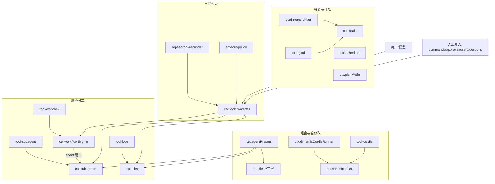
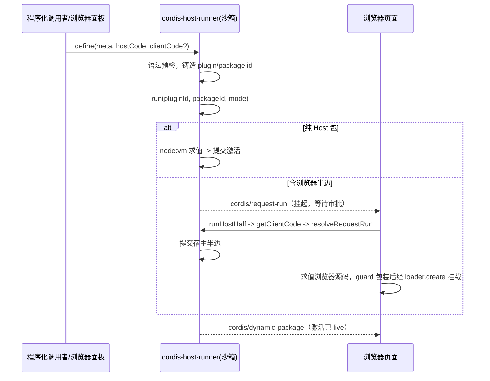

# 04 编排自动化与自修改

> **一句话总结**：让 agent 会分工、会等待、会自我约束、会改写自己。

| 项目 | 内容 |
|---|---|
| 回答的问题 | DSH 如何让 agent 委派子任务、把长任务放入后台、按计划唤醒、跨轮次追求一个目标，以及如何在运行时检视与改写自己的插件组合？ |
| 适合读者 | 已读过 [01-系统架构](../01-系统架构.md) 与 [01-内核与会话运行时](01-内核与会话运行时.md)，想理解编排与自修改子系统的工程师 |
| 前置阅读 | [01-系统架构](../01-系统架构.md)、[01-内核与会话运行时](01-内核与会话运行时.md)、[03-工具与执行环境](03-工具与执行环境.md) |
| 主要来源 | `packages/subagent/`、`packages/jobs/`、`packages/workflow/`、`packages/schedule/`、`packages/goal/`、`packages/plan/`、`packages/guard/`、`packages/preset/`、`packages/bundle/`、`packages/extensions/`、`packages/feedback/`、`packages/interaction/`、`packages/deliverables/` 各组与子包 README；`docs/subsystems/` 下 subagent、jobs、workflow、schedule、goal、plan、extensions、feedback、deliverables 等页 |

## 一、通俗理解（先读这一节）

### 这一卷在讲什么

一个只会「用户问一句、模型答一句」的 harness 做不了长活。真实任务需要：把活拆给多个执行者（分工）、等一件事发生时再继续（等待）、防止自己原地打转（自约束）、以及在自己的插件组合上开刀（自修改）。这四件事由 13 个包组承担，全部挂在 Cordis 插件树上，通过 `ctx` 服务互相发现。来源：`packages/README.md`、`AGENTS.md`。

### 分工：subagent 与 workflow

`subagent` 组定义一个委派 seam（能力缝）：一个 agent 把任务交给子 agent，拿回一个子会话 id，子 agent 完成后父 agent 收到通知。后端是可替换的 provider：`spawn` 开一个空会话的子进程内 agent，`fork` 用父会话已完成的轮次做种子，`acp`、`dsh-sdk`、Codex、Claude Code 则把子 agent 放到独立进程里。来源：`packages/subagent/README.md`。

`workflow` 组把「分工」写成脚本：模型写一段普通 JavaScript，用 `agent()`、`parallel()`、`pipeline()` 扇出大量子 agent，最后 `return` 一个 JSON 值。脚本在 PTC 的 Node 沙箱进程里跑，不是在同进程里跑。来源：`packages/workflow/workflow/README.md`、`packages/workflow/workflow-ptc/README.md`。

### 等待：jobs、schedule、goal

`jobs` 组管「同一条命里的后台任务」：长时间运行的命令注册成 job，返回 `bash-1` 这样的 id，owner（属主 agent 会话）之后可以读输出、等待、列出、取消；完成时收到会话内通知，不靠轮询。来源：`packages/jobs/jobs/README.md`。

`schedule` 组管「宿主级定时」：一次性延迟、绝对时刻、固定间隔、每日、每周、cron 六种规则；到点把提醒作为一条普通后续消息投递回原会话，宿主重启后任务仍在。来源：`packages/schedule/schedule/README.md`。

`goal` 组管「一个会话一个目标」：目标持久化在会话日志里，能暂停、恢复、完成、标记受阻；再挂上 `goal-round-driver` 后，空闲时自动接着跑下一轮（Round）。来源：`packages/goal/goal/README.md`、`packages/goal/goal-round-driver/README.md`。

### 自我约束：plan、guard、preset、permission

`plan-mode` 在动手前先探索和设计，把计划交给用户审批；它是软引导，不禁用任何工具。`guard` 组用两条小规则保住循环卫生：重复调用同一工具时提醒模型换招，工具调用超时后返回明确错误。`preset` 组用声明式 YAML 决定每个会话看到哪些工具、提示词和技能。`interaction` 组把沙箱模式与审批策略打包成一个「权限预设」选择器。来源：`packages/plan/plan-mode/README.md`、`packages/guard/README.md`、`packages/preset/README.md`、`packages/interaction/permission-presets/README.md`。

### 自修改：bundle 与 extensions

`bundle` 组是可安装的补丁层：每个包声明 `"dsh.bundle.patch"`，`dsh --profile` 把补丁叠成一份组合。`extensions` 组让 agent 用两个只读工具（`cordis_inspect_list`、`cordis_inspect_query`）检视运行时 API；动态 Cordis 包的生命周期由 `ctx.dynamicCordisRunner` 承担——Host 半边在 `node:vm` 里运行，浏览器半边由页面加载；**没有任何模型工具能创建动态定义**，动态包来自程序化调用者与浏览器面板，持久化安装走 Plugin Manager。来源：`packages/bundle/README.md`、`packages/extensions/README.md`。

### 直觉图

```text
用户/模型请求
   │
   ├─ subagent/workflow ──► 子 agent（spawn/fork/acp/…）──► 完成通知
   ├─ jobs ─────────────► 后台 job（bash-1 …）─────────► 会话内通知
   ├─ schedule ─────────► 宿主定时器 ──到点──► 原会话后续消息
   ├─ goal ─────────────► goal/change 事件 ──driver──► 下一轮 goal_round
   ├─ guard ────────────► 重复调用提醒 / 工具超时错误
   └─ extensions ───────► cordisInspect 检视 + dynamicCordisRunner 挂载 live 插件
```

## 二、技术细节

### 2.1 组级说明

| 组 | 包 | 一句话职责 | 关键 seam / 服务 |
|---|---|---|---|
| `subagent/` | 9 | 委派能力家族：服务定义、进程内/进程外后端、模型工具 | `ctx.subagents` |
| `jobs/` | 3 | 后台任务能力家族：注册契约、进程内实现、模型工具 | `ctx.jobs` |
| `workflow/` | 3 | 模型编写的编排脚本扇出子 agent | `ctx.workflowEngine` |
| `schedule/` | 2 | 宿主拥有的持久提醒与任务管理 | `ctx.schedule` |
| `goal/` | 4 | 每会话一个持久完成目标 + 工具 + 命令 + 自动续跑 | `ctx.goals` |
| `plan/` | 1 | plan mode：先设计、后审批 | `ctx.planMode` |
| `guard/` | 2 | 循环卫生：重复调用提醒与工具调用截止时间 | 挂在 `ctx.tools` waterfall |
| `preset/` | 3 | 声明式 agent 组合、选择与运行时修订 | `ctx.agentPresets` |
| `bundle/` | 6 | `dsh --profile` 使用的可安装补丁层 | `"dsh.bundle.patch"` |
| `extensions/` | 4 | 运行时 API 检视与动态 Cordis 包生命周期 | `ctx.dynamicCordisRunner`、`ctx.cordisInspect` |
| `feedback/` | 2 | 会话级与消息级人工反馈（不进入模型） | `ctx.messageFeedback`、`sessionFeedback` Remote |
| `interaction/` | 5 | 人工协作面：命令、审批、权限预设、提问 | `ctx.commands`、`ctx.approval`、`ctx.permissionPresets`、`ctx.userQuestions` |
| `deliverables/` | 2 | 记录一轮交付给用户的东西 | `ctx.workspaceChanges`、`deliverables/presented` 事件 |

### 2.2 包级条目表

| 包名 | 职责 | 关键服务/seam | 扩展点 | 来源 |
|---|---|---|---|---|
| `subagent/subagent` | 委派服务定义：provider 注册表、启动、续聊、发现 | `ctx.subagents` | 注册 provider；`subagent/catalog`、`subagent/descriptor` 事件 | `packages/subagent/subagent/README.md` |
| `subagent/subagent-spawn-in-process` | 进程内全新子会话后端，provider 名 `spawn` | 在 `ctx.subagents` 上注册 | provider 契约 | `packages/subagent/subagent-spawn-in-process/README.md` |
| `subagent/subagent-fork-in-process` | 进程内 fork 后端，用父已完成轮次作种子，provider 名 `fork` | 在 `ctx.subagents` 上注册 | provider 契约 | `packages/subagent/subagent-fork-in-process/README.md` |
| `subagent/subagent-acp` | 经 ACP 的进程外子 agent，一次性执行 | 在 `ctx.subagents` 上注册 | provider 契约 | `packages/subagent/subagent-acp/README.md` |
| `subagent/subagent-codex` | 经官方 app-server 协议启动真实 Codex 子会话 | 在 `ctx.subagents` 上注册 | provider 契约；Profile bundle | `packages/subagent/subagent-codex/README.md` |
| `subagent/subagent-claude-code` | 经官方 Agent SDK 启动真实 Claude Code 子会话 | 在 `ctx.subagents` 上注册 | provider 契约；Profile bundle | `packages/subagent/subagent-claude-code/README.md` |
| `subagent/subagent-dsh-sdk` | 经 TypeScript SDK 启动进程外 Harness 子运行时 | 在 `ctx.subagents` 上注册 | provider 契约 | `packages/subagent/subagent-dsh-sdk/README.md` |
| `subagent/tool-subagent` | 模型侧委派工具，一个实例绑定一个 provider | 注册到 `ctx.tools` | 每实例 `provider/toolName/persona/toolFilter/maxDepth` | `packages/subagent/tool-subagent/README.md` |
| `subagent/tool-subagent-control` | `send_message`、`interrupt_agent`，list-agents 插件提供 `list_agents` | 注册到 `ctx.tools` | 薄适配 `ctx.subagents` | `packages/subagent/tool-subagent-control/README.md` |
| `jobs/jobs` | 后台任务契约：id、属主、生命周期、输出环、事件流 | `ctx.jobs`（抽象 JobRegistry） | JobSpec/JobHandle；`events.subscribe` | `packages/jobs/jobs/README.md` |
| `jobs/jobs-local` | 进程内后台 job 注册表实现 | 在 `ctx.jobs` 上注册 | 每属主准入、输出环、teardown | `packages/jobs/jobs-local/README.md` |
| `jobs/tool-jobs` | 模型工具 `job_output/job_list/job_kill` 与完成通知 | 注册到 `ctx.tools` | 完成投递 lane（wakeup/quiet） | `packages/jobs/tool-jobs/README.md` |
| `workflow/workflow` | 编排能力 seam：脚本、run、result、`workflow/*` 事件 | `ctx.workflowEngine` | 可换 engine；事件只读 | `packages/workflow/workflow/README.md` |
| `workflow/workflow-ptc` | PTC Node 进程执行引擎（guest 程序 + host bindings） | 在 `ctx.workflowEngine` 上注册 | Node PTC/sandbox provider | `packages/workflow/workflow-ptc/README.md` |
| `workflow/tool-workflow` | 模型侧 `workflow` 工具，前台等待或后台 job | 注册到 `ctx.tools` | `toolName/maxResultChars/enableRunInBackground` | `packages/workflow/tool-workflow/README.md` |
| `schedule/schedule` | 宿主级持久提醒：存储域、定时器、投递、历史 | `ctx.schedule` | `schedule/changed`；archive admission | `packages/schedule/schedule/README.md` |
| `schedule/tool-schedule` | 预设作用域的四个提醒工具 | 注册到 `ctx.tools` | 委托 `ctx.schedule` | `packages/schedule/tool-schedule/README.md` |
| `goal/goal` | 每会话一个持久目标：事件溯源状态与 CAS 变更 | `ctx.goals` | `goal/change`、`goal/changed`、`goal/activation-changed` | `packages/goal/goal/README.md` |
| `goal/tool-goal` | 模型工具 `get_goal/create_goal/update_goal` | 注册到 `ctx.tools` | 执行期权限校验与提示段 | `packages/goal/tool-goal/README.md` |
| `goal/command-goal` | 人工 `/goal` 命令 | 注册到 `ctx.commands` | 命令语法与附件提交 | `packages/goal/command-goal/README.md` |
| `goal/goal-round-driver` | 空闲时自动续跑 goal 轮次 | 无服务键 | `goal/changed`、`agent/pre-step` 竞态栅栏 | `packages/goal/goal-round-driver/README.md` |
| `plan/plan-mode` | plan mode：进入/退出、`plan:policy` 段、`exit_plan_mode` | `ctx.planMode` | `plan/mode` 事件、`plan` 投影单元 | `packages/plan/plan-mode/README.md` |
| `guard/repeat-tool-reminder` | 完全重复调用达到阈值时提醒模型 | 挂在 `tools/post-execute` | `additionalContexts`、`thresholds/include/exclude` | `packages/guard/repeat-tool-reminder/README.md` |
| `guard/timeout-policy` | 给声明了 `timeoutMs` 的工具加协作式截止时间 | 挂在 `tools/execute` | `exec.signal` 替换与恢复 | `packages/guard/timeout-policy/README.md` |
| `preset/agent-preset-registry` | 预设选择、修订保留、聚合检视 | `ctx.agentPresets` | `"dsh-agent-preset"` 声明行、bundle 补丁 | `packages/preset/agent-preset-registry/README.md` |
| `preset/agent-preset` | 用普通 Cordis YAML 声明一个预设的子插件与元数据 | 要求 `ctx.agentPresets` | `plugins` 子项列表 | `packages/preset/agent-preset/README.md` |
| `preset/persona` | 预设内覆盖某个 agent 的人格前缀/后缀 | 作用域内注册 prompt section | `prefix/suffix/complete/includeRuntimeContext` | `packages/preset/persona/README.md` |
| `bundle/base` | 所有 base-backed profile 的共享核心补丁 | 无（纯 patch） | `"dsh.bundle.patch"` | `packages/bundle/base/README.md` |
| `bundle/web-app` | 浏览器 GUI profile 层 | 挂在 base 之上 | profile 补丁 | `packages/bundle/web-app/README.md` |
| `bundle/headless` | 一次性命令行任务 profile 层 | `headless-runner` | profile 补丁 | `packages/bundle/headless/README.md` |
| `bundle/acp-app` | 仅自动化的 ACP stdio 应用 | 挂在 base 之上 | profile 补丁 | `packages/bundle/acp-app/README.md` |
| `bundle/sdk-app` | SDK JSON-RPC stdio 应用 | 挂在 base 之上 | profile 补丁 | `packages/bundle/sdk-app/README.md` |
| `bundle/sdk-minimal` | 不带 base/Web 的独立最小 SDK 树 | 完整补丁树 | profile 补丁 | `packages/bundle/sdk-minimal/README.md` |
| `extensions/tool-cordis` | 两个只读运行时 API 检视工具 | 注册到 `ctx.tools`；宿主行注册 provider | `/host` 入口一次注册 | `packages/extensions/tool-cordis/README.md` |
| `extensions/cordis-host-runner` | Host 半边：定义注册表、vm 沙箱、inspect 注册表 | `ctx.dynamicCordisRunner`、`ctx.cordisInspect` | `cordis/*` 事件、Remote 方法 | `packages/extensions/cordis-host-runner/README.md` |
| `extensions/cordis-client-runner` | 浏览器半边：求值浏览器源码并挂载 live 插件 | 浏览器 `ctx.dynamicCordisRunner` | `host.call`、render failure 上报 | `packages/extensions/cordis-client-runner/README.md` |
| `extensions/ui-cordis` | 面板与历史 Cordis 卡片 | 客户端 slot | `tool.view.cordis` slot | `packages/extensions/ui-cordis/README.md` |
| `feedback/command-feedback` | 会话级反馈：`/feedback` 命令与 `sessionFeedback` Remote | `ctx.commands`、Remote | `feedback/record` 事件、七类分类法 | `packages/feedback/command-feedback/README.md` |
| `feedback/message-feedback` | 逐条 assistant 消息的评分/分类/备注 | `ctx.messageFeedback` | `feedback/message-put/delete` 事件 | `packages/feedback/message-feedback/README.md` |
| `interaction/commands` | 斜杠命令注册表，命令不产生模型消息 | `ctx.commands` | `ctx.commands.register()` | `packages/interaction/commands/README.md` |
| `interaction/user-approval` | 一次性审批 seam，缺失即 fail closed | `ctx.approval` | `approval/request` waterfall | `packages/interaction/user-approval/README.md` |
| `interaction/permission-presets` | 把沙箱模式与审批策略打包成一个选择器 | `ctx.permissionPresets` | `permission/preset` 事件、`permissions` 投影 | `packages/interaction/permission-presets/README.md` |
| `interaction/user-questions` | 结构化问答 seam，支持阻塞与定时 | `ctx.userQuestions` | `ask/askTimed`、`userQuestions` 投影 | `packages/interaction/user-questions/README.md` |
| `interaction/tool-ask-user` | 模型工具 `ask_user_question` | 注册到 `ctx.tools` | `mode: timed` 备用 schema | `packages/interaction/tool-ask-user/README.md` |
| `deliverables/tool-present` | 模型用 `present` 声明最终文件 | 注册到 `ctx.tools` | `deliverables/presented` 事件 | `packages/deliverables/tool-present/README.md` |
| `deliverables/workspace-changes` | 汇总每轮改动文件并服务 diff | `ctx.workspaceChanges` | `workspace/changes` 事件 | `packages/deliverables/workspace-changes/README.md` |

### 2.3 重点讲透

#### 2.3.1 subagent 的 provider registry 与委派工具

`ctx.subagents` 是一个「一个服务、多个 provider」的命名注册表：后端用唯一名字注册，请求按名字选一个。`SubagentManager` 统管启动、消息准入、容量、父子关系与销毁；本地子 agent 保留一个 AgentHandle，外部子 agent 保留一个 SubagentRun。来源：`packages/subagent/subagent/README.md`。

启动入口是 `startActivation({ provider, label, request, signal, delivery })`，返回 `{ childId, messageId?, result, dispose }`。传 `childId` 走本地后端并保证有 `messageId`；外部后端只暴露一次执行，拒绝续聊。`delivery: 'parent'` 生成模型可见的完成通知，`delivery: 'caller'` 让 workflow 自己收结果、不发父通知。本地父投递需要持久化；caller 投递可以用临时会话。来源：`packages/subagent/subagent/README.md`。

provider 名：`spawn`、`fork`、`acp`；Codex、Claude Code、DSH SDK 各自注册自己的名字。`tool-subagent` 的每个实例绑定一个 provider 与一个 `toolName`，只在该 provider 存在时注册工具，provider 卸载即撤下工具。来源：`packages/subagent/tool-subagent/README.md`。

容量与深度是两套策略：`maxActiveSubagents` 默认 8，限制一棵激活树里活着的子 agent（根父不占槽），超限以 `ACTIVATION_LIMIT_REACHED` 拒绝；`maxDepth` 默认 1，来自宿主 `subagent` 设置，工具自身配置可覆盖。来源：`packages/subagent/subagent/README.md`、`packages/subagent/tool-subagent/README.md`。

子 agent 的发现靠父会话里的 `subagent/catalog` 投影：创建成功即追加一条成员记录，已完成的子 agent 仍可被发现与打开；外部条目 `mode: 'external'` 是叶子。`tool-subagent-control` 提供 `send_message`、`interrupt_agent`，list-agents 子插件提供 `list_agents`（默认 `children`，`descendants` 递归）。来源：`packages/subagent/subagent/README.md`、`packages/subagent/tool-subagent-control/README.md`。

一个重要细节：每个进程内子 agent 的运行时上下文带固定语句，声明委派范围不能从内部加宽、需要更宽权限时不要重试、而要把限制写进回复。这段文本是子 agent prompt 前缀的一部分。来源：`packages/subagent/subagent/README.md`。

#### 2.3.2 jobs 的后台任务运行时

`ctx.jobs` 是抽象 JobRegistry 服务定义：直接加载类会抛错，必须由实现（`dsh-jobs-local`）提供，配置错误在加载期就失败。job 有稳定 id `"<kind>-N"`（如 `bash-1`），属主是被启动它的 agent 会话。来源：`packages/jobs/jobs/README.md`。

读写操作都接受可选调用者 `SessionId`：`list/get/read/readAt/kill/wait/remove`。`read` 推进模型游标并只在结算后交一次 producer 结果；`readAt` 按绝对字节偏移读保留块、完全不消费，观察者对模型不可见。来源：`packages/jobs/jobs/README.md`。

`jobs-local` 的默认值：`maxConcurrentJobsPerOwner` 10、`retainBytes` 262144、`settledRetainBytes` 16384、`pumpPollMs` 150。输出环有界：超过保留窗口的读是「有损」而非报错。来源：`packages/jobs/jobs-local/README.md`。

没有 controller（由 `tool-jobs` 挂载）的 agent 不能启动后台工作：`start()` 会以「缺少 controller」失败，而不是启动一个永远收不了尾的任务。来源：`packages/jobs/jobs/README.md`。

完成投递有两种 lane：`wakeup` 给空闲属主开一个新 turn，`quiet` 只做注入；忙碌属主的通知注入下一步，因此多个 job 同时完成只多花一步。`maxConsecutiveWakes` 给「唤醒→再启动后台 job→再唤醒」的自激链设上限。来源：`packages/jobs/tool-jobs/README.md`。

#### 2.3.3 workflow 的 PTC 引擎与 guest 契约

`ctx.workflowEngine` 是 seam：`workflow` 包只定义脚本、run、result 与事件；一个上下文同时只能有一个 engine，加载第二个会大声失败。事件 `workflow/start`、`workflow/end`、`workflow/phase`、`workflow/log`、`workflow/agent-start`、`workflow/agent-end` 全是只读，payload 是身份快照而不是 live run。来源：`packages/workflow/workflow/README.md`。

guest 契约：脚本是普通 JavaScript 函数体（不是 TypeScript），有顶层 `await`，以 `return <json-value>` 结束；`meta` 和 `args` 以纯 JSON 数据进入，永不求值成代码；可调用 `agent(prompt, opts)`、`parallel()`、`pipeline()`、`phase()`、`log()`。来源：`packages/workflow/workflow/README.md`。

结果永不 reject：脚本失败解析为 `stopReason: 'error'`，取消解析为 `"cancelled"`；普通子 agent 失败让 `agent()` 返回 `null` 交由脚本处理，而 hook 误用会大声杀掉脚本。`ctx.workflowEngine.start({ script, meta, args?, parent, signal? })` 先校验再建 run。来源：`packages/workflow/workflow/README.md`。

`workflow-ptc` 把 guest 程序放进全新 Node 进程，用调用会话的文件策略约束；`provider` 默认 `spawn`，`maxTotalAgents` 1000、`maxItemsPerCall` 4096、`syncTimeoutMs` 5000。它向 PTC 请求 `timeoutMs: null`（没有整体超时），取消会立即中止进程并处置子 agent。VM 与文件策略都不是安全边界：能触达 Node 的代码受 OS 策略约束。来源：`packages/workflow/workflow-ptc/README.md`。

`tool-workflow` 是模型入口：前台调用阻塞父 turn，返回 `{ runId, agentsStarted, result }`；`run_in_background: true` 立即返回 `{ jobId, runId }`，run 以 kind `workflow` 注册到 `ctx.jobs`，phase/log 行流入 job 输出环，结算作为 job 结算。来源：`packages/workflow/tool-workflow/README.md`。

#### 2.3.4 schedule 的宿主定时

`ScheduleService` 拥有一个 version-1 `schedule` 存储域、全局唯一任务 id 和一个宿主定时器。每个任务同时存会话绑定、记录和 `active/inactive` 状态；只有 active 任务驱动定时器。来源：`packages/schedule/schedule/README.md`。

六种选择器：`after_seconds`（正安全整数延迟）、`at`（严格未来的绝对时刻）、`every_seconds`（至少 60 秒的固定间隔）、`daily`（显式 IANA 时区的本地时刻）、`weekly`（再加 ISO 星期集合）、`cron`（五字段 Vixie 表达式 + 时区）。每条创建都必须给 `title`（去空白后非空、不超过 120 字符）。来源：`packages/schedule/schedule/README.md`。

投递经 `sessionController.resolveAgent` 解析原会话，`followup()` 同步写入会话 inbox，`session/flush` 确认持久投递后才写回任务行与历史。因此入队与任务写入不是原子的：flush 之后崩溃可能重复投递同一条提醒。来源：`packages/schedule/schedule/README.md`。

给模型的投递文本带固定框架 `[SCHEDULE REMINDER]`（一次性）或 `[SCHEDULE REMINDER BATCH]`（重复任务，每条只带最近一次遗漏，且同一会话的到期任务合并成一条）。来源：`packages/schedule/schedule/README.md`。

`tool-schedule` 的四个工具都拒绝委派子 agent 调用（深度大于 0 时返回 `subagent_session`）；服务层 `create/update` 同样拒绝。来源：`packages/schedule/tool-schedule/README.md`。

#### 2.3.5 goal 的同会话目标持久化

`GoalService` 用一个事件溯源状态：每次变更追加一条 version-1 `goal/change`，携带变更后完整快照；`clear` 写一条带修订号的 tombstone。会话日志是唯一持久权威，最对多一个当前 goal。来源：`packages/goal/goal/README.md`。

四个持久 phase：`active/paused/blocked/complete`；另有一个进程本地 `armed/disarmed` 标志，表示自动续跑是否已武装。任何 session-start 边界（新 cache、`agent/created`）都会 disarm，所以 resume/fork 后必须显式 `resume` 才会自己继续跑。来源：`packages/goal/goal/README.md`。

变更是 compare-and-set：`get()` 返回 detached `GoalView`，变更必须带 `{ id, revision }`，陈旧引用被拒绝而不是覆盖。`defaultMaxGoalRounds` 默认 256，只计已进入模型历史的 goal 轮次。来源：`packages/goal/goal/README.md`、`packages/goal/tool-goal/README.md`。

`tool-goal` 的权限规则：`create/edit/pause/resume` 需要 runtime-root agent 当前 turn 里有一条直接人类消息；`complete/blocked` 也接受当前 goal 轮次。模型的 `blocked` 在连续轮次达到阈值（默认 3）前被机械拒绝，模型仍需判断条件是否真的持续存在。来源：`packages/goal/tool-goal/README.md`。

`goal-round-driver` 在「恰好一个 live agent 空闲 + active + armed + 还有剩余轮次」时排队一条 `<goal_round>` 提示；只有真正进入 `user/message` 的轮次才消耗配额，到上限记 blocker `round-limit`。来源：`packages/goal/goal-round-driver/README.md`。

#### 2.3.6 plan/todo 的规划状态

`plan-mode` 是「产品包」而不是 seam：状态、引导文本、`/plan` 命令和 `exit_plan_mode` 工具都在一个包里。持久状态只有一条 log-only 的 `plan/mode` 整值替换事件，最近的日志值就是状态；resume、fork、compaction 靠折叠日志恢复。来源：`docs/subsystems/plan.md`、`packages/plan/plan-mode/README.md`。

因为每个会话事件都被 turn 包围，用户在 turn 中的选择先记作 pending，直到下一个被接受的 in-turn pre-step 才追加。`get` 返回 `{ active, pending? }`，客户端投影也是 `{ active, pending }`；turn 结束后才做的选择是进程本地的，进程退出即丢失。来源：`docs/subsystems/plan.md`。

`exit_plan_mode` 在 plan mode 未激活时也保持注册，因此进出 plan mode 只改变 `plan:policy` 提示段，不改变请求里的工具目录。审批通过会记一条「静默 pending exit」，在下一个 accepted pre-step 追加，所以当前工具批次内引导仍然有效。来源：`docs/subsystems/plan.md`。

Todo 状态不在本卷：`todo_write` 工具属于工具与执行环境卷，见 [03-工具与执行环境](03-工具与执行环境.md)。`docs/subsystems/todo.md` 是它的子系统页。来源：`packages/README.md`。

#### 2.3.7 guard 的循环卫生

`repeat-tool-reminder` 在 `tools/post-execute` 上统计「同一工具 + 规范化后完全相同的参数」的连续次数（deep key-sort 后再 `JSON.stringify`，属性顺序无关）；不同工具/参数重置计数，`include/exclude` 未跟踪的调用既不增也不重置。默认阈值 `[3, 5, 8]`，`argumentsPreviewChars` 默认 500。来源：`packages/guard/repeat-tool-reminder/README.md`。

提醒通过 post-execute 决策的 `additionalContexts` 附加，而不是替换工具结果，所以 `tool/result` 审计仍是工具自己的输出；循环把它作为注入的 `user/message` 追加，来源标注为插件。它是纯建议，从不阻塞调用；计数按 agent 存在 `WeakMap` 里，用户新消息清空。来源：`packages/guard/repeat-tool-reminder/README.md`。

`timeout-policy` 在 `tools/execute` 上读被派发工具自己的 `ToolDefinition.timeoutMs`（来自 `ctx.tools.get(exec.name, exec.agent)?.timeoutMs`），用 `deadline(exec.signal, timeoutMs, TOOL_TIMEOUT)` 合成融合信号并在 `finally` 恢复调用者信号。来源：`packages/guard/timeout-policy/README.md`。

它是协作式而非硬杀：截止时间只通过 `exec.signal` 通知，忽略取消的工具会让调用者继续等，直到下游结算才返回 `Error: tool call timed out after <ms>ms` 与结构化 `TOOL_TIMEOUT`。没有全局默认预算——只有声明了 `timeoutMs` 的工具受保护。来源：`packages/guard/timeout-policy/README.md`。

#### 2.3.8 preset 的每会话组合

`ctx.agentPresets`（`agent-preset-registry`）负责选择、修订保留和 profile 编辑。每个声明会急切地创建一个注册表作用域和一棵内存 Loader 树；更新或删除声明会退役旧修订，等最后一个引用释放后销毁。来源：`packages/preset/agent-preset-registry/README.md`。

`agent-preset` 用普通 Cordis YAML 声明一个 agent 的子插件与元数据（`id` 必需、`plugins` 必需、`name/description/order` 可选）；声明行的 `id` 供 Loader 编辑寻址，`config.id` 是会话保存的预设身份。来源：`packages/preset/agent-preset/README.md`。

组合隔离要求 provider 与 consumer 共享同一个 `cordis:group` realm；普通的 `Context` 查找（包括 `agent.ctx`）仍落在 Host realm，只有 `agentPresets.serviceFor()` 会显式看保留的组合。`inspectCompositions()` 读该注册表保留的所有修订。来源：`packages/preset/agent-preset-registry/README.md`。

`persona` 只能在 agent 作用域内挂载，用共享 section 名覆盖部署级人格；`complete: true` 让渲染后的 prefix 成为唯一系统提示，`includeRuntimeContext: false` 关闭该作用域的全部运行时上下文贡献（不关闭其服务）。来源：`packages/preset/persona/README.md`。

#### 2.3.9 bundle 的可安装 profile 补丁层

每个 bundle 包声明 `"dsh.bundle.patch"`；`dsh` 启动器把这些补丁文档叠成一个命名 profile。`web`、`headless`、`acp`、`sdk` 都建立在 `dsh-base` 上，`sdk-minimal` 则自带完整树、不使用 base。来源：`packages/bundle/README.md`。

补丁语义：一条 patch 条目替换目标行的整个 `config` 而不是合并；后叠加的 bundle 与用户 `cordis.patch.yml` 按行 id 覆盖，最后一个写入者生效。来源：`packages/bundle/base/README.md`。

`dsh-base` 提供 DeepSeek 模型连接、完整工具集、持久会话与默认权限策略；平台门控在补丁自己的行上：`bash-sandbox/tool-bash` 用 `"disabled: !!js process.platform === 'win32'"`，`pwsh-sandbox/tool-pwsh` 用相反表达式。来源：`packages/bundle/base/README.md`。

`sdk-minimal` 明确排除 base、Web、settings、凭据、telemetry、compaction、文件系统工具、workspace 指令、技能、jobs 与 subagent，默认危险全访问，因此只应在隔离工作区使用。来源：`packages/bundle/sdk-minimal/README.md`。

#### 2.3.10 extensions 的运行时自修改

`extensions` 组把「检视」与「改写」分成两半。检视侧 `tool-cordis` 贡献两个只读工具：`cordis_inspect_list` 发现 provider，`cordis_inspect_query` 查询某个 provider 的精确方法与类型；Host provider 组合生成的 Service/Event 目录、经 app-boot Config projector 投影的 live Loader 树，以及请求 agent 的工具注册表。来源：`packages/extensions/tool-cordis/README.md`。

改写侧的 Host 半边是 `cordis-host-runner`：`ctx.dynamicCordisRunner`（`DynamicCordisRunnerService`）把注册表与沙箱合成一个服务，拥有定义注册表、`node:vm` 沙箱、Host 半边 fiber 生命周期与 invoke 处理器表；`ctx.cordisInspect`（`CordisInspectRegistryService`）是检视注册表与跨页路由。版本是不可变 package：`define` 之后 package 永不改变，`mode: "run"` 跑当前版本，`mode: "update"` 替换它；`stop` 撤销 live dispatch 但保留定义，`undefine` 才忘记定义。来源：`packages/extensions/cordis-host-runner/README.md`、`docs/subsystems/extensions.md`。

一次 run 的往返：`define` 校验元数据、对每一半做只编译不运行的语法预检、铸造 plugin/package id；纯 Host 包直接在沙箱求值并提交，带浏览器半边的包则挂起审批请求、发出 `cordis/request-run` 并等待。答题页面依次走 `runHostHalf`、`getClientCode`、`resolveRequestRun`；成功命名 live 修订才提交激活。转发事件 `cordis/request-run`、`cordis/request-run-resolved`、`cordis/dynamic-package`、`cordis/dynamic-retract` 在 client-safe `./types` 子路径声明，并由 `dsh-api-remotes` 允许投递，浏览器才能通过 `ctx.remote.$on` 收到。来源：`packages/extensions/cordis-host-runner/README.md`。

浏览器半边由 `cordis-client-runner` 加载：它必须是普通 JavaScript 异步函数体（无 JSX、无 TypeScript、无模块 import），只拿到 `React`、`console`、`styles`、`host` 这几个名字，`fetch/setTimeout` 等浏览器全局不可用；返回的插件只能声明的 `inject` 与生命周期动词，`host.call(method, args)` 到达自己的 Host 半边。来源：`packages/extensions/cordis-client-runner/README.md`。

信任立场要写清楚：沙箱隔离全局但**不是安全边界**——Host 半边拿到的 Node 全局缺失或重定向到 Cordis 服务，但它声明的服务能触达活运行时，因此文档建议「把动态包当作 bash 访问一样对待」。`vmTimeoutMs` 默认 5000 只约束同步求值，异步 Host 半边能逃出它。来源：`packages/extensions/cordis-host-runner/README.md`。

一个关键的当前状态：**当前发布的模型工具是只读检视**。`cordis-host-runner` README 明确写「没有模型工具会创建动态定义」「已发布的模型工具不能创建或更新动态定义」；定义注册表由程序化调用者与浏览器面板操作，而持久化的自修改走 Plugin Manager（`packages/boot/plugin-manager`）。`ui-cordis` 渲染的 `cordis_define`、`cordis_run`、`cordis_stop`、`cordis_undefine` 是历史生成插件卡片。来源：`packages/extensions/cordis-host-runner/README.md`、`packages/extensions/ui-cordis/README.md`。

#### 2.3.11 feedback 与 interaction 的人工介入

feedback 分两级且都不进入模型：`command-feedback` 的 `/feedback` 命令写一条 append-only 的 `feedback/record`，Web 对话框经 `sessionFeedback.record` 写同一事件；`message-feedback` 的 `ctx.messageFeedback` 用 `list/put/delete` 管理逐条 assistant 消息的评分、分类与备注，状态由会话日志的 `feedback/message-put`/`feedback/message-delete` 事件派生。两者都对模型不可见。来源：`packages/feedback/command-feedback/README.md`、`packages/feedback/message-feedback/README.md`。

interaction 的四条人工通道：`ctx.commands` 让 `/command` 直接对 agent 执行而不产生模型消息（`command/run`、`command/done` 是 log-only 独立追加，不包围 turn）；`ctx.approval` 的 `ask/never` 策略把一次性审批交给 `approval/request` waterfall，没有回答者就 `unavailable` 并 fail closed，审计写 `approval/asked`/`approval/decided`。来源：`packages/interaction/commands/README.md`、`packages/interaction/user-approval/README.md`。

`permission-presets` 把沙箱模式与审批策略绑成一个用户可见选择器：切换时只写有效值不同的旋钮，经 `setSandboxMode` 与 `setApprovalPolicy`，再追加 `permission/preset`；`custom` 是派生状态，`auto` 由 Auto review 集成临时贡献。来源：`packages/interaction/permission-presets/README.md`。

`ctx.userQuestions` 提供 `ask()`（必须等答案）与 `askTimed()`（前台等待超时后放模型继续独立工作，问题仍可答）；`tool-ask-user` 把它暴露成 `ask_user_question`，默认阻塞、`mode: timed` 切换备用 schema。被委派的 live 子 agent 会被 `DELEGATED_CALLER` 拒绝。来源：`packages/interaction/user-questions/README.md`、`packages/interaction/tool-ask-user/README.md`。

#### 2.3.12 deliverables 的交付物记录

`tool-present` 的 `present` 工具校验路径是会话文件系统可达的普通文件，成功时追加 log-only 事件 `deliverables/presented: { turn; callId; files: PresentedFile[] }`。它只记路径与可选描述，不复制内容；父 agent 必须自己调用才能声明子 agent 创建的文件。来源：`packages/deliverables/tool-present/README.md`、`docs/subsystems/deliverables.md`。

`workspace-changes` 在 turn 起止各取一次 git 工作树快照并 diff，同时对每个被文件工具改动的路径在首次改动前与 turn 结束各整文件复制一次，覆盖 git 不覆盖的路径；没有仓库或 git 时只列文件工具改动。turn 停止时追加一条只带 turn 号的 `workspace/changes`。来源：`packages/deliverables/workspace-changes/README.md`。

汇总和 diff 不写入日志：`ctx.workspaceChanges.summary(sessionId, seq)` 与 `.diff(sessionId, seq, index, signal)` 只在 Session 存活期间由 Host 服务返回，Session 销毁或 Host 重启后旧 turn 没有卡片，这是已决定的「读不到内容就不显示」。来源：`packages/deliverables/workspace-changes/README.md`、`docs/subsystems/deliverables.md`。

### 2.4 依赖关系图



图注：实线表示「调用/注册/委托」关系。`ctx.tools` 的 execute waterfall 是所有模型工具的共同入口，guard 与人工介入都挂在它上面；preset 决定每个会话看到哪些工具，bundle 决定进程启动时装了哪些插件；extensions 的检视工具读的是运行时，动态包生命周期则通过 `ctx.dynamicCordisRunner` 影响后续请求。来源：`packages/guard/README.md`、`packages/preset/README.md`、`packages/extensions/README.md`、`packages/interaction/README.md`。

### 2.5 关键时序：subagent 委派

```mermaid
sequenceDiagram
  participant M as 父 agent 模型
  participant T as tool-subagent
  participant S as SubagentManager(ctx.subagents)
  participant P as provider(spawn/fork/acp/…)
  participant C as 子 agent
  participant PAR as 父会话
  M->>T: subagent(prompt, cwd?)
  T->>S: startActivation({provider, delivery:'parent'})
  S->>S: 解析 provider、预留容量与 childId
  S->>P: prepareContinuable()/start()
  P->>C: 创建/物化子 agent（继承 cwd、权限根、来源元数据）
  S-->>T: { childId }
  T-->>M: "started subagent <childId>"
  S->>PAR: 追加 subagent/catalog 成员事实
  C->>C: 在子会话里执行任务
  C-->>S: 结算（输出/结构化数据/停止原因）
  S->>S: 释放容量、清理、结算通知
  S-->>PAR: 投递完成通知（子 agent 最终文本）
  PAR-->>M: 下一步看到通知
```

图注：委派是「先发布再完成」——`startActivation` 在子 agent 被接受、句柄能取消该次执行之后才返回；工具调用本身不等待结果，完成通过会话内通知到达父 agent。来源：`packages/subagent/subagent/README.md`、`packages/subagent/tool-subagent/README.md`。

#### 附：extensions 挂载时序（浏览器半边）



图注：浏览器半边只能由页面携带，所以服务发出请求后挂起，页面裁决（审批或用户手势）才能提交。刷新页面不会恢复定义，必须再次显式 run。来源：`packages/extensions/cordis-host-runner/README.md`、`packages/extensions/cordis-client-runner/README.md`。

## 三、常见误解

- ❌ 子 agent 默认共享父会话上下文 → ✅ `spawn` 子 agent 从空会话开始、任务提示必须自足；`fork` 只播种父已完成轮次，当前进行中的那轮不可见，且种子是 fork 时刻的一次性快照。来源：`packages/subagent/subagent-spawn-in-process/README.md`、`packages/subagent/subagent-fork-in-process/README.md`。
- ❌ workflow 能在后台分阶段取中间值 → ✅ 前台调用阻塞父 turn；`run_in_background` 立即返回 `jobId`，但结算前 `job_output` 只给状态，返回值整体在完成时到达。来源：`packages/workflow/tool-workflow/README.md`。
- ❌ 设了 goal 就会自己一直跑 → ✅ 状态与调度分离；必须另挂 `goal-round-driver`，且 resume/fork 后 active 目标处于 disarmed，需要显式 `resume`。来源：`packages/goal/goal/README.md`、`packages/goal/goal-round-driver/README.md`。
- ❌ plan mode 会限制工具 → ✅ 它是软引导，所有工具仍可用；要强制限制得另外配置 sandbox mode 与审批策略。来源：`packages/plan/plan-mode/README.md`。
- ❌ extensions 让模型直接写代码挂载插件 → ✅ 当前发布的模型工具 `cordis_inspect_list`/`cordis_inspect_query` 是只读检视；动态定义由程序化调用者与浏览器面板操作，持久化自修改走 Plugin Manager，`ui-cordis` 的 define/run 卡片是历史记录。来源：`packages/extensions/cordis-host-runner/README.md`、`packages/extensions/tool-cordis/README.md`。
- ❌ timeout-policy 能硬性终止超时工具 → ✅ 它是协作式：只 abort `exec.signal`，忽略取消的工具仍会让调用者等待；且只有声明 `timeoutMs` 的工具受保护。来源：`packages/guard/timeout-policy/README.md`。
- ❌ 后台 job 能跨进程或重启存活 → ✅ `jobs-local` 是进程内记录，随 harness 进程退出而消失；跨重启需要另实现同一契约。来源：`packages/jobs/jobs-local/README.md`。
- ❌ 反馈会进入模型或影响回答 → ✅ 会话级与消息级反馈都是 log-only，不进模型历史、不进 prompt，也不打断 turn。来源：`packages/feedback/README.md`。

## 四、关键文件索引

| 路径 | 作用 |
|---|---|
| `packages/subagent/subagent/src/manager.ts` | 统一启动、消息准入、冷恢复、父子归属、结算与销毁 |
| `packages/subagent/subagent/src/catalog.ts` | 父拥有的 `subagent/catalog` 事件与分块宿主投影 |
| `packages/subagent/tool-subagent/src/model-selection.ts` | 子模型请求/配置合并与 live LLM 路由预检 |
| `packages/jobs/jobs/src/types.ts` | JobSpec/JobHandle/JobOutcome/JobEvent 与读取结果 |
| `packages/jobs/jobs-local/src/ring.ts` | 有界输出环：追加、保留裁剪、偏移读取 |
| `packages/jobs/tool-jobs/src/render.ts` | 模型侧投影、状态行、消费式增量渲染 |
| `packages/workflow/workflow-ptc/src/guest.ts` | PTC host bindings 上的 guest 适配 |
| `packages/workflow/workflow-ptc/src/runtime.ts` | VM 求值、helper 契约与组合子 |
| `packages/workflow/tool-workflow/src/record.ts` | 后台 run 的 live 进度镜像进 job 输出环 |
| `packages/schedule/schedule/src/domain.ts` | 选择器、重复算术与提醒措辞 |
| `packages/schedule/schedule/src/runtime.ts` | 宿主定时器与入队顺序 |
| `packages/goal/goal/src/fold.ts` | 持久 goal change 的严格重放折叠与解码 |
| `packages/goal/goal-round-driver/src/prompt.ts` | 保留的 `<goal_round>` 续跑提示 |
| `packages/plan/plan-mode/src/index.ts` | `ctx.planMode` 服务、`plan:policy` 段、`/plan` 命令、`exit_plan_mode` |
| `packages/guard/repeat-tool-reminder/src/index.ts` | Config 校验与重复链监听 |
| `packages/guard/timeout-policy/src/index.ts` | `TOOL_TIMEOUT` 与 `tools/execute` 包装 |
| `packages/preset/agent-preset-registry/src/mount.ts` | 作用域插件树与激活审计 |
| `packages/bundle/base/cordis.patch.yml` | base 组合的主体：插件行与逐行理由 |
| `packages/extensions/cordis-host-runner/src/registry.ts` | 定义存储：plugin/package 身份、run 尝试、审批请求 |
| `packages/extensions/cordis-host-runner/src/sandbox.ts` | `node:vm` 求值：全局、Node API 陷阱、define 期语法预检 |
| `packages/extensions/cordis-host-runner/src/inspect-registry.ts` | `ctx.cordisInspect`：Host provider 与镜像的 Client manifest |
| `packages/extensions/cordis-client-runner/src/client/runtime.ts` | 按 run 身份收敛的加载引擎、受保护挂载与撤回 |
| `packages/interaction/user-approval/src/index.ts` | `ApprovalService`：请求派发、策略折叠、运行时上下文贡献 |
| `packages/interaction/permission-presets/src/index.ts` | 配置表、固定 Auto 注册、写路径、会话钉扎 |
| `packages/deliverables/workspace-changes/src/types.ts` | `WorkspaceChangesSummary`/`WorkspaceFileDiff` 等类型 |
| `docs/subsystems/extensions.md` | 生成的 `ctx.cordisInspect`/`ctx.dynamicCordisRunner` 与 `cordis/*` 事件 |
| `docs/subsystems/subagent.md` | 委派服务契约、provider 契约与终态结果语义 |

## 五、延伸阅读

- [01-系统架构](../01-系统架构.md)：先看整体分层与 capability seam 的定义。
- [01-内核与会话运行时](01-内核与会话运行时.md)：会话日志、投影与 `Agent` 生命周期，本卷所有状态都落在其上。
- [03-工具与执行环境](03-工具与执行环境.md)：`ctx.tools` waterfall、PTC 运行时与 `todo_write`。
- [05-数据身份与用户状态](05-数据身份与用户状态.md)：本卷的 storage、workspace、settings、credentials 等基础。
- [07-开发者接口与集成](07-开发者接口与集成.md)：Plugin Manager、bundle 安装与 SDK/ACP 应用层。
- 子系统参考：`docs/subsystems/subagent.md`、`docs/subsystems/jobs.md`、`docs/subsystems/workflow.md`、`docs/subsystems/schedule.md`、`docs/subsystems/goal.md`、`docs/subsystems/plan.md`、`docs/subsystems/extensions.md`、`docs/subsystems/deliverables.md`。
