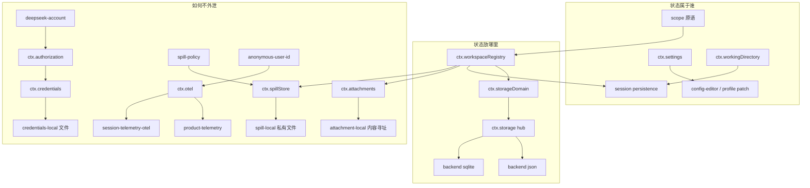
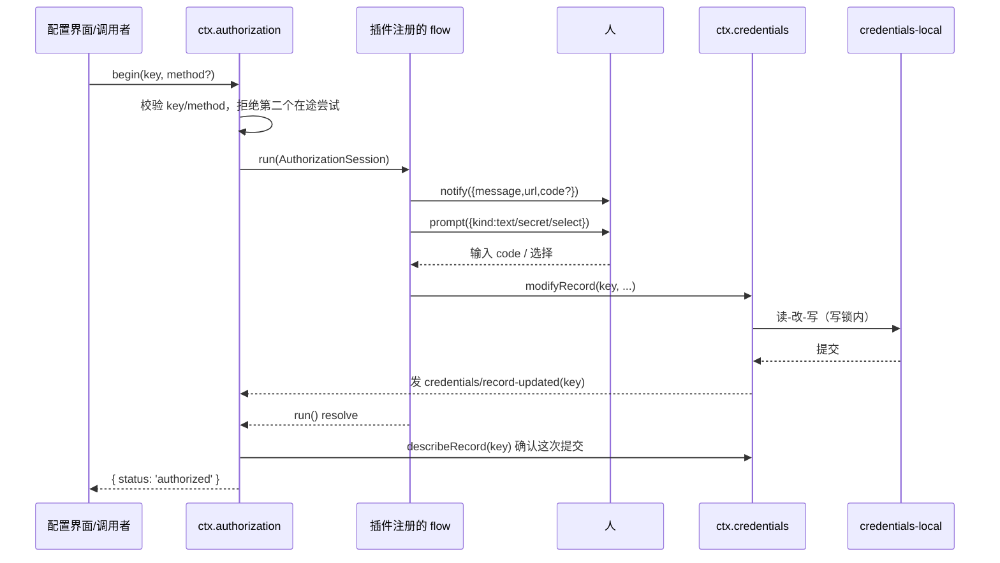

# 05 数据身份与用户状态

> **一句话总结**：状态放在哪里、属于谁、如何不外泄。

> **适用版本**：DeepSeek Harness `0.2.1-alpha.2`（`master` @ `d743267388`）· 核对日期 2026-10-12

| 项目 | 内容 |
|---|---|
| 回答的问题 | DSH 把非会话应用数据放在哪里、谁拥有它、如何把密钥与用户数据挡在模型和配置之外？ |
| 适合读者 | 已读过 [01-系统架构](../01-系统架构.md) 与 [01-内核与会话运行时](01-内核与会话运行时.md)，需要理解持久化、身份与用户状态子系统的工程师 |
| 前置阅读 | [01-系统架构](../01-系统架构.md)、[01-内核与会话运行时](01-内核与会话运行时.md)、[04-编排自动化与自修改](04-编排自动化与自修改.md) |
| 主要来源 | `packages/storage/`、`packages/workspace/`、`packages/settings/`、`packages/credentials/`、`packages/attachment/`、`packages/spill/`、`packages/identity/`、`packages/telemetry/` 各组与子包 README；`docs/subsystems/` 下 storage、workspace、settings、credentials、attachment、spill、otel、product-telemetry、scope、working-directory、worktrees 等页 |

## 一、通俗理解（先读这一节）

### 这一卷在讲什么

会话日志（session log）记的是「模型看得见的东西」，但一个产品还需要另一类状态：项目列表、插件配置、API 密钥、用户贴的图片、被截断的大结果、匿名安装 id、上报通道。这些都不是会话事件，却必须跨重启存在，而且大多不能让模型看到。这一卷按三个问题组织：状态放在哪里、属于谁、如何不外泄。来源：`packages/storage/README.md`、`AGENTS.md`。

### 状态放在哪里：storage 与 workspace

`storage` 组是「非会话持久化」的底座：`ctx.storage` 只是一张注册表，把后端（json / sqlite）和数据形态（目前只有 `kv`）连起来；`ctx.storageDomain` 在其上提供带 zod schema 的 KV 域，读同步走内存、写在 resolve 前落盘并发 `domain/changed`。`workspace` 是它的第一个消费者，把项目目录与会话分组存成一个 version 2 的域。来源：`packages/storage/README.md`、`packages/storage/storage-domain/README.md`、`packages/workspace/workspace/README.md`。

### 状态属于谁：settings、scope、working-directory

`settings` 只投影插件用 `.volatile()` 声明的字段，按「活动 profile 中唯一定位的 entry id」给每个命名空间建表单，编辑经 Cordis patch 持久化。`scope` 是「一次注册同时意味着每个 agent 的可见性与共享生命周期的所有权」这个原语。`working-directory` 把「原项目」与「当前工作目录」分开：header 记原项目，`working-directory/change` 记后续生效目录。来源：`packages/settings/settings/README.md`、`docs/subsystems/scope.md`、`docs/subsystems/working-directory.md`。

### 如何不外泄：credentials、attachment、spill、identity、telemetry

`credentials` 让配置里只写密钥名不写值，并区分「引用（reference，环境变量形状）」与「记录（record，`<scope>/<id>` 形状）」；`authorization` 用一次和人对话的流程把无法由配置提供的凭据写进记录。`attachment` 把图片与普通文件按内容寻址存到本机，会话事件里只留不可变引用。`spill` 把超长工具结果存到模型上下文之外，只回一个 locator 与检索提示。`identity` 每台 harness home 一个随机匿名 id。`telemetry` 提供 OTel 传输通道，但授权、脱敏、身份都由业务消费者自己决定。来源：`packages/credentials/README.md`、`packages/attachment/README.md`、`packages/spill/README.md`、`packages/identity/README.md`、`packages/telemetry/README.md`。

### 直觉图

```text
状态放在哪里                     属于谁                        如何不外泄
──────────────────────────      ──────────────────────       ─────────────────────────
ctx.storage (hub)               session id / scope           credentials: 配置只写引用
 ├─ backend json / sqlite        ├─ session events            authorization: 人机对话换记录
 └─ ctx.storageDomain (kv)       ├─ settings 表单 entry       attachment: 内容寻址 + 引用
workspace domain (v2)            └─ workspace 项目             spill: locator + 提示
                                              identity: 随机匿名 id
                                              telemetry: 通道，策略归消费者
```

## 二、技术细节

### 2.1 组级说明

| 组 | 包 | 一句话职责 | 关键服务/seam |
|---|---|---|---|
| `storage/` | 4 | 非会话持久化：后端注册表 + schema 化 KV 域 + 两种介质 | `ctx.storage`、`ctx.storageDomain` |
| `workspace/` | 1 | 命名有序的项目目录与会话分组 | `ctx.workspaceRegistry` |
| `settings/` | 1 | 由 Config schema 派生的插件配置表单 | `ctx.settings` |
| `credentials/` | 5 | 凭据引用/记录、本机存储、授权流、DeepSeek 账号 | `ctx.credentials`、`ctx.authorization` |
| `attachment/` | 2 | 持久图片与普通文件附件，内容寻址存储 | `ctx.attachments` |
| `spill/` | 3 | 超长文本外溢：服务、本机后端、结果策略 | `ctx.spillStore` |
| `identity/` | 1 | 每 harness home 一个匿名关联 id | 库函数，无服务键 |
| `telemetry/` | 1 | 共享 OTel 传输：普通事件通道与会话日志通道 | `ctx.otel` |

### 2.2 包级条目表

| 包名 | 职责 | 关键服务/seam | 扩展点 | 来源 |
|---|---|---|---|---|
| `storage/storage` | 存储 hub：后端注册表与数据形态挂载 | `ctx.storage` | `register()/mount()` 返回 disposer；`storage.backend.<name>` | `packages/storage/storage/README.md` |
| `storage/storage-domain` | schema 校验、变更通知的 KV 域 | `ctx.storageDomain` | `defineDomain`；`domain/changed` 事件 | `packages/storage/storage-domain/README.md` |
| `storage/storage-json` | JSON 后端，注册名 `json`，single / per-record 布局 | 在 `ctx.storage` 上注册后端 | 原子替换 + fsync；布局由域 spec 选 | `packages/storage/storage-json/README.md` |
| `storage/storage-sqlite` | SQLite 后端，注册名 `sqlite`，一库一文件、一记录一行 | 在 `ctx.storage` 上注册后端 | `path/journalMode`；STRICT 表 | `packages/storage/storage-sqlite/README.md` |
| `workspace/workspace` | 命名有序项目、会话成员、归档准入 | `ctx.workspaceRegistry` | `workspace/session-activity`、`workspace/session-stop` | `packages/workspace/workspace/README.md` |
| `settings/settings` | volatile 字段的表单投影与带修订的编辑 | `ctx.settings` | `settings/document-updated`；`configure()` | `packages/settings/settings/README.md` |
| `credentials/credentials` | 凭据引用与记录的服务定义 | `ctx.credentials` | `credentials/reference-updated`、`credentials/record-updated` | `packages/credentials/credentials/README.md` |
| `credentials/credentials-local` | 本机私有 YAML 存储与固定优先级解析 | 在 `ctx.credentials` 上注册 | 环境 > 存储文件 > 项目 .env > home .env | `packages/credentials/credentials-local/README.md` |
| `credentials/authorization` | 插件拥有的授权流注册表 | `ctx.authorization` | `registerFlow()/begin()/cancel()` | `packages/credentials/authorization/README.md` |
| `credentials/deepseek-account` | 账号操作与可重连状态快照 | `ctx.deepseekAccount`（服务） | 账号事件 `deepseek-account/*` | `packages/credentials/deepseek-account/README.md` |
| `credentials/deepseek-account-platform` | Platform 协议与本地授权持久化 | 账号 provider | 浏览器登录回调、五类客户端头 | `packages/credentials/deepseek-account-platform/README.md` |
| `attachment/attachment` | 持久图片/文件附件服务定义 | `ctx.attachments` | `admitPromptContent/admitEncodedFile/saveFile` | `packages/attachment/attachment/README.md` |
| `attachment/attachment-local` | 本机内容寻址附件存储 | 在 `ctx.attachments` 上注册 | 归一化/请求版本缓存/verify-on-read | `packages/attachment/attachment-local/README.md` |
| `spill/spill` | 外溢存储服务定义：`saveText` 单方法 | `ctx.spillStore` | 后端实现；无检索/删除 API | `packages/spill/spill/README.md` |
| `spill/spill-local` | 本机私有、会话分组的文件后端 | 在 `ctx.spillStore` 上注册 | `root/cleanupPeriodDays`；启动清理 | `packages/spill/spill-local/README.md` |
| `spill/spill-policy` | 超预算工具结果换成预览 + locator | 监听 `ctx.tools` | `maxInlineTokens`；`tools/ptc-dispatch-log` | `packages/spill/spill-policy/README.md` |
| `identity/anonymous-user-id` | 每 home 随机匿名 id | 库函数 | 删除 `.anonymous-user-id` 即重置 | `packages/identity/anonymous-user-id/README.md` |
| `telemetry/otel` | 独立普通事件 / 会话日志 OTel 通道 | `ctx.otel` | `createEventReporter/createSessionLogReporter` | `packages/telemetry/otel/README.md` |

### 2.3 重点讲透

#### 2.3.1 storage hub 与后端

`ctx.storage` 是纯注册表，有两面：后端名到后端实现的表，数据形态名到 facility 的映射。它从不做 IO；后端拥有介质，数据形态拥有语义，二者互不知道细节。可以同时挂多个后端，哪个域由哪个后端服务是域形态的配置（`backend` 默认路由 + `routes` 覆盖），不是 hub 的全局二选一。来源：`packages/storage/storage/README.md`。

注册与挂载都是 effect：`register()`/`mount()` 返回 disposer，只移除本次贡献、不关闭后端（由拥有插件先注销再关闭）。为了让激活不竞态，每个后端插件还发布只用于生命周期的服务键 `storage.backend.<name>`，形态 provider 注入这些键，因此域形态只在每个配置的后端注册后才激活。来源：`packages/storage/storage/README.md`。

后端契约（`src/backend.ts`，由共享一致性套件 `tests/contract.ts` 逐条检查）：一个后端拥有一种介质，暴露可选数据形状 facet，`kv` 是唯一一个；打开一个 unit 得到带版本、全局单例的 schema 句柄，单次调用原子且 resolve 即持久。version 与描述符不一致会以 `version-mismatch` 拒绝，没有迁移。来源：`packages/storage/storage/README.md`。

`storage-domain` 用一个 spec 对象做唯一事实来源：`defineDomain({ name, version, tables })` 在所属包模块加载时就校验字段。读是内存中的同步读，每次写先落盘再改内存再发 `domain/changed`；`put/delete/update/global.set` 都排在每个域一条写链上，`update` 的变换在自己的链位上运行。写事件在提交点之后发出，监听器抛错只记日志、不影响已持久化的写。来源：`packages/storage/storage-domain/README.md`。

两个 shipped 后端：`storage-json` 的 `single` 布局让内存权威、每次写重写整个 `<unit>.json`，`per-record` 布局让目录树权威、每次只改一个文档；两者都用临时文件 + fsync + 原子 `rename()` 发布。`storage-sqlite` 把每个 unit 表映射成 `u_<unit>_<table> (key TEXT PRIMARY KEY, value TEXT)` 的 STRICT 表，单键更新只动一行；物理布局版本放 `PRAGMA user_version`，非当前版本直接拒绝。来源：`packages/storage/storage-json/README.md`、`packages/storage/storage-sqlite/README.md`。

失败码是稳定的：hub 侧 `backend-not-found`、`form-not-mounted`、`duplicate-backend`、`duplicate-mount`；域侧 `already-open`、`facet-unsupported`、`invalid-record`、`missing-key`、`closed`。这些状态都不进模型：整个组不注册工具、不加 prompt、不写会话事件。来源：`packages/storage/storage/README.md`、`packages/storage/storage-domain/README.md`。

#### 2.3.2 workspace 实体

`workspace` 打开 version 2 的 `workspace` 域：`workspaces` 表以 `WorkspaceId` 为键，加一个 global 状态保存 `workspaceIds`（权威显示顺序）、`archivedSessionIds`、`pinnedSessionIds`、可选的 `defaultWorkspaceId` 与 `pendingMutation` 标记。来源：`packages/workspace/workspace/README.md`。

唯一性以 `fs.realpath` 为单一 canon：路径按规范形式存储，指向同一目录的符号链接会冲突。成员关系 = 记录里的有序 `sessionIds`（所有权事实）+ 启动时的 header 索引校验，读时过滤、下次变更时持久清理。启动与 attach 校验只读 `SessionHeader`，从不加载事件体。来源：`packages/workspace/workspace/README.md`。

归档准入是一个 capability seam：`workspace/session-activity`（waterfall）询问各 provider 该会话还有什么在跑，`workspace/session-stop`（parallel）要求它们停止。`archiveSession(sessionId)` 得到非空结果就抛 `WorkspaceActiveSessionError`；`{ stopActivity: true }` 跳过检查、先写归档再派发停止，因为归档集已经门控了停止引发的唤醒。shipped provider 是 Agent registry（运行中的 turn）、job registry seam（拥有的 job）、Subagent runtime（运行中的后代）与 Schedule 插件（活动提醒）。`SessionActivityKindMap` 由本包留空，provider 各自合并自己的键。来源：`packages/workspace/workspace/README.md`。

创建/删除是「两写 + 显式标记」：先持久化 `pendingMutation` 标记，避免记录与顺序两个写分叉；启动时补完被中断的操作，无标记的分叉以损坏大声失败。首次使用由 `initializeDefault(resolveDirectory)` 初始化，成功后身份持久化，删除注册也不会再自动创建。移除项目永不删除目录、文件或会话历史。来源：`packages/workspace/workspace/README.md`。

#### 2.3.3 settings seam

`ctx.settings` 只投影 `.volatile()` 字段，普通字段被排除。表单命名空间是活动 profile 中「唯一定位的 entry 的本地 id」，因此同一个插件的多个实例只要 entry id 不同就有各自表单。描述符携带解析值、继承值、显式 profile 覆盖与一个乐观修订号。来源：`docs/subsystems/settings.md`。

三个写方法：`update` 合并提交字段，`replace` 先把活动字段重置为继承配置再应用提交字段，`mutate` 按路径编辑并保留客户端未收到的密钥。每次写都会校验完整 Config 并在持久化前拒绝陈旧修订。`settings/document-updated` 是 UI 通知：Loader 配置变化后让表单客户端重读 schema、解析值与修订。来源：`docs/subsystems/settings.md`、`packages/settings/settings/README.md`。

密钥角色从值、继承值、profile 覆盖与 schema 默认中全部涂掉，客户端只拿到「是否存在」标记；路径编辑保留客户端没收到的字段。持久化由 config-editor 经活动 profile 的 Cordis patch 完成。插件可以用 `configure({ auto: false }, ctx.fiber)` 在可选 `ctx.inject(['settings'], ...)` 子作用域里注册自己的页面策略，且不依赖 Settings 也能运行。来源：`packages/settings/settings/README.md`。

#### 2.3.4 credentials：引用 vs 记录、env-over-.env、授权流

两个键空间必须分清。`credentialRef('DEEPSEEK_API_KEY')` 生成 `CredentialRef`，是 POSIX 环境变量形状的扁平命名空间，因为引用同时就是它解析时用的环境名；`credentialKey('llm-pi-ai', 'openai-codex')` 生成 `CredentialKey`，是更丰富的 `<owner>/<id>` 记录寻址。来源：`packages/credentials/credentials/README.md`。

引用一侧有 `resolve/describe/set/unset`：解析是每次操作一次的读，没有跨操作缓存，这正是热更新的机制；空值视为「不存在」，绝不会伪装成已配置的密钥。记录一侧有 `readRecord/describeRecord/listRecords/modifyRecord/deleteRecord`：记录的存在本身就是事实，`api-key` 记录即使既无 key 又无 env 也表达「owner 已确认环境凭据链」，空值规则不适用。`modifyRecord` 是唯一写路径，因为正确写依赖当前值（read-decide-replace）；它把记录在「写独占的那一刻」交给变换函数，返回 `undefined` 表示不动。来源：`packages/credentials/credentials/README.md`。

两个事件分开是因为两套键语法不相交：`credentials/reference-updated(ref)` 在 provider 管理的来源提交变更后触发（`set/unset` 或观察到外部编辑），进程环境变化不可观察、永不触发；`credentials/record-updated(key)` 在记录提交变更后触发。来源：`packages/credentials/credentials/README.md`。

`credentials-local` 的解析优先级是固定的一张表：启动环境 > 存储文件 > 项目 `.env`（`<invocation cwd>/.env`）> home `.env`（`$DSH_HOME/.env`）。启动环境最高，因为 `DEEPSEEK_API_KEY=… dsh`、CI secret、容器 `"-e"` 是本次运行的显式意图，且产品内部改不了它，所以报告为只读并拒绝写入；它来自启动时冻结的环境快照（`dsh-launch-environment`），因此启动后 export 的变量看不到。存储文件胜过两个 `.env`，所以新保存的密钥立即生效。来源：`packages/credentials/credentials-local/README.md`。

凭据文件是 version 1 的 YAML，只有 `refs` 与 `records` 两节；它只装凭据，出现任何别的东西在启动时就大声失败。文档刻意不是 dotenv 文件：一个 harness 拥有、且从不物化进环境的存储，不能同时充当用户的环境层。文件以 owner-only 权限创建，POSIX 上若任何其他用户可读则拒绝加载并提示 `chmod 600`；但 agent 的工具进程以同一 OS 用户运行，所以「文件权限挡不住 agent」，README 明确说这是 discretion 不是 boundary。来源：`packages/credentials/credentials-local/README.md`。

`authorization` 处理「只能由人交给你的凭据」。插件用 `registerFlow({ key, label, methods, run })` 注册，`key` 是它要写的 `<scope>/<id>` 记录；`run(session)` 通过 session 的 `notify`（单向通知，永不携带密钥）和 `prompt`（`text/secret/select`）与人交互，并且必须在 resolve 前通过 `ctx.credentials.modifyRecord` 提交记录。交互随请求走而不是放在注册表里，所以提示恰好到达发起它的那个页面。来源：`packages/credentials/authorization/README.md`。

授权流的确认逻辑很关键：seam 在尝试期间监听 `credentials/record-updated`，`run()` resolve 后再读一次 `describeRecord` 确认「这次」发生了提交——只看存在会让一次重新授权把旧记录当成新凭据。未提交就 resolve（或反而删除了记录）抛 `NOT_COMMITTED`。其他失败码：`NO_FLOW`、`ALREADY_IN_FLIGHT`（每个凭据同时只允许一次尝试）、`UNKNOWN_METHOD`；人拒绝或调用者撤回记为 `cancelled`，是结果而不是故障。来源：`packages/credentials/authorization/README.md`。

`deepseek-account` 与 `deepseek-account-platform` 把 DeepSeek 账号登录叠在这一层上：服务定义账号操作与可重连快照，platform provider 拥有协议与存储的 grant，凭据是 Host-only，API controller 只导出状态与命令、不导出 `resolveToken`。来源：`packages/credentials/credentials/README.md`、`packages/credentials/deepseek-account/README.md`。

#### 2.3.5 attachment 的持久身份与内容寻址

`ctx.attachments` 是服务定义（`AttachmentStore`）；图片与普通文件走两条路径。图片在消息被接受前就校验、归一化成与 provider 无关的 8-bit sRGB/sRGBA 栅格；支持 PNG、JPEG、WebP、GIF，部署分别控制源限制、归一键存储与路由请求限制。普通文件按字节原样保存、无格式白名单无大小限制，模型只收到一行句柄（文件名、字节数、digest 前缀、只读路径），需要时才用文件工具去读。来源：`packages/attachment/attachment/README.md`。

持久身份是内容寻址：对象落在 `<DSH_HOME>/attachments/v1/objects/<sha256-prefix>/<sha256>`，相同字节只存一次、只有一个 `sha256:` id；普通文件的规范对象在 `.../file-objects/<digest-prefix>/<digest>`，每个引用路径 `.../files/<digest-prefix>/<digest>/<name>` 是指向它的只读硬链接，所以同字节不同显示名不重复占盘。来源：`packages/attachment/attachment-local/README.md`。

读时校验：历史或请求版本被读回时，会按记录核对字节与长度，缺失、损坏或被替换的图片以错误暴露而不是给出错误字节。请求版本是确定性的、按路由尺寸/字节目标缓存于 `<DSH_HOME>/cache/attachments/request-images/`，缓存身份包含 attachment id、transform 版本、目标尺寸、字节目标与固定编码器设置；并发调用共享一次变换与缓存写。来源：`packages/attachment/attachment-local/README.md`。

存储默认值：`maxImageBytes` 20 MiB、`maxImagesPerMessage` 20、`maxMessageImageBytes` 200 MiB、`maxImagePixels` 6400 万、`maxImageDimension` 8192；归一化预算 `normalizedImageMaxPixels` 2048×2048、`normalizedImageMaxBytes` 4 MiB，alpha 图用 WebP、不透明图用 JPEG，共享 85/75/60 质量阶梯。附件从不自动删除，因此跨机器不可读；音频/视频没有专门处理。来源：`packages/attachment/attachment-local/README.md`。

#### 2.3.6 spill 的大结果外溢

`ctx.spillStore` 是只有一个方法 `saveText(input) → SpillRef` 的抽象 seam。它原样写入完整 `content`，返回三个字段：`locator`（后端产出的不透明模型可见句柄）、`bytes`（精确 UTF-8 字节数）、`retrievalHint`（消费者展示给模型的检索提示）。`owner.sessionId` 是保存时的存储命名空间，`suggestedName` 只是命名提示、后端会净化成单个安全路径段。来源：`packages/spill/spill/README.md`。

契约边界要记牢：存储不是访问控制——owner 命名空间只是写入分组，不授权读取某个 locator；seam 不提供保留期、替换、检索或搜索 API，这些各有拥有包。`saveText` 只在真实存储失败（权限、ENOSPC、后端不可用）时 reject，由调用者决定如何降级。来源：`packages/spill/spill/README.md`、`docs/subsystems/spill.md`。

`spill-local` 把文件写到 `<root>/session-<hash>/<random>-<safeName>`：`session-<hash>` 是 owner 会话 id 的短哈希（同一会话的文件聚在一起），叶子名是不可预测的十六进制前缀加净化后的建议名。建议名不可信，`encodeSegment` 把 `[A-Za-z0-9._-]` 之外的每个字符（含 `~` 自身）与整段 `.`/`..` 都转义成注入式的 `~XXXX`；写用 `open(path, 'wx', 0o600)`，任何已存在路径（包括符号链接）都失败，所以预埋目标无法重定向。启动时做一次性清理（`cleanupPeriodDays` 默认 30，0 关闭），解析文件系统身份、从不跟随或删除符号链接。来源：`packages/spill/spill-local/README.md`。

`spill-policy` 才决定「何时外溢」：`maxInlineTokens` 省略即关闭策略，设置后超过共享预算的文本/图片结果会被换成按原顺序保留的头尾预览加一条说明；说明里给出省略字节数、可选的整图计数与完整结果路径。它是 best-effort：缺少 owner 或后端、存储失败、缺少路由图片计价、执行世界图片路径不可用时都只记警告并保留原内容，绝不把成功调用变成 `isError`。`read`、被阻塞的决策、值替换与其他块类型都直接透传。来源：`packages/spill/spill-policy/README.md`。

#### 2.3.7 identity 匿名身份

`getOrCreateAnonymousUserId()` 返回每台 harness home 一个匿名 id。它来自 `crypto.randomUUID()`，绝不从 hostname、网络地址、git remote 或其他可识别来源派生——匿名性是「铸造」时刻的属性。值存在 `$DSH_HOME/.anonymous-user-id`（`$DSH_HOME` 默认 `~/.dsh`），是一行纯 UUID 文本。来源：`packages/identity/anonymous-user-id/README.md`。

实现要点：同步且按「解析后的文件路径」记忆化，一个进程每个路径只碰一次；首次写入用独占创建 `"wx"`，并发输家重读并采用赢家的值；损坏或不可读文件回退为重新铸造并覆盖；写失败也返回一个本次运行可用的 id，所以遥测与反馈不会因为 home 不可写而卡住。删除文件会在下次启动得到新 id，但当前进程在退出前保持原 id。来源：`packages/identity/anonymous-user-id/README.md`。

这个 id 跟着三样东西出去：会话遥测把它作为 OTel Resource 的 `user.id`；反馈确认里写着匿名安装；DeepSeek 请求带 `x-deepseek-harness-user-id` 头。注意最后一条：`dsh-llm-deepseek` 会把稳定头发给解析后的 `baseURL`（包括部署覆盖），与遥测共享模式无关。来源：`packages/identity/anonymous-user-id/README.md`。

#### 2.3.8 telemetry 的 OTel 通道

`ctx.otel` 只是共享传输工厂：`createEventReporter(options)` 建普通事件通道（SDK 按数量批量），`createSessionLogReporter(options)` 建会话日志通道（每条记录一个完整事件，`eventName: "session-log"`、`sessionId`、JSON 字符串 `content`，未压缩请求体上限 4,000,000 字节）。两条通道各有自己的 exporter、resource、instrumentation scope 与队列，永不共享请求或队列。来源：`packages/telemetry/otel/README.md`、`docs/subsystems/otel.md`。

服务刻意不提供默认策略：端点是显式的，不继承环境授权头或 TLS 身份，不安装全局 OTel provider，scope 名与版本由消费者提供；消费者拥有授权、脱敏、字段选择与通道 shutdown。通道是尽力而为、仅内存的：队列溢出、超大会话事件、传输失败与进程退出都可能丢记录，没有持久 outbox。来源：`packages/telemetry/otel/README.md`。

产品侧消费者是 product telemetry（`ctx.productTelemetry` / `ctx.productAnalytics`）：它只发送显式选择的普通分析事件，由 Desktop analytics 选择交互与 compaction 事件、附加可用登录身份、遵循桌面启动时的收集开关；普通 Web 客户端不采集产品事件。会话侧消费者是 session-telemetry-otel，反馈记录授权它做规范前缀捕获与脱敏，默认 `FEEDBACK_ONLY`。来源：`docs/subsystems/product-telemetry.md`、`packages/bundle/base/README.md`。

#### 2.3.9 支撑：scope、working-directory、worktrees

`scope` 是库原语而不是 Cordis 服务：`ScopeKey` 是不透明对象身份（shipped loop 用 live `Agent` 对象本身当 key，但原语从不检查这个对象），`Scoped<T>` 是 `scopeTarget(base, key)` 返回的路由接收者的编译期品牌，`Scope` 把注册上下文与两条 teardown 路径（`rawDispose` 与公开的 `dispose()`）配对，`ScopedLayers<L>` 拥有急切的 global 层与懒创建的 exact-scope 层，读不创建层。来源：`docs/subsystems/scope.md`。

`working-directory` 把「原项目」与「生效目录」分开：不可变 header 记原项目，`working-directory/change` 记后续目录操作使用的有效目录；`get/ensure/set` 是服务方法，`ensure` 在校验后目录消失时恢复原项目。变更只对一个 Session 生效：相对文件操作、新启动进程、指令发现、技能与文件补全用活动目录，而已有终端与持久 shell 保留自己的目录，sandbox 可写根与项目成员仍锚定原项目。来源：`docs/subsystems/working-directory.md`。

`worktrees` 是实验性的：`ctx.worktrees.create` 从调用会话当前目录选源仓库，先在本地 commit/branch/tag 上钉住，再分配新 branch 与未使用的 checkout 路径，默认目的地 `<当前 checkout 根>/.agents/worktrees/<name>`；成功后经 working-directory 服务切进去。它不 fetch、不复制已暂存/未暂存/未跟踪/被忽略的文件，离开后 checkout 与 branch 保留。来源：`docs/subsystems/worktrees.md`。

### 2.4 依赖关系图



图注：`storage` 是唯一的非会话持久化底座，`workspace` 是它的第一个消费者；`settings` 经 config-editor 落回 profile patch；凭据、附件、外溢三者都把「值」放在会话与模型之外，只让引用或 locator 进入日志；`identity` 与 `otel` 决定「什么能出去」。来源：`packages/storage/README.md`、`packages/workspace/README.md`、`packages/credentials/README.md`、`packages/attachment/README.md`、`packages/spill/README.md`、`packages/telemetry/README.md`。

### 2.5 关键时序：credentials 授权流



图注：授权流的核心不变量是「`authorized` 一定意味着记录真的在这次尝试中被提交」。人拒绝或调用者撤回记为 `cancelled`，任何其他失败以抛出的错误到达调用者。来源：`packages/credentials/authorization/README.md`。

## 三、常见误解

- ❌ 存储 hub 自己决定用哪个后端 → ✅ hub 只是注册表；哪个域路由到哪个后端是域形态的 `backend/routes` 配置，多个后端可并存。来源：`packages/storage/storage/README.md`。
- ❌ workspace 的「移除项目」会删目录或会话 → ✅ 移除永不触碰文件夹、文件与会话历史，那些会话变成未分组；再次添加同一目录会开一个全新的空项目。来源：`packages/workspace/workspace/README.md`。
- ❌ 把密钥存进 credentials-local 就能对 agent 保密 → ✅ 文件权限只挡其他 OS 用户；agent 的工具进程以同一用户运行，README 明确说这是 discretion 不是 boundary。来源：`packages/credentials/credentials-local/README.md`。
- ❌ 空值和新值是等价的 → ✅ 引用侧空值算「未配置」；记录侧没有空值规则，一条既无 key 又无 env 的 `api-key` 记录是 owner 确认环境凭据链的刻意声明。来源：`packages/credentials/credentials/README.md`。
- ❌ 附件与 spill 会被自动清理 → ✅ 两者都不自动删除；attachment 无 GC（resumed/fork 可能共享不可变对象），spill-local 只有启动时一次性按 `cleanupPeriodDays` 清理。来源：`packages/attachment/attachment/README.md`、`packages/spill/spill-local/README.md`。
- ❌ spill 的 owner 字段能保护读取 → ✅ owner 只是写入分组命名空间，存储不是访问控制，读取边界由各后端与检索消费者自己负责。来源：`packages/spill/spill/README.md`。
- ❌ 装了 OTel 服务就会自动采集并上报 → ✅ 挂载本身不创建队列、身份或连接、也不发送任何东西；授权、脱敏、字段选择与 shutdown 都由业务消费者拥有。来源：`packages/telemetry/otel/README.md`。
- ❌ 匿名 id 能跨 harness home 关联用户 → ✅ 它每 home 一个、随机且不可从机器/账号派生，不同 `$DSH_HOME` 之间无法 join；它也不标识用户。来源：`packages/identity/README.md`。

## 四、关键文件索引

| 路径 | 作用 |
|---|---|
| `packages/storage/storage/src/registry.ts` | `BackendRegistry`：名称到后端表与注册 disposer |
| `packages/storage/storage/src/backend.ts` | 后端契约：facet、unit、`UNIT_NAME_RE` |
| `packages/storage/storage-domain/src/domain.ts` | 打开域运行时：写链、table/global 句柄、close |
| `packages/storage/storage-json/src/atomic.ts` | 原子文件替换：临时写、fsync、rename、目录 fsync |
| `packages/storage/storage-sqlite/src/schema.ts` | 打开序列、物理布局版本、元数据表 |
| `packages/workspace/workspace/src/spec.ts` | 域声明：记录 schema、registry state、`defineDomain` |
| `packages/workspace/workspace/src/entity.ts` | 包内 `Workspace` 实现与唯一 `mutate` 写路径 |
| `packages/settings/settings/src/schema.ts` | 表单投影：剥离运行时引用与普通字段 |
| `packages/credentials/credentials/src/index.ts` | 服务定义：两个品牌、抽象 provider、包含式 fan-out |
| `packages/credentials/credentials-local/src/index.ts` | provider：层解析、严格文档解析、写锁下的读写路径、watcher |
| `packages/credentials/authorization/src/index.ts` | flow 注册表、每 key 一次尝试、交互路由、提交确认 |
| `packages/attachment/attachment/src/admission.ts` | 规范 base64 校验与 encoded 上传委托 |
| `packages/attachment/attachment-local/src/store.ts` | 内容寻址写与校验读：staging、硬链接发布、fsync 链、digest 校验 |
| `packages/attachment/attachment-local/src/request-image.ts` | 路由请求变换、缓存身份与 singleflight |
| `packages/spill/spill/src/types.ts` | `SaveTextSpill/SpillRef/SpillLocator/SpillOwner/SpillSource` |
| `packages/spill/spill-local/src/store.ts` | 无 Cordis 依赖的存储机制：私有根、会话目录、安全名编码、独占写 |
| `packages/spill/spill-policy/src/retention.ts` | 纯函数：有序文本/图片头尾保留 |
| `packages/identity/anonymous-user-id/src/index.ts` | `getOrCreateAnonymousUserId`、文件持久化、按路径记忆化 |
| `packages/telemetry/otel/src/index.ts` | `ctx.otel` 服务注册与两条通道工厂 |
| `docs/subsystems/credentials.md` | `CredentialRef`/`CredentialKey`、逐操作解析、UI 安全信息、provider 分层 |
| `docs/subsystems/storage.md` | 后端契约、域语义、`domain/changed` 与生成 API |
| `docs/subsystems/workspace.md` | 项目与会话分组的权威功能契约 |
| `docs/subsystems/attachment.md` | 附件服务契约、payload 类型与 `ctx.attachments` |
| `docs/subsystems/spill.md` | `SaveTextSpill`/`SpillRef` 词汇、所有权与后端关系 |

## 五、延伸阅读

- [01-系统架构](../01-系统架构.md)：能力缝与插件组合的整体图景。
- [01-内核与会话运行时](01-内核与会话运行时.md)：会话日志与持久化，理解「会话事件 vs 非会话存储」的分工。
- [04-编排自动化与自修改](04-编排自动化与自修改.md)：`goal`、`schedule`、`jobs` 的持久状态也落在会话日志上。
- [06-界面与交互层](06-界面与交互层.md)：settings 表单、附件卡片与 deliverables 卡片的客户端消费者。
- [07-开发者接口与集成](07-开发者接口与集成.md)：`deepseek-account-platform` 的 Host API 与 Remote 面。
- 子系统参考：`docs/subsystems/storage.md`、`docs/subsystems/workspace.md`、`docs/subsystems/settings.md`、`docs/subsystems/credentials.md`、`docs/subsystems/attachment.md`、`docs/subsystems/spill.md`、`docs/subsystems/otel.md`、`docs/subsystems/product-telemetry.md`、`docs/subsystems/scope.md`、`docs/subsystems/working-directory.md`、`docs/subsystems/worktrees.md`。
