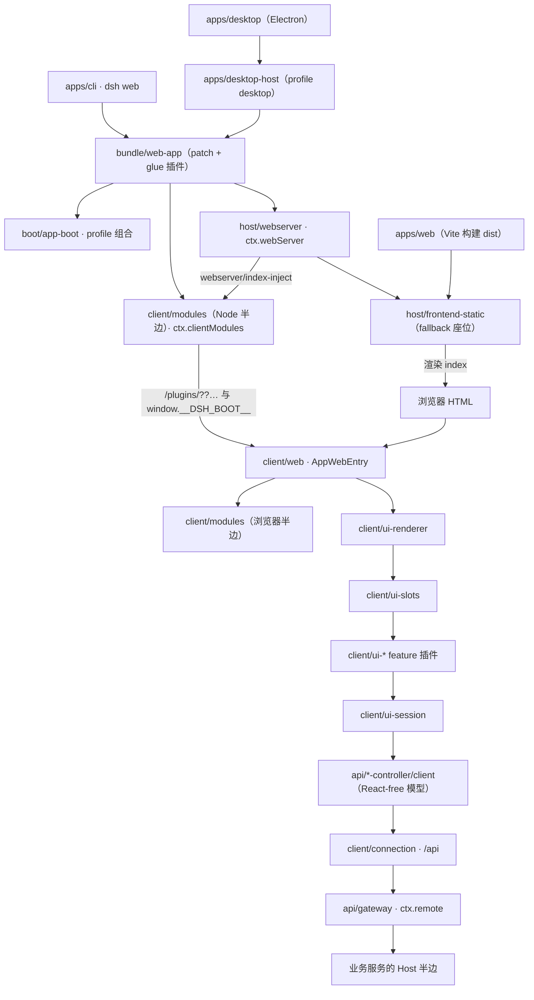

# 06 · 界面与交互层

> **一句话总结**：Host 服务端 + 浏览器插件树 + 四个应用壳，构成 dsh 的 GUI 与 CLI。

| 项目 | 内容 |
|---|---|
| 回答的问题 | Web GUI、桌面应用、CLI 分别由哪些包组成？界面如何启动、如何扩展？ |
| 适合读者 | 要改 GUI、加界面插件、排查前端启动链路或桌面打包的工程师 |
| 前置阅读 | [00-项目全景](../00-项目全景.md)、[04-模块说明/README](README.md)、[01-系统架构](../01-系统架构.md) |
| 主要来源 | `packages/client/README.md`、`packages/host/README.md`、`apps/cli/README.md`、`apps/desktop/README.md`、`docs/subsystems/web-client.md`、`docs/subsystems/client-modules.md`、`docs/subsystems/slots.md`、`docs/subsystems/sidebar-right.md`、`docs/subsystems/web-server.md` |

## 一、通俗理解（先读这一节）

### 1. 这一层解决什么问题

DSH 的内核是"agent 怎么跑"，而界面层的任务是把这个内核投射成四种人能看到、能操作的形态：浏览器里的 Web GUI（`dsh web`）、桌面应用（Electron）、命令行（`dsh --profile headless` 之类）以及给程序用的接口。本卷只讲前三种面向人的形态；SDK/ACP 等程序接口见 [07-开发者接口与集成](07-开发者接口与集成.md)。

### 2. 最重要的一个切分：Host 与 Client

整个 GUI 被劈成两半（来源：`docs/subsystems/web-client.md`）：

- **Host**（`packages/host/*` 加上各业务包的 Host 半边）拥有权威状态：持久化、变更顺序、访问策略、流的生产。它跑在 Node 里，是"真相"所在。
- **Client**（`packages/client/*`）只做投影与呈现：维护一份 React-free 的本地镜像，把变更渲染成组件。浏览器里看到的一切都来自它。

换句话说：**Host 决定"是什么"，Client 决定"怎么看"**。这条原则被写进了客户端规范——"The web layer is pure presentation"（来源：`packages/client/AGENTS.md`）。

### 3. 直觉图

```text
                          浏览器（Web GUI）
        ┌────────────────────────────────────────────┐
        │  client/web  两阶段启动内核                  │
        │      ↓ window.__DSH_BOOT__ 里的插件图        │
        │  client/modules  懒加载 CJS 模块表            │
        │      ↓                                      │
        │  ui-renderer → ui-slots → ui-* 界面插件      │
        │      ↓ /api（client/connection）             │
        └──────┬─────────────────────────────────────┘
               │ HTTP + WebSocket
        ┌──────┴─────────────────────────────────────┐
        │  host/webserver  HTTP/HTTPS 载体             │
        │  host/frontend-static  提供 dist/ 与 index   │
        │  client/modules（Node 半边）扫描 dsh.client  │
        │  api/*-controller（Host 半边）拥有权威状态    │
        └──────┬─────────────────────────────────────┘
               │
        apps/cli 的 dsh web  →  bundle/web-app 组合出的插件树
```

### 4. 三种应用壳的分工

- **CLI**（`apps/cli`，包名 `@deepseek-ai/dsh`）是"唯一受支持的 Node 应用启动器"：`dsh <profile>` 按 profile 组合出一棵插件树并启动（来源：`apps/cli/README.md`）。
- **Web**（`apps/web`，包名 `@deepseek-ai/dsh-web-frontend`）不是独立应用，而是用 Vite 把 `@deepseek-ai/dsh-client-web` 这个浏览器 shell 库构建成 `dist/`，由 `dsh web` 提供的 Host 来服务（来源：`apps/web/package.json`、`apps/web/vite.config.ts`）。
- **Desktop**（`apps/desktop`）是包住整套 Web 应用的 Electron 外壳；`apps/desktop-host` 是它私有的 Node 模式 Host 进程（来源：`apps/desktop/README.md`、`apps/desktop-host/package.json`）。

### 5. 一个容易忽略的事实

`apps/web` 的 Vite 配置里显式禁止"裸 Vite 启动"，并抛出提示 `apps/web is not a standalone application`，因为只有 `dsh web` 才会注入 `window.__DSH_BOOT__`（来源：`apps/web/vite.config.ts`）。这是理解整条启动链路的关键：**页面本身不知道自己该加载哪些插件，插件清单由 Host 在渲染 HTML 时注入**。

## 二、组级说明

### 2.1 packages/client —— Web GUI 的浏览器半边（63 个包）

组级 README 的定义是：kernel 包负责启动与承载页面，UI feature 包负责呈现它（来源：`packages/client/README.md`）。包名一律为 `@deepseek-ai/dsh-client-<name>`（来源：`packages/client/AGENTS.md`）。这一组合计 63 个包（来源：`04-模块说明/README.md` 的组计数，与 `packages/client/` 目录实测一致）。

客户端包有明显的**构建面**差异：动态 UI 插件产出 `lib/client.js` 浏览器 bundle，其 `/client` 入口是"公共浏览器 API"；静态库（如 `client/store`、`ui-primitives`、`ui-slots`、`ui-dockkit`）则被 Web shell 的 Vite 构建合并，并进入 `PLATFORM_MODULES` 基线（来源：`packages/client/AGENTS.md`、`packages/client/web/README.md`）。

### 2.2 packages/host —— Web GUI 的 Host 半边（9 个包）

组级 README 的定义：HTTP(S) 服务器、SPA dist 服务器、工作区目录选择 seam 及三种后端、open-in-app 探测与启动路由、只读插件清单投影、显式产品事件上报（来源：`packages/host/README.md`）。这 9 个包都是 product package，浏览器传输则在 `packages/client`。

### 2.3 apps/* —— 四个应用入口

| 应用 | 包名 | 形态 |
|---|---|---|
| `apps/cli` | `@deepseek-ai/dsh` | 唯一受支持的 Node 应用启动器：profile 启动、插件管理、配置检视（来源：`apps/cli/README.md`） |
| `apps/web` | `@deepseek-ai/dsh-web-frontend` | Vite 构建入口：产出 `dist/`，由 `dsh web` 服务（来源：`apps/web/package.json`） |
| `apps/desktop` | `@deepseek-ai/dsh-desktop`（`private: true`） | Electron 桌面外壳，内嵌 dsh runtime 与外部插件（来源：`apps/desktop/package.json`） |
| `apps/desktop-host` | `@deepseek-ai/dsh-desktop-host`（`private: true`） | Electron 应用私有的 Node 模式 Host 进程（来源：`apps/desktop-host/package.json`） |

注意：`apps/web` 与 `apps/desktop-host` 在仓库里**没有 README.md**；本卷对它们的描述直接来自其 `package.json`、`src/` 与 `vite.config.ts`。

## 三、条目表

### 3.1 client 的 8 个子领域（覆盖全部 63 个包）

| 子领域 | 包含的包 | 职责 | 关键概念 / 服务 | 来源 |
|---|---|---|---|---|
| 内核与传输（9） | `web` `modules` `connection` `file-upload` `hmr` `locale` `resources` `shortcuts` `store` | 启动浏览器 shell、加载模块图、承载 RPC、开发期热更、本地化、资源模型、快捷键与观察者 store | `window.__DSH_BOOT__`、`ctx.clientModules`/`ctx.modules`、`ctx.connection`、`ctx.fileUpload`、`ctx.locale`、`ctx.resources`、`ctx.shortcuts` | `packages/client/README.md`；`docs/subsystems/web-client.md`；`docs/subsystems/client-modules.md` |
| 渲染与组合（6） | `ui-renderer` `ui-slots` `ui-session` `ui-theme` `ui-primitives` `ui-layout` | 唯一的 ctx→React 集成点、类型化 Slot 注册表、会话作用域适配、主题、共享控件与图标、主区域布局 | `ctx.uiRenderer`、`ctx.slots`、`useSession`、`--dsw-*` token | `packages/client/README.md`；`docs/subsystems/slots.md`；`packages/client/ui-renderer/README.md` |
| 会话与对话呈现（10） | `ui-conversation` `ui-chat` `ui-trajectory` `ui-tool` `ui-workflow-run` `ui-attachment` `ui-deliverables` `ui-message-feedback` `ui-user-questions` `ui-approval` | 对话 shell 与输入面、Chat/Trajectory 两种目标视图、工具调用树、工作流重放、附件、交付卡片、消息评分、用户提问卡片、审批面板 | `ConversationNodeDefinition`、`conversation.chat.node`、`tool.call.toolview`、`ctx.feedbackUi`、`userQuestionPanels`、Agent 作用域 Remote waterfall | `packages/client/README.md`；`docs/subsystems/conversation.md`；`packages/client/ui-user-questions/README.md`；`packages/client/ui-approval/README.md` |
| 导航与停靠（11） | `ui-sidebar` `ui-sidebar-right` `ui-sidebar-files` `ui-sidebar-browser` `ui-sidebar-documentpreview` `ui-sidebar-terminal` `ui-dockkit` `ui-workspace` `ui-open-in-app` `ui-directory-picker-browse` `ui-directory-picker-native` | 左栏导航、右栏 docking 面板与 tab 类型、文件树、浏览器页、文档预览、终端、布局引擎、工作区选择、在外部应用打开、两种目录选择交互 | `ctx.sidebarRight`/`ctx.sidebarRightTabs`、`ctx.documentPreviews`、`dsh-resource://` 地址、`ctx.workspaces` | `docs/subsystems/sidebar-right.md`；`packages/client/README.md`；`packages/client/ui-sidebar-terminal/README.md` |
| 输入与命令（6） | `ui-commands` `ui-input-trigger` `ui-reference` `ui-skill` `ui-shortcuts` `ui-model-selection` | slash 命令发现与派发、内联触发建议、`@file`/`@session` 引用、技能引用、快捷键参考、模型选择 | session-aware 命令、内联建议协调、引用来源 | `packages/client/README.md`；`docs/subsystems/web-client.md` |
| agent / session 管理（7） | `ui-agent-preset` `ui-goal` `ui-plan` `ui-schedule` `ui-subagent` `ui-jobs` `ui-permission-presets` | agent preset 选择与编辑、目标、计划模式状态、定时提醒目录、子 agent 导航、后台任务列表、权限预设 | preset 编辑、`conversation.plan-review.actions`、job roster | `packages/client/README.md`；`docs/subsystems/plan.md` |
| 设置与插件管理（12） | `ui-settings` `ui-settings-general` `ui-settings-models` `ui-settings-account` `ui-settings-shell` `ui-settings-agent-loop` `ui-settings-session-log` `ui-settings-subagent` `ui-settings-web-search` `ui-settings-plugins` `ui-settings-plugin-inventory` `ui-plugin-manager` | 设置界面与扩展区、各设置分区、Desktop 账户、侧栏 Plugins 面板、只读 Host Loader 清单 | `settings.section`、`settings.plugins.tab`、`ctx.pluginManager`、account Remote | `packages/client/README.md`；`packages/client/ui-settings-account/README.md`；`docs/subsystems/boot.md` |
| 品牌与运营（2） | `ui-brand-official` `product-analytics` | 通用品牌槽填入官方名称与标识；Desktop 产品事件上报 | 品牌 slot；`product-analytics` 设置命名空间 | `packages/client/README.md`；`packages/client/product-analytics/README.md` |

### 3.2 host 的 9 个包

| 路径 | 职责 | 关键概念 / 服务 | 来源 |
|---|---|---|---|
| `packages/host/webserver` | 浏览器 HTTP(S) 载体：命名路由、upgrade、index tap、fallback 座位 | `ctx.webServer`、`webserver/index-inject` | `packages/host/README.md`；`docs/subsystems/web-server.md` |
| `packages/host/frontend-static` | 在 fallback 座位上服务 SPA dist，拒绝路径穿越 | `distIndex`、`renderIndex`、`<base href="./">` | `packages/host/frontend-static/README.md` |
| `packages/host/directory-picker` | 工作区目录选择 seam：能力契约与错误词汇 | `ctx.directoryPicker`、`capability()` | `packages/host/directory-picker/README.md` |
| `packages/host/directory-picker-native` | 原生 OS 选择器后端 | 注册 `ctx.directoryPicker` | `packages/host/README.md` |
| `packages/host/directory-picker-browse` | 应用内目录浏览器后端（面向远程客户端） | 注册 `ctx.directoryPicker` | `packages/host/README.md` |
| `packages/host/directory-picker-auto` | 启动时按 Host 情形挂载匹配后端的自适应 chooser | 挂载一个后端 | `packages/host/README.md` |
| `packages/host/open-in-app` | 应用探测、图标与启动路由，在已安装应用中打开工作区目录 | 消费 `ctx.webServer` | `packages/host/README.md` |
| `packages/host/plugin-inventory` | 当前 Loader 条目的只读投影 | Remote `pluginInventory/list` | `packages/host/README.md` |
| `packages/host/product-telemetry-otel` | 显式产品使用事件，走 OTLP/HTTP | `ctx.productTelemetry` | `packages/host/README.md`；`docs/subsystems/product-telemetry.md` |

### 3.3 apps/* 的 4 个入口

| 路径 | 职责 | 关键概念 / 服务 | 来源 |
|---|---|---|---|
| `apps/cli` | `dsh` 唯一受支持的 Node 应用启动器 | `dsh web`、`dsh --profile`、`dsh plugin`、`runCli()`、`profile-boot` | `apps/cli/README.md` |
| `apps/web` | Web 壳的 Vite 构建入口 | `AppWebEntry`、`applyIndexInjections`、``DSH_TRANSPORT``、``DSH_BOOT_READY`` | `apps/web/src/main.ts`；`apps/web/vite.config.ts` |
| `apps/desktop` | Electron 桌面外壳 | `ELECTRON_RUN_AS_NODE=1`、`dsh-app://app/`、`dsh-app://shell/`、私有的 `profiles/desktop` | `apps/desktop/README.md` |
| `apps/desktop-host` | Electron 私有的 Node 模式 Host 进程 | `runProfile({ profile: 'desktop' })`、IPC `shutdown` / `quit-inspection`、`runDesktopCli()` | `apps/desktop-host/src/index.ts`；`apps/desktop-host/src/cli.ts` |

## 四、重点讲透

### 4.1 Host 与 Client 的职责切分

`docs/subsystems/web-client.md` 给出一张分层所有权表，这是本卷最该记住的内容：

| 层 | 主要拥有者 | 职责 |
|---|---|---|
| Host 应用 | 业务服务与 `packages/api/*-controller` 的 Host 半边 | 权威状态、持久化、变更顺序、访问策略、流生产 |
| 传输与 API 组装 | `client/connection`、`api/gateway`、`api/remotes` | 建立 Client 世代、暴露 `ctx.remote`、转发选定事件、承载取消与结果 |
| Client 模型 | `api/session-controller/client`、`api/workspace-controller/client` | React-free 的 Host 状态镜像、解决流/单次调用竞态、对象身份与订阅 |
| UI 适配器 | `client/ui-session`、`client/ui-workspace` | 把模型 observable 转成 Slot 源，拥有视图级导航与状态策略 |
| 对话数据 | `client/ui-conversation` 及各目标包 | 组装事件、生成目标快照、拥有对话 shell 与输入流 |
| 组合与渲染 | `client/ui-slots`、`client/ui-renderer`、`client/ui-layout`、feature UI 包 | 声明扩展位置、派生组件 props、把 observable 绑定到 React hook、挂载最终树 |

依赖方向是单向的：**Host state → Remote transport → Client model → UI adapter → Conversation/presentation → Slots → React**；用户操作则沿回调返回（来源：`docs/subsystems/web-client.md`）。呈现组件永远拿不到 Cordis `ctx`、传输对象或另一个 feature 插件的实现（来源：`packages/client/AGENTS.md`）。

两条"红线"值得单独记住（来源：`packages/client/AGENTS.md`）：

1. **业务数据住在对象层，绝不放进 store。** entry 声明的 store 只装载共享的浏览/交互状态（选择、草稿、面板宽度）；session、frame、connection 留在对象层。
2. **Web 层是纯呈现。** 任何只是"怎么画"的东西都不进入 session log；工具卡片在 Client 端从原始 call/result 事件和持久化 result metadata 派生。

### 4.2 GUI 客户端插件体系

客户端的"插件"有三种彼此独立、不可互换的声明，`packages/client/AGENTS.md` 专门列了一张对照表：

| | Cordis 服务 `inject` | 模块图 `external` |
|---|---|---|
| 单位 | 服务名 | 模块说明符 |
| 时机 | 运行时；fiber 等待 | 物化时；交给工厂的 `require` 是同步的，不能等待 |
| 未满足 | 保持 PENDING，无超时 | 当场抛错 |
| 谁能满足 | 任何提供该服务的插件，可替换 | 唯一的模块身份，不可替换 |
| 环 | 允许 | 拒绝 |

此外还有 `dsh.client.inject`，它只是**信息性**的包名依赖边（用于预检显示与 HMR diff），不决定激活顺序（来源：`packages/client/AGENTS.md`）。

一个包如何加入插件表：在 `package.json` 声明 `dsh.client`（`platform: 'web'`，可选 `inject`、`immediately`、`external`），并在 `exports["./client"]` 暴露构建好的 bundle（来源：`docs/subsystems/client-modules.md`）。模块图的实际外部基线由 `client/web/src/platform.ts` 的 `PLATFORM_MODULES` 定义，`dsh.client.external` 只用于基础设施/传输/生成产物这类**非基线**请求（来源：`packages/client/AGENTS.md`）。

按用途可以把 63 个包压成上面 3.1 的 8 个子领域；其中前两个子领域（内核、渲染）是"基础设施"，其余是 feature 插件。文档层面，feature 插件的 `/client` 入口是公共浏览器 API 而不是便利 barrel：除 cordis 加载所需的 `apply`/`inject`/`Config` 与供组件 type-only 使用的 store 工厂外，不导出别的值（来源：`packages/client/AGENTS.md`）。

### 4.3 Web 服务端与 Web GUI 启动链路

这是本卷最完整的一条链路，可以拆成五步。

**第一步：`dsh web` 启动 Host。** `dsh web` 是 CLI 的入口模式之一，会启动 Web profile（来源：`apps/cli/README.md`）。Web profile 由 `@deepseek-ai/dsh-web-app` bundle 提供；它的 `cordis.patch.yml` 携带 Host 行与 preset 注册表，glue 插件拥有 dist 服务、广告 URL、明文 HTTP 曝光警告、prompt 段落、bash 变量与就绪公告（来源：`packages/bundle/web-app/README.md`）。默认监听 loopback，端口 3080（来源：`packages/bundle/web-app/README.md`）。

**第二步：Web 服务端承载页面。** `packages/host/webserver` 是一个 `node:http`（配置 TLS 时为 `node:https`）服务器，提供 `ctx.webServer`：命名路由注册表、可选 gzip、index 注入表与唯一 fallback 座位；它"不认识任何 harness 概念"，所有 feature 路由（包括 `/api` 桥、插件 bundle、HMR 事件流）都由别的插件注册（来源：`docs/subsystems/web-server.md`）。`packages/host/frontend-static` 认领 fallback 座位，从 dist root 提供文件，并在每次成功的 index 响应上调用 `renderIndex`（来源：`packages/host/frontend-static/README.md`）。

**第三步：Host 注入 `window.__DSH_BOOT__`。** Host 把组合好的 `WebBootGraph` 写进 `window.__DSH_BOOT__`，并在 parser 预加载脚本执行前安装浏览器模块加载 facade（来源：`docs/subsystems/web-client.md`）。图的来源是 `packages/client/modules` 的 Node 半边：它增量扫描 Loader 条目中声明了 `dsh.client` 的包，通过 `webserver/index-inject` 事件把 boot 协议行交给 index 渲染（来源：`docs/subsystems/client-modules.md`）。`WebBootGraph` 含 `entries` 与 `batches`，每个 entry 有 `id`/`url`/`rev`/`inject`/`immediately`/`external`（来源：`docs/subsystems/client-modules.md`）。bundle 路由是 `GET/HEAD /plugins/??<package-a>/client.js,<package-b>/client.js&rev=<rev>`，只支持 `??` 组合形式，未知或过期 revision 返回 404（来源：`docs/subsystems/client-modules.md`）。

**第四步：浏览器启动两阶段。** `apps/web/src/main.ts` 在 `#root` 上执行 `new AppWebEntry(container).run()`（来源：`apps/web/src/main.ts`）。`client/web` 的启动分两阶段：模块阶段采用 parser 已加载的 bootstrap batch、用 Host 提供的 boot graph 构建模块系统、并预取 `immediately` 层；随后进入插件阶段，激活每个图条目并全部等待完成后，把标记过的 boot DOM 交给 UI renderer（来源：`packages/client/web/README.md`）。启动页是纯 DOM + 本地 CSS，任何 bundle 或插件激活失败都会以条目名和原因显示，而不是白屏（来源：`packages/client/web/README.md`）。`ui-renderer` 最终 hydrate boot DOM 并执行唯一的 context 级 `renderSlot('root')`（来源：`docs/subsystems/slots.md`）。

**第五步：构建与 HMR。** `apps/web` 的 Vite 配置包含一个 `rejectStandaloneServe` 插件，只要以 `serve` 命令启动就抛错，提示必须用 `pnpm dsh web`（来源：`apps/web/vite.config.ts`）。开发时 `pnpm run dev:web` 先完整构建，再并行跑三组 watcher（`tsc -b tsconfig.client.json --watch` 产出 `lib/types`、tsdown watch 产出 `lib/index.js` 与 `lib/client.js`、`vite build --watch` 重写 `apps/web/dist`），最后启动 `dsh web`（来源：`scripts/dev-web.ts`）。热更本身不需要这个脚本广播：Host 的 webserver 对自己的 bundle 做 stat 轮询并广播 `rebuilt` 帧（来源：`scripts/dev-web.ts`）。浏览器侧的 `client/hmr` 订阅 `/plugins/events` SSE，收到 `rebuilt` 帧后使旧模块失效、预取新脚本、排空旧 fiber、再让 Loader 挂载新导出（来源：`packages/client/hmr/README.md`）。**重建粒度是"重新执行 bundle + 重挂插件"**：插件内部的 React state 会丢失，session/workspace/connection 存活（来源：`packages/client/hmr/README.md`）。

还有一个 Desktop 专用分支：`apps/web` 在检测到 `globalThis.dshDesktopBoot` 时会先等 Desktop 的 `ready()` 返回 boot injections 与 `streamBaseUrl`，把 `__DSH_TRANSPORT__` 设为 `{ ownsHost: true, streamBaseUrl }`，用 DOM `<script>` 逐条应用注入后再 resolve `__DSH_BOOT_READY__`（来源：`apps/web/src/main.ts`）。

### 4.4 Desktop 与 desktop-host

Desktop 不是另一套应用，而是"包住完整 dsh Web 应用的 Electron 壳"：Electron RunAsNode 子进程启动共享 profile runner，Electron 立即加载打包的 Web 入口 `dsh-app://app/`；共享加载页等待 Host boot injections，然后在不导航到别的文档的情况下启动 client（来源：`apps/desktop/README.md`）。Electron 把应用 HTTP 请求转发给已认证的 Web Host，并按需丢弃 `transfer-encoding`/`connection`/`keep-alive` 这类描述 Node fetch 而非资源的头（来源：`apps/desktop/README.md`）。

几个已验证的关键事实（来源：`apps/desktop/README.md`）：

- Desktop 默认监听 OS 分配的端口，因此不会与 Web 的 `3080` 冲突；`webserver.config.port` patch 可覆盖。
- WebSocket 流用 `ws:`/`wss:` 跟随 Host listener；凭证只在所属应用窗口附加。
- 安装的 `dsh` 命令使用 Desktop 的 Electron 可执行文件与 bundled pnpm，可在 Desktop 关闭时运行；Desktop profile `$DSH_HOME/profiles/desktop` 只有 Desktop 自己或其安装的命令能管理，npm 安装的 dsh 不能修改它。
- 主 bundle 的 workspace devDependencies 被内联，`apps/desktop/scripts/desktop-bundle-imports.mjs` 会否决不打包就无法解析的 import。

`apps/desktop-host` 是这个 Electron 应用私有的 Node 模式 Host 进程：它的 `src/index.ts` 用 `runProfile({ environment: loadLayeredEnv('dsh'), profile: 'desktop', args: ['--no-open', '--host', '127.0.0.1', '--port', '0'] })` 启动，并通过 `process.send` 与 Electron 交换 `shutdown`、`quit-inspection` 等消息（来源：`apps/desktop-host/src/index.ts`）。它的 `src/cli.ts` 提供 `runDesktopCli()`，用 `runCli({ manageDesktopProfile: true, packageManager: ... })` 让安装的 `dsh` 命令复用 Desktop 的 runtime（来源：`apps/desktop-host/src/cli.ts`）。注意：Desktop-host **没有 README**，以上来自源码。

### 4.5 CLI 应用与 profile

`apps/cli` 是唯一受支持的 Node 应用启动器，其入口模式包括（来源：`apps/cli/README.md`）：

| 命令 | 用途 |
|---|---|
| `dsh <name>` / `dsh --profile <name>` | 在 `$DSH_HOME/profiles/<name>` 下启动命名 profile |
| `dsh --profile <name> --from-default-profile <template>` | 以 shipped 模板创建自定义 profile 再启动 |
| `dsh --profile acp` | 用 ACP stdio 服务自动化客户端 |
| `dsh --profile headless "job"` | 跑一个全新持久会话并打印最终答案 |
| `dsh --profile sdk` / `sdk-minimal` | 用 JSON-RPC stdio 服务 SDK 客户端 |
| `dsh web` | 启动 Web profile |
| `dsh plugin --profile <name> <pnpm args>` | 在 profile 目录里转发 pnpm 管理插件 |

profile 目录含 `package.json`（profile manifest `dsh.profile` 及其有序 `bundles` 列表）与 `cordis.patch.yml`（用户自己的补丁层）。树的组合顺序是：**空根 → 每个 bundle 的 patch（按 `bundles` 顺序）→ profile 的 `cordis.patch.yml` → `$DSH_HOME/cordis.patch.yml` → `--patch` overlay**（来源：`apps/cli/README.md`）。app 参数由 launcher 之后的第一个 token 开始，交给 booted profile 中的 app 插件解析（来源：`apps/cli/README.md`、`packages/boot/cmdline/README.md`）。

`desktop` 这个名字被保留给 Electron 拥有的 profile，CLI 拒绝 boot 或 config-dump 它（来源：`apps/cli/README.md`）。

### 4.6 界面扩展点：slots 与侧边栏

**Slots 是 Web Client 的类型化 React 组合系统。** `ui-slots` 定义 React-free 的注册表与类型代数，`ui-renderer` 绑定 observable 并在内部拥有 React context；feature 插件通过 `ctx.slots.register()` 贡献 UI，绝不 import 另一个 feature 插件的组件（来源：`docs/subsystems/slots.md`）。

四条最关键的规则（来源：`docs/subsystems/slots.md`）：

1. **两种声明形式**：父级拥有的扩展位置用 `ctx.slots.register({ name, children?, store?, inject? }, Component)`；只有当一套可复用装配需要在无关联父级下独立渲染时才用 `registerFactory()`。只有 shell 渲染 `'root'`。
2. **children = 声明 + 授权**：组件渲染的 slot 恰好是其注册 `children` 对象的键。渲染未声明的 slot、或声明别人已拥有的 slot，在加载时失败。slot 名镜像组合路径，形如 `<domain>.<entry>.<hole>`（例如 `tool.call.toolview`）。
3. **组件 props 是五个 share，全部派生**：`PropsRuntime`、`PropsRenderSlots`、`PropsRenderFactories`、`PropsStore`、inject face。
4. **hooks 只由框架制造**：常驻 seat 包括 `useSession`、`useSessions`、`useWorkspaces`、`useStore`、`renderSlot`、`renderFactorySlot`；业务代码绝不自己造 hook 或 selector。

层级中值得记住的扩展点：`conversation.input.activity`（模型选择器与 Send 之间的一个动作）、`conversation.chat.reasoning.body`（reasoning 正文）、`tool.call.toolview`（每个工具的自定义视图）、`settings.section`（设置分区）、`sidebar.right.pane.tab`（右栏 tab 正文）（来源：`docs/subsystems/slots.md`）。

**右栏是第一个资源模型消费者。** `ui-sidebar-right` 拥有面板、tab 类型注册表与导航服务；`ui-dockkit` 是内部布局引擎；`client/resources` 把地址变成活数据（来源：`docs/subsystems/sidebar-right.md`）。一个 tab 类型是共享同一 `id` 的两个注册：`ctx.sidebarRightTabs` 里的静态 definition（声明它的 `kind` 打开哪些地址），以及一个 keyed slot 注册提供正文（来源：`docs/subsystems/sidebar-right.md`）。地址家族有两类：`dsh-resource://<type>/…` 资源地址，以及 Sidebar 自己写出的 `sidebar://<kind>` 页面地址（来源：`docs/subsystems/sidebar-right.md`）。`useResource<P>(address)` 是每个 slot 组件都收到的全局标准 prop，返回 `{ status, value, failure }`，状态为 `none`/`loading`/`live`/`failed`（来源：`docs/subsystems/client-resources.md`）。

### 4.7 本地化与 i18n

`client/locale` 有一个 `LocaleRuntime`，它同时就是 slot 系统的 `LocaleFace`：`getSnapshot`/`subscribe` 通过 `ctx.slots.installLocale` 支撑框架注入的 `t` seat（来源：`packages/client/locale/README.md`）。关键事实：

- 用户在 Settings → General 切换语言后立即生效，`<html lang>` 同步更新；**loopback 页面把选择持久化到 `$DSH_HOME/cordis.patch.yml`，非 loopback 页面只在当前进程内保留**（来源：`packages/client/locale/README.md`）。
- 没有显式 Host preference 的浏览器按 `navigator` 的全 tag、再按 primary subtag 匹配，最后回退英语；已存的外部 locale 会等其 definition 注册，而不是在不可用时变成 active（来源：`packages/client/locale/README.md`）。
- 插件通过 `ctx.locale.register(ns, { zh, en })` 注册类型化命名空间字典；外部语言包通过 `ctx.locale.addLanguage(...)`，fallback 链必须终止于 `en`（来源：`packages/client/locale/README.md`）。
- **产品可见文案只允许走类型化字典或已本地化的 primitive prop**，`pnpm run verify-client-ui-i18n` 强制执行这条源码所有权规则（来源：`packages/client/AGENTS.md`）。
- 已注册时捕获的文本（例如 command registry 里的 `/model` 描述）不会跟随语言切换，直到重新注册；slot 渲染的文案则实时跟随（来源：`packages/client/locale/README.md`）。

### 4.8 交互组件：用户提问、审批、语音

**用户提问**由三层组成：Host 侧 `packages/interaction/user-questions` 的 seam、模型侧 `tool-ask-user`、以及 Web 侧 `client/ui-user-questions`。Host seam 提供 `ctx.userQuestions` 与 agent 作用域的 `user-questions/request` waterfall；答案按 question id 路由，`custom` 承载自由文本（来源：`docs/subsystems/user-questions.md`）。timed 问题有明确语义：如果窗口内没人回答则返回 `{ pending: true, callId }`，问题仍可回答；Client 通过业务 Remote 流 `attachWait` 抢占前台等待并拿到剩余时长（来源：`docs/subsystems/user-questions.md`）。Web 端把卡片临时占在 composer 座位上，草稿按 Session 与 pending request 独立保存在浏览器存储里，且**草稿只属于本浏览器**，Host 投影才是问题是否 open/continued 的权威（来源：`packages/client/ui-user-questions/README.md`）。`plan-review` intent 会渲染成紧凑的审批卡片（`Request changes` / `Approve`）（来源：`packages/client/ui-user-questions/README.md`）。

**审批**由 `client/ui-approval` 呈现：它发布每个 pending 请求到 `ctx.uiSession`，接管 Conversation composer，可选渲染关联的工具详情，并把用户决定返回给等待中的 Host 请求（来源：`packages/client/ui-approval/README.md`）。它的键盘契约是：聚焦审批详情区后 Enter 同意、Escape 拒绝，两个键都对可编辑快捷键保留；键盘与指针动作共享同一个 pending-request 锁（来源：`packages/client/ui-approval/README.md`）。注意它只支持 allow-once 与 reject，持久权限策略由 Host 侧审批包拥有（来源：`packages/client/ui-approval/README.md`）。

**语音输入**是实验能力，其三个角色分别是 Service Definition、SenseVoice provider 与 Remote consumer，再由一个默认关闭的 optional bundle 组合（来源：`docs/subsystems/voice-input.md`）。浏览器拥有麦克风轨道与未发送草稿；识别本身**不写任何 Session 事件**，最终模型可见文本由普通用户提交拥有（来源：`docs/subsystems/voice-input.md`）。麦克风占据 `conversation.input.activity`，位于模型选择器与 Send 之间（来源：`docs/subsystems/voice-input.md`）。涉及的包位于 `packages/experimental/`（`speech-to-text`、`speech-to-text-sensevoice`、`api-speech-to-text`、`client-ui-voice-input`、`voice-input-bundle`），按实验政策归本手册 [08 卷](08-工程质量与支撑设施.md) 的 experimental 一节。

## 五、依赖关系图



> 图题：Web GUI 的启动与请求链路。实线表示"启动/提供"，箭头方向即依赖方向。桌面应用复用同一套 bundle 与 Web 前端，只是换成 Electron 壳与 `desktop-host` 进程。

## 六、常见误解

- ❌ **"`apps/web` 是独立应用，`vite dev` 即可跑。"** → ✅ `apps/web` 明确不是独立应用；裸 Vite 无法注入 `window.__DSH_BOOT__`，必须用 `pnpm dsh web`，开发热更用 `pnpm run dev:web`（来源：`apps/web/vite.config.ts`）。
- ❌ **"Client 是第二份业务真相。"** → ✅ Host controller 决定持久状态与变更结果，Client 模型只保留最新可用的本地投影并保留渲染所需的局部身份（来源：`docs/subsystems/web-client.md`）。
- ❌ **"UI 包可以 import 另一个 UI 包的组件。"** → ✅ 不允许。声明用 `import type`；行为通过注入的 Cordis 服务跨越，UI 通过 slots 跨越（来源：`packages/client/AGENTS.md`）。
- ❌ **"改了一个客户端 bundle 就会全页刷新。"** → ✅ 重建粒度是重执行该插件 bundle 并重挂插件，插件内 React state 丢失，页面不整刷，数据层 fiber 不动（来源：`packages/client/hmr/README.md`）。
- ❌ **"Web 服务端认识 agent 概念。"** → ✅ `host/webserver` 不认识任何 harness 概念，`/api`、插件 bundle、HMR 流都由别的插件注册（来源：`docs/subsystems/web-server.md`）。
- ❌ **"Desktop 是另一套后端。"** → ✅ Desktop 是包住完整 dsh Web 应用的 Electron 壳，`desktop-host` 用 `profile: 'desktop'` 启动同一套 bundle 与 Web 前端（来源：`apps/desktop/README.md`、`apps/desktop-host/src/index.ts`）。

## 七、关键文件索引

| 路径 | 作用 |
|---|---|
| `packages/client/README.md` | client 组权威包表（63 包的职责与 ctx key） |
| `packages/client/AGENTS.md` | 客户端编写规范：slot、导出、分层红线、依赖声明、模块图 |
| `docs/subsystems/web-client.md` | Web Client 架构：分层所有权、启动、Remote、重连、包边界 |
| `docs/subsystems/client-modules.md` | 插件表、`WebBootGraph` 线格式、bundle 路由与扫描 |
| `docs/subsystems/slots.md` | Slot 模型：声明、基数、作用域、hook、当前层级树 |
| `docs/subsystems/sidebar-right.md` | 右栏：地址、tab 类型注册、导航服务、资源模型 |
| `docs/subsystems/client-resources.md` | Client 资源模型：地址、provider、状态、生命周期 |
| `docs/subsystems/web-server.md` | HTTP 载体：路由、配置、`webserver/index-inject` |
| `packages/client/web/src/platform.ts` | `PLATFORM_MODULES` / `PRELOADED_CLIENT_EXTERNALS` 基线 |
| `packages/client/modules/src/client/manifest.ts` | boot graph 线格式的单一来源 |
| `apps/web/vite.config.ts` | Web 壳构建：禁止裸启动、vendor chunk、preview.html |
| `apps/web/src/main.ts` | 浏览器入口：`AppWebEntry` 与 Desktop 分支 |
| `scripts/dev-web.ts` | `dev:web` 的构建 + 三组 watcher + serve 流程 |
| `apps/cli/README.md` | CLI 入口模式与 profile 组合规则 |
| `apps/desktop/README.md` | Desktop：打包、更新、runtime、命令注册、窗口生命周期 |

## 八、延伸阅读

- [01-系统架构](../01-系统架构.md)：插件内核、启动链路与 agent loop 的全局位置
- [04-模块说明/README](README.md)：8 卷划分与包组计数
- [07-开发者接口与集成](07-开发者接口与集成.md)：api / sdk / acp / boot 与 Typert RPC 网关
- [08-工程质量与支撑设施](08-工程质量与支撑设施.md)：experimental 的语音、翻译等界面相关实验包
- `packages/bundle/web-app/README.md`：Web profile 的 patch 语义与就绪时序
- `docs/subsystems/conversation.md`：对话事件关联、目标快照与 keyed renderer
