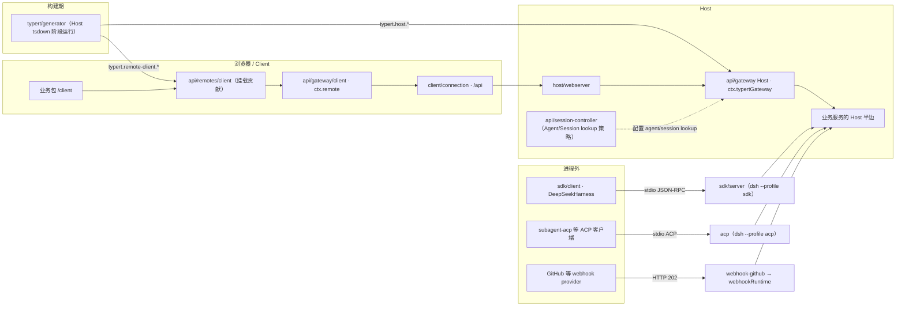

# 07 · 开发者接口与集成

> **一句话总结**：把 Host 能力变成类型化 RPC、SDK、ACP 与可安装 profile。

| 项目 | 内容 |
|---|---|
| 回答的问题 | Host 能力如何暴露给浏览器与外部进程？应用如何按 profile 装配启动？ |
| 适合读者 | 要写 Remote 方法、集成 SDK/ACP、理解启动装配与 webhook 接入的工程师 |
| 前置阅读 | [01-系统架构](../01-系统架构.md)、[04-模块说明/README](README.md)、[06-界面与交互层](06-界面与交互层.md) |
| 主要来源 | `docs/api-gateway.md`、`packages/api/README.md`、`packages/sdk/*/README.md`、`packages/acp/acp/README.md`、`packages/boot/README.md`、`docs/subsystems/boot.md`、`docs/subsystems/webhook.md`、`packages/mcp/README.md` |

## 一、通俗理解（先读这一节）

### 1. 这一层解决什么问题

内核与业务服务都跑在 Host 进程里，但"使用 DSH"的人或程序在别处：浏览器、另一个 Node 进程、一个自动化脚本，或者一个 Git 托管平台的 webhook。本卷讲四件事：

1. **远程 BFF 与 Typert RPC 网关**：把 Host 服务的方法变成浏览器能调用的类型化方法。
2. **SDK**：让任意进程通过 stdio JSON-RPC 驱动一个完整的 DSH runtime。
3. **ACP**：让自动化程序用标准 Agent Client Protocol 管理持久 agent。
4. **boot 与集成**：`dsh` 应用如何按 profile 装配启动，以及 webhook 如何把外部投递变成 Session。

### 2. 为什么分成四层

`docs/api-gateway.md` 给出的组织顺序是 `remotes → gateway → connection → webserver`。用快递打比方：**remotes** 决定"这家公司对外提供哪些服务"，**gateway** 是"收发与验货的岗位"，**connection** 是"运输公司"，**webserver** 是"公路"。业务组件只面向 `ctx.remote.<namespace>` 这个生成出来的接口，不接触后面三层。

### 3. 直觉图

```text
  外部进程 ──stdio JSON-RPC──▶ dsh --profile sdk ──▶ jsonrpc server 插件 ──▶ agent 服务
  自动化客户端 ──stdio ACP────▶ dsh --profile acp ──▶ AcpServer ──▶ 持久 Session
  Git 平台 ──HTTP webhook───▶ webhook-github 路由 ──▶ webhookRuntime ──▶ 新建 Session

  浏览器 ──HTTP /api──▶ host/webserver ──▶ connection（信任/信封）──▶ api/gateway Host
         ◀─Remote 结果/流──                       │
                                                   ▼
                              api/remotes（选择暴露面）+ 业务服务的 Host 半边
                                                   │  生成自 @Remote 装饰器
                                                   ▼
                              Client: api/gateway/client（ctx.remote）→ 业务包 /client
```

### 4. 一句话记住各自边界

- **API Gateway 只管"调用与流"**，不选择业务；选择业务是 `api/remotes` 的职责（来源：`packages/api/README.md`）。
- **SDK 不创建开发者工程**，也不定义第二个应用；它复用 `dsh --profile sdk` 这棵插件树（来源：`packages/sdk/README.md`）。
- **ACP 只有自动化**，刻意不暴露 DSH 特有的展示数据与交互 UI（来源：`packages/acp/acp/README.md`）。
- **boot 是 app bin 的启动胶水**，不是内核的一部分（来源：`packages/boot/README.md`）。

## 二、组级说明

### 2.1 packages/api —— 应用的 Remote 层（9 个包）

组级 README 的定义：Client 环境可以调用 Host 上运行的业务能力——管理目标、运行命令、列插件清单、发现文件与会话引用——以类型化方法调用获得结果或流，在打开的流上发送上行项，并观察转发过来的 Host 事件（来源：`packages/api/README.md`）。`remotes` 决定暴露哪些能力以及每次调用如何到达正确 Session 的 agent；`gateway` 承载调用与结果；整个栈跑在应用共享的 Connection 之上，**流式 Session 数据刻意不走它**（来源：`packages/api/README.md`）。

### 2.2 packages/sdk —— 用另一个进程驱动 runtime（3 个包）

SDK family 让另一个进程通过换行分隔的 JSON-RPC 驱动一个完整 DSH runtime。`protocol` 定义公共消息；`client`（TypeScript）用命名 profile 加有序 patch 启动 `dsh`；`server` 通过 stdio 接受 SDK 请求。TypeScript 客户端与 Python SDK（`python/README.md`）使用同一协议（来源：`packages/sdk/README.md`）。

### 2.3 packages/acp —— 仅自动化的 Agent Client Protocol（1 个包）

`acp` 组只提供一个包：让程序与自动化通过标准 ACP 运行持久 DSH agent 的服务器。客户端可以创建、列出、恢复、关闭会话；挂载标准 MCP 服务器；选择模型选项；发送文本与图片 prompt；接收语义更新；回答权限 prompt；并在没有人类参与的情况下取消工作（来源：`packages/acp/README.md`）。仓库内匹配的客户端在 `packages/subagent/subagent-acp`。

### 2.4 packages/boot —— 共享 app-bin 启动胶水（5 个包）

`app-boot` 解析配置并启动 Loader，`cmdline` 提供应用参数，`hmr` 协调模块与配置重载，`config-editor` 持久化 profile 配置，`plugin-manager` 暴露当前 profile 的插件与 bundle 操作（来源：`packages/boot/README.md`）。

### 2.5 webhook —— 外部投递的接入口（实验包）

Webhook 子系统把已认证的外部投递变成可选的普通 root Session。provider adapter 拥有认证与通用 JSON 接收；受信任的程序化 rule 拥有条件与外部调用；`ctx.webhookRuntime` 拥有回调生命周期与基于 Workspace 的 Session 创建（来源：`docs/subsystems/webhook.md`）。实现包位于 `packages/experimental/webhook` 与 `packages/experimental/webhook-github`（来源：`packages/experimental/README.md`；npm 名 `@deepseek-ai/dsh-webhook` 与 `@deepseek-ai/dsh-webhook-github`，来源：`scripts/experimental-package-policy.ts`）。

### 2.6 mcp —— 对外接口视角（详见 [03 卷](03-工具与执行环境.md)）

`packages/mcp` 让模型调用外部 Model Context Protocol 服务器的工具并读取其资源。只需配置 `mcp-client` 条目；shipped profile 已挂载一次 `mcp-resources`（来源：`packages/mcp/README.md`）。MCP 工具与 prompt 文本只对"作用域内配置了服务器"的调用者可见，连接还会提供 server instructions（来源：`packages/mcp/README.md`）。**从"对外接口"看，它是一组模型可见的工具**，属于工具与执行环境范畴，类型与工具语义见 [03-工具与执行环境](03-工具与执行环境.md)；本卷只列接口形态。

## 三、条目表

### 3.1 api 的 9 个包

| 路径 | 职责 | 关键概念 / 服务 | 来源 |
|---|---|---|---|
| `packages/api/gateway` | 双向 Typert RPC endpoint：Host 侧分发与校验，Client 侧 `ctx.remote` | `ctx.typertGateway` / `ctx.remote`、`/api/remote.mux`、`RemoteStreamHandle` | `packages/api/README.md`；`packages/api/gateway/README.md` |
| `packages/api/remotes` | 应用 Remote 组装：选择并挂载允许的 Host 能力与转发事件 | `ctx.remote.$mount()`、`API_REMOTE_FORWARDED_EVENTS`、`$events` | `packages/api/remotes/README.md` |
| `packages/api/account-controller` | 账户界面用的认证 Remote 命令与快照流，不返回 token 或 PKCE secret | account namespace、`watch` / `watchExpiry`、`AccountClientMetadata` | `packages/api/account-controller/README.md` |
| `packages/api/job-controller` | 把单个后台任务的观察记录流给 Client | `ctx.jobController` / `ctx.remote.job` | `packages/api/README.md` |
| `packages/api/session-controller` | Session 命令、历史流、live 控制状态、Agent/Session 身份策略 | `ctx.sessionController` / `ctx.remote.session`、Client `ClientSessions → SessionManager → Session` | `packages/api/README.md`；`docs/subsystems/web-client.md` |
| `packages/api/settings-controller` | 配置面读写，覆盖 settings 领域的 seam | `ctx.settingsController`、`ctx.credentialsController` / `ctx.remote.settings`、`ctx.remote.credentials` | `packages/api/README.md` |
| `packages/api/workspace-controller` | Workspace 变更与完整的 Client Workspace 投影 | `ctx.workspaceController` / `ctx.remote.workspace` | `packages/api/README.md` |
| `packages/api/terminal-controller` | Session 拥有的交互 shell、屏幕恢复与浏览器终端控制 | `ctx.terminalController` / `ctx.remote.terminal` | `packages/api/README.md` |
| `packages/api/workspace-files` | 有界工作区文件访问（`stat`/分页 `read`/`list`/`changes`）与 Client `file` 资源 provider | `ctx.workspaceFiles` / `ctx.remote.workspaceFiles` | `packages/api/README.md`；`docs/subsystems/sidebar-right.md` |

### 3.2 sdk 的 3 个包

| 路径 | 职责 | 关键概念 / 服务 | 来源 |
|---|---|---|---|
| `packages/sdk/protocol` | wire 协议：换行分隔 JSON-RPC 传输与具名 request/result/notification 类型 | `JsonRpcLineTransport`、`HarnessSdkRequestMap`、`HarnessSdkNotificationMap` | `packages/sdk/protocol/README.md` |
| `packages/sdk/client` | TypeScript 客户端：拉起 runtime 子进程并驱动 agent turn | `DeepSeekHarness`、`HarnessClient`、`RunResult`、`JsonRpcResponseError` 等 | `packages/sdk/client/README.md` |
| `packages/sdk/server` | `jsonrpc` 插件：通过 stdio 服务进程外 SDK 客户端 | `HarnessSdkJsonRpcServer`、`initialize`、`session/prompt`、`session/wait` | `packages/sdk/server/README.md` |

### 3.3 acp 的 1 个包

| 路径 | 职责 | 关键概念 / 服务 | 来源 |
|---|---|---|---|
| `packages/acp/acp` | 通过标准 ACP 让程序管理持久 agent、挂载 MCP 服务器、选择模型、prompt 与取消 | `session/new`、`session/list`、`session/resume`、`session/close`、`session/set_config_option`、`session/request_permission` | `packages/acp/acp/README.md` |

### 3.4 boot 的 5 个包

| 路径 | 职责 | 关键概念 / 服务 | 来源 |
|---|---|---|---|
| `packages/boot/app-boot` | 从 `cordis.yml` 启动 dsh 应用：加载 `.env`、应用 profile 与 patch 层、清晰报告启动失败 | `readProfilePatches()`、`ctx.profileContext`、`app-boot/config-reload` | `packages/boot/README.md`；`docs/subsystems/boot.md` |
| `packages/boot/cmdline` | 让 app 拥有自己的 flag、`--help` 与退出码；launcher flag 之后原样透传 | `ctx.cmdlineArgs`、`ctx.appExit`、`ctx.appReady`、`parseCmdline` | `packages/boot/cmdline/README.md` |
| `packages/boot/hmr` | 用包变更协调模块与配置重载 | `ctx.hmr`、`runExclusive`、`watchConfig`、`hmr/reload` | `packages/boot/README.md`；`docs/subsystems/boot.md` |
| `packages/boot/config-editor` | 通过 Loader 协调持久化活动 profile 配置 | `ctx.configEditor`、`entries()`、`configuration()`、`edit()` | `packages/boot/README.md`；`docs/subsystems/boot.md` |
| `packages/boot/plugin-manager` | 通过共享 CLI 操作管理当前 profile 的插件与 bundle 包 | `ctx.pluginManager`、`listPlugins()`、`listBundles()`、`installBundle()`、`setBundleEnabled()` | `packages/boot/README.md`；`docs/subsystems/boot.md` |

### 3.5 webhook 相关包（实验组）

| 路径 | 职责 | 关键概念 / 服务 | 来源 |
|---|---|---|---|
| `packages/experimental/webhook` | 认证投递分发与 Workspace Session 创建 | `ctx.webhookRuntime`、`WebhookRule`、`dispatch()` | `docs/subsystems/webhook.md`；`packages/experimental/README.md` |
| `packages/experimental/webhook-github` | 经签名校验的 GitHub webhook 入口 | 在注入的 WebServer 上注册精确路由、返回 202 | `docs/subsystems/webhook.md` |

### 3.6 mcp 的 2 个包（接口视角）

| 路径 | 职责 | 关键概念 / 服务 | 来源 |
|---|---|---|---|
| `packages/mcp/mcp-client` | 连接一个 MCP 服务器，暴露其工具与 instructions，并提供资源操作 | `serverName`、`stdio` / `streamable-http`、`toolCallTimeoutMs`、`failOnStartupError` | `packages/mcp/mcp-client/README.md` |
| `packages/mcp/mcp-resources` | 用共享工具按显式服务器选择发现与读取资源 | `list_mcp_resources`、`list_mcp_resource_templates`、`read_mcp_resource` | `packages/mcp/mcp-resources/README.md` |

## 四、重点讲透

### 4.1 远程 BFF 与 Typert RPC 网关

**编程模型。** 业务服务用 `@Remote` 或 `@RemoteScope` 标记要暴露给 Client 的方法；未标记的方法不会进入生成的 Client 类型或运行时贡献，也无法通过 `ctx.remote` 调用（来源：`docs/api-gateway.md`）。Host 复杂对象不能直接过线：业务包必须通过 `TypertLookupMap` 声明它与某个 wire 身份的关联，并在运行时用 `ctx.typert.lookups` 注册默认解析 provider。例如 Host 签名里名为 `agent` 的 `Agent` 参数在 wire 上是一个 `agentId` 字段（来源：`docs/api-gateway.md`）。服务通常继承 `TypertRemoteService` 以显式绑定 Cordis 服务键与默认 Remote namespace；已有别的基类时可以改声明 `readonly typertRemote = bindTypertRemote(this, serviceKey)`（来源：`docs/api-gateway.md`）。

**流与上行。** `@Remote({ mode: 'stream' })` 标记返回 `Iterable` / `AsyncIterable` / `RemoteStream<Out, In>` 的方法。Gateway 通过 `/api/remote.mux` WebSocket 或进程内 carrier 下发每一项；生成的 Client 方法返回 `RemoteStreamHandle<Out, In>`，暴露 `send`、`end`、`dispose` 用于同一条逻辑流的 Client→Host 上行。上行项由 Gateway 用生成的 `In` codec 校验，因为它是从浏览器来的；Host 方法通过 `this.ctx.invocation.uplink<In>()` 读取，它既不进 `args` 也不进参数列表（来源：`docs/api-gateway.md`、`packages/api/gateway/README.md`）。每个逻辑流的上行缓冲上限是 `streamInboxBytes`，默认 262144；溢出以 `gateway/uplink-overflow` 失败，`end` 之后再发项以 `gateway/protocol` 失败，两者都不关闭 socket（来源：`packages/api/gateway/README.md`）。

**构造管线。** 根构建按 `build:lib:host`、`build:lib:client`、`build:web` 的顺序跑。Host lib 阶段先 `tsc -b tsconfig.host.json`、再 `tsdown --env.DSH_BUILD_FACE host`，Typert generator 在这一趟以 Host aggregate 作为唯一 `ts.Program` 种子运行；Client lib 阶段消费刚生成的 Remote Client 声明与运行时贡献，**不再次启动 Typert**（来源：`docs/api-gateway.md`）。每个业务包把生成文件写进自己的 `lib/`，包括 `typert.host.js`、`typert.host.d.ts`、`typert.remote-client.js`、`typert.remote-client.d.ts` 及其 source map；业务包通过 `./typert` 暴露 Host Loader 入口，通过 `./remote` 暴露 Host-for-Client 入口（来源：`docs/api-gateway.md`）。

**运行时调用。** Client Remote 调用 `connection.rpc.call('/api', '<namespace>/<method>', { args }, signal)`，HTTP carrier 映射为 `POST /api/<namespace>/<method>`，payload 只含具名 `args` 对象（来源：`docs/api-gateway.md`）。对每次调用，Gateway 都从当前注册表解析 descriptor 与 live service，不缓存业务对象；它要求 `args` 字段与 descriptor 完全一致、用 codec 校验 wire 值、经注册的 lookup/Context provider 解析对象或 receiver，然后调用绑定指向的服务方法（来源：`docs/api-gateway.md`）。`agent` / `session` 的标准解析语义由 Session Controller 拥有：复用 live Agent、自动恢复普通冷 Session、去重并发恢复、拒绝子 agent 路由拥有的身份（来源：`docs/api-gateway.md`）。

**转发事件。** `api/remotes` 的 `API_REMOTE_FORWARDED_EVENTS` 是应用转发的 Host Cordis 事件 allowlist，也就是 `ctx.remote.$on` 的合法键集；每条还选择普通 emit 或 Agent 作用域 waterfall 投递（来源：`packages/api/remotes/README.md`）。Host 侧为每个 Client 流注册独立的 allowlist listener 集与队列；内部 `$events` 逻辑流的首个 `ready` 帧携带 Host home，用于 Client 路径显示（来源：`docs/subsystems/web-client.md`、`packages/api/remotes/README.md`）。

**SRC 开发回退。** 当 Host 通过 `node --import tsx/esm` 从源码启动时不执行 Typert 编译器插件；标准装饰器初始化仍把方法名与调用模式记录成 Service prototype 上的版本化 descriptor，`TypertRemoteService` / `bindTypertRemote()` 提供显式服务绑定，因此 Gateway 能在不启动 `ts.Program` 的情况下构造一个较弱的临时 descriptor（来源：`docs/api-gateway.md`）。SRC 只解析简单参数名与 JSON-safe 值，不读 TypeScript 类型、不生成 Zod schema；Client 端拒绝挂载缺少 strict codec 的 SRC descriptor（来源：`docs/api-gateway.md`）。

**开发模式。** `pnpm run dev:web` 先构建当前 Host/Client/Web 产物，再启动源码 Host 并保持 Client bundle 重建；改 Remote 方法体不需要重新生成 Typert 文件，但增删装饰器或改 export 名、namespace、参数、返回值、lookup、Context、取消签名后必须重跑有序 lib build（来源：`docs/api-gateway.md`）。

### 4.2 SDK 的 JSON-RPC 协议与 TypeScript 客户端/服务端

**协议。** 一个 JSON-RPC 2.0 消息占一行 `\n` 结尾，跑在调用方拥有的字节流上。同时含 `id` 与 `method` 是 request，只有 `id` 是 response，只有 `method` 是 notification；畸形行被忽略。无 handler 的 request 回 `-32601`，handler 失败回 `-32603`（来源：`packages/sdk/protocol/README.md`）。

双方共享一套方法：**6 个 client→server 请求**（`initialize`、`session/prompt`、`session/wait`、`session/working-directory/get`、`session/working-directory/set`、`shutdown`）与 **4 个 server→client 通知**（`session.event`、`session.status`、`subagent.started`、`subagent.finished`）（来源：`packages/sdk/protocol/README.md`）。注意 `SessionPromptResult.messageId` 只标识入队的用户消息，不标识后续 assistant 消息或 turn 结束；`InitializeParams.reasoningEffort` 是可选的非空适配器自有标识，省略即保留该模型默认；`InitializeParams.maxTokens` 是可选正整数上限（来源：`packages/sdk/protocol/README.md`）。协议没有版本协商、没有 cancel 或 session-close 方法，server→client request 是"死能力"（来源：`packages/sdk/protocol/README.md`）。

**TypeScript 客户端。** `DeepSeekHarness` 是顶层 API，`HarnessClient` 是下面的协议客户端。`run()` 拥有一个活动区间：入队 prompt、等到其 message id 出现在 durable inbox receipt、再收集到下一个 whole-agent `idle`，返回 `RunResult { sessionId, finalResponse, events, notifications }`；其中 `finalResponse` 是该区间内最后一条已提交的 root-session assistant 文本，**不是因果归属于该 prompt 的响应**（来源：`packages/sdk/client/README.md`）。客户端导出四类错误：`JsonRpcResponseError`、`RequestTimeoutError`、`SdkProtocolError`、`TransportClosedError`；`close()` 先请求 protocol `shutdown`（`shutdownTimeoutMs` 默认 1000 ms），再走 stdin-EOF → SIGTERM → SIGKILL 阶梯（来源：`packages/sdk/client/README.md`）。

**服务端。** `jsonrpc` 插件通过 stdio 服务 SDK 协议：每个 `sessionId` 一个 agent，prompt 入队，并把每个 session 事件与 agent 状态转换流回客户端。**stdout 只承载 JSON-RPC 帧**，所以部署不得组合 stdout logger；它应答 `shutdown` 时先 flush 响应，再 dispose root context 并 exit 0（来源：`packages/sdk/server/README.md`）。`initialize` 是 runtime 就绪边界：当服务器由 Loader composition 挂载时，它等当前插件树 settle 再回复，因此首个 prompt 能看到异步兄弟能力（如初始 MCP 工具发现）（来源：`packages/sdk/server/README.md`）。

**应用形态。** SDK 不是一个独立可执行应用，而是 `dsh --profile sdk` / `sdk-minimal` 这棵插件树（来源：`apps/cli/README.md`）。Python SDK 与运行时 wheel 的细节见 [08 卷](08-工程质量与支撑设施.md)。

### 4.3 ACP（仅自动化）

`pnpm dsh --profile acp` 启动 shipped stdio server；`acp` profile 挂载 session persistence，客户端因此可以 list、resume、close 持久会话（来源：`packages/acp/acp/README.md`）。一个连接可同时跑多个彼此独立的会话，每个会话一次只允许一个在飞 prompt（来源：`packages/acp/acp/README.md`）。

能力面上，`initialize` 只广告实际挂载的支持，包含标准 ACP v1 加上 `session/list`、`session/resume`、`session/close` 与 Streamable HTTP MCP 支持；不支持的面被省略或拒绝，包括 `session/load`、删除、fork、附加目录、SSE/ACP-transport MCP、modes、commands、plans、terminals、客户端文件系统操作与 elicitation（来源：`packages/acp/acp/README.md`）。ACP 客户端被视为受信任的控制器：stdio MCP 条目的绝对命令与环境、HTTP 条目的绝对 URL 与 header 都被授权；初始连接或发现失败会回滚未发布的 Agent（来源：`packages/acp/acp/README.md`）。设置里 `provider` / `model` 可选，`sessionListPageSize` 默认 100（来源：`packages/acp/acp/README.md`）。

### 4.4 boot 的启动装配

**app-boot。** 它负责配置解析与快照重放、分层环境加载、fail-loud 报告、激活审计、patch 解析、root include 挂载、config dump 渲染、profile 组合与 harness-source 段落（来源：`packages/boot/app-boot/README.md`）。启动失败有一张明确表格：可选插件失败是"警告并继续"，必填插件失败是"停止启动"；**detached 异步工作产生的 unhandled rejection 在任何模式下都是致命**：dispose 应用并非零退出（来源：`packages/boot/app-boot/README.md`）。Web 启动必需的列表包含 `modules` 与 `connection` 两条 enabled 条目（来源：`packages/boot/app-boot/README.md`）。它还实现了 process-local 的运行时模块解析：launcher 先于 profile 行挂载安装运行时解析，Node 仍拥有 exports、conditions、subpath、module cache 与错误码（来源：`packages/boot/app-boot/README.md`）。

**cmdline。** launcher 只解析自己的 flag，之后的一切原样交给 booted profile。`ctx.cmdlineArgs` 返回不可变快照且永不消费；`ctx.appExit` 请求进程在树关闭后退出；`ctx.appReady` 是成功启动信号，只有在 Loader 树与 launcher 自有 setup 成功后提交（来源：`packages/boot/cmdline/README.md`）。flag 优先于配置的机制是：配置里 `!!js` 表达式旁写的值是 fallback，表达式在 app parser 跑完后、依赖注入激活时才解析（来源：`packages/boot/cmdline/README.md`）。

**hmr / config-editor / plugin-manager。** `ctx.hmr` 提供 `runExclusive()` 把调用方自己的变更与所有自动重载路径串行化、`watchConfig()` 走同一队列、`getLinked()` 读模块依赖 URL（来源：`docs/subsystems/boot.md`）。`ctx.configEditor` 校验、持久化并把插件下一个配置通过正常 Loader 路径 reconcile（来源：`docs/subsystems/boot.md`）。`ctx.pluginManager` 暴露 `listPlugins`、`listBundles`、`setPluginEnabled`、`setBundleEnabled`、`installBundle`、`waitForInstall`、`cancelInstall`、`removeBundle`、`listVersionExemptions`、`setVersionExemption`、`inspect`、`registries`；安装失败、被取消、或加包但没有 bundle patch 时会恢复 `package.json` 与 `pnpm-lock.yaml`（来源：`docs/subsystems/boot.md`）。CLI 的 `dsh plugin` 与 `plugin-manager` 共享包操作与 profile 写锁（来源：`apps/cli/README.md`）。

### 4.5 webhook 集成

`ctx.webhookRuntime` 是一个 **fire-and-forget** 的 rule runtime：`dispatch()` 快照匹配的 rule、独立调度每一个、并在任何回调 settle 之前返回；抛错与 rejection 按 rule 隔离（来源：`docs/subsystems/webhook.md`）。它**没有队列、重试、去重、执行状态、崩溃重放、Agent 状态监听或完成结果**；重复投递可能创建重复 Session（来源：`docs/subsystems/webhook.md`）。

Session 创建路径是：验证 permission 与 agent preset、解析或创建规范 Workspace、创建一个 Session cwd 等于 Workspace path 的 Agent、在发布前挂载选择的 agent preset、持久附着 Session，然后应用权限、title 与初始 follow-up。follow-up 是一条普通 durable user-role 消息，`source.kind` 为 `"webhook"`，并携带 provider、source、delivery、rule 标识；它的入队提交即完成 webhook 操作，runtime 不会特殊 flush 或等待该 turn（来源：`docs/subsystems/webhook.md`）。

GitHub adapter（`@deepseek-ai/dsh-webhook-github`）在注入的 WebServer 上注册精确路由，对每个请求解析其 credential reference，**在解析前校验未经改动的 `application/json` body**，并在内存 dispatch 后立即返回 `202`（来源：`docs/subsystems/webhook.md`）。GitHub review 指南把这条路由挂在隔离的第二个 WebServer 上，因此暴露 webhook 入口不会暴露浏览器 API（来源：`docs/subsystems/webhook.md`）。

### 4.6 MCP 作为对外接口

只要作用域里配置了 MCP 服务器，shipped profile 就自动提供三个共享资源工具 `list_mcp_resources`、`list_mcp_resource_templates`、`read_mcp_resource`；每个工具都要求显式 server name，且只在被调用时读取内容（来源：`packages/mcp/mcp-resources/README.md`）。工具命名形如 `mcp__github__create_issue`；服务器 instructions 作为字面文本进入已记录的 system prompt，MCP prompt templates 不支持（来源：`packages/mcp/mcp-client/README.md`）。配置面包括 `transport`（`stdio` / `streamable-http`）、`serverName`、`toolCallTimeoutMs`（默认 60000）、`maxInstructionBytes`（默认 32768）、`failOnStartupError`（默认 false）与 reconnect 退避参数（来源：`packages/mcp/mcp-client/README.md`）。**没有任何默认启用的服务器**；空调用者作用域不添加 MCP 工具或 prompt 文本（来源：`packages/mcp/mcp-client/README.md`）。工具语义与执行细节归 [03 卷](03-工具与执行环境.md)。

## 五、依赖关系图



> 图题：生成期（Typert generator）、浏览器调用链（remotes → gateway → connection → webserver）与三条进程外集成入口（SDK、ACP、webhook）。虚线表示 Session Controller 为 Gateway 配置 lookup 解析策略。

## 六、常见误解

- ❌ **"Remote 方法可以直接接收 Host 对象。"** → ✅ 复杂 Host 对象必须经 `TypertLookupMap` 声明 wire 身份并注册运行时 provider，否则参数只能是不能跨线的值（来源：`docs/api-gateway.md`）。
- ❌ **"Client 端会做业务类型校验。"** → ✅ Client 只检查位置参数 arity 并按 descriptor 组装具名 `args`，Host 在处理业务前校验收到的 wire 字段（来源：`packages/api/gateway/README.md`）。
- ❌ **"SDK 会创建或构建一个开发者工程。"** → ✅ SDK 组明确不创建、配置或构建开发者工程；它驱动的是 `dsh --profile` 应用（来源：`packages/sdk/README.md`）。
- ❌ **"ACP 是给人用的交互协议。"** → ✅ ACP 刻意只提供标准自动化面；DSH 特有的展示卡、计划、标题、todo、终端视图与 elicitation 都不在线上（来源：`packages/acp/acp/README.md`）。
- ❌ **"webhook 会重试、去重并保留执行状态。"** → ✅ runtime 明确没有 queue、retry、dedup、execution status、crash replay、completion result；重复投递可能创建重复 Session（来源：`docs/subsystems/webhook.md`）。
- ❌ **"boot 属于内核，改它只影响启动。"** → ✅ boot 拥有 profile 组合、运行时模块解析、必需条目策略与 unhandled rejection 的致命判定，是应用行为的一部分（来源：`packages/boot/app-boot/README.md`）。
- ❌ **"未标记 `@Remote` 的方法也能被 Client 调到。"** → ✅ 未标记方法不进入生成的 Client 类型与运行时贡献，无法通过 `ctx.remote` 调用（来源：`docs/api-gateway.md`）。

## 七、关键文件索引

| 路径 | 作用 |
|---|---|
| `docs/api-gateway.md` | Typert API Gateway 的当前参考：编程模型、生成管线、运行时调用 |
| `docs/subsystems/typert.md` | protocol、Gateway 与 consumer 装配共享的公共契约 |
| `packages/api/README.md` | api 组包表与 Remote 模型总览 |
| `packages/api/gateway/README.md` | Host/Client 两侧服务、流、uplink、转发事件与限制 |
| `packages/api/remotes/README.md` | 应用暴露面选择、`API_REMOTE_FORWARDED_EVENTS`、构建边界 |
| `packages/sdk/protocol/README.md` | 线格式、方法集与 payload 语义 |
| `packages/sdk/client/README.md` | `DeepSeekHarness` / `HarnessClient`、错误与 teardown |
| `packages/sdk/server/README.md` | `jsonrpc` 插件、`initialize` 就绪、stdout 纯净性 |
| `packages/acp/acp/README.md` | ACP 调用表、能力面、admission/settlement |
| `packages/boot/app-boot/README.md` | 启动失败矩阵、profile 组合、运行时解析 |
| `packages/boot/cmdline/README.md` | launcher→app 参数交接与 flag 优先规则 |
| `docs/subsystems/boot.md` | 管理记录与 `configEditor`/`hmr`/`pluginManager` 的生成 API |
| `docs/subsystems/webhook.md` | Webhook runtime 语义、Session 创建与 GitHub adapter |
| `packages/mcp/README.md` | MCP 组包表与配置入口 |

## 八、延伸阅读

- [01-系统架构](../01-系统架构.md)：插件内核与启动链路的全局视角
- [03-工具与执行环境](03-工具与执行环境.md)：MCP 工具的类型与模型可见语义
- [06-界面与交互层](06-界面与交互层.md)：这些 Remote 方法如何被浏览器消费
- [08-工程质量与支撑设施](08-工程质量与支撑设施.md)：Python SDK/runtime、experimental 实验包与门禁
- `apps/cli/README.md`：`dsh --profile`、`dsh plugin` 与配置 dump 的完整命令行契约
