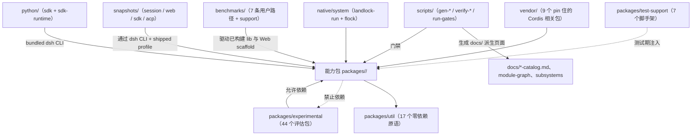

# 08 · 工程质量与支撑设施

> **一句话总结**：共享工具、测试基建、实验包与门禁/快照/依赖源码，托住全部能力包。

> **适用版本**：DeepSeek Harness `0.2.1-alpha.2`（`master` @ `d743267388`）· 核对日期 2026-10-12

| 项目 | 内容 |
|---|---|
| 回答的问题 | 所有能力包共用的底座有哪些？质量门禁、快照回放、原生依赖与 Python SDK 如何组织？ |
| 适合读者 | 要加共享工具、写测试、评估实验能力或维护生成器/门禁的工程师 |
| 前置阅读 | [00-项目全景](../00-项目全景.md)、[02-AI开发规范](../02-AI开发规范.md)、[04-模块说明/README](README.md) |
| 主要来源 | `packages/util/README.md`、`packages/test-support/README.md`、`packages/experimental/README.md`、`scripts/AGENTS.md`、`benchmarks/AGENTS.md`、`snapshots/AGENTS.md`、`vendor/README.md`、`native/README.md`、`python/README.md` |

## 一、通俗理解（先读这一节）

### 1. 这一层不提供业务能力

前七卷讲的是"DSH 能做什么"；本卷讲的是"DSH 靠什么保持可用、可测、可维护"。这里的东西大多不面对模型，也不构成 agent loop 的一部分：

- **`util/`** 给能力包提供共享的机械原语，避免同一段代码各写一遍。
- **`test-support/`** 给仓库测试提供确定性、无需 API key 的脚手架。
- **`experimental/`** 是"评估中、没有产品支持承诺"的能力集合。
- **`benchmarks/`、`scripts/`、`snapshots/`** 是质量门禁：性能预算、生成器/校验器、录制回放。
- **`vendor/`、`native/`、`python/`** 是"仓库如何拥有自己的底座"：pin 住的 Cordis 源码、平台原生 addon、Python SDK 与运行时 wheel。

### 2. 一句话区分三个容易混淆的概念

| 概念 | 含义 | 权威来源 |
|---|---|---|
| Experimental | 完整公开契约仍在评估，不是产品支持承诺；行为或 API 可能变化，能力可能被撤回 | `packages/experimental/README.md#status` |
| Optional | 用户显式选择该能力 | `packages/experimental/README.md#status` |
| Official | 项目维护并把它列在 Plugins 页面 | `packages/experimental/README.md#status` |

**发布、默认安装、GUI 可见性都不决定成熟度**（来源：`packages/experimental/README.md#status`）。

### 3. 直觉图

```text
  能力包 packages/<group>/<pkg>
      │  依赖
      ▼
  util/（17 个零依赖原语：brand、values、timeout、atomic-write …）

  测试与门禁
  ├─ test-support/（7 个脚手架：llm-replay、session-snapshot、loader-smoke …）
  ├─ snapshots/（acp / sdk / session / web：dsh CLI 驱动的录制回放）
  ├─ benchmarks/（7 条被测用户路径 + support/）
  └─ scripts/（生成器 gen-*、校验器 verify-*、门禁 run-gates）

  底座自有
  ├─ vendor/（9 个 pin 住的 Cordis 相关包，@deepseek-ai 重定 scope）
  ├─ native/（@deepseek-ai/node-addon-system：landlock-run + flock）
  └─ python/（deepseek-harness-sdk + deepseek-harness-runtime-bin）
```

### 4. 一个贯穿本卷的原则

仓库对"支撑设施"也有和产品代码一样严格的纪律：脚本的门禁必须语法感知发现、必须防御空/被裁剪的语料、必须测试每个改变检测边界的准入/排除形式（来源：`scripts/AGENTS.md`）；基准必须按被测用户路径组织、必须使用审查过的常量、不得用环境变量覆盖性能预算（来源：`benchmarks/AGENTS.md`）；快照里提交的 session 是归一化不动点（来源：`snapshots/AGENTS.md`）。换句话说，**"测试和工具代码"不是二等公民**。

## 二、目录级说明

### 2.1 packages/util —— 跨组共享的零依赖工具（17 个包）

组级 README：`util/` 给能力包提供共享的机械原语，覆盖原子写、branded id、deque、无损 JSON 值、UUID、Harness-home 路径、启动环境、出站代理策略、原生命令、输出保留、时区规范化与超时处理。**这里每个根条目都是 library：不注册任何产品服务或事件，业务语义由消费方保留**（来源：`packages/util/README.md`）。

### 2.2 packages/test-support —— 测试基础设施（7 个包）

组级 README：给仓库测试提供确定性、无需 key 的真实产品练习方式，包括 Loader 应用脚手架、session-log 快照适配器、replay LLM 插件与可脚本化的 OpenAI 兼容故障服务器。**每个包都是 support-tier 基础设施；当它获得产品契约和产品消费者时会移出这个组**（来源：`packages/test-support/README.md`）。

### 2.3 packages/experimental —— 评估中的能力（44 个包）

组级 README：显式安装并组合实验能力，不附带产品支持承诺；包命名与发布遵循 `scripts/experimental-package-policy.ts`，optional-bundle 规则决定哪些能力以"安装但关闭、可在 GUI 插件管理器的 Official 组里显式选择"的形式随安装发布（来源：`packages/experimental/README.md`）。实验状态**不放松**工程、安全、文档、生命周期、测试或快照要求（来源：`packages/experimental/AGENTS.md`）。这 44 个包按子领域分组见 3.3。

### 2.4 benchmarks/ —— 跨包的性能门禁

`benchmarks/` 拥有"被测用户路径跨越包所有权"的、仓库级必需性能门禁；包内局部诊断留在各所有者旁边并用 `.perf.ts` 后缀，不加入 `test:bench`（来源：`benchmarks/AGENTS.md`）。Host 用例用 `*.bench.ts`，Client-face 用例用 `*.bench.client.ts`；Worker、fixture 与 support 模块不带 bench 后缀（来源：`benchmarks/AGENTS.md`）。私有 `@deepseek-ai/dsh-benchmarks` workspace 拥有 benchmark-only 依赖（来源：`benchmarks/AGENTS.md`、`benchmarks/package.json`）。

### 2.5 scripts/ —— 生成器、校验器与门禁

`scripts/` 里有三类东西：**gen-* 生成器**（把源事实投影成生成文档/目录）、**verify-* 校验器**（在 CI 里检查不变式并防漂移）、**run-*/build/clean 等运行器**（门禁聚合、构建、清理、迁移）。门禁用无 shell 的方式调用 pnpm，并在摄取时把仓库相对 glob 路径规范化为 `/`（来源：`scripts/AGENTS.md`）。

### 2.6 snapshots/ —— 录制回放

这个树只包含"提交的 session JSONL 既是回放输入又是期望持久化输出"的测试；非 session 的 ARIA、几何、生成器、CLI 与单元期望输出留在各自所有者处（来源：`snapshots/AGENTS.md`）。每个被测进程都通过 `dsh` CLI 加 shipped profile 和可选场景 patch 启动；测试客户端可以驱动公共协议或浏览器接口，但不得另加入口点、隐藏 CLI 模式或可执行场景驱动（来源：`snapshots/AGENTS.md`）。

### 2.7 vendor/ —— pin 住的 Cordis 源码

`vendor/` 存放 Cordis 框架及其基础库的源码拷贝，使 harness 完全拥有自己的框架层（可审计、可打补丁、可 pin）。所有 vendored 包使用 `@deepseek-ai` scope，manifest 表记录上游版本与源提交，引用使用 `workspace:~`，上游 MIT LICENSE 保留在各包目录（来源：`vendor/README.md`）。**每个与上游的偏离都必须在 `vendor/README.md` 的 Local modifications 里穷尽列出**（来源：`vendor/AGENTS.md`）。

### 2.8 native/ —— 原生 addon

`native/` 是随 DSH 维护的原生源码与公开包；`system/` workspace 拥有 Landlock launcher 与 POSIX flock 绑定、它们的平台包以及发布流程（来源：`native/README.md`）。`native/system` 与它的包属于根 pnpm workspace 与 lockfile，因此 launcher 契约变更与消费者更新可以一起落地测试（来源：`native/README.md`）。

### 2.9 python/ —— Python SDK 与运行时 wheel

`python/` 提供驱动 DSH 子进程的 Python 包：`sdk`（`deepseek-harness-sdk` / `deepseek_harness`，高层 turns API 与低层 JSON-RPC 客户端）与 `sdk-runtime`（`deepseek-harness-runtime-bin` / `deepseek_harness_runtime`，打包的 `dsh` CLI 可执行文件与原生 sidecar）。SDK 默认启动同版本 bundled `dsh --profile sdk` runtime，**每次启动都要求显式选择 Harness home，Python 绝不静默读取 `~/.dsh`**（来源：`python/README.md`）。

## 三、条目表

### 3.1 util 的 17 个包

职责取自 `packages/util/README.md` 的包表。

| 路径 | 职责 | 关键概念 | 来源 |
|---|---|---|---|
| `packages/util/brand` | 名义字符串类型及其无状态构造函数 | `Branded<B>` | `packages/util/README.md` |
| `packages/util/package-manifest` | 包 manifest 的共享 TypeScript 声明 | 包元数据类型 | `packages/util/README.md` |
| `packages/util/crypto` | 从跨运行时 `crypto.getRandomValues` 生成 RFC 9562 v4 UUID | UUID v4 | `packages/util/README.md` |
| `packages/util/deque` | 摊还常数时间的队列操作，带界定的空闲存储 | deque | `packages/util/README.md` |
| `packages/util/chunked-list` | 保留不可变列表版本，append 复制有界、checkpoint 可校验 | 不可变列表版本 | `packages/util/README.md` |
| `packages/util/values` | 校验、快照、比较与冻结无损 JSON 兼容值 | lossless JSON | `packages/util/README.md` |
| `packages/util/home-paths` | 解析唯一 Harness home 并拼接共享用户数据路径 | `resolveDshHome` | `packages/util/README.md` |
| `packages/util/http-proxy` | 解析一个出站代理策略并安装给 `fetch`、SDK agent 与子进程 | 代理策略 | `packages/util/README.md` |
| `packages/util/launch-environment` | 冻结的启动环境，记住每个值由哪一层提供 | launch environment | `packages/util/README.md` |
| `packages/util/atomic-write` | 原子文件替换与跨进程写锁 | atomic write | `packages/util/README.md` |
| `packages/util/lazy-require` | 首次使用时加载 CJS 兼容的 Host 依赖，解析相对调用方 | lazy require | `packages/util/README.md` |
| `packages/util/native-command` | 直接运行 host-native 命令，绝不经过 shell 字符串 | argv 执行 | `packages/util/README.md` |
| `packages/util/workspace-path` | 浏览器安全的 Workspace 路径与显示助手 | `fileAddressFor` / `parseFileAddress` | `packages/util/README.md` |
| `packages/util/code-language` | 把文件后缀映射为语法高亮语言 | code language | `packages/util/README.md` |
| `packages/util/output-retention` | 界定模型可见输出并报告精确的省略元数据 | output retention | `packages/util/README.md` |
| `packages/util/time` | 校验并规范化调用方上报的 IANA 时区 | IANA time zone | `packages/util/README.md` |
| `packages/util/timeout` | 截止时间运算、信号融合与 timeout/cancel 分类 | deadline | `packages/util/README.md` |

### 3.2 test-support 的 7 个包

| 路径 | 职责 | 关键概念 | 来源 |
|---|---|---|---|
| `packages/test-support/session-snapshot` | 为 profile 驱动测试提供 session-log 快照支持与协议适配器 | replay 输入/输出 | `packages/test-support/README.md` |
| `packages/test-support/agent-loop-testkit` | 为练习具体 AgentLoop 的测试提供共享前置服务 | agent-loop testkit | `packages/test-support/README.md` |
| `packages/test-support/client-runtime` | 浏览器 feature spec 的 jsdom slot 测试台 | slot test bench | `packages/test-support/README.md` |
| `packages/test-support/remote-mock` | 以 endpoint 命名的 Typert Remote mock 与 Connection carrier face | Remote mock | `packages/test-support/README.md` |
| `packages/test-support/loader-smoke` | 启动 Loader 组合的应用并驱动 fixture turn 做 smoke | loader smoke | `packages/test-support/README.md` |
| `packages/test-support/llm-mock-server` | 可脚本化的 OpenAI 兼容故障服务器，用于恢复测试 | fault server | `packages/test-support/README.md` |
| `packages/test-support/llm-replay` | 回放录制的模型流，供无 key 测试与 demo 使用 | llm replay | `packages/test-support/README.md` |

### 3.3 experimental 的 44 个包（按子领域）

职责取自 `packages/experimental/README.md` 的包表；ctx key 亦同。

| 子领域 | 包含的包 | 职责与关键概念 | 来源 |
|---|---|---|---|
| Agent 协作与重复委派（6） | `agent-team` `agent-team-profile` `client-ui-agent-team` `tool-agent-team` `ralph-bundle` `tool-ralph` | 命名 teammate、直接消息与持久共享任务板（`ctx.agentTeams`）；Agent Teams 组合 bundle；Web 名册/任务板；九个协作工具；有界重复委派与隔离 workflow 引擎 | `packages/experimental/README.md`；`docs/subsystems/agent-team.md` |
| 浏览器与桌面 provider（6） | `browser-use-chrome-devtools-mcp` `browser-use-playwright-mcp` `browser-use-stagehand-native` `browser-use-runtime` `computer-use-cua-driver-mcp` `computer-use-cua-driver-native` | 经 MCP 或原生模型提供浏览器工具；Session 拥有的浏览器资源；通过 MCP 或内嵌 npm runtime 使用 Cua Driver 桌面能力 | `packages/experimental/README.md`；`docs/subsystems/browser-use.md` |
| Hook 桥（3） | `hook-protocol` `hooks-claude-code` `hooks-codex` | Hook 桥 wire 类型与持久事件；Claude Code 与 Codex 的 hook bridge | `packages/experimental/README.md` |
| Claude Code mods（2） | `claude-code-mods` `client-ui-claude-code-mods` | 把 Claude Code mod 当插件跑：其 hook 链落到 harness 扩展点、prompt 上方一条 band（`ctx.claudeCodeMods`）；Web band 绘制 mod 的树并回传按钮点击 | `packages/experimental/README.md`；`docs/subsystems/claude-code-mods.md` |
| 语音（5） | `speech-to-text` `speech-to-text-sensevoice` `api-speech-to-text` `client-ui-voice-input` `voice-input-bundle` | 命名语音识别 provider（`ctx.speechToText`）；托管本地 SenseVoice 推理；已认证的临时转写 Remote（`ctx.speechController`）；麦克风采集与受保护的草稿插入；默认关闭的语音组合 | `packages/experimental/README.md`；`docs/subsystems/voice-input.md` |
| 翻译（3） | `translator` `client-ui-cot-translation` `cot-translation-bundle` | 匿名 Google/Bing 与显式付费路由翻译（`ctx.translator`）；展开的 reasoning 翻译与原文本控制（`ctx.cotTranslation`）；默认关闭的翻译组合 | `packages/experimental/README.md`；`docs/subsystems/translation.md` |
| 会话检视、标题与检索（7） | `inspector` `session-inspector` `inspector-profile` `tool-session-query` `session-search` `session-title-all-prompts-llm` `session-titles-bundle` | 跨 realm CDP hub（`ctx.inspector`）；session log 与 Chat node 的侧栏表；其可选 Web bundle；工作区授权的会话搜索/追踪/事件读取；可选全局搜索工具；从全部人类 prompt 取标题；标题组合 | `packages/experimental/README.md` |
| 终端与工作树（4） | `tool-terminal` `terminal-bundle` `worktree` `tool-worktree` | 持久终端工具；可选的全局持久终端工具；创建命名 Git worktree 并切换调用 Session 目录（`ctx.worktrees`）；可选 bundle 与模型工具 | `packages/experimental/README.md`；`docs/subsystems/worktrees.md` |
| 其他执行扩展（1） | `ptc-runtime-python` | PTC 执行 seam 的 CPython 子进程后端（`ctx.ptcRuntime`） | `packages/experimental/README.md` |
| Web Worker 运行时（2） | `webworker-packer` `webworker-runtime` | 构建浏览器 worker 预览消费的 gzip VFS 镜像；在专用浏览器 worker 里跑 harness 插件树 | `packages/experimental/README.md` |
| Webhook（2） | `webhook` `webhook-github` | 认证投递分发与 Workspace Session 创建（`ctx.webhookRuntime`）；签名 GitHub ingress | `packages/experimental/README.md`；`docs/subsystems/webhook.md` |
| 评审与徽章（3） | `auto-review` `badge-skill-bundle` `skill-badge` | 每次原生或 PTC 内层工具调用前的同模型评审 Web 层；powered-by-dsh 徽章 skill bundle 与其 skill | `packages/experimental/README.md` |

### 3.4 benchmarks/ 的 7 条被测用户路径

| 路径 | 测什么 | 来源 |
|---|---|---|
| `benchmarks/agent-continuation` | 长历史请求处理、冷 tool-heavy continuation、重复发现 inactive fork 子节点；SDK 变体跑 100 turn 与 800 次真实文件读 | `benchmarks/agent-continuation/README.md` |
| `benchmarks/session-corpus` | Web Host 的 Session list、内容搜索与 fork（合成语料） | `benchmarks/session-corpus/README.md` |
| `benchmarks/long-session-browser` | Chromium 打开 240-turn Session、翻完历史页、进 Trajectory、在 paced 回复中继续输入草稿 | `benchmarks/long-session-browser/README.md` |
| `benchmarks/active-stream-reconnect` | 重连携带未完成 100,000-delta reasoning 前缀时生产 Client fold 的替换时间与保留堆 | `benchmarks/active-stream-reconnect/README.md` |
| `benchmarks/conversation-fold` | 对话 fold 的 Client-face 用例 | `benchmarks/AGENTS.md`；`benchmarks/` 目录 |
| `benchmarks/session-open` | Session 打开路径（含 released v0 session 合成） | `benchmarks/` 目录 |
| `benchmarks/terminal-io` | 终端 IO 路径 | `benchmarks/` 目录 |
| `benchmarks/support` | report/scaling/calibration/machine-profile 与 built-worker 支持模块 | `benchmarks/` 目录；`benchmarks/AGENTS.md` |

### 3.5 scripts/ 的四类脚本（代表性，非全集）

| 类别 | 代表性文件 | 作用 | 来源 |
|---|---|---|---|
| 生成器 | `gen-config-catalog.ts`、`gen-persistence-catalog.ts`、`gen-tool-catalog.ts`、`gen-client-catalog.ts`、`gen-module-graph.ts`、`gen-cordis-catalog.ts`、`gen-session-format-catalog.ts`、`gen-plugin-packages.ts`、`gen-tsconfig-paths.ts` | 从源码事实生成文档目录/目录清单，CI 用对应 `verify-*-catalog` 检查新鲜度 | `scripts/` 目录；`docs/AGENTS.md` |
| 校验器/门禁 | `verify-package-dependencies.ts`、`verify-cordis-config.ts`、`verify-client-ui-i18n.ts`、`verify-md-links.ts`、`verify-doc-budgets.ts`、`verify-no-unknown-casts.ts`、`verify-export-jsdoc.ts`、`verify-type-equiv.ts`、`verify-subsystem-pages.ts` | 检查依赖声明、配置、UI 文案所有权、文档链接/预算/类型粘贴等不变式 | `scripts/AGENTS.md`；`package.json` |
| 运行器/聚合 | `run-gates.ts`、`run-oxlint.ts`、`run-coverage-partitions.ts`、`run-web-snapshots.ts`、`run-memory-pressure-bench.ts` | 把门禁组织成 ci-primary/ci-static/ci-coverage 等具名聚合，并在有界并行下调度 | `scripts/run-gates.ts`；`package.json` |
| 构建/迁移/清理 | `build.ts`、`clean.ts`、`dev-web.ts`、`migrate-sessions-to-v4.ts`、`build-exe-for-python-sdk.ts`、`persistence-*.ts` | 构建、开发循环、会话格式迁移与 Python runtime 打包 | `package.json`；`scripts/` 目录 |

### 3.6 snapshots/ 的四个场景树

| 路径 | 覆盖 | 来源 |
|---|---|---|
| `snapshots/session` | 以 session 为回放输入/期望输出的场景（工具、压缩、subagent、MCP、PTC、Office 等） | `snapshots/AGENTS.md`；`snapshots/` 目录 |
| `snapshots/web` | Web 交互场景（导航、预览、审批、反馈、计划、语音等） | `snapshots/` 目录 |
| `snapshots/sdk` | SDK 协议与多轮/subagent 场景 | `snapshots/` 目录 |
| `snapshots/acp` | ACP 握手、多会话、权限、取消等场景 | `snapshots/` 目录 |

### 3.7 vendor/ 的 9 个 pin 包

npm 名、版本与上游提交取自 `vendor/README.md` 的 manifest 表。

| 目录 | npm 名 | 上游版本 |
|---|---|---|
| `vendor/cordis` | `@deepseek-ai/cordis` | 4.0.0-rc.7 |
| `vendor/loader` | `@deepseek-ai/cordis-plugin-loader` | 1.0.0-rc.5 |
| `vendor/include` | `@deepseek-ai/cordis-plugin-include` | 1.0.4 |
| `vendor/group` | `@deepseek-ai/cordis-plugin-group` | 1.0.0 |
| `vendor/timer` | `@deepseek-ai/cordis-plugin-timer` | 1.1.2 |
| `vendor/hmr` | `@deepseek-ai/cordis-plugin-hmr` | 1.0.15 |
| `vendor/logger-console` | `@deepseek-ai/cordis-plugin-logger-console` | 1.0.0 |
| `vendor/cosmokit` | `@deepseek-ai/cosmokit` | 1.8.1 |
| `vendor/schemastery` | `@deepseek-ai/schemastery` | 3.18.0 |

### 3.8 native/ 与 python/ 的条目

| 路径 | 职责 | 关键概念 | 来源 |
|---|---|---|---|
| `native/system` | Linux `landlock-run` 隔离可执行文件与 POSIX `flock` 绑定 | `launcherPath` / `probe` / `grantArgs`、`tryLockExclusive(fd)` | `native/system/README.md` |
| `python/sdk` | 驱动 DSH 子进程的 Python 高层 turns API 与低层 JSON-RPC 客户端 | `DeepSeekHarness`、`Session.run()`、Office 本地 API | `python/sdk/README.md` |
| `python/sdk-runtime` | 平台运行时 wheel：把 `dsh` CLI 与闭包 Node 依赖打成原生可执行文件 | `bundled_runtime_path()`、`download_office()`、`download_primary_runtime()` | `python/sdk-runtime/README.md` |

## 四、重点讲透

### 4.1 util 家族

util 的设计约束只有一条：**只放机械原语，不放业务语义**。README 明确"每一个根条目都是 library：不注册任何产品服务或事件，消费的能力包保留业务语义"（来源：`packages/util/README.md`）。这条约束带来三个可观察后果：

- 依赖方向单向：能力包依赖 util，util 不依赖能力包。
- 没有生命周期：util 包不参与 Cordis fiber 的加载/卸载。
- 命名与职责一一对应：17 个包各自提供一个原语，不出现"工具杂货铺"。

几个跨卷高频出现的原语（来源：`packages/util/README.md`）：`brand` 提供 `Branded<B>` 名义类型（仓库约定"不透明的跨边界 id 必须 branded，绝不是裸 `string`"，来源：`AGENTS.md`）；`home-paths` 提供 `resolveDshHome`，是 boot 与 Python runtime 共同依赖的 Harness home 解析器；`values` 处理无损 JSON 值的校验/快照/比较/冻结；`timeout` 做截止时间运算、信号融合与 timeout/cancel 分类；`output-retention` 界定模型可见输出并报告精确省略元数据。

### 4.2 test-support 测试基础设施

这 7 个包覆盖测试的三类需求（来源：`packages/test-support/README.md`）：

1. **无 key 地跑真实产品**：`llm-replay` 回放录制的模型流，`llm-mock-server` 提供可脚本化的 OpenAI 兼容故障服务器用于恢复测试。
2. **驱动真实组合**：`loader-smoke` 启动 Loader 组合的应用并驱动 fixture turn；`agent-loop-testkit` 为练习具体 AgentLoop 的测试提供共享前置服务。
3. **断言输出与客户端**：`session-snapshot` 提供 session-log 快照支持与协议适配器；`client-runtime` 提供浏览器 feature spec 用的 jsdom slot 测试台；`remote-mock` 提供 endpoint 命名的 Typert Remote mock 与 Connection carrier face。

配套的测试政策在 `docs/testing.md`；其中 `test:coverage`（而非 `test`）才是 CI 覆盖率门禁，且客户端源码包处于 per-file 100% 覆盖率门禁内（来源：`AGENTS.md`、`packages/client/AGENTS.md`）。

### 4.3 experimental 的 44 个包与实验政策

**什么算 experimental。** 完整公开能力仍在评估、且不是产品支持承诺；行为或 API 可能变化，能力可能被撤回。但工程、安全、文档、测试与已发布数据义务仍然适用。**一个包只有在"完整公开契约都是实验性或仅内部"时才属于这里**；产品包里的实验性选项留在它的产品角色下（来源：`packages/experimental/README.md#status`）。

**命名与发布。** 包名遵循 `scripts/experimental-package-policy.ts`：默认使用 `@deepseek-ai/dsh-experimental-` 前缀，保留历史 npm 名的目录列在 `EXPERIMENTAL_PACKAGE_NAME_EXCEPTIONS`（例如 `tool-session-query` 仍是 `@deepseek-ai/dsh-tool-session-query`，`webhook` 仍是 `@deepseek-ai/dsh-webhook`）。包默认加入 dsh release family（省略 `private`、设 `publishConfig.access: public`）；只有 `PRIVATE_EXPERIMENTAL_PACKAGE_DIRECTORIES` 里的目录保持私有——该常量当前是空数组（来源：`scripts/experimental-package-policy.ts`）。

**隔离规则。** 实验组之外的 release 包与 apps **不得**在 `dependencies`/`optionalDependencies`/`peerDependencies` 里点名实验包；`default-product isolation` 还会在 CI 里检查传递安装、运行时 import 与 shipped composition。实验包可以依赖 release 包与彼此；测试可以通过 `devDependencies` 使用实验包（来源：`packages/experimental/AGENTS.md`）。

**晋级条件。** 晋级需要：具名产品角色、已文档化的公开行为与限制、当前消费者、发布内容与测试证据；然后把包移入其产品组、套用该组命名规则，并原子更新受影响消费者（来源：`packages/experimental/README.md#status`）。**发布一个实验包不等于晋级，也不增加稳定性承诺**（来源：`packages/experimental/AGENTS.md`）。

**44 个包的覆盖范围。** 3.3 把它们分成 12 个子领域：Agent 协作与重复委派、浏览器/桌面 provider、Hook 桥、Claude Code mods、语音、翻译、会话检视/标题/检索、终端与工作树、PTC Python 后端、Web Worker 运行时、webhook、评审与徽章。其中语音、翻译、Claude Code mods 的 UI 半边是 `packages/client` 生态的插件，但归属实验组，因此统一在本卷登记。

### 4.4 benchmarks 性能门禁

**组织原则。** 按被测用户路径组织，一个目录一条路径，**不镜像包树**（来源：`benchmarks/AGENTS.md`）。Host 用例后缀 `*.bench.ts`，Client-face 用例后缀 `*.bench.client.ts`；Worker、fixture 与 support 模块不带后缀（来源：`benchmarks/AGENTS.md`）。

**运行方式。** `test:bench` 先构建 workspace libraries 与 `benchmarks/.dsh-build/` 下的 worker，再交给 Vitest 编排；计时 CPU 工作在那些 worker 里以 plain Node 跑，没有 TypeScript loader，因此运行时包 import 必须解析到已构建的 `lib/` 条目（来源：`benchmarks/AGENTS.md`）。浏览器工作流用例通过共享 shipped-composition Web scaffold 驱动已构建的 Client bundle；source-resolved 测试 Host 的证据必须与 published-Host 证据分开报告（来源：`benchmarks/AGENTS.md`）。

**取样与防作弊。** 输入必须由审查过的常量合成，**绝不使用录制的 Session、用户材料、环境仓库或网络服务**（来源：`benchmarks/AGENTS.md`）。进程级 wall-clock 与 retained-memory 样本在私有 `mkdtemp` 根下的 fresh child 中跑；每个 child 要有界、要 await exit，失败与成功都要清理自有根（来源：`benchmarks/AGENTS.md`）。

**预算与报告。** 每个预算 wall-clock 端点都必须先经 `support/scaling-report.ts` 的 `recordTimings` 记录，并附带说明"测什么、影响哪个用户场景"的 `BenchmarkCase`；整进程峰值 RSS 交给 `recordPeakMemory`；machine profile 在 `support/machine-profiles.ts`；每次运行写 `.dsh-report/report.html`，由 `node 24 / benchmarks` job 作为 `benchmark-report` artifact 发布（来源：`benchmarks/AGENTS.md`）。参考机器期望与共享 CI 时间尺度、方差余量分开记录；**不得把时间尺度应用到内存或无量纲比值**；环境变量不得覆盖性能预算（来源：`benchmarks/AGENTS.md`）。

**已有预算示例。** agent-continuation 的 catalog 与 tool continuation 各用 900 ms 标准 hosted CI 期望与 1.25× 余量（1125 ms），request history 用单独审查的 297 ms；active-stream-reconnect 的 50 ms 参考机器期望经共享 2× CI 时间尺度与 1.25× 余量得 125 ms 上限，retained-heap 预算保持 30 MiB 且不做时间缩放；long-session-browser 的 open/slowest-page/first-Trajectory 用 900/700/520 ms 期望与 1.25× 余量（来源：`benchmarks/agent-continuation/README.md`、`benchmarks/active-stream-reconnect/README.md`、`benchmarks/long-session-browser/README.md`）。

**内存受限复跑。** `pnpm run test:bench:memory 4g|8g` 在无 swap、上限 4 或 8 GiB 的 cgroup 里重跑 `scripts/run-memory-pressure-bench.ts` 列出的文件，**预算不变**；加入该列表的文件必须在两种上限下都有效（来源：`benchmarks/AGENTS.md`）。

### 4.5 scripts 的生成器/校验器组织方式

**生成器（gen-*）把源事实投影成生成产物。** 例如 `gen-config-catalog.ts`、`gen-persistence-catalog.ts`、`gen-tool-catalog.ts`、`gen-module-graph.ts`、`gen-client-catalog.ts`、`gen-cordis-catalog.ts`、`gen-session-format-catalog.ts`。生成产物在文档侧对应 `docs/config-catalog.md`、`docs/persistence-catalog.md`（346 KB）、`docs/tool-catalog.md`、`docs/module-graph.md`（130 KB）以及各 subsystems 页里的 `cordis-surface` 区域；docs 规范明确"生成目录的手工改动禁止"，中文对照只走配对流程（来源：`docs/AGENTS.md`）。

**校验器（verify-*）是 CI 里的防漂移门禁。** `verify-package-dependencies.ts` 检查并修复依赖声明；`verify-client-packages.ts` 拥有 Client 加载与模块请求；`verify-cordis-config.ts` 强制 raw/Web `cordis.yml` 里的 bare plugin 出现在其 resolver manifest 的 `dependencies` 中；`verify-client-ui-i18n.ts` 拒绝硬编码产品文案；`verify-md-links.ts`、`verify-doc-budgets.ts`、`verify-type-equiv.ts`、`verify-export-jsdoc.ts`、`verify-subsystem-pages.ts` 分别守文档链接、文档预算、`ts type-equiv` 粘贴不漂移、导出 JSDoc 与子系统页覆盖（来源：`scripts/` 目录；`AGENTS.md`）。

**门禁聚合器。** 包脚本拥有公开聚合名，`scripts/run-gates.ts` 拥有它们的合法依赖图、调度环境与进程诊断。它定义了 `ci-primary`、`ci-linux-primary`、`ci-static`、`ci-lint-contracts-ready`、`ci-coverage`、`ci-unit`、`ci-bench`、`ci-snapshot`、`ci-artifacts`、`ci-consumers`、`ci-windows-*`、`node-compat`、`check-all`、`hygiene`、`doc-sync`、`doc-quick` 等 Mode，每个 Gate 带 `needs`/`after` 依赖元数据与可选 `allowFailure`/`streamOutput`（来源：`scripts/run-gates.ts`；`package.json`）。

**纪律。** 门禁脚本无 shell 地调用 pnpm，在摄取时把仓库相对 glob 路径规范化为 `/`，并把平台适配留在需要它的门禁里而不是抽共享平台层；源码所有权门禁必须语法感知发现、防御空或被裁剪的语料、并测试每个改变检测边界的准入/排除形式（来源：`scripts/AGENTS.md`）。脚本 spec 在 forked worker 里与其余套件、其他门禁进程并跑，因此每个 spec 都要自己拥有并清理端口、临时路径与子进程；**一个只有在单独运行时才通过的 spec 是缺陷**（来源：`scripts/AGENTS.md`）。

### 4.6 snapshots 录制回放

**职责边界。** 这个树只放"提交的 session JSONL 既是回放输入又是期望持久化输出"的测试；非 session 的 ARIA、几何、生成器、CLI 与单元期望输出留在各自所有者处，用 `test:expected`、`test:web` 或 `test`（来源：`snapshots/AGENTS.md`）。

**启动方式。** 每个被测进程都通过 `dsh` CLI 加 shipped profile 和可选场景 patch 启动；**不得另加应用入口、隐藏 CLI 模式或可执行场景驱动**（来源：`snapshots/AGENTS.md`）。

**文件命名与版本。** canonical parent 文件名是 `session[.vN].jsonl`，child 是 `session.<ordinal>[.vN].jsonl`；v0 省略 `.v0`，正版本用小写 `.vN`，文件名必须与 header 一致。一个目录可以保留同一 role 的多代，但 replay/record/refresh 选数值最高的一代（来源：`snapshots/AGENTS.md`）。需要保留历史代的 owner 在 `snapshot.yml` 声明精确的 `sessionFormat.version` 与封闭的迁移 `coverage` 名；`retired-tools` 独立钉住已移除能力（来源：`snapshots/AGENTS.md`）。

**归一化。** 提交的 session 是归一化不动点：把易变身份替换为"保留类型的 token"、把请求 system prompt 与工具 schema 替换为 token，并让每个 header class 恰好有一个可读 sidecar owner；**绝不因为任意用户或工具文本"像标识符"就把它抹掉**（来源：`snapshots/AGENTS.md`）。

**三方命令。** `pnpm run test:snapshot` 只回放不写入；record 与 refresh 用显式脚本（`test:snapshot:record` / `test:snapshot:refresh`），每一处 JSONL、prompt、schema、协议、UI 与 workspace diff 都要审查后再提交（来源：`snapshots/AGENTS.md`）。会改动 workspace 的场景设 `workspace.final: true`，并把完整结果提交到 `workspace.expected/`；空结果只允许用被忽略的 `.empty` 标记（来源：`snapshots/AGENTS.md`）。

### 4.7 vendor 的 pinned 源码与同步流程

**为什么 vendored。** harness 要完全拥有自己的框架层（可审计、可打补丁、可 pin），所以 Cordis 与其基础库以源码形式拷进 monorepo，而不是从 npm 依赖（来源：`vendor/README.md`）。所有 vendored 包用 `@deepseek-ai` scope；引用用 `workspace:~`，因此本地构建解析 workspace 包、发布范围允许同一 minor 内的 patch 更新（来源：`vendor/README.md`）。

**manifest。** `vendor/README.md` 的表格记录每个目录的 npm 名、上游名、版本、上游仓库与提交 SHA；上游 workspace 是 `cordis-workspace`（来源：`vendor/README.md`）。第三方依赖仍留在 npm，例如 `@standard-schema/spec`、`js-yaml`、`chokidar`、`picomatch`（来源：`vendor/README.md`）。

**本地修改日志。** 每个与上游的偏离都必须穷尽列在 `vendor/README.md` 的 Local modifications 一节；`vendor/*/tsconfig.json` 是唯一例外（为适配 monorepo 构建而重新生成，可以因类型检查策略调整而修改）（来源：`vendor/AGENTS.md`）。日志里的条目类型包括：为 Harness 发布重生成 package.json/tsconfig、把内部 specifier 改成显式 `.ts`、移除依赖 `@cordisjs/unyaml` 的 i18n 配置、`cordis/src/fiber.ts` 的重入 dispose 加固、JSDoc 补全、Include 的弹性刷新与 patch 再应用、HMR 的 watcher 就绪与路径比较等（来源：`vendor/README.md`）。

**同步流程（更新既有 vendored 包）。** 五步：在上游 workspace 记下相关 submodule 的 `git rev-parse HEAD`；把包的 `src/`（以及需要时的 `bin.js`、`README.md`、`LICENSE`）拷到 vendored 目录；重新应用上面列出的本地修改（或在上游已包含它们时删除并同步更新日志）；更新 manifest 表的版本与提交哈希；在仓库根跑 `pnpm install && pnpm run test && pnpm run build`（来源：`vendor/README.md`）。新增 vendored 包走 cookbook `docs/cookbook/adding-a-vendored-package.md`；rescope 用 `pnpm run rescope-vendor --apply` 在同步后重新套用（来源：`vendor/README.md`、`vendor/AGENTS.md`）。

### 4.8 native addon

**暴露面。** `@deepseek-ai/node-addon-system/landlock-run` 导出 `launcherPath`、`probe`、`grantArgs`；`@deepseek-ai/node-addon-system/flock` 导出 `tryLockExclusive(fd): Promise<void>`。**import 任一条目都不会加载 addon**：缺失的 Landlock 可执行文件探测为不可用，缺失的 flock 绑定会让获取锁 reject（来源：`native/system/README.md`）。

**契约。** Landlock 的 argv、退出码、诊断与 fail-closed 约束定义在 `native/system/docs/cli-contract.md`，扩展其他 system 能力时不得改动；launcher 只用 libc，静态链接 musl，kernel UAPI 定义留在受审查的 C 源里（来源：`native/system/AGENTS.md`）。flock 绑定只在异步工作中尝试 `LOCK_EX | LOCK_NB` 并在该 worker 捕获 errno；调用方在完成前拥有 fd，通过关闭它释放锁（来源：`native/system/AGENTS.md`）。Node 绑定用稳定的 Node-API v8，绝不用 NAN、V8 C++ API 或实验性 Node 接口；Linux glibc 与 musl addon 是不同二进制，macOS 有自己的 Mach-O bundle（来源：`native/system/AGENTS.md`）。**没有 install-time 编译回退**（来源：`native/system/AGENTS.md`）。

**发布边界。** `native/system` 与它的包属于根 pnpm workspace 与 lockfile；主仓库的 Node Addon System workflow 构建并测试每个受支持架构，Node Addon System Release 组装这些原生产物、打包并校验 npm tarball，然后可选地在同一个 native 版本下发布。入口包把平台包作为 npm optional dependencies，因此 npm 仍只为用户的操作系统与 CPU 安装匹配的包（来源：`native/README.md`）。平台包布局：Linux 含 `bin/landlock-run`、`bin/glibc/system.node`、`bin/musl/system.node`；macOS 含 `bin/system.node`；Windows 不需要平台包（来源：`native/system/AGENTS.md`）。

### 4.9 python SDK/runtime

**两个包。** `python/sdk`（`deepseek-harness-sdk`）是高层 turns API 与低层 JSON-RPC 客户端；`python/sdk-runtime`（`deepseek-harness-runtime-bin`）把普通 `dsh` CLI 与其闭合 Node 依赖树打包成原生可执行文件，因此 SDK 使用**不需要系统 Node.js**（来源：`python/sdk/README.md`、`python/sdk-runtime/README.md`）。

**启动契约。** SDK 没有独立应用入口，它启动 bundled `dsh` CLI 的 `--profile sdk`；所选 profile 拥有 JSON-RPC 服务器、agent 组合、凭据、持久化、工具与关闭行为。**每次启动都要求显式 Harness home**（`dsh_home` 参数或子进程环境里的非空 `DSH_HOME`），SDK 刻意从不发现 `~/.dsh`（来源：`python/sdk/README.md`）。`provider`/`model`/`reasoning_effort`/`max_tokens` 在 JSON-RPC 初始化时发送；初始化会在任何 prompt 运行前拒绝缺失 adapter、不可用模型或不支持的 effort（来源：`python/sdk/README.md`）。

**profile 定制。** 持久定制属于 `dsh` profile：用 runtime wheel 的 `dsh` 命令初始化 shipped SDK profile 并安装外部 bundle（`dsh plugin --profile sdk add file:...`）。profile manifest 记录已安装依赖与有序 bundle 层，`$DSH_HOME/profiles/sdk/cordis.patch.yml` 是持久用户 patch；`dsh plugin` 只在管理外部包时需要 `pnpm`（来源：`python/sdk/README.md`）。`sdk-minimal` 是独立显式树而非 `dsh-base` 的 overlay（来源：`python/sdk/README.md`）。

**运行时 wheel。** wheel 只带可执行文件、原生执行助手与 `<platform>-<arch>/` 下的 `downloads.json` 和轻量 `office-skills/` 树；CPython、authoring libraries、standalone Node、pnpm 与完整 Office sidecar 都是可选下载。**import Python 模块、启动 SDK profile、处理 Office 文件都不会触发下载**；要显式调用 `download_office()` / `download_primary_runtime()`（来源：`python/sdk-runtime/README.md`）。发布目标为 Linux x64、Linux arm64、macOS arm64、macOS x64、Windows x64；wheel tag 与 payload 必须精确匹配，不发布 Windows arm64 wheel（来源：`python/sdk-runtime/README.md`）。`DSH_RESOURCE_CACHE` 选择绝对缓存根（默认 `~/.cache/deepseek-harness/resources`），下载校验 archive 哈希与包身份、保留可执行权限、原子发布完成目录，`DSH_RESOURCE_DOWNLOAD_TIMEOUT_MS` 默认 300000（来源：`python/sdk-runtime/README.md`）。bundled `dsh` 用内存 generation 而非磁盘 symlink 做运行时解析，built-in 行与外部插件 peer 共享 bundled Cordis/module 实例（来源：`python/sdk-runtime/README.md`）。

## 五、依赖关系图



> 图题：支撑设施与能力包的关系。实线表示使用/依赖，虚线表示测试期或禁止关系。注意两条反向约束：实验包可以依赖 release 包，release 包不得依赖实验包（来源：`packages/experimental/AGENTS.md`）。

## 六、常见误解

- ❌ **"experimental 就是没发布或不能用。"** → ✅ 实验状态与发布、安装、可选交付、GUI 可见性互相独立；判断标准是 `packages/experimental/README.md#status` 的定义（来源：`packages/experimental/README.md#status`）。
- ❌ **"util 里可以放业务逻辑。"** → ✅ util 的每个根条目都是 library，不注册任何产品服务或事件，业务语义由消费的能力包保留（来源：`packages/util/README.md`）。
- ❌ **"vendored 源码可以随手改。"** → ✅ 每个与上游的偏离都必须穷尽记录在 `vendor/README.md`；只有 `vendor/*/tsconfig.json` 是例外（来源：`vendor/AGENTS.md`）。
- ❌ **"性能预算可以用环境变量临时放宽。"** → ✅ 必须强制执行审查过的源码常量，环境变量不得覆盖性能预算（来源：`benchmarks/AGENTS.md`）。
- ❌ **"快照测试可以自带驱动脚本。"** → ✅ 每个被测进程都必须通过 `dsh` CLI 加 shipped profile 启动，不得另加入口点或可执行场景驱动（来源：`snapshots/AGENTS.md`）。
- ❌ **"native addon 会在安装时编译。"** → ✅ 没有 install-time 编译回退；平台包只装匹配 OS/CPU 的预编译产物（来源：`native/system/AGENTS.md`、`native/README.md`）。
- ❌ **"Python SDK 会自动读取用户的 ~/.dsh。"** → ✅ 每次启动都要求显式 Harness home，Python 绝不静默读取 `~/.dsh`（来源：`python/README.md`、`python/sdk/README.md`）。

## 七、关键文件索引

| 路径 | 作用 |
|---|---|
| `packages/util/README.md` | util 的 17 个原语与"只放机械原语"的约束 |
| `packages/test-support/README.md` | 7 个测试脚手架及其 support-tier 定位 |
| `packages/experimental/README.md` | 实验/可选/Official 的定义、44 包表与晋级条件 |
| `packages/experimental/AGENTS.md` | 实验子树规则：命名、发布、依赖隔离 |
| `scripts/experimental-package-policy.ts` | 实验包命名、保留名与私有目录常量 |
| `scripts/product-package-policy.ts` | 非实验但非默认运行时的产品角色分类 |
| `scripts/run-gates.ts` | 门禁聚合 Mode 与调度实现 |
| `scripts/AGENTS.md` | 脚本子树规则：pnpm 调用、语法感知发现、spec 隔离 |
| `benchmarks/AGENTS.md` | 基准组织、取样、预算与报告规则 |
| `benchmarks/support/scaling-report.ts` | `recordTimings` / `recordPeakMemory` 报告基础设施 |
| `snapshots/AGENTS.md` | 录制回放的所有权、命名、归一化与命令 |
| `vendor/README.md` | vendor manifest、Local modifications 与同步流程 |
| `native/README.md`、`native/system/README.md` | 原生包边界与 landlock/flock 使用契约 |
| `python/README.md`、`python/sdk-runtime/README.md` | Python SDK 与运行时 wheel 的启动/下载/解析契约 |
| `docs/testing.md` | 测试分层、覆盖率门禁与快照要求 |

## 八、延伸阅读

- [01-系统架构](../01-系统架构.md)：这些支撑设施在内核与启动链路中的位置
- [02-AI开发规范](../02-AI开发规范.md)：门禁、生成器与快照在 AI 协作流程中的角色
- [04-模块说明/README](README.md)：8 卷划分与包/组计数
- [06-界面与交互层](06-界面与交互层.md)：语音、翻译等实验能力的 UI 半边
- [07-开发者接口与集成](07-开发者接口与集成.md)：webhook 与 SDK 的对外契约
- `docs/development.md`：本地开发、构建顺序与检查命令
