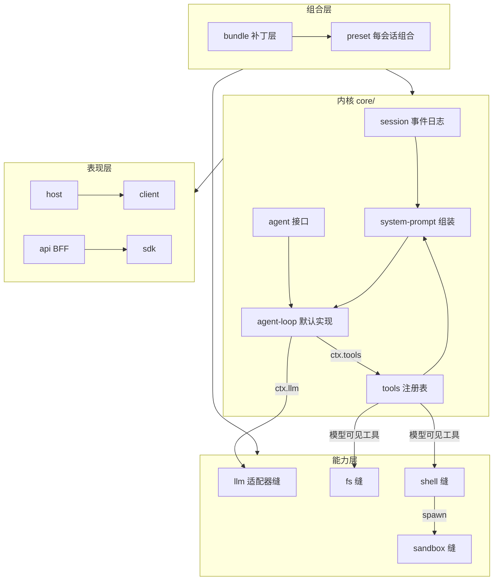

# DSH 模块说明（模块手册）

> **一句话总结**：DSH 的 331 个 npm 包按 52 个能力族分组，本目录把它们收拢成 8 卷，逐层讲清"谁负责什么、依赖谁、在哪里扩展"。

| 项目 | 内容 |
|---|---|
| 回答的问题 | DSH 由哪些模块组成？每个模块负责什么？模块之间如何依赖与协作？ |
| 适合读者 | 想定位代码、评估改动影响面、或准备写插件的工程师 |
| 前置阅读 | [00-项目全景](../00-项目全景.md)、[01-系统架构](../01-系统架构.md) |
| 主要来源 | `packages/README.md`、各包组 `README.md`、`docs/module-graph.md`、`docs/subsystems/` |

## 一、通俗理解

DSH 的代码组织方式可以用一句话概括：**一个内核 + 一组能力族**。

- **内核**（`packages/core`）只负责"agent 怎么跑"：会话日志、提示词组装、工具注册表、agent 句柄与循环。
- **能力族**（其余 51 个包组）各自提供一种能力：读写文件、执行命令、访问网络、调用模型、委派子 agent、保存设置……每种能力都通过一个**能力缝（capability seam）**对外暴露，因此实现可以整体替换。
- **组合层**（`bundle`、`preset`、`boot`）把想要的插件按顺序拼成一棵树，这就是一个可运行的 `dsh`。
- **表现层**（`host`、`client`、`api`、`sdk`）把内核的能力投射成 Web GUI、桌面应用、CLI 与远程接口。

一个重要的组织原则（来自 `packages/README.md`）：**扩展插件只依赖 Service Definition，绝不依赖具体 Provider**。所以 UI、hook、工具插件都挂在 `dsh-agent` 这一层抽象上，而不是绑死某个具体实现；只有组合 bundle 才允许依赖"脊柱"插件。

```text
┌ 表现层 ── host · client · api · sdk · acp · boot
│            Web GUI / Desktop / CLI / SDK / ACP / 远程 BFF
│
├ 编排层 ── subagent · jobs · workflow · schedule · goal · plan ·
│            guard · preset · bundle · extensions · feedback · interaction
│
├ 能力层 ── llm · context · fs · shell · subprocess · ssh · sandbox ·
│            terminal · ptc-runtime · web · lsp · mcp · skill · storage …
│
└ 内核层 ── core：session 事件日志 · system-prompt 组装 · tools 注册表 ·
             agent 接口 + agent-loop 默认实现
```

## 二、8 卷划分与包数量

包数量的统计口径是 `packages/<组>/<包>/package.json`，全仓库共 **331 个**（`来源：packages/` 目录实测；组数量 52，见 `packages/README.md`）。

| 卷 | 主题 | 覆盖包组 | 包数 |
|---|---|---|---|
| [01](01-内核与会话运行时.md) | 内核与会话运行时 | core, session, session-query, typert | 36 |
| [02](02-模型与上下文.md) | 模型与上下文 | llm, context, compaction, skill | 25 |
| [03](03-工具与执行环境.md) | 工具与执行环境 | fs, shell, subprocess, ssh, sandbox, terminal, ptc-runtime, web, lsp, mcp, computer-use, browser-use, document, todo | 48 |
| [04](04-编排自动化与自修改.md) | 编排、自动化与自修改 | subagent, jobs, workflow, schedule, goal, plan, guard, preset, bundle, extensions, feedback, interaction, deliverables | 46 |
| [05](05-数据身份与用户状态.md) | 数据、身份与用户状态 | storage, workspace, settings, credentials, attachment, spill, identity, telemetry | 18 |
| [06](06-界面与交互层.md) | 界面与交互层 | client, host（另有 `apps/` 下 4 个应用包，不在本表 `packages/<组>/<包>` 计数口径内） | 72 |
| [07](07-开发者接口与集成.md) | 开发者接口与集成 | api, sdk, acp, boot | 18 |
| [08](08-工程质量与支撑设施.md) | 工程质量与支撑设施 | util, test-support, experimental + benchmarks/ scripts/ snapshots/ vendor/ native/ python/ | 68 |
| | | **合计** | **331** |

## 三、包组 → 卷 一览表

职责文字取自 `packages/README.md` 的包组表（它是包组的权威地图）。

| 组 | 包数 | 职责 | 所属卷 |
|---|---|---|---|
| core | 8 | Product API spine：会话、提示词、工具、agent 服务与具体循环 | 01 |
| session | 21 | 持久会话数据平面：持久化缝 + 后端、投影缝、日志支撑的标题、会话报告 | 01 |
| session-query | 3 | 会话检索：逻辑语料、有界读取、血缘、语义过滤、SQLite 全文搜索 | 01 |
| typert | 4 | 类型图生成、产物加载与运行时注册表 | 01 |
| llm | 9 | LLM 能力族：抽象服务 + provider 适配器 | 02 |
| context | 6 | 模型可见的请求上下文：工作区指令、时间上下文、引用 | 02 |
| compaction | 5 | 压缩能力族：Service Definition + 基础 provider + 命令 Consumer | 02 |
| skill | 5 | 技能能力族：provider 注册表、本地 provider、模型可见目录/加载器 | 02 |
| fs | 7 | 文件系统能力族：缝、本地实现、模型可见文件工具、发现工具 | 03 |
| shell | 10 | Bash 能力族：执行器缝、本地实现、模型可见工具 | 03 |
| subprocess | 3 | 子进程能力族：Service Definition + 本地进程树 provider | 03 |
| ssh | 5 | POSIX 远程连接，配套 filesystem/subprocess/sandbox 三个 provider | 03 |
| sandbox | 4 | 进程隔离缝；bwrap/Landlock/Seatbelt 后端 | 03 |
| terminal | 2 | 持久 PTY 服务，owner 作用域会话 + 本地 shell 后端 | 03 |
| ptc-runtime | 2 | PTC 执行能力族：Service Definition + 沙箱 Node provider + PTC 模式 Consumer | 03 |
| web | 6 | Web 能力族：缝、搜索/抓取 provider、模型可见 web 工具 | 03 |
| lsp | 3 | LSP 能力族：缝、通用 stdio provider、`lsp` 工具 | 03 |
| mcp | 2 | 外部 Model Context Protocol 服务器暴露为原生工具 | 03 |
| computer-use | 1 | 独占命名桌面 provider 注册 | 03 |
| browser-use | 1 | 独占命名浏览器 provider 注册 | 03 |
| document | 1 | 共享的 Host 端 Office→PDF 转换 | 03 |
| todo | 1 | 模型可见的 `todo_write` 工具 | 03 |
| subagent | 9 | 子 agent 能力族：provider 注册表契约 + 模型可见委派工具 | 04 |
| jobs | 3 | 通用后台任务运行时与模型可见的任务控制工具 | 04 |
| workflow | 3 | 工作流缝、PTC 进程引擎、模型可见 `workflow` 工具 | 04 |
| schedule | 2 | Host 拥有的定时跟进 | 04 |
| goal | 4 | 同会话目标持久化与生命周期 | 04 |
| plan | 1 | 计划协作状态：直接入口命令 + 受审查的退出 | 04 |
| guard | 2 | 循环卫生：重复调用提醒 + `tools/execute` 截止时间执行器 | 04 |
| preset | 3 | 每会话的 agent 组合（来自 preset `cordis.yml`） | 04 |
| bundle | 6 | 可安装的 `dsh --profile` 补丁层 | 04 |
| extensions | 4 | agent 运行时自修改：live 插件/服务检视 + 受控的 mount/unmount（当前模型工具只有两个只读检视工具；动态定义由程序化调用者与浏览器面板创建，持久安装走 Plugin Manager） | 04 |
| feedback | 2 | 人类反馈采集与命令 | 04 |
| interaction | 5 | 人机协作平面：审批/交互缝、权限预设、命令、ask-user 工具 | 04 |
| deliverables | 2 | 回合交付物：显式文件交付 + 已记录的工作区变更 | 04 |
| storage | 4 | 非会话存储 hub + 后端 + 领域形态 | 05 |
| workspace | 1 | Workspace 实体 | 05 |
| settings | 1 | 用户设置缝 + 文件后端 provider | 05 |
| credentials | 5 | 凭据引用/记录缝 + env-over-`.env` provider + 需要人类的授权流 | 05 |
| attachment | 2 | 持久附件身份、校验、本地内容寻址存储 | 05 |
| spill | 3 | 外溢能力族：存储缝、本地实现、工具结果外溢策略 | 05 |
| identity | 1 | 共享匿名身份 | 05 |
| telemetry | 1 | 共享 Cordis OTel 上报通道 | 05 |
| client | 63 | Web GUI 浏览器半边：shell、wire、对象服务、slots、`ui-*` 插件 | 06 |
| host | 9 | Web GUI host 服务、目录选择、应用启动、插件清单、产品遥测 | 06 |
| api | 9 | 远程 BFF 组装与 Typert RPC 网关 | 07 |
| sdk | 3 | 进程外 SDK：JSON-RPC 协议与 TypeScript 客户端/服务端 | 07 |
| acp | 1 | 仅自动化的 Agent Client Protocol 服务器 | 07 |
| boot | 5 | 共享 app-bin 启动胶水 | 07 |
| util | 17 | 跨组共享的零依赖底层工具（`Branded<B>`、home/path 助手、超时、保留策略） | 08 |
| test-support | 7 | 测试基础设施（testkit、replay、Loader smoke） | 08 |
| experimental | 44 | 评估中的能力，状态政策见 `packages/experimental/README.md#status` | 08 |

## 四、依赖方向

`packages/README.md` 明确了依赖纪律：

1. **扩展插件依赖 Service Definition，绝不依赖具体 provider。** 例如 `dsh-agent-loop` 是可替换的；UI、hook 与工具插件依赖 `dsh-agent`。
2. **组合 bundle 可以依赖脊柱（spine）插件。**
3. 依赖图是生成的：`docs/module-graph.md`（`pnpm run gen-module-graph`，CI 中有新鲜度门禁）。



> 说明：图中箭头表示"使用/依赖"方向。真实的包级依赖以 `docs/module-graph.md` 为准。

## 五、每个模块条目的统一格式

各卷中的包级条目统一为：

**包名 → 一句话职责 → 关键概念/服务 → 关键扩展点 → 来源**

例如：

| 包 | 职责 | 关键服务 | 扩展点 | 来源 |
|---|---|---|---|---|
| `@deepseek-ai/dsh-shell` | shell 执行能力缝（Service Definition） | `ctx.shell` | 注册 `ctx.shell` 后端 | `packages/shell/README.md` |

## 六、常见误解

- ❌ **"内核很大，改起来风险高。"** → ✅ 内核（`packages/core`）只有 8 个包，且每个都是可替换插件；绝大多数改动应落在扩展点上（来源：`docs/architecture.md`、`packages/core/README.md`）。
- ❌ **"一个包就是一个能力缝。"** → ✅ 能力缝是"Service Definition + Provider + Consumer"三者的**完整组合**，单独一个角色不构成缝；一个包也可以同时承担多个角色（来源：`docs/glossary.md#capability-seam`）。
- ❌ **"包组按技术分层划分。"** → ✅ 包组按**能力族**划分，与进程/运行时分层的概念不同（来源：`packages/README.md`）。
- ❌ **"experimental 就是没发布或不能用。"** → ✅ 实验状态与发布、安装、可选交付互相独立；判断依据是 `packages/experimental/README.md#status`（来源：`packages/README.md`）。

## 七、关键文件索引

| 路径 | 作用 |
|---|---|
| `packages/README.md` | 包组权威地图与依赖纪律 |
| `packages/AGENTS.md` | 包子树专属规范（导出、服务访问、测试） |
| `docs/module-graph.md` | 生成的包级依赖图（130 KB，用 grep 定位） |
| `docs/capability-seams.md` | 能力缝清单与角色矩阵 |
| `docs/subsystems/` | 每个子系统一页的类型与语义参考 |
| `docs/config-catalog.md` | 生成的配置字段目录 |
| `docs/tool-catalog.md` | 生成的工具目录 |

## 八、延伸阅读

- [01-系统架构](../01-系统架构.md)：全局机制与扩展点
- [03-设计规范](../03-设计规范.md)：写新模块时必须遵守的设计约束
- [05-自迭代实现方案](../05-自迭代实现方案.md)：模块如何被运行时动态挂载
