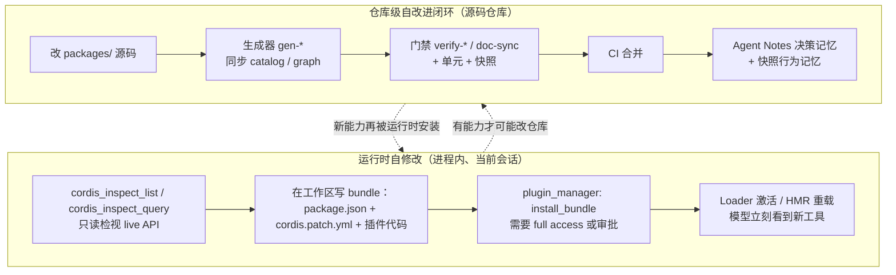
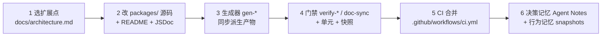

# DSH 自迭代实现方案

> **一句话总结**：DSH 的自我改进分为运行时改插件与仓库级改进闭环两层。

> **适用版本**：DeepSeek Harness `0.2.1-alpha.2`（`master` @ `d743267388`）· 核对日期 2026-10-12

| 项目 | 内容 |
|---|---|
| 回答的问题 | DSH 是如何做到自己改自己 / 自己提升自己的？ |
| 适合读者 | 想理解 agent 运行时自修改与仓库级自改进闭环的工程师、架构师 |
| 前置阅读 | [01-系统架构](01-系统架构.md)、[04-模块说明/04-编排自动化与自修改](04-模块说明/04-编排自动化与自修改.md) |
| 主要来源 | `packages/extensions/*/README.md`、`packages/boot/plugin-manager/README.md`、`packages/preset/*/README.md`、`packages/bundle/README.md`、`packages/guard/*/README.md`、`packages/goal/*/README.md`、`packages/schedule/*/README.md`、`packages/subagent/*/README.md`、`packages/workflow/*/README.md`、`docs/subsystems/extensions.md`、`docs/cookbook/extension-cookbook.md`、`docs/architecture.md`、`.agents/notes/README.md`、`scripts/run-gates.ts`、`package.json` |

## 一、通俗理解

### 1.1 两个层面，别混为一谈

「DSH 自己改自己」在代码里有两种完全不同的机制，作用范围、持久性、审批方式都不同。

- **运行时自修改**：agent 在**一次会话运行过程中**，检视当前进程里活着的插件与服务，写一个新插件/新 bundle，并把它挂进当前 profile。它改的是**运行中的组合**，不是 DSH 的源码仓库。
- **仓库级自改进闭环**：agent（或人）改的是**仓库源码**，然后经过生成器、门禁、快照、CI、合并、决策记忆（Agent Notes）走一圈，最后成为下一个版本的 DSH。它改的是**产品本身**。

一篇文档如果只讲其中一个，就会漏掉另一半。运行时自修改回答「此刻能不能加能力」，仓库级闭环回答「能力如何被固化、验证、防止回退」。

### 1.2 直觉图

图注：左半是会话内的即时自修改，右半是把改动固化成产品的闭环；两者通过「能力」互为输入。

### 1.3 运行时自修改长什么样

一次典型的运行时自修改（来源：`packages/preset/agent-preset/skills/cordis-plugin-development/SKILL.md`）：

1. 用 `cordis_inspect_list` 发现可查询的 Host/Client provider，再用 `cordis_inspect_query` 问到精确的 Service 方法、Event 模式、当前挂载插件的 Config JSON Schema（来源：`packages/extensions/tool-cordis/README.md`）。
2. 在**工作区**（不是 `$DSH_HOME`）写一个 bundle 目录：`package.json`、`cordis.patch.yml`，以及 Host 半或 Client 半代码。
3. 调 `plugin_manager` 的 `install_bundle`，`target` 传该 bundle 的绝对目录；安装、bundle 选择、HMR 重载都由 Plugin Manager 代做（来源：`packages/boot/plugin-manager/README.md`）。
4. 读安装结果的 `application` 与 `warnings`，再用 `cordis_inspect_query` 确认新行已生效（来源：`packages/preset/agent-preset/skills/cordis-plugin-development/SKILL.md`）。

关键限制：模型**没有**任意改写 profile 配置或直接动 `packages/` 的工具。所有 Host 代码执行都要 `danger-full-access` 或一次调用审批（来源：`.agents/notes/implemented/architecture/2026-09-16-creator-persistent-plugin-management.md`）。

### 1.4 仓库级闭环长什么样

一次典型的仓库级自改进：

1. 选扩展点，在 `packages/` 新增或修改包（来源：`docs/architecture.md` 的 "Where new behavior goes" 表）。
2. 跑生成器把 catalog、composition graph、module graph 等派生产物同步（来源：`package.json` 的 `gen-*` 脚本）。
3. 跑 `doc-sync`、`constraints`、测试、快照等门禁（来源：`scripts/run-gates.ts`）。
4. CI 通过后合并（来源：`.github/workflows/ci.yml`）。
5. 写 / 更新目标生命周期与类别的 Agent Note 作为决策记忆；快照作为行为记忆（来源：`.agents/notes/README.md`、`snapshots/AGENTS.md`）。

### 1.5 为什么两层必须分开看

因为两者的**权威来源**和**失败后果**不同。运行时自修改可能加载拥有 Host 权限的代码，影响同一个 profile 下的**所有会话**（来源：`packages/boot/plugin-manager/README.md`）；仓库级改动一旦合并则进入发布物，需要可回放的行为证据与决策记录。DSH 用「审批 + profile 事务」约束前者，用「生成器 + 门禁 + 快照 + Agent Notes」约束后者。

## 二、技术细节

### 2.1 extensions 提供的原子能力

`packages/extensions/` 有四个包，构成运行时可检视、可执行的原子能力（来源：`packages/extensions/README.md`）。

| 包 | 作用 | ctx key / 面 |
|---|---|---|
| `tool-cordis` | 两个只读运行期 API 发现工具 | 注册到 `ctx.tools` |
| `cordis-host-runner` | Host 半：定义注册表、sandbox 化 Host 半生命周期、inspect 注册表 | `ctx.dynamicCordisRunner`、`ctx.cordisInspect` |
| `cordis-client-runner` | 浏览器半：把浏览器半源码求值为 live 插件并应答 run 请求 | client 面，浏览器侧 `ctx.dynamicCordisRunner` |
| `ui-cordis` | 浏览器面板与历史生命周期卡片 | client 面，注册 slots |

注意包的定位：extensions 组 README 明确写它是「read-only runtime API discovery for agents, process-local runners for programmatic and browser consumers, and historical generated-plugin cards. Creator mode installs persistent plugins through Plugin Manager」（来源：`packages/extensions/README.md`）。

检视侧的核心 API 是 `ctx.cordisInspect`（`CordisInspectRegistryService`），它提供 `register`、`syncClientManifest`、`list`、`query`、`resolveClientQuery`（来源：`docs/subsystems/extensions.md`）。Host provider 组合了生成的 Service/Event catalog、经 app-boot Config 投影的 live Loader 树、以及请求 agent 的工具注册表；Client provider 经同一注册表同步 manifest 并由打开的页面应答（来源：`packages/extensions/tool-cordis/README.md`）。

`Config.listConfigs` 是其中一个 Host provider：它分页列出 live Loader entry（`offset`、`limit` 最大 100、可按精确插件 `name` 过滤，用 `total` 与 `nextOffset` 界定遍历），并给出每个 entry 的 Config 状态（`schema`、`absent`、`unsupported`、`tree`、`inactive`）；查询单个 entry 时，若能解析 profile 包查找，会投影出该 entry 的原生 Config JSON Schema 及 `packageDir`（来源：`packages/extensions/tool-cordis/README.md`）。`packageDir` 是插件作者读 README、再读 `lib/` 或源码的入口。

### 2.2 模型可见工具：只读检视 vs 受控安装

模型在自修改链路里能看到两类工具，权限完全不同。

| 工具 | 作用 | 权限 |
|---|---|---|
| `cordis_inspect_list` | 列出可查询 provider | 只读 |
| `cordis_inspect_query` | 查询精确 Service 方法/Event 模式/Config Schema/Tool/Slots | 只读，且不调用业务方法 |
| `plugin_manager` | action 枚举：`list_plugins`、`list_bundles`、`set_plugin`、`set_bundle`、`install_bundle`、`remove_bundle`、`list_version_exemptions`、`set_version_exemption` | 每个 action（含 list）都需要 `danger-full-access` 或审批 |

`tool-cordis` 只注册两个只读工具，且「queries never invoke business methods」（来源：`packages/extensions/tool-cordis/README.md`）。`plugin_manager` 在 Creator 模式下启用，「Every tool action requires `danger-full-access` or approval for that call」；在较低 sandbox 模式下，`ask` 会请求审批，`never`、拒绝、取消或审批通道不可用都会阻止执行（来源：`packages/boot/plugin-manager/README.md`）。

一个容易误解的点：**generated-code 的 define/run/stop/undefine 不是模型工具**。Creator 模式只启用 `plugin_manager`；「Generated-code define/run/stop/undefine and dynamic self-inspection tool APIs are absent」（来源：`.agents/notes/implemented/architecture/2026-09-16-creator-persistent-plugin-management.md`）。`cordis-host-runner` 的写 API 仍保留给程序化调用方和浏览器控件（来源：同 note；`packages/extensions/cordis-host-runner/README.md`）。

### 2.3 生命周期与 effect 语义

Cordis 的注册即 effect：每次贡献都经 `ctx.effect()` / `ctx.on()`，registry 的 `register()` 返回 disposer（来源：`AGENTS.md` 约定；`docs/cookbook/extension-cookbook.md` 的 "every registration is a `ctx.effect` → vendored HMR just works"）。

`DynamicCordisRunnerService` 的生命周期语义（来源：`docs/subsystems/extensions.md` 与 `packages/extensions/cordis-host-runner/README.md`）：

- `define(request)`：定义一个 Plugin 的第一个 Package，或给已有 Plugin 追加 Package；返回 Host 签发的 Plugin 与 Package 标识。
- `run(agent, pluginId, packageId, mode, signal?)`：启动或更新一个 Package。`mode: "run"` 启动当前版本，`mode: "update"` 替换。
- `stop(agent, pluginId)`：停止 live run，但保留所有 Package 版本。
- `undefine(agent, pluginId)`：移除 Plugin、其 active run 与所有不可变 Package。
- `invoke(...)`：调用 active Host 方法，并拒绝陈旧 Client run。

三条不可混淆的规则：

1. **版本不可变**：一个 Plugin 持有在 `define` 后永不改变的 Package；`currentPackageId` 与 `nextPackageId` 分别指向运行中与目标版本，「run」与「update」的差别就是目标是否等于当前（来源：`packages/extensions/cordis-host-runner/README.md`）。
2. **定义是会话级、进程本地的**：其他会话读到的是「不存在」，重启即清空；历史日志保留工具参数与回执，但**不会恢复注册表**（来源：`packages/extensions/cordis-host-runner/README.md`）。
3. **Host 先于 Client**：带浏览器半的 Package 先跑 Host 半；有浏览器半的 run 会等待一个页面审批或取消，然后 Host 先加载、Client 后加载（来源：`packages/extensions/cordis-host-runner/README.md`）。浏览器半用纯 JavaScript 编写，作为 async 函数求值，只拿到固定符号 `React`、`console`、`styles`、`host`，`fetch` 与 `setTimeout` 不可用；返回的插件只能用生命周期动词和自己声明的 `inject` 服务（来源：`packages/extensions/cordis-client-runner/README.md`）。

HMR 提供「注册即生效」的重载能力，但 Plugin Manager 的直接操作不等文件事件：「Direct Plugin Manager operations apply without waiting for file events」（来源：`packages/boot/hmr/README.md`）。base bundle 在 launcher 提供 `profileContext` 时以 `root: []` 启用 HMR；headless、SDK、ACP bundle 在 YAML 里禁用它，后续 profile patch 可再启用（来源：`packages/boot/hmr/README.md`）。

### 2.4 失败与回滚策略

运行时安装与动态 run 的失败处理是分层的（来源：`packages/boot/plugin-manager/README.md` 的 "Failure behavior"、`packages/extensions/cordis-host-runner/README.md`）。

| 失败 | 处理 |
|---|---|
| 安装时 pnpm 或 bundle 校验失败 | 恢复到 pnpm 运行前快照的 `package.json` 与 `pnpm-lock.yaml`；pnpm 已下载的文件可能残留 |
| 保存选择或加载失败（enable） | 保留已安装依赖与已保存的选择，报告 enable 失败，允许修复/禁用/移除 |
| 成功的包操作后发布 runtime resolution 失败 | 保留已完成磁盘改动与旧 runtime 表，报告 `application: 'failed'` |
| 移除任一步失败 | 停在失败步，保留已完成改动与剩余依赖以便重试，且**不重新启用**该 bundle |
| 动态 Package 的 Host 半求值失败 | vm 求值中止，不会挂载；`stop` 撤销 live dispatch（handler disposer、fiber dispose、广播 retract） |

动态 run 有一个明确的不重试边界：当应答页面给出的 revision 已被注册表越过时，`resolveRequestRun` 返回 `accepted: false`（**被拒绝的解析不会被重试**），页面保留已加载内容、不再编排；请求保持可应答，直到另一页面应答或调用方取消（来源：`packages/extensions/cordis-client-runner/README.md`、`packages/extensions/cordis-host-runner/README.md`）。

HMR 的替换失败也有回滚：失败时移除部分激活的替换，并恢复先前的模块与插件实现；成功的 reload 会更新所有匹配的 entry 记录，包括 disabled entry，失败的替换则不改这些记录（来源：`packages/boot/hmr/README.md`）。

### 2.5 安全边界

运行时自修改的安全边界是**显式审批 + 沙箱 façade**，而不是一个安全隔离沙箱。

- `plugin_manager` 的整个管理工具都需要 `danger-full-access` 或一次调用审批；profile 改动会加载拥有 Host 权限的代码，并影响其他会话（来源：`.agents/notes/implemented/architecture/2026-09-16-creator-persistent-plugin-management.md`）。
- 动态 Host 半跑在 `node:vm` realm 中，Node 全局缺失或重定向到 Cordis 服务（`ctx.fs`、`ctx.web`、`ctx.bash`、timer helper）；但包声明到的服务能触达 live runtime。官方 stance 是「The sandbox isolates globals but is not a security boundary ... Treat a dynamic package like bash access」（来源：`packages/extensions/cordis-host-runner/README.md`）。
- `vmTimeoutMs`（默认 5000 ms）只约束同步求值部分；async Host 半体会逃逸该上限，与工具的协作式信任立场一致（来源：`packages/extensions/cordis-host-runner/README.md`）。
- 用户审批语义是 fail-closed：`ApprovalOutcome` 关闭为 `allowed-once | rejected | cancelled | unavailable`，调用方在 `rejected`、`cancelled`、`unavailable` 上拒绝；`never` 策略直接返回 `rejected` 而不派发任何 answerer（来源：`docs/subsystems/approval.md`）。

### 2.6 动态组合：preset / bundle / overlay / HMR

四种机制都能改变「运行中的组合」，但粒度和持久性不同。

| 机制 | 归属 | 粒度 | 持久性 | 生效方式 |
|---|---|---|---|---|
| **agent preset** | `@deepseek-ai/dsh-agent-preset` 声明，由 bundle patch 携带 | 每会话/每 agent 的工具、prompt section、skill | 声明持久（写在 profile patch），revision 进程内保留 | registry 为每个 revision 建独立 scope 与 Loader 树，agent 绑定 revision |
| **bundle** | npm 包声明 `dsh.bundle.patch` | profile 的一层 patch | 持久（`dsh.profile.bundles`） | 按 ordered bundles 逐层 apply patch |
| **cordis.yml overlay** | profile 目录与 home 的 `cordis.patch.yml`、`--patch` invocation overlay | 单行 entry 的覆盖/插入 | 持久 | 覆盖按 row id，last write wins |
| **HMR** | `dsh-hmr` | 模块与配置热替换 | 不持久（进程内重载） | 一条队列串行处理模块替换、Include 刷新、profile 配置变更 |

bundle 的机制细节：一个 profile 是目录 `$DSH_HOME/profiles/<name>`，含 `package.json`（pnpm 管理的 out-of-tree 插件 `dependencies` 加 profile manifest `dsh.profile` 的 ordered `bundles` 列表）与用户 `cordis.patch.yml`；一个 bundle 是声明 `"dsh": { "bundle": { "patch": "./cordis.patch.yml" } }` 的 npm 包；树从空根开始，按 `dsh.profile.bundles` 顺序 apply 每个 bundle patch，再 apply 用户层与 `--patch` overlay（来源：`.agents/notes/implemented/architecture/2026-08-05-profile-plugin-bundles.md`）。`dsh.profile.bundles` 的解析是双锚点：先 DSH 安装，再 profile 目录（来源：同 note）。

preset 的机制细节：`dsh-agent-preset-registry` 拥有 selection 与 runtime revision；每个声明**急切激活**为一个 registry 拥有的 scope 与内存 Loader 树；更新/移除会 retire 之前的 revision，Agent、children 与临时历史读取保留引用，最后一个引用释放时才 dispose（来源：`.agents/notes/implemented/architecture/2026-09-18-declarative-agent-presets.md`）。preset 只接受 child plugin YAML；Web 编辑器与 `agent_preset` 工具保存时写 active profile 的 user patch（来源：同 note）。Preset 服务 provider 与其 consumer 必须共享同一个 `cordis:group` isolation realm，否则 Host realm 会遮住它们（来源：`packages/preset/agent-preset-registry/README.md`）。

patch 语义提醒：一个 patch entry 替换目标 row 的整个 `config`，而不是合并进它；后面的 bundle 层与用户 patch 按 id 覆盖 row，逐行 last write wins（来源：`packages/bundle/base/README.md`）。这也是为什么新增能力时「新增独立 row」比「改别人 row 的 config」更稳。

Web 组合里 shipped preset 是 `@deepseek-ai/dsh-web-app` bundle 的 `presets/<id>.patch.yml`，id 有 `standard`、`ptc`、`minimal`、`cordis`（来源：`packages/preset/agent-preset/skills/editing-cordis-compositions/SKILL.md`）。

### 2.7 自我调节：长跑不失控的机制

长跑 agent 有几类典型失控模式，DSH 各有对应机制。

| 机制 | 包 | 解决的问题 | 关键事实 |
|---|---|---|---|
| 重复调用提醒 | `packages/guard/repeat-tool-reminder` | 同一工具同一参数死循环 | 在 `tools/post-execute` 计数，默认阈值 `[3, 5, 8]`，advisory 不阻塞；每 agent 一条链（`WeakMap<Agent, Chain>`），新用户消息清空 |
| 调用超时 | `packages/guard/timeout-policy` | 挂死的工具调用 | 在 `tools/execute` 包一层；limit 来自工具自己声明的 `timeoutMs`；超时映射为 `TOOL_TIMEOUT` 结构化错误 |
| 上下文压缩 | `packages/compaction/*` | 上下文溢出 | `ctx.compaction` seam；自动 pressure 跑在 `agent/pre-step`，canonical overflow 恢复跑在 `agent/request-error`，手动用同一 service |
| 目标续跑 | `packages/goal/*` | 多轮目标不中断 | `ctx.goals` 每会话一个 durable goal；`goal-round-driver` 在 idle 时排队下一轮；cap 用尽记录 `round-limit` blocker |
| 宿主定时 | `packages/schedule/*` | 跨会话定时提醒 | Host 拥有 storage 与调度；due reminder 作为普通 follow-up 投递回原会话 |
| 规划 | `packages/plan/` | 动手前先计划 | `plan/mode` 是 logged 状态；`exit_plan_mode` 需用户复核 |
| 任务清单 | `packages/todo/` | 多步进度可见 | `todo_write` 工具 |

guard 的细节值得注意：两种 guard 都**不改 loop**，而是挂在已文档化的工具流水线事件上。repeat-tool-reminder 不阻拦调用，只把提醒经 `tools/post-execute` decision 的 `additionalContexts`（source `{kind: 'repeat-tool-reminder', ...}`）注入为工具结果之后的一条 synthetic user message，因此「model-visible ⟺ logged」不破（来源：`packages/guard/repeat-tool-reminder/README.md`）。timeout-policy 在 `tools/execute` 上交换 `exec.signal` 并在 `finally` 恢复，使 `tools/post-execute` 监听者看不到它派生出的信号（来源：`packages/guard/timeout-policy/README.md`）。

compaction 的锁语义是「整个操作被 `compaction/start` 与 `compaction/end` 括住」，锁最后释放，因此中途崩溃留下可检测的 orphaned lock，而不是谎称已完成的 `compaction/end`（来源：`docs/subsystems/compaction.md`）。三个 `compaction/*` 事件都是 log-only；summary 本身搭一条单独 `user/message`，用 `surfaceOp: { op: 'replace', startSeq, endSeq }` 做唯一一次 surface 变更（来源：`docs/subsystems/compaction.md`）。

goal 的续跑用「reservation 后 admission」：驱动在 idle 时预留 `roundsStarted + 1`、排队一条 `<goal_round>` goal 消息，只有 **entered** 的 `user/message` 才真正消耗额度；被判定 stale 的 reservation 不消耗轮次号（来源：`packages/goal/goal-round-driver/README.md`）。resume 或 fork 之后 active goal 保持 disarmed，直到显式人类授权 resume，驱动不会自行复活工作（来源：同 README）。

schedule 由 Host 拥有，跨 Host 重启保留，且「read and delete must not activate a Session」；due recurring task 在一个 Session 内共享一条消息；enqueue 与 retire 非原子，崩溃可能重复投递，官方明确不描述为模型完成、也不加通用重试循环（来源：`packages/schedule/AGENTS.md`、`docs/subsystems/schedule.md`）。

### 2.8 自主学习与记忆

四类「记忆」各管一段。

**Skill 加载**：`ctx.skills` 是 provider registry，注册同步、远程初始化和发现放在 awaited `list()`（来源：`docs/subsystems/skills.md`）。本地 provider 按 rank 扫描（来源：`docs/subsystems/skills.md`）：

| Rank | Source | Root |
|---|---|---|
| 100 | `project-dsh` | `<projectRoot>/.dsh/skills` |
| 200 | `project-agents` | `<projectRoot>/.agents/skills` |
| 300 | `custom` | `Config.customSkillDirs` |
| 400 | `user-dsh` | `<dshHome>/skills` |
| 500 | `user-agents` | `<agentsHome>/skills` |
| 600 | `bundled` | `Config.bundledSkillDir` |

skill 名是 kebab-case，目录 bundle 形如 `<name>/SKILL.md`，扁平文件形如 `<name>.md`；不支持递归 `**/SKILL.md`。summary 只把 model-invocable 的 `name` 与 `description` 渲染进模型目录，绝不带正文或绝对路径（来源：`docs/subsystems/skills.md`）。模型加载 skill 经 `skill` 工具（`@deepseek-ai/dsh-tool-skill`），source 为 `project-agents` 的正是 `.agents/skills/` 下的仓库技能。

**Context 注入**：AGENTS.md 与工作区指令是「模型可见输入」，按「Model-visible ⟺ logged」原则必须有对应 session event 或等价的 inject 路径。扩展点的映射表给出机制：root AGENTS.md 是一个 section provider 读文件；子目录 AGENTS.md 的 on-touch 注入与文件变更通知走 watcher / tool-result 监听里的 `agent.inject()`；Memory 是 section provider + tool（来源：`docs/cookbook/extension-cookbook.md`）。runtime context 在 request 派生时刷新并按需 reconcile（来源：`docs/architecture.md` 的 turn flow）。

**决策记忆（Agent Notes）**：`.agents/notes/` 按 `{lifecycle}/{class}/yyyy-mm-dd-topic-title.md` 组织，lifecycle 为 `proposed`/`implemented`/`rejected`，class 为 `feature`、`bug-fix`、`simplification`、`architecture`、`process`、`testing`（来源：`.agents/notes/README.md` 与 `scripts/agent-note-tree.ts`）。每条 note 必须有 `## Alternatives considered`；implemented note 的正文骨架是 `## Problem`、`## Decision`、bespoke sections、`## Alternatives considered`、`## Consequences`；格式由 `verify-agent-note-format` 门禁。归档 triplet 一旦封存永久冻结，不再编辑也不作为当前权威（来源：`.agents/notes/README.md`）。新 note 触发 supersession 检查（来源：`.agents/notes/AGENTS.md`）。

**行为记忆（快照）**：`snapshots/` 只放「committed session JSONL 既是 replay 输入又是预期持久化输出」的测试（来源：`snapshots/AGENTS.md`）。场景的 user 输入与模型 replay 都来自该场景最高代 parent session；工作区变更用独立的 `workspace.expected/` 对照，record/refresh 不会重写这个独立 oracle（来源：`snapshots/AGENTS.md`）。策略上，每次非平凡的 model-、protocol-、human-visible 改动，必须在同一 PR 里新增或更新一个 keyless recorded-session 场景；`test:snapshot` replay 不写盘，record/refresh 的每一处 diff 都要 review（来源：`docs/testing.md`）。

### 2.9 多 agent 自组织

四个能力族有不同的分工与协作契约。

| 族 | 包 / ctx key | 分工 | 协作契约 |
|---|---|---|---|
| subagent | `ctx.subagents` + 多个 provider | 把任务委派给 child，并继续 child 的工作 | provider registry；fresh in-process、history-seeded fork、ACP、Codex、Claude Code、DSH SDK；terminal result 语义由 `docs/subsystems/subagent.md` 定义 |
| jobs | `ctx.jobs` | 长工作的后台注册与控制 | 按 owning Session 做访问围栏；完成事件在会话内投递，不轮询 |
| workflow | `ctx.workflowEngine` | 跑模型写的编排脚本，fan-out subagent | 脚本是纯 JS（top-level await，`return <json-value>`）；`meta`/`args` 是纯 JSON 数据并在运行前校验；`WorkflowResult` 的 `stopReason` 是闭集 |
| agent-team | `ctx.agentTeams`（experimental） | Lead + teammates 的持久 roster 与共享 task DAG | TeamId 等于 root SessionId；task 事件存完整快照，`revision` 是 compare-and-set；`writeScopes` 是 advisory 路径前缀而非锁 |

jobs 的契约：`JobSpec` 声明 identity、owning session、可选 pull output source 与 starter；runtme 在调用 `run()` 前完成 preflight，然后原子提交；producer 拥有执行资源，runtime 拥有 identity、访问、生命周期状态与 output ring（来源：`docs/subsystems/jobs.md`）。`JobStatus` 为 `running | stopping | completed | killed | failed`。

workflow 的产物是 `WorkflowStartRequest`（`script`、`meta`、可选 `args`、可选 `subagentProvider`、可选 `maxTotalAgents`、必填 `parent`）与 `WorkflowRun.result`（永不 reject，失败以 `stopReason: 'error'` 结算）（来源：`docs/subsystems/workflow.md`）。`workflow-ptc` 在 calling Session 的 file policy 下用共享 PTC Node 进程运行时执行脚本（来源：`packages/workflow/README.md`）。

agent-team 的共享任务 DAG 约束：`blockedBy` 边必须指向未删除 task 且保持无环（来源：`docs/subsystems/agent-team.md`）。

### 2.10 仓库级自迭代闭环与门禁

闭环可以拆成六个环节。

图注：生成器保证「派生产物不手写」，门禁保证「不漂移」，快照保证「产品输出可回归」，Agent Note 保证「为什么这么做」不丢。

**聚合入口**是 `scripts/run-gates.ts`。它定义并调度这些 aggregate：`ci-primary`、`ci-linux-primary`、`ci-static`、`ci-lint-contracts-ready`、`ci-coverage`、`ci-unit`、`ci-bench`、`ci-snapshot`、`ci-artifacts`、`ci-consumers`、`ci-windows-*`、`node-compat`、`check-all`、`hygiene`、`doc-sync`、`doc-quick`（来源：`scripts/run-gates.ts`）。`package.json` 暴露 `doc-sync`、`constraints`、`hygiene` 等脚本。

`doc-sync` 聚合的叶门禁（来源：`scripts/run-gates.ts` 的 `docSyncLeafGates`）分三类：

- **生成物新鲜度**（`gen-*` 的 `--check` 模式）：`verify-doc-graphs`、`verify-cli-help`、`verify-type-equiv`、`verify-cordis-catalog`、`verify-cordis-inspect-catalog`、`verify-workflow-guest`、`verify-client-catalog`、`verify-tool-catalog`、`verify-config-catalog`、`verify-plugin-packages`、`verify-dependency-catalog`、`verify-persistence-catalog`、`verify-persistence-changes`、`verify-persistence-releases`、`verify-persistence-formats`、`verify-session-format-catalog`、`verify-tsconfig-paths`。
- **文档与代码一致性**：`verify-md-links`、`verify-md-wrap`、`verify-mermaid`、`verify-translation-pairing`、`verify-export-jsdoc`、`verify-subsystem-pages`、`verify-package-paths`、`verify-config-source-ownership`、`verify-package-readme-summaries`、`verify-package-readme-model-experience`、`verify-package-readme-limitations`、`verify-doc-budgets`、`verify-upgrade-guides`、`verify-concrete-terms`、`verify-doc-refs`。
- **决策记录与站点**：`verify-agent-note-classification`、`verify-agent-note-format`、`verify-archived-agent-notes`、`verify-skill-invocation-metadata`、`verify-translation-prompt`、`docs:build` 与 `doc-standard-tests`、`docs-site-projection`。
- 该集合还包括 `doc-typecheck`、`verify-public-repository-links`、`verify-repository-references`。来源：`scripts/run-gates.ts`。

`hygiene` 与静态聚合还包含（来源：`scripts/run-gates.ts` 的 `hygieneLeafGates`、`ciSharedStaticGates`）：`verify-runtime-closure`、`verify-default-product-isolation`、`verify-product-use`、`verify-official-bundle-catalog`、`verify-package-dependencies`、`verify-application-entrypoints`、`verify-dsh-package-licenses`、`verify-package-meta`、`verify-cordis-config`、`verify-client-packages`、`verify-client-ui-i18n`、`verify-client-route-resolution`、`verify-no-bare-dispatcher`、`verify-plugin-record-callers`、`verify-no-unknown-casts`、`verify-optional-dependency-imports`、`rescope-vendor:check`、`publint`、`constraints`。

关键生成器及其作用（来源：`scripts/` 下各文件首行 JSDoc 与 `package.json`）：

| 生成器 | 产物 / 作用 |
|---|---|
| `gen-tool-catalog.ts` | 从「启动每个 tool 插件后收集的 schema」生成 `docs/tool-catalog.md`；运行时注册是 computed schema 的事实源 |
| `gen-config-catalog.ts` | 生成 `docs/config-catalog.md` |
| `gen-cordis-catalog.ts` | 生成 subsystems 页的 `cordis-surface` 区域（Service/Event） |
| `gen-cordis-inspect-catalog.ts` | 生成模型可见的 Host/Client Service 与 Event inspect catalog |
| `gen-client-catalog.ts` | 生成 Client catalog |
| `gen-cli-help.ts` | 生成 `docs/cli-help.md` |
| `gen-doc-graphs.ts` / `gen-module-graph.ts` | 生成文档图与 `docs/module-graph.md` |
| `gen-persistence-catalog.ts` / `gen-session-format-catalog.ts` | 生成持久化与 session 格式 catalog |
| `gen-plugin-packages.ts` | 生成 `cordis-composition-reference` skill 的 `references/packages.md` |
| `gen-workflow-guest.ts` | 把 workflow guest 打成 source data，`--check` 拒绝陈旧的 committed module |
| `gen-third-party-notices.ts` / `gen-dependency-catalog.ts` / `gen-official-bundle-catalog.ts` | 依赖与许可、Official bundle catalog |

合并门禁由 GitHub Actions 承担。`.github/workflows/ci.yml` 只在 `pull_request` 触发，用 `concurrency` 取消被新 push 取代的旧 run；它把 coverage、static analysis 与 build-backed consumer tail 分成独立 job（来源：`.github/workflows/ci.yml`）。`.github/AGENTS.md` 规定 Windows 原生 job 以 `pwsh` 运行并计入 PR 的 `all checks passed`，`ci-master.yml` 只监听 master push 与 `workflow_dispatch`（来源：`.github/AGENTS.md`）。

覆盖率是独立于「测试通过」的门禁：`pnpm run test:coverage` 对 `packages/*/*/src` 做 per-file 100%，且它是 CI 覆盖率门禁而非 `pnpm run test`（来源：`docs/testing.md`、`AGENTS.md`）。测试策略还要求：每个 registry 有 HMR-safety 测试（dispose contributing fiber 并断言清理）；product-visible 插件必须有非单元的真实组合测试；`test:snapshot` 提供 keyless recorded-session 回放（来源：`docs/testing.md`）。

### 2.11 端到端案例：让 DSH 给自己新增一个能力

分两条链路：会话内即时自修改，和仓库级固化为产品能力。

**链路 A：会话内新增（运行时自修改）**

1. **选择扩展点**：`cordis_inspect_list` 找到可用 provider，再用 `cordis_inspect_query` 问 Service/Event/Config/Tool/Slots/Theme 的精确声明（来源：`packages/extensions/tool-cordis/README.md`）。扩展点选型规则见 `docs/architecture.md` 的 "Where new behavior goes" 表。
2. **在工作区写 bundle**：目录 `<workspace>/my-bundle/`，文件包括 `package.json`（声明 `"dsh": { "bundle": { "patch": "./cordis.patch.yml" } }`）、`cordis.patch.yml`、Host 半入口、可选 Client 半、`locale/en.json`、`icon.svg`。可复制模板在 `packages/preset/agent-preset/skills/cordis-plugin-development/templates/decoration/`（含 `package.json`、`cordis.patch.yml`、`index.js`、`client.js`、`locale/en.json`、`icon.svg`）与 `templates/mcp/`（来源：`packages/preset/agent-preset/skills/cordis-plugin-development/SKILL.md`）。
3. **安装**：`plugin_manager` 的 `install_bundle`，`target` 传绝对包目录；pnpm 安装、bundle 校验、选择、激活都由它完成，不要手写 profile 的 `package.json` 或 `cordis.patch.yml`（来源：`packages/boot/plugin-manager/README.md` 与 `cordis-plugin-development/SKILL.md`）。
4. **验证**：`application` 与 `warnings` 决定改动是否 live；再用审批无关的 `cordis_inspect_query` 确认新 row（`Config.listConfigs`）与新 Tool/Slots 已生效（来源：`cordis-plugin-development/SKILL.md`）。
5. **做 preset 能力**：改为安装一个插入 `@deepseek-ai/dsh-agent-preset` row 的 bundle，或按 row id 覆盖 shipped preset；覆盖会整段替换 `config`，必须重述 `id`、`plugins` 等字段（来源：`packages/preset/agent-preset/skills/editing-cordis-compositions/SKILL.md`）。

**链路 B：仓库级新增（提交代码）**

以一个「新增模型可见工具」为例，逐步给出文件路径。

1. **选扩展点**：读 `docs/architecture.md` 的 "Add a model-facing capability → register on `ctx.tools`"；确认它是 capability seam 的三角色（Service Definition / Service Provider / Consumer）之一（来源：`docs/architecture.md`）。相关 cookbook：`docs/cookbook/adding-a-package.md`、`docs/cookbook/adding-a-tool.md`。
2. **新增包**：在 `packages/<group>/<name>/` 建包，文件至少包括 `package.json`、`tsconfig.json`（extends `tsconfig.base.json`，设 `rootDir: src`、`outDir: lib/types`）、`src/index.ts`、`tests/<behavior>.spec.ts`、`README.md`（来源：`packages/AGENTS.md` 的命名规则）。`src/types.ts` 只放类型；测试放包级 `tests/`，不放 `src/__tests__/`。
3. **README 与 JSDoc**：README 记录 config、语义、限制、扩展点，并按 canonical Model Experience 格式写模型/token/KV-cache 影响；限制写在 `## Known Limitations and Deferred Work`。JSDoc 要求由 `verify-export-jsdoc` 强制；README 的 Summary、Model Experience、Limitations 分别由 `verify-package-readme-summaries`、`verify-package-readme-model-experience`、`verify-package-readme-limitations` 校验；README 与 JSDoc 必须与行为同一次改动更新（来源：`packages/AGENTS.md`、`docs/AGENTS.md`）。
4. **测试与快照**：包级单测 + 每个 registry 的 HMR-safety 测试 + product-visible 插件的非单元真实组合测试（boot test-only `cordis.yml` through Loader）。model-visible 改动在同一 PR 增加 keyless recorded-session 场景，目录形如 `snapshots/session/<name>/` 配 `snapshot.yml` 与 `session[.vN].jsonl`；回放用 `pnpm run test:snapshot`，录制用 `pnpm run test:snapshot:record`。改 agent-loop 或 `SessionEventMap` 还要同步 TS 与 Python 两套 SDK 投影（来源：`docs/testing.md`、`snapshots/AGENTS.md`、`AGENTS.md`）。
5. **生成器与校验**：工具 schema 变化跑 `pnpm run gen-tool-catalog`；有 Config 跑 `gen-config-catalog`；有 Service/Event 跑 `gen-cordis-catalog`；另有 `gen-doc-graphs`、`gen-module-graph`、`gen-plugin-packages`。然后跑 `pnpm run doc-sync`、`pnpm run constraints`、`pnpm run typecheck`、`pnpm run lint`、`pnpm run test:coverage`；CI 的 PR job 会跑 `check:ci:static` 等 aggregate（来源：`package.json`、`scripts/run-gates.ts`、`.github/workflows/ci.yml`）。
6. **note 与文档**：在 `.agents/notes/proposed/<class>/`（未实现）或 `.agents/notes/implemented/<class>/`（已实现）写 note，路径日期是首次提出日期，`Status:` 必须与目录一致，且必有 `## Alternatives considered`。若重塑了已文档化类型，同一改动更新 owning subsystem page `docs/subsystems/<x>.md`；若改了 loop，同时更新 `docs/architecture.md`（来源：`.agents/notes/README.md`、`docs/AGENTS.md`、`AGENTS.md`）。
7. **profile 组合生效**：在 `packages/bundle/base/cordis.patch.yml` 或领域 bundle 的 `cordis.patch.yml` 增加/覆盖 row；该 bundle 由目标 profile 的 `dsh.profile.bundles` 选择；`apps/cli/composition.md` 是生成的组合图。用户侧可用 `dsh --profile <name> --dump-config` 打印合成后的 profile（来源：`packages/bundle/base/README.md`、`.agents/notes/implemented/architecture/2026-08-05-profile-plugin-bundles.md`、`cordis-plugin-development/SKILL.md`）。

链条里最容易漏的一环是「model-visible ⟺ logged」：任何进入模型请求的新输入都必须能从 session log 重建，新增 model-visible 输入需要新的 session event（来源：`AGENTS.md`、`docs/architecture.md`）。

### 2.12 边界与风险：设计上禁止自改的东西

| 禁止项 | 原因 / 来源 |
|---|---|
| 改 agent loop 而不更新架构文档 | 新行为必须挂文档化扩展点；改 `agent-loop` 必须在同一改动更新 `docs/architecture.md`（`AGENTS.md`、`docs/architecture.md`） |
| 模型创建/更新动态 Cordis 定义 | Creator 模式只给 `plugin_manager`；define/run/stop/undefine 对模型不可见（creator Agent Note） |
| Plugin Manager 禁用自身管理组件、改别的 profile、编辑 preset composition | 管理器声明的能力边界（`packages/boot/plugin-manager/README.md` 的 Known Limitations） |
| 把 preset 当安全沙箱 | preset 的 YAML 与插件能执行 Host 代码；用户 override 整段替换 child list，不自动合并未来 builtin 变化（`packages/preset/agent-preset-registry/README.md`） |
| 移动/覆盖/删除已提交的持久化代 | released session 格式的后继只能新增，绝不 rename/replace/delete；SQLite 用单调 `SCHEMA_VERSION`（`AGENTS.md`、`docs/session-format-status.md`） |
| 编辑已归档的 Agent Note | archived triplet 永久冻结，不得编辑、翻译、重排、移动或删除（`.agents/notes/README.md`） |
| 直接改 `vendor/` | vendor 是 pinned source copy，只能按 `vendor/README.md` 的同步流程更新（`AGENTS.md`） |
| 假设 HMR 能热替换一切 | 应用包版本替换仍需重启；TSX loader 与应用自建 Worker 不在支持的包缓存刷新范围（`packages/boot/hmr/README.md`） |

为什么必须有门禁和人工审批：

- **运行时**：安装会以 Host 权限执行代码，并影响同一 profile 下的所有会话，因此每一 action（包括读 inventory）都需要 `danger-full-access` 或审批；审批 grant 不改变会话权限，但 profile 改动持久（来源：creator Agent Note）。动态 Host 半的 vm 只隔离全局、不是安全边界，官方 stance 是当作 bash 访问对待（来源：`packages/extensions/cordis-host-runner/README.md`）。
- **仓库级**：改动进入发布物并可能触及持久化或 wire 兼容，必须由生成器与门禁证明派生产物无漂移，由快照证明产品输出可回归，由 Agent Note 保存被否决的选项与放弃的代价，避免同一个决策被反复争论（来源：`docs/AGENTS.md`、`docs/testing.md`、`.agents/notes/README.md`）。

## 三、常见误解

❌ **自迭代 = 微调模型 / 更新权重** → ✅ DSH 没有模型权重更新路径。运行时自修改改的是插件与服务组合，仓库级自改进改的是 TypeScript 源码、配置与文档；模型是这一切的驱动者而不是被改的对象（来源：`packages/boot/plugin-manager/README.md`、`docs/architecture.md`）。

❌ **`extensions` 让模型随便改代码、改任意文件** → ✅ `extensions` 对模型只提供两个只读检视工具；写能力是 `plugin_manager` 的 `install_bundle`，且必须 `danger-full-access` 或逐次审批；安装走 profile 事务，不是任意文件编辑（来源：`packages/extensions/tool-cordis/README.md`、`.agents/notes/implemented/architecture/2026-09-16-creator-persistent-plugin-management.md`）。

❌ **动态 Cordis 定义会持久保存，重启还在** → ✅ `define` 出来的定义是会话级、进程本地的：其他会话读作不存在，重启清空；历史日志保留参数与回执但不恢复注册表。要持久，走 Plugin Manager 安装 bundle（来源：`packages/extensions/cordis-host-runner/README.md`）。

❌ **门禁只是走形式，改坏了也能合** → ✅ 门禁是执行过的：`gen-*` 有 `--check` 新鲜度校验，`doc-sync` 的叶门禁覆盖 catalog、type-equiv、package README、Agent Note 格式、translation pairing 等；覆盖率对每个源文件 100%，CI 以 PR 为单位跑 `ci-static` / coverage / build-backed 消费者（来源：`scripts/run-gates.ts`、`package.json`、`docs/testing.md`、`.github/workflows/ci.yml`）。

❌ **Agent Notes 是可选装饰，随手写写即可** → ✅ note 有强制的路径分类、`Status:` 必须与 lifecycle 目录一致、`## Alternatives considered` 必填、implemented note 禁止 `## Proposal`/`## Acceptance criteria` 等 spec-speak；格式由 `verify-agent-note-format` 强制，归档 triplet 永久冻结。它是决策记忆，不是散文（来源：`.agents/notes/README.md`）。

❌ **运行时自修改有真正的安全沙箱** → ✅ Host 半的 `node:vm` 只隔离全局，不是安全边界，包声明到的服务能触达 live runtime；官方定位是「像 bash 访问一样对待动态包」（来源：`packages/extensions/cordis-host-runner/README.md`）。

❌ **只要有 HMR，改任何文件都立即生效** → ✅ HMR 有一条串行队列处理模块替换、Include 刷新与 profile 配置变更；替换不可用包版本仍需重启，package 安装跑在队列之外，TSX loader 与应用自建 Worker 不在支持的包缓存刷新范围（来源：`packages/boot/hmr/README.md`）。

## 四、关键文件索引

| 路径 | 作用 |
|---|---|
| `packages/extensions/README.md` | extensions 组地图：四个包的定位与 ctx key |
| `packages/extensions/tool-cordis/README.md` | 两个只读检视工具、Host `Config` provider、`packageDir` |
| `packages/extensions/cordis-host-runner/README.md` | 动态定义注册表、vm sandbox、run 流程、trust stance、限制 |
| `packages/extensions/cordis-client-runner/README.md` | 浏览器半求值、guard 白名单、加载生命周期 |
| `packages/extensions/ui-cordis/README.md` | 面板与历史卡片；无模型 mutation 工具 |
| `docs/subsystems/extensions.md` | `ctx.cordisInspect` / `ctx.dynamicCordisRunner` 的生成 API 与 `cordis/*` 事件 |
| `docs/cookbook/extension-cookbook.md` | 「产品特性 → 插件机制」映射表与各类插件骨架 |
| `packages/boot/plugin-manager/README.md` | `plugin_manager` 工具、profile 事务、失败行为、版本豁免 |
| `.agents/notes/implemented/architecture/2026-09-16-creator-persistent-plugin-management.md` | Creator 模式决策：只读检视 + 受控安装，取代 generated-code mutation |
| `packages/preset/agent-preset-registry/README.md` | preset 选择、revision、profile 编辑、激活审计 |
| `.agents/notes/implemented/architecture/2026-09-18-declarative-agent-presets.md` | 声明式 preset 与 retained revision 决策 |
| `packages/preset/agent-preset/skills/cordis-plugin-development/SKILL.md` | 运行时会话内新增能力的标准流程与知识源顺序 |
| `packages/preset/agent-preset/skills/editing-cordis-compositions/SKILL.md` | 创建/覆盖 preset 的 YAML 与 bundle 写法 |
| `.agents/notes/implemented/architecture/2026-08-05-profile-plugin-bundles.md` | profile/bundle 分层模型与双锚点解析 |
| `packages/bundle/README.md` | 各组 bundle 与 `dsh.bundle.patch` |
| `packages/bundle/base/README.md` | base patch 的 row、平台 gating 与 patch 替换语义 |
| `packages/boot/hmr/README.md` | HMR 配置、串行队列、替换回滚、限制 |
| `packages/guard/repeat-tool-reminder/README.md` | 重复调用提醒的阈值、检测与注入语义 |
| `packages/guard/timeout-policy/README.md` | `tools/execute` 上的 deadline 包装与 `TOOL_TIMEOUT` |
| `docs/subsystems/compaction.md` | compaction seam、log-only 事件、锁与 surface 替换 |
| `packages/goal/goal-round-driver/README.md` | goal 续跑的 reservation/admission、停止条件 |
| `docs/subsystems/goal.md` | goal 的 durable 类型与 `goal/change` 事件 |
| `docs/subsystems/schedule.md` | schedule 的 durable 记录与规则类型 |
| `packages/schedule/AGENTS.md` | schedule 的 Host 所有权与投递约束 |
| `docs/subsystems/skills.md` | provider registry、本地发现 rank、skill 身份与 invocation policy |
| `docs/subsystems/jobs.md` | job 的 `JobSpec`/`JobHandle`/`JobStatus` 契约 |
| `docs/subsystems/workflow.md` | workflow seam 的类型与运行契约 |
| `docs/subsystems/agent-team.md` | experimental Team 的 roster、mailbox、task DAG |
| `docs/subsystems/worktrees.md` | experimental worktree 服务的创建与保留语义 |
| `docs/architecture.md` | event/extension point、capability seam、"Where new behavior goes" |
| `.agents/notes/README.md` | Agent Note 的路径、生命周期、类别、格式与归档规则 |
| `snapshots/AGENTS.md` | recorded-session 快照的所有权与规范化规则 |
| `docs/testing.md` | 测试层级、覆盖率门禁、快照何时必需 |
| `scripts/run-gates.ts` | 所有 aggregate 与门禁图的定义 |
| `scripts/gen-tool-catalog.ts` | 以运行时注册为事实源的 tool catalog 生成器 |
| `scripts/gen-cordis-inspect-catalog.ts` | 模型可见 inspect catalog 生成器 |
| `scripts/check-workspace-constraints.ts` | `pnpm constraints`：workspace/发布/实验包不变量 |
| `package.json` | `gen-*` / `verify-*` / `doc-sync` / `constraints` 等脚本入口 |
| `.github/workflows/ci.yml` | PR 门禁 job 划分与并发策略 |

## 五、延伸阅读

- [01-系统架构](01-系统架构.md) — 先看整体分层与扩展点地图。
- [04-模块说明/04-编排自动化与自修改](04-模块说明/04-编排自动化与自修改.md) — extensions、preset、bundle、guard、goal、schedule 的模块手册。
- [02-AI开发规范](02-AI开发规范.md) — 门禁、生成器、Agent Notes 与快照为何这样要求。
- 仓库内路径（行内代码）：`docs/architecture.md`、`docs/subsystems/extensions.md`、`docs/cookbook/extension-cookbook.md`、`.agents/notes/README.md`、`snapshots/AGENTS.md`、`scripts/run-gates.ts`。
